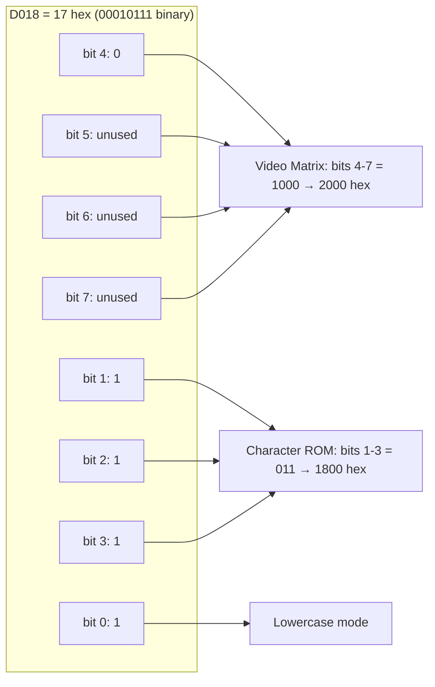
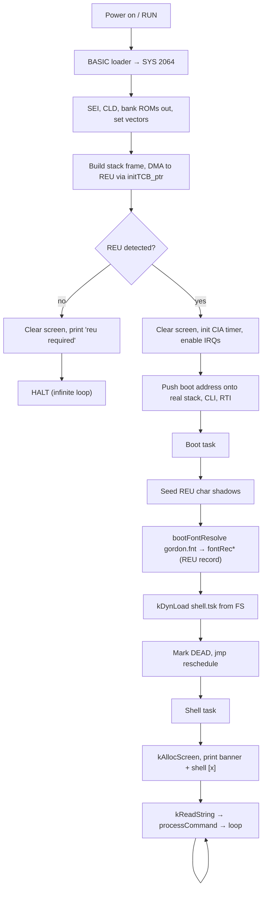
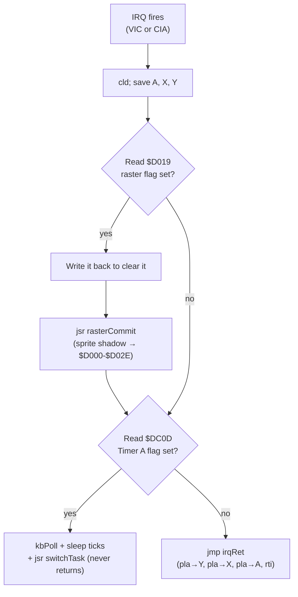
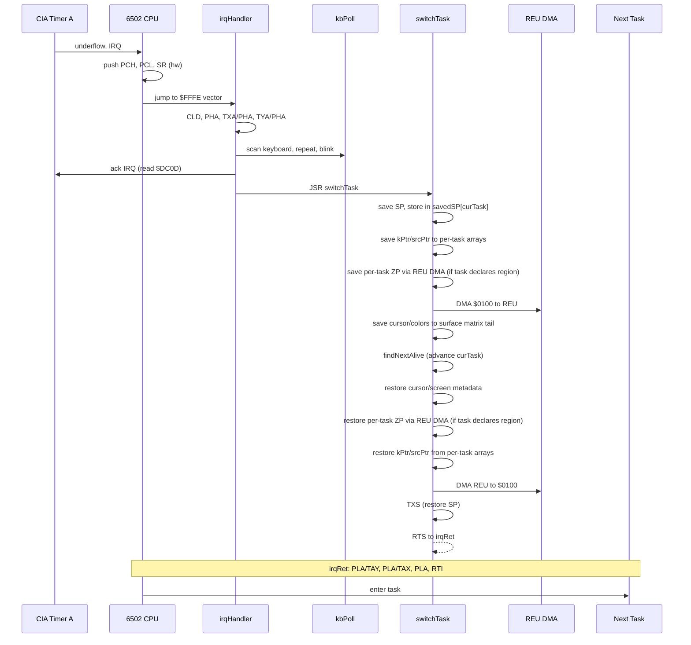
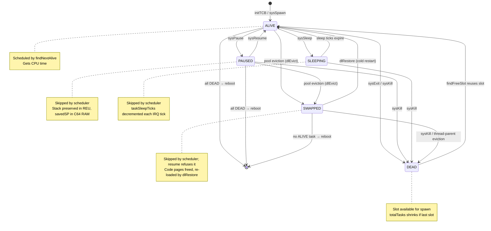

# GordonOS Architecture

> Preemptive multitasking kernel for the Commodore 64

---

## Overview

GordonOS is a round-robin preemptive multitasking kernel running on bare metal (no KERNAL ROM). Tasks are switched by a CIA hardware timer interrupt at ~60 Hz. Each task gets a 256-byte stack image in REU; only the used portion (from `savedSP` to `$01FF`, typically ~9 bytes for idle tasks) is DMA'd on each context switch, allowing tasks to freely use `JSR`/`RTS`, local variables on stack, and arbitrary call depths.

**Key features:**
- Up to 24 concurrent tasks (configurable via `MAX_TASKS`)
- Stack copy per context switch via REU DMA — only the used portion (`$0100 - savedSP` bytes)
- 14 syscalls: `exit`, `spawn`, `kill`, `yield`, `pause`, `resume`, `setprio`, `gettid`, `allocscreen`, `freescreen`, `semWait`, `semSignal`, `threadSpawn`, `sleep`. Two of the numbers are inert: 8/9 (`allocscreen`/`freescreen`) are no-ops, because a task allocates its screen through the `kAllocScreen`/`kFreeScreen` jump-table calls. 10/11 are counting semaphores for task synchronisation; 13 is a timed sleep
- All-bitmap display: framebuffer `$2000-$3FFF` (hires) + video matrix `$0400-$07FF`; every screen is a 10 KB REU surface slot (28 max, banks 1+); `doGfxSwitch` swaps slots into the framebuffer
- REU required — boot halts if RAM Expansion Unit is not present
- IRQ-driven keyboard ring buffer with key repeat
- Kernel-managed blinking cursor (`kEnableCursor`/`kDisableCursor`)
- Interactive shell console with command dispatch (help, ps, kill, pause, resume, prio, view, run, runbatch, time, clear, exit, format, fsinfo, dir, type, print, save, load, del, compact, rename, copy, setfont, banner, pool, ver, me, wait)
- EhBASIC v2.22p5 interpreter loaded on demand via `run basic` (nominal origin `$5000`, relocatable; floating point; persistent 64 KB REU working-file program RAM `basicwrk` — reused if present, created if absent, deleted on `EXIT`; `run basic` twice → `? already running`; full-screen bitmap line editor in `src/tasks/dynamic/basicedit.inc` with C64 screen-editor navigation and multi-row wrapped-line RETURN). See [gordonbasic.md](gordonbasic.md) for the Gordon Basic language reference.
- Dynamic task loader (`kDynLoad`) — 256-byte paged header, then the code body at file offset 256 and a hi-byte fixup table after it (16-bit count, streamed in 128-entry chunks); loads relocatable binaries from the REU filesystem (a fixed-origin `flags=0` binary is rejected with error 2 — there is no fixed-origin load path); name-keyed reentrant residency for shared code copies; re-runnable (`KF_RE_RUNNABLE`) tasks load a fresh copy per `run` instead of erroring `? already running`
- **Dynamic kernel libraries** — cold kernel code (`time.lib`, `filesys.lib`, `gfx.lib`, `fp.lib`, `string.lib`, `sid.lib`, `ipc.lib`, `sprite.lib`, `mouse.lib`) lives in shared, refcounted `.lib` binaries loaded on demand via jump-table vector stubs (eager/lazy). `fp.lib` carries the EhBASIC floating-point core (single `fpExec` entry, lib id 3). Two of them are not only code: `sid.lib`'s player state and `ipc.lib`'s four 128-byte channel rings live in the library's own data, which is one copy shared by every declaring task. See [dynamic-libraries.md](dynamic-libraries.md).
- REU filesystem built host-side by `tools/build-reu.ps1` — pre-formatted with the bundled task/command binaries (`basic.tsk`, `maze.tsk`, `clock.tsk`, `gfxdemo.tsk`, `fpdemo.tsk`, `spirog.tsk`, `sprdemo.tsk`, `godzi.tsk`, `gortris.tsk`, `grknoid.tsk`, `grview.tsk`, `grpaint.tsk`, `granim.tsk`, `shell.tsk`, `edit.tsk`, `sidplay.tsk`, plus `.com` commands and the `.mus` songs `commodo`/`fsonata`/`tetris`/`katmand`/`immig`/`firstdt`) and the bootstrap batch `boot.bat`. It also seeds the animation chunks under `assets/anim/` — 60 `.anm` chunk files plus a manifest for the bundled film that `granim` plays (the container is `docs/pic-format.md`)
- Named tasks with runtime spawn by name
- Two binary classes on the REU FS: **tasks** (`.tsk`) — long-running programs started with `run`; and **commands** (`.com`) — foreground utilities the shell loads, runs to completion, and waits for (they share the shell's screen and read args from `cmdArgsBuf`). See [`programmers-guide.md`](programmers-guide.md).
- No known-task registry — every task loads from the REU FS via `kDynLoad` and the `run` command
- Re-entrant tasks via per-instance `(dataPtr),y` data buffers
- Generic page-granular kernel heap (`kMalloc`/`kFree`) — task-owned pool blocks, preserved across eviction via per-slot REU shadows (32 KB/slot), freed on exit/kill
- Bump-allocated instance data heap at `$1D40-$1FFF`
- Dead-task garbage collection (shrinks scheduler scan range)
- Parent-child task tracking with cascading kill
- No KERNAL ROM dependency — runs on bare metal

---

## Memory Map

> See **[`memory-map.md`](memory-map.md)** for the complete address space layout — every byte from `$0000` to `$FFFF`.

---

## Source File Layout

| File | Purpose |
|---|---|
| `main.asm` | Entry point, BASIC loader, import chain, data tables at $4000 |
| `kernel.inc` | Constants, ZP labels with IRQ safety annotations |
| `kernel.asm` | Kernel utility library — jump table at `$E000` (see [`kernel.md`](kernel.md) for full API) |
| `init.inc` | Boot sequence, REU detection, TCB builders, compile-time task setup |
| `scheduler.inc` | Context switch (REU DMA), `findNextAlive`, `reschedule` |
| `irq.inc` | `irqHandler`, `irqRet` |
| `syscall.inc` | Dispatcher, `exit`/`spawn`/`kill`/`yield`/`pause`/`resume`/`setprio`/`gettid`/`allocscreen`/`freescreen`/`semWait`/`semSignal`/`threadSpawn`, `findFreeSlot`, `shrinkTotalTasks`, `transferFocusAway`, parent tracking, cascading kill |
| `kernel/dynload.inc` | Dynamic task loader (`dynLoad`, `dynParseHeader`, `dynRegister`, `dynFree`, pools) |
| `kernel/fs-offset.inc` | 24-bit REU filesystem offset macros (`FSCopy`, `FSAdd16`, `FSAddPage`, `FSToReuAddr`) — macro-only, emits no bytes |
| `kernel/cursor-helpers.inc` | Load-cursor helpers (`dlFindMaster`, `dlInstallCursor`), in the loader band's `$5457` run |
| `kernel/pool-top.inc` | Library pool placement (`dlLibCore`, `allocFromPoolTop`, `dlAllocCode`) in the `$53F2` pocket after font-help — libraries allocate from the top of the pool |
| `kernel/slot-shadow.inc` | `clearSlotShadows` (32B at `$5482`): zeroes a slot's per-slot REU ZP shadow when a task is spawned, so a recycled slot cannot hand the new task the previous occupant's zero-page state |
| `kernel/reu.inc` | REU DMA transfer routines |
| `kernel/reu-fs.inc` | REU filesystem (format, dir, save, load, delete, find/dma helpers) |
| `kernel/math.inc` | mul16, div16, random, byteToHex, byteToDec |
| `tasks/tasks.inc` | Task lookup tables (`taskLo`/`taskHi`, populated at runtime) |
| `tasks/boot.inc` | Boot task — seeds REU char shadows (dead data), `kDynLoad`s `shell.tsk` with startup args `runbatch boot` (the first shell executes `boot.bat` once), exits |
| `tasks/dynamic/shell.inc` | Interactive shell body — allocates own screen, prints `shell [x]`, REPL; dispatches 15 built-in words (`help`/`clear`/`run`/`view`/`exit`/`fsinfo`/`save`/`load`/`del`/`print`/`runbatch`/`pool`/`ver`/`me`/`wait`); any other word falls through to the REU FS as `<word>.com`; wrapped by `dynamic/shell.asm` |
| `tasks/cmd/ps.asm` | `ps` command — lists the running tasks (id, priority, name, state, pool size, `shared`/`swp`) |
| `tasks/cmd/time.asm` | `time` command — shows the CIA #1 time-of-day clock, or sets it (`time hhmmss [am\|pm]`) |
| `tasks/cmd/pause.asm` | `pause <id>` command — suspends a task; a swapped or dead task is left alone (its state byte is the only record that its pages went back) |
| `tasks/cmd/resume.asm` | `resume <id>` command — resumes a paused task |
| `tasks/cmd/prio.asm` | `prio <id> <0-5>` command — sets a task's scheduling priority; `0` routes to `sysPause` rather than writing the state byte itself |
| `tasks/cmd/dir.asm` | `dir` command — the REU FS directory: names, sizes and free space, with `/w` for two columns, `/p` to page and a wildcard pattern filter |
| `tasks/cmd/format.asm` | `format` command — formats the REU filesystem (y/n confirm) |
| `tasks/cmd/type.asm` | `type <file>` command — prints a file's contents to the shell |
| `tasks/cmd/setfont.asm` | `setfont <name>` command — loads `<name>.fnt` from the REU FS into the font buffer |
| `tasks/cmd/rename.asm` | `rename <old> <new>` command — renames a file in the REU FS |
| `tasks/cmd/copy.asm` | `copy <src> <dst>` command — copies a file to a new name in the REU FS |
| `tasks/cmd/del.asm` | `del <pattern>` command — deletes files matching a wildcard (`*` = any run, `?` = any single character) |
| `tasks/cmd/compact.asm` | `compact` command — packs the FS and reclaims tombstoned slots |
| `tasks/cmd/fstest.asm` | `fstest` command — the REU FS self-test that crosses the bank boundary; the file its window spans is seeded by `build-reu.ps1` |
| `tasks/cmd/ipctest.asm` | `ipctest` command — the `ipc.lib` self-test: two thread producers (channels 1 and 3) consumed interleaved, which exercises the backpressure wait too; prints `ipc PASS` |
| `tasks/cmd/banner.asm` | `banner` command — draws `.bnr` custom-glyph banner files (`banner <file> <row> <col>`) |
| `tasks/cmd/kill.asm` | `kill <id>` command — kills a task (cascading to its thread children) and silences the SID when the victim, or the task that spawned it, declared `sid.lib`: a killed player never runs its own hush, and a thread child (the actual player in both music demos) has no dyn entry, so the declaration is the only task-visible evidence. Reads `dynTaskLibMaskLo` (bit 5) **before** the kill — `sysKill` frees the victim's dyn entry — then zeroes `$D400-$D418` itself, exactly as `sidrst` does, so no library is loaded. It also saves `dataPtr` across the kill, because `dynFree` ends in `dlRestore`, whose documented clobbers include `dataPtr` |
| `tasks/cmd/sidrst.asm` | `sidrst` command — zeroes all 25 writeable SID registers (`$D400-$D418`) to silence a stuck note; the manual fallback for the cases `kill` does not cover, since `kill` clears the chip only for a task that declared `sid.lib` (a `sidplay` killed by hand, a task that died another way, or a SID left by something that declared nothing); no screen/keyboard, exits immediately |
| `tasks/cmd/blink.asm` | `blink` command — writes the kernel `blinkRate` (ZP `$F0`) to set the cursor blink interval (`blink <n>`, ticks per toggle, default 30); no screen/keyboard, exits immediately |
| `tasks/cmd/keyrpt.asm` | `keyrpt` command — patches the kernel's `lda #KEYB_INITIAL`/`lda #KEYB_REPEAT` immediates (self-modifying) to set the keyboard repeat timing (`keyrpt <delay> <repeat>`, ticks, defaults 30/6); no screen/keyboard, exits immediately |
| `tasks/cmd/speed.asm` | `speed` command — declares the speed the whole machine runs at relative to real time (`speed <percent>`, powers of two only). Writes the kernel's `sysSpeedShift` (`$E531`, the signed exponent sid.lib and a frame-paced task read) and re-derives `blinkRate` and the two key-repeat immediates from `BLINK_RATE`/`KEYB_INITIAL`/`KEYB_REPEAT` — never from the live values, so a second run is a no-op. Prints only to refuse an argument; no keyboard |
| `tasks/cmd/mouse.asm` | `mouse` command — declares the pointer device this machine has (`mouse 1351` / `mouse off`, bare `mouse` prints the setting). Writes the kernel's `mouseKind` (`$E530`, 0 = off, 1 = 1351), the machine-wide value a task reads at start-up; an unrecognised argument prints the accepted words and leaves the byte alone. Policy only — no libraries, no hardware, no keyboard |
| `tasks/cmd/mousetest.asm` | `mtest` command — the **1351 protocol readout**, which is what settles the mouse protocol on real hardware: the raw POT byte, the position mod 64, the delta since the last sample, the running total and the six button lines of `$DC00`, refreshed while it runs. `p` switches port, `h` cycles the hold, `l` switches between reading the hardware directly and reading it through `mouse.lib`, and any other key exits. It ignores `mouseKind`, so a machine the OS believes has no mouse can still be diagnosed. Declares `mouse.lib` |
| `tasks/dynamic/basic.asm` | EhBASIC dynamic task — nominal origin `$5000` (relocatable, `BASIC_FLAGS=$01` = RELOCATABLE), 64 KB REU working-file program RAM (persistent named file), assembled to `basic.bin` (imports `tasks/dynamic/ehbasic.asm` + `tasks/dynamic/basicedit.inc` line editor). Declares `libMask` `$000E` (filesys + gfx + fp): + − × ÷ ^ and the transcendental functions dispatch to `fpExec` via thin wrappers |
| `tasks/dynamic/maze.asm` | Relocatable maze renderer (116 B, 5 fixups); `q` exits |
| `tasks/dynamic/grpaint.asm` | Relocatable, **single-instance** 1351 paint program — no `KF_RE_RUNNABLE`, because its live footprint is 71 of the pool's 109 pages and a second `run` would evict the copy that is running. The `mouseKind` gate prints on a screen of its own (the `sidplay` pattern), `kAllocScreen` takes the bitmap canvas, `kBlinkReset`/`kSwitchView` hand the display over without baking the shell's blink block, and the pointer is two sprites from `pointer.spr` positioned once per **displayed** frame off `frameCount` at (canvas x + 24, canvas y + 50) from `mouse.lib`'s signed deltas, clamped to the canvas. The tools are the pencil, the three brushes, the line, the box, the filled box, the circle, the flood fill and a text pen; the palette/tool band is the REU-FS image `gpui.bin` (or `gpui_mc.bin`) over the canvas's bottom two cell rows, `<name>.pic` saves and loads the 10,032-byte picture, and `q` leaves at once with a clean canvas but otherwise asks first — the band comes up and the SAVE tile flashes (0.64 s marked, 0.64 s dark — 0.8 Hz) until the tile is pressed (which saves and stays) or `q` is pressed again with the band up (which leaves); a dismissed band means the next `q` asks again. Declares sprite.lib + mouse.lib + gfx.lib + filesys.lib. Full reference: [gordonpaint.md](gordonpaint.md) |
| `tasks/dynamic/grview.asm` | Relocatable picture viewer `grview` — `run grview <name>` opens `<name>.pic` (the suffix is appended, so the base name is ≤ 7 characters), allocates a bitmap surface, takes the display and DMAs the file's three regions straight to `$2000` / `$0400` / `$D800`; the mode and all four VIC colours come from the file's own header. `m` reinterprets the same bytes in the other mode and any other key exits; the header's label is metadata and is not printed. A missing name or a file that is not a picture takes a screen of its own, prints `? not found` / `? not a picture` and waits for a key (the `sidplay` pattern). Declares gfx.lib + filesys.lib |
| `tasks/dynamic/clock.asm` | Relocatable clock (2 fixups) |
| `tasks/dynamic/gfxdemo.asm` | Relocatable graphics demo `gfxdemo` — spider-web line weave, step arg, yields every frame (506 B, 7 fixups); `q` exits |
| `tasks/dynamic/fpdemo.asm` | Relocatable fp.lib showcase `fpdemo` — sine + cosine waves drawn pixel by pixel via `fpExec` + `kPlot`, peaks touch top/bottom, yields every pixel (430 B, 28 fixups); `q` exits |
| `tasks/dynamic/spirog.asm` | Relocatable integer spirograph `spirog` — a hypotrochoid traced as a `kLine` polyline from a 256-entry sine table, four 8x8 multiplies per point (1662 B, 62 fixups); takes `R r d [col]` or a `1`-`10` preset (10 draws three random distinct colours, then 25 figures -- the largest radii, random origins over the screen, and a random lobe count capped by the size -- each in one of the three, alternating), closes exactly, `q` exits |
| `tasks/dynamic/sprdemo.asm` | Relocatable sprite demo `sprdemo` — eight coloured balls bouncing off the walls and each other, driven through the sprite library with one update per displayed frame, all eight slots (985 B, 108 fixups); `q` exits. **Re-runnable with nothing to guard**: a task owns all eight slots while its surface is displayed, and the kernel hands the whole sprite state over with the display, so any number of sprite tasks coexist. |
| `tasks/dynamic/godzi.asm` | Relocatable sprite demo `godzi` — a boat-shaped walker (two X-expanded layers) plus two Godzilla poses in four slots, `1`/`2` switch looks live, `q` exits and hushes the SID with the child (1039 B, 103 fixups). Single-instance because it holds the **SID claim** for the whole session; its two looks are different art, which the per-task sprite state handles on its own (the looks are switched while `godzi` owns the display). Its music is the same arrangement as `gortris`: `sid.lib` called directly by a thread child, with both modes' tunes (`commodo`, `fsonata`) loaded once at startup and switched live |
| `tasks/dynamic/gortris.asm` | Relocatable **Tetris** `gortris` — a port of the game logic of Wiebo de Wit's `tetris.c64` (MIT, `reference/tetris/`) with its own all-bitmap chrome and art (5940 B, 838 fixups). It is **pinned** in the pool and **not re-runnable**, because it owns the display for its whole life and holds the board; the 10×20 board lives in the task image, so collision is a board lookup rather than a screen read. Five modes (attract, level select, play, game over, hi-score name entry), three hi scores in the REU FS (`gortris.hi`), keyboard *and* port-2 joystick. Its music is `music/tetris.mus` played through `sid.lib` by a thread child it spawns — one of **three** tasks that call `kSidPlay` directly rather than through `sidplay.tsk` (`godzi` and `grknoid` are the others). Full reference: [gortris.md](gortris.md) |
| `tasks/dynamic/grknoid.asm` | Relocatable **Arkanoid/Breakout** game `grknoid` ("gorkanoid") — a paddle sprite (X-expanded 24→48px) under a wall of glyph bricks, the ball flown in 8.8 fixed point with the bounce angle taken from where it met the paddle plus english from the paddle's own movement; the paddle's step starts at 1 px and **accelerates** to 3 px while the same direction is held (a gear every 16 of the game's own frames, dropped straight back by a release or a reversal) (4612 B, 543 fixups). It is **pinned** in the pool and **not re-runnable**, because it owns the display for its whole life and holds the wall and the score table. The 48-entry wall lives in the task image (0 = gap, 1-3 = hits to break it), so collision is a table lookup rather than a screen read. Five lives, a per-level launch ramp, four attract screens, and a game-over screen whose tune is its clock: it leaves when the one-shot ends, or at once on a key. Three hi scores in the REU FS (`grknoid.hi`), keyboard *and* port-2 joystick. Its music is three **CGSC** tunes (`katmand`/`immig`/`firstdt`, one per mode) played through `sid.lib` by a thread child it spawns, out of **one 18-page buffer for the session** (taken at startup, freed after the child is reaped), which retries a SID another task is holding and falls back to the attract tune when one will not load. Full reference: [grknoid.md](grknoid.md) |
| `tasks/dynamic/sidplay.asm` | Relocatable `.mus` music player — a **508-byte wrapper** over `sid.lib` (`src/libs/sid.asm`, lib 5): it finds the tune in the REU FS, `kMalloc`s a buffer sized to the file, loads it, calls `kSidPlay` and frees it. The COMPUTE!'s Enhanced Sidplayer body itself (`src/libs/sidplay.inc`) and its 483 fixups live in the library, so any task can play music without carrying the player. On failure it reports on a temporary screen (`? tune <name>` …) and waits for a key, because a task with no screen otherwise fails silently. Single-instance, no screen/keyboard |
| `tasks/dynamic/edit.asm` | Relocatable full-screen text editor `edit` — 25×40, insert/overwrite modes, two-way scrolling, document grows on demand (up to 192 lines); saves back to the same file (imports `tasks/dynamic/edit.inc`). Full reference: [edit.md](edit.md) |
| `tasks/dynamic/*.inc` | Original task code (clock, maze, gfxdemo, fpdemo, edit, gortris, grknoid, grpaint, grview, spirog) — imported by the co-located `tasks/dynamic/` wrappers |
| `tools/` | Build helpers (`assemble-tasks.asm`, `gen-fixups.asm`, `build-tasks.ps1`, `launch-vice.ps1`, `toolpaths.ps1` — resolves the machine-specific VICE/KickAssembler/Java paths from `.vscode/settings.json`, which is gitignored and has a bundled `.vscode/settings.json.sample`, `seed-font.ps1` — builds `gordon.fnt` from the PET/C64 chargen ROMs, `img2pic.py` — PNG → `.pic`, `check-pool-budget.ps1` — a task's live pool footprint vs the 109-page pool, `tasks-stamp.ps1` — the task build's input hash). VICE automation helpers (`vice-step.ps1`, `vice-test.ps1`, `drive-string-tests.ps1`) drive VICE programmatically (send keys, screenshot) for manual test sessions — kept on hand but not part of the normal build flow |

---

## Data Structures

### Task Stack Images (REU-backed)

Stack images (256 bytes per task, 24 tasks = 6KB) are stored in REU bank 0
at `$0000-$17FF` (`REU_STACK_BASE`). Only `savedSP` (1 byte per task,
24 bytes total) is kept in C64 RAM at `$4008`.

| Location | Size | Field |
|---|---|---|
| C64 RAM `savedSP[x]` | 1B | Stack pointer when task was preempted |
| REU `$0000 + x×256` | 256B | Stack image — copy of `$0100-$01FF`. Only `$0100 - savedSP` bytes DMA'd per switch (typically 9B for idle tasks) |

### Scheduler Data Arrays (at $4000)

Defined in `main.asm`. Stack images are in REU; only `savedSP` and
REU base addresses are kept in C64 RAM.

| Label | Size | Description |
|---|---|---|
| `savedSP` | `MAX_TASKS` | Stack pointer saved per task at preemption |
| `taskStackReuLo` | `MAX_TASKS` | REU stack base address low byte per task |
| `taskStackReuHi` | `MAX_TASKS` | REU stack base address high byte per task |
| `taskLo` | `MAX_TASKS` | Task entry address low byte |
| `taskHi` | `MAX_TASKS` | Task entry address high byte |
| `taskNameLo` | `MAX_TASKS` | Task name pointer low byte |
| `taskNameHi` | `MAX_TASKS` | Task name pointer high byte |
| `taskState` | `MAX_TASKS` | `0`=DEAD, `1`=ALIVE, `2`=PAUSED, `3`=SLEEPING, `4`=SWAPPED (code evicted; scheduler skips, `resume` refuses) |
| `totalTasks` | 1 | Current scheduler scan range (grows/shrinks) |
| `taskPriority` | `MAX_TASKS` | Priority (0-5); 0=paused, >5 clamped to 5 |
| `taskSliceLeft` | `MAX_TASKS` | Slices remaining this round |
| `screenAlloc` | `MAX_TASKS` | 1 = task has an allocated surface |
| `screenOwner` | `MAX_TASKS` | `$FF` = owns surface; 0 = none; else = sharing task index |
| `taskDataPtrLo` | `MAX_TASKS` | Per-instance data buffer pointer low byte (re-entrant tasks) |
| `taskDataPtrHi` | `MAX_TASKS` | Per-instance data buffer pointer high byte (re-entrant tasks) |
| `taskDataSize` | `MAX_TASKS` | Bytes allocated per instance (0 = none) |
| `taskZpBase` | `MAX_TASKS` | ZP DMA region start (0 = no ZP save) |
| `taskZpLen` | `MAX_TASKS` | ZP DMA region length (0 = skip DMA) |
| `taskZpReuLo` | `MAX_TASKS` | REU shadow address low (precomputed at boot) |
| `taskZpReuHi` | `MAX_TASKS` | REU shadow address high (precomputed at boot) |
| `dataHeap` | 2 | Bump allocator next-free pointer ($1D40-$1FFF; `spawnCore` scavenges same-size buffers from dead slots before bumping) |
| `dataHeapEnd` | 2 | End of data heap (`$2000`) |

### Kernel Data (at $4000+, defined in main.asm + kernel.asm)

Defined primarily in `main.asm` and `kernel.asm`. Lives in the `$4000+` kernel data region (see [`memory-map.md`](memory-map.md)).

| Label | Size | Description |
|---|---|---|
| `cursorCol`/`cursorRow` | 2 | Current task's cursor position |
| `screenBase` | 2 | Current task's write screen address |
| `dispBase` | 2 | Current VIC display screen address |
| `semCount` | `MAX_SEMAPHORES` | Counting semaphore pool (0=unavailable, 1-255=available slots) |
| `semOwner` | `MAX_SEMAPHORES` | Last task to exhaust semaphore 1→0 (`$FF`=none). Best-effort for counting semaphores (single byte can't track multiple holders). |
| `screenLockKPtrLo/Hi` | `MAX_TASKS` × 2 | Per-task kPtr saved across lockScreen yields |
| `screenLockKArg` | `MAX_TASKS` | Per-task kArg saved across lockScreen yields |
| `taskKPtrLo/Hi` | `MAX_TASKS` × 2 | Per-task kPtr saved/restored on context switch |
| `taskSrcPtrLo/Hi` | `MAX_TASKS` × 2 | Per-task srcPtr saved/restored on context switch |
| `kbFocus` | 1 | Task index that owns keyboard (`$FF` = none) |
| `readStrBuf`/`readStrLen`/`readStrMax` | 5 | kReadString persistent state |
| `keybBuffer` | 16 | Keyboard ring buffer |
| `keybCount`/`keybHead`/`keybTail` | 3 | Ring buffer indices |
| `cursorOn`/`cursorVisible`/`blinkTick` | 3 | Cursor blink state |
| `randomSeed` | 1 | LFSR random seed |

### Stack Frame (8 bytes at $01F8-$01FF)

The fake interrupt frame built by `initTCB` and saved/restored on every context switch:

```
$01F8  <[irqRet - 1]    RTS return address (6502 RTS adds 1 → lands on irqRet)
$01F9  >[irqRet - 1]
$01FA  Y register        (popped by PLA:TAY at irqRet)
$01FB  X register        (popped by PLA:TAX)
$01FC  A register        (popped by PLA)
$01FD  SR / flags        (popped by RTI; bit 2=0 → IRQs enabled)
$01FE  PCL               (popped by RTI → task entry address)
$01FF  PCH               (popped by RTI)
```

`savedSP = $F7` — points to the RTS return address (8 bytes below top of stack).

**Critical: RTS adds 1 to the popped address.** We store `irqRet - 1` so that `(irqRet - 1) + 1 = irqRet`.

### Zero Page Usage ($F0-$FF)

⚠️ See `programmers-guide.md` for IRQ safety rules.

| Label | Addr | Size | Owner | Purpose |
|---|---|---|---|---|
| `blinkRate` | $F0 | 1 | Kernel | Cursor blink interval (ticks) — runtime-settable via `blink.com`, and re-derived for the machine by `speed.com`; never DMA'd (task ZP bound is `≤ $F0`) |
| `dataPtr` | $F1 | 2 | Scheduler | Task-private data pointer (scheduler saves/restores per-task) |
| `taskNamePtr` | $F3 | 2 | Spawn | Task name pointer (SEI-protected) |
| `kPtr` | $F5 | 2 | Kernel | String/screen pointer (scheduler saves/restores per-task) |
| `spawnPtr` | $F7 | 2 | Spawn | Task entry address (SEI-protected) |
| `srcPtr` | $F9 | 2 | Kernel | Scroll/general scratch (scheduler saves/restores per-task) |
| `tmpPtr` | $FB | 2 | Scheduler | TCB pointer (⛔ never use in task code) |
| `curTask` | $FD | 1 | Scheduler | Current task index (⛔ never use in task code) |
| `saveSP` | $FE | 1 | Scheduler | Temporary SP (⛔ never use in task code) |
| `kbTemp` | $FF | 1 | IRQ | Keyboard scan temp (⛔ never use in task code) |

---

## Boot Sequence

When you load `gordon-os.prg` and type `RUN` (or drag into VICE), the C64's BASIC interpreter reads the loader stub and executes `SYS 2064` ($0810). From there, GordonOS takes full control.

### Step-by-step Walkthrough

**1. CPU initialisation** (`start:` in `init.inc`)

The first instructions disable interrupts (`SEI`) and clear decimal mode (`CLD`). The 6502's BCD mode is buggy on the NMOS 6502 used in the C64 — it must be turned off before any arithmetic.

**2. Memory banking** (`$01 = $35`)

The 6510's built-in I/O port at `$0001` controls three memory regions:
- Bit 0 (LORAM): 0=RAM at `$A000-$BFFF`, 1=BASIC ROM
- Bit 1 (HIRAM): 0=RAM at `$E000-$FFFF`, 1=KERNAL ROM
- Bit 2 (CHAREN): 0=character ROM at `$D000-$DFFF`, 1=I/O

Writing `$35` (%00110101) gives: BASIC ROM at `$A000` (unused, ignored), RAM at `$E000-$FFFF` (we can write vectors here!), I/O at `$D000-$DFFF` (VIC-II, CIA, SID, REU visible). The character ROM is still accessible for VIC-II reads (CHAREN only affects CPU access to `$D000-$DFFF`; the VIC-II always sees character ROM at `$1000-$1FFF` when bit 1 of `$D018` is set appropriately).

**3. Video initialisation** (`$D018 = $17`)

`$D018` controls where the VIC-II chip looks for screen RAM and character definitions:



| Register bits | Value | Multiplier | Result |
|---|---|---|---|
| bits 4-7 (video matrix) | `%1000` = 8 | × $0400 | Screen at **$2000** |
| bits 1-3 (character set) | `%011` = 3 | × $0800 | Charset at **$1800** |
| bit 0 | 1 | — | Lowercase/PETSCII |

The VIC-II reads character codes from $2000-$23E7 (40×25 grid) and looks up glyphs at $1800-$1FFF. Bit 0 selects the lowercase/PETSCII character set.

**4. Hardware vectors**

With KERNAL ROM banked out, `$FFFA-$FFFF` is now writable RAM:
- `$FFFA-$FFFB` → `nmiNull` (just `RTI` — ignores RESTORE key presses and CIA #2 NMIs)
- `$FFFE-$FFFF` → `irqHandler` (the main interrupt handler)

**5. Stack frame initialisation**

The boot task (slot 0) gets its initial stack frame built via `initTCB_ptr`.
The 8-byte fake interrupt frame is assembled in `frameBuf` (a kernel data
buffer), then DMA'd directly to REU at `REU_STACK_BASE + 0×256 + $F8`.
Only `savedSP[0] = $F7` is kept in C64 RAM. This makes the task look like
it was preempted mid-execution when first restored:

```
$01F8  <[irqRet-1]        RTS pops this, adds 1 → irqRet
$01F9  >[irqRet-1] 
$01FA  $00                 Y register (PLA:TAY at irqRet)
$01FB  $00                 X register (PLA:TAX at irqRet)
$01FC  $00                 A register (PLA at irqRet)
$01FD  $00                 SR: I=0 → interrupts enabled on RTI
$01FE  <boot               PCL → boot task entry
$01FF  >boot               PCH
```

The `savedSP` is set to `$F7` — pointing at the RTS return address, 8 bytes below `$01FF`. The `taskState` for slot 0 is set to `ALIVE`, `totalTasks` = 1.

**6. Task identity**

The boot task's address (`boot` in `boot.inc`) and name (`"boot"` in `init.inc`) are stored in the per-task arrays `taskLo/Hi` and `taskNameLo/Hi` for slot 0.

**7. REU detection**

The kernel writes known test values to REU address registers `$DF02-$DF05` and reads them back. Without an REU, the C64's data bus floats and returns `$FF` for unmapped I/O — the test values won't match. If all four bytes match, the REU is present. Otherwise, the kernel clears the screen, prints `"reu required"`, and halts in an infinite loop.

When REU is found:
- `taskStackReuLo[x]` and `taskStackReuHi[x]` are set to `REU_STACK_BASE + x×256` for each task slot
- The initial 8-byte stack frame is DMA'd from `frameBuf` to REU by `initTCB_ptr` (no separate copy step)

**8. Default screen state**

`init.inc` sets `cursorState` (0,0), `cursorOn=1`, `kbFocus=$FF` and the
`DEFAULT_*` colors; `reuReady` points `screenBase` at the framebuffer
`$2000` and puts the VIC in hires bitmap mode (`GFX_D018`, bitmap on).
Per-surface state lives in each REU slot's matrix tail (`slot+$23E8`:
cursor col/row, cursor enable, saved-glyph nibble, scroll-region top/
bottom at `slot+$23EE`/`+$23EF`) and is mirrored in the framebuffer
matrix tail while a surface is displayed.

Colors are per-surface: `taskGfxBorder/Bg0/Bg1/Bg2` (set by
`kAllocScreen`'s `kArg` colors) are applied to `$D020-$D023` by
`doGfxSwitch`; hires text foreground comes from the video matrix high
nibble (`taskTextColor`), the cursor blink uses `taskCursorColor`.
Colour RAM (`$D800`) is saved/restored with the surface by `doGfxSwitch`
(`surfSave`/`surfLoad`) — not per tick. In multicolor bitmap the palette
is `$D021` (value 0), the matrix nibbles (values 1/2) and colour RAM
(value 3); `$D022`/`$D023` are written but never read by the VIC.

The scroll region is also per-surface: `kSetScrollRegion(A=top, X=bottom)`
stores it in `taskScrollTop/Bottom[curTask]` and seeds the surface's
matrix tail (`GFX_SCROLL_TOP`/`GFX_SCROLL_BOTTOM`, offsets `+$3EE`/`+$3EF`),
so it travels with the surface across view switches, eviction and sharing.

**9. Clear screen**

`kClearScreen` clears the framebuffer and its matrix via REU fills and
homes the cursor — a clean visual start before any task has allocated
a surface.

**10. Scheduler initialisation**

`curTask` is set to 0 (the boot task). CIA #1 Timer A is configured:
- Latch = `$4100` (16640 cycles at 1 MHz ≈ 60.1 Hz)
- Continuous mode: timer auto-reloads on underflow
- Φ2 system clock as timebase

CIA #1 Timer A IRQ is enabled (`$DC0D = $81`), CIA #2 interrupts are disabled. The keyboard ports are configured: DDRA = `$FF` (all outputs for column select), DDRB = `$00` (all inputs for row read).

**11. Entering the boot task**

The CPU manually builds a minimal interrupt return frame on the real stack:
```
PHA  >boot        → $01FF  (PCH)
PHA  <boot        → $01FE  (PCL)
PHA  $00          → $01FD  (SR: I=0, interrupts enabled)
```

Then `CLI` re-enables interrupts and `RTI` pops SR, PCL, PCH — the CPU jumps to `boot` with interrupts active. The CIA timer is already counting; ~16,640 cycles later the first IRQ will fire and the scheduler will perform its first context switch.

### What the Boot Task Does

The boot task (`boot:` in `tasks/boot.inc`):
1. Seeds the 8 REU char-shadow slots with default colors. The seeded data
   is inert in the all-bitmap model, but the loop is not free to remove:
   boot timing depends on its delay
2. Loads the shell from the pre-built FS via `kDynLoad` — the FS and
   bundled binaries are written host-side by `tools/build-reu.ps1`, so
   there is no boot-time formatting or seeding. Failure → halt
   (recover by re-seeding `reu/REU.bin` and rebooting)
3. Marks slot 0 DEAD and jumps to `reschedule` — the load→exit
   sequence is atomic under `SEI`

After boot exits, the shell is the only ALIVE task. The shell allocates its own screen via `kAllocScreen`, prints the OS banner (`gordonOS` + version), prints `shell [0]` (using `kGetTaskName` + `kByteToDec` for the task ID), and enters its REPL. The user sees the banner followed by a blinking block cursor — the shell is ready for commands.

### Visual Timeline



---

## Context Switch Flow

### IRQ Path (two sources: CIA timer tick · VIC raster)

`irqHandler` serves **two** interrupt sources, and it must first ask *who*
interrupted it, because the two need **opposite exits**: the timer tick switches
tasks and never returns, while the raster interrupt must *resume* the code it
interrupted. A blanket `jsr switchTask` on every interrupt would switch ~50 extra
times a second and destroy the priority-slice scheduler.



**The two reads are the acknowledgements**, so neither may be skipped or
duplicated: the VIC's `$D019` must be *written back* with the value read, while
the CIA's `$DC0D` clears on a plain read. Both are masked (`$D019` bit 0 = raster,
`$DC0D` bit 0 = Timer A) because no other source from either chip is enabled.

**The timer branch, after the `and #$01` / `beq irqResume` pair:**



> The sequence diagram above is the **Timer A branch**. The raster branch is the
> `jsr rasterCommit` in the flowchart: it copies the sprite shadow to
> `$D000-$D02E`, assembles `$D010` from the per-sprite X-MSB flags, writes the
> sprite pointers `$07F8-$07FF`, and latches `$D01E`/`$D01F` — then falls through
> to the same acknowledgement test and normally leaves via `jmp irqRet`, resuming
> whatever it interrupted.
>
> It runs with `I = 1` and can preempt *any* task or kernel code, including the
> dynamic loader's CLI windows, so it calls nothing, touches no kernel ZP and
> performs no REU DMA. Cost ≈425 cycles/frame (≈2.2%) for the commit alone. Being the **only**
> writer of the sprite registers is what makes the sprite API timing-free — see
> [kernel.md](kernel.md) → *Sprites*.
>
> ⚠️ **`$D012`/`$D019`/`$D01A` are kernel-owned from this point on**: the compare
> line is set to 0 and raster interrupts enabled at the end of `init.inc` —
> deliberately *after* the VIC mode setup and immediately before the boot task is
> entered, so no raster interrupt can fire while init is still running.

### Syscall Path (task exit / yield)

```
Task calls lda #0; jsr syscall
  → dispatcher: PHP/PLA saves SR, SEI (atomic)
  → sysExit: mark curTask DEAD
  → shrinkTotalTasks (if last slots are dead)
  → reschedule:
      → findNextAlive (skip current + dead tasks)
      → restoreStack (copy next TCB → stack)
      → JMP irqRet (PLA:TAY,PLA:TAX,PLA,RTI)

Task calls lda #3; jsr syscall
  → dispatcher: PHP/PLA saves SR, SEI (atomic)
  → sysYield: pops JSR return addr, builds fake IRQ frame
  → JSR switchTask (saves yielding task, switches away)
  → on resume: RTS → irqRet → RTI → task's JSR+3
```

---

## Scheduler

- **Algorithm:** Round-robin, cooperative within timeslice, preemptive across slices
- **Tick source:** CIA #1 Timer A, continuous mode, ~60 Hz
- **Dead task handling:** `findNextAlive` schedules only `TA_ALIVE` — skips DEAD, PAUSED, SLEEPING and SWAPPED; the `childGate` at the end of the core then **holds a thread child whose parent is not running** (`TA_DEAD` = never scheduled again, `TA_SWAPPED` = held until the parent is restored)
- **Guard:** If all tasks are DEAD, the system reboots — the path `jmp`s to
  `warmBootReset` (which releases every library, see `docs/kernel.md`) and that falls
  through to `start:`, re-running the full init sequence. A warm reboot is a full
  re-initialisation *including* the library system: a surviving library
  would leave patched call entries pointing into pages the fresh pool bitmap calls free.
- **Slot limit:** `MAX_TASKS` (24), enforced by `findFreeSlot`

---

## Syscalls

> Full syscall reference: **[`syscall.md`](syscall.md)** — detailed descriptions, examples, internal routines, and dispatch flow diagram.

Entry point: `syscall` (in `syscall.inc`). Tasks call via `LDA #N; JSR syscall`.

| N | Name | Input | Returns | Description |
|---|---|---|---|---|
| 0 | `exit` | — | *never* | Mark DEAD, shrink, `dynFree`, reschedule |
| 1 | `spawn` | `spawnPtr`, `taskNamePtr`, `kArg+1`=dataSize, `kArg+6`=zpBase, `kArg+7`=zpLen | C=1 no slots (kArg=0) / heap full (kArg=1) | Create named task, DMA TCB→REU |
| 2 | `kill` | X = target index | — | Mark target DEAD; self→reschedule |
| 3 | `yield` | — | *resumes later* | Give up timeslice voluntarily |
| 4 | `pause` | X = target index | — | Suspend task (scheduler skips it) |
| 5 | `resume` | X = target index | — | Resume PAUSED→ALIVE (refuses SWAPPED) |
| 6 | `setprio` | X = target, `kArg+1` = prio | — | Set priority 0-5 |
| 7 | `gettid` | — | A = curTask | Return current task index |
| 8 | `allocscreen` | — | no-op (`CLI`/`RTS`) | Inert — use the `kAllocScreen` jump-table call |
| 9 | `freescreen` | — | no-op | Inert — use the `kFreeScreen` jump-table call |
| 10 | `semWait` | X = semaphore index | — (blocks until acquired) | Acquire: decrement, or yield and retry while 0 |
| 11 | `semSignal` | X = semaphore index | — | Release: increment (caps at 255) |
| 12 | `threadSpawn` | `spawnPtr` = entry | C=0 ok; C=1 (kArg=0 no slots) | Spawn child task, auto-named `parent.N` |
| 13 | `sleep` | `kArg+1` = tick count | *resumes later* | Timed block; task sleeps N ticks |

**Reentrancy guard:** Dispatcher does `PHP/PLA` to capture SR (I=0), then `SEI`. Returning handlers (`spawn`, `kill`-other, `pause`, `resume`, `setprio`, `gettid`, `semSignal`) do `CLI` before `RTS` (8/9 are no-ops that `CLI`/`RTS` immediately). `semWait` is the one handler that returns only when it acquires: while the count is 0 it does `CLI`, yields (syscall 3) and retries. Non-returning handlers (`exit`, `kill`-self, `yield`) rely on RTI to restore I from the saved frame.

---

## Task States



`totalTasks` grows on spawn, shrinks when the highest-index slot(s) are DEAD — keeping the scheduler's scan loop tight. When no ALIVE tasks remain, the scheduler jumps to `start`, re-running the full init sequence (REU detection, TCB build, shell spawn). This acts as a soft reboot.

---

## REU DMA (RAM Expansion Unit)

GordonOS **requires** a Commodore REU (1700/1750/1764). All context switches use hardware DMA transfers (~256 cycles). Boot halts with "reu required" if no REU is detected.

**REU register layout ($DF00-$DF0F):**

| Register | Address | Purpose |
|---|---|---|
| STATUS | `$DF00` | Bit 7=IRQ, bit 6=EOB (end of block) |
| COMMAND | `$DF01` | `$90` = C64→REU, `$91` = REU→C64 (bit 7=exec, bit 4=immediate) |
| C64BASE | `$DF02-$DF03` | C64 memory address (low, high) |
| REUBASE | `$DF04-$DF06` | REU address (low, high, bank) |
| TRANSLEN | `$DF07-$DF08` | Transfer length (16-bit value; `$0100` = 256 bytes) |
| CONTROL | `$DF0A` | `$00` = both addresses increment |

**Critical register order:** Write `$DF02-$DF08` (C64 addr, REU addr/bank, length), then `$DF0A` (control), then `$DF01` (trigger). Never write `$DF09` — causes address aliasing.

**Two subroutines** handle save/restore via REU DMA:
- `saveStackReu` — DMA `$0100+savedSP` → REU[task × 256 + savedSP], only the used portion
- `restoreStackReu` — DMA REU[task × 256] → `$0100` + set SP

**Spawn integrity:** `sysSpawn` DMAs the new task's TCB buffer to REU before marking it ALIVE, so the first context switch into a spawned task loads valid data rather than stale REU contents from a previously-dead task in that slot.

---

## Hardware Dependencies

| Resource | Usage |
|---|---|
| CIA #1 Timer A | Scheduler tick (~60 Hz) |
| CIA #1 IRQ | Context switch trigger |
| $01 port | Memory configuration ($35 = RAM at $E000, I/O visible) |
| $FFFA-$FFFF | Hardware vectors (NMI, IRQ) |
| $DC04-$DC05 | Timer A latch |
| $DC0D | IRQ control/ack |
| $DC0E | Timer control |
| $DF00-$DF0F | REU registers (if present) |
| $D012/$D019/$D01A | VIC raster interrupt — compare line 0, raster flag, enable. **Kernel-owned** (sprite commit), not available to tasks |
| $D000-$D02E, $07F8-$07FF | Sprite registers + sprite data pointers — written **only** by the raster commit in vblank; tasks use the `kSprite*` calls, which write a shadow |
| $D025/$D026, $D027-$D02E | Sprite multicolour + per-sprite colours — part of the shadow, committed per frame |
| $D011/$D016/$D018/$D020-$D023 | VIC mode, scroll, bitmap base, border/background + bitmap MC colours — **per surface**, set by `doGfxSwitch` on a view switch |

**Not used / available for tasks:** CIA #2, SID, all CIA timers except CIA #1 Timer A,
and the sprite registers directly — a task drives sprites through the `kSprite*`
API, never by poking `$D000-$D02E` (the commit would overwrite it within a frame,
and only the task whose surface is displayed may write the shadow).

---

## Glossary

| Term | Meaning | Context |
|---|---|---|
| **ABI** | Application Binary Interface | The contract between separately built binaries, as opposed to an API's source-level contract: calling conventions, register/text clobber rules, data layout, fixed entry points and addresses, file formats. In GordonOS the load-bearing ABIs are the task/lib header (magic, `origin + 256` code body, `HDR_*` field offsets), the kernel call contract (`kArg` is per-call scratch only, per the clobber tables in `docs/kernel.md`), and the **fixed addresses** in the `$E000` band — `keyrpt`'s poke targets and gfx.lib's scratch addresses are pinned by `main.asm` asserts, so a size change there must be paid back as an inert `.fill n, $ea` sled, or every external consumer updated in the same commit |
| **BCD** | Binary-Coded Decimal | Decimal digits stored 0-9 per nibble (CIA TOD clock uses this) |
| **Bump allocator** | Instance-data heap | Allocates per-instance data buffers for re-entrant tasks from the 704-byte heap at `$1D40-$1FFF`. No `free()` — a dead slot's buffer is reused on respawn. |
| **CIA** | Complex Interface Adapter | 6526 chip — two in C64: CIA #1 (keyboard, timer) and CIA #2 (serial, user port) |
| **Command** | Foreground program (`.com`) | A relocatable binary the shell loads, runs to completion, and waits for. Commands share the shell's screen and read arguments from `cmdArgsBuf` (`$42DE`). |
| **dataPtr** | Per-instance data pointer (`$F1-$F2`) | ZP pointer the scheduler saves/restores per task; re-entrant tasks keep mutable state at `(dataPtr),y` offsets. |
| **DMA** | Direct Memory Access | Hardware-driven memory copy without CPU involvement (REU uses this) |
| **Dynamic binary** | task/command file | 256-byte paged header (magic/flags/origin/sizes/`libMask`/name, then the fixup count and the table's own file offset), the code body at file offset 256, and the fixup table after it; stored on the REU FS. |
| **Fixup** | Relocation entry | A code-body offset whose byte is an absolute-address high byte. `kDynLoad` adds the load delta to each fixup byte so the code runs at its actual load address. |
| **Eviction** | Pool space reclaim | The pool cannot hold a load, so the loader swaps a resident task's code pages out to the REU (`dlEvict`) and restores them later; the task's entry code re-runs on restore, which is why `kAllocScreen` is idempotent for that case. `ps` marks the row `(swp)`. A task with live thread children is **killed** rather than swapped, because a child runs the parent's code pages. |
| **Instance buffer** | Per-instance private RAM | The block the loader allocates for one instance from the bump allocator when the header's `data_size` is non-zero, addressed as `(dataPtr),y`. This is where a task's mutable state belongs: private per instance and preserved across preemption, unlike a writable label in the code image (shared by every `KF_REENTRANT` instance) or `kArg`. See [writing-relocatable-tasks.md](writing-relocatable-tasks.md) §5. |
| **IRQ** | Interrupt Request | Hardware signal that pauses the CPU to run a handler (~60 Hz scheduler tick) |
| **`kArg`** | Kernel argument scratch (`$4000-$4007`) | The 8-byte block a kernel call takes its arguments in (`kArg..kArg+3` = colours for `kAllocScreen`; `+4` = a DMA length; `+1` = a syscall parameter). ⚠️ **It is scratch per CALL, not per task**: any task's kernel call may overwrite it, and the loader's restore path and `switchView` write it too — so a task sets it, calls, and reads the result, and keeps nothing across a `yield`. State that must survive belongs in the instance buffer. See [kernel.md](kernel.md). |
| **kbFocus** | Keyboard focus | The single task currently receiving keyboard input; `kReadString`/`kScanKeyboard` return empty for non-focused tasks. |
| **KERNAL** | C64's built-in OS ROM ($E000-$FFFF) | Banked out by GordonOS to use the RAM underneath |
| **`kPtr`** | Kernel pointer argument (`$F5-$F6`) | The ZP pointer the string, DMA and loader calls read (`kPrintString`, `kReuToC64`, `kDynLoad`). A per-call input like `kArg`, clobbered by many calls — check the routine's own clobber list before holding anything in it. |
| **LFSR** | Linear Feedback Shift Register | Pseudo-random number generator used by `kRandom` |
| **`libMask`** | Header field: the libraries a task calls | One bit per `LIB_*` id (`src/kernel/task-header.inc`); the loader loads the eager ones at spawn and the lazy ones on the first call. A call to a library the mask does not name lands in a trap stub, so the task silently does nothing. See [dynamic-libraries.md](dynamic-libraries.md). |
| **LUT** | Look-Up Table | Precomputed array replacing runtime calculations. `kPlot` uses LUTs mapping row→pixel address, col→byte offset, and cell row→matrix offset — yielding a 3.8× speedup over `kMul16` |
| **Magic** | Magic word / magic number | A fixed value stored at a known offset so a loader can tell it has the right *kind* of thing before trusting any other field. Two are load-bearing here: the **task/lib header** carries `HDR_MAGIC` (`$4F47` = `'G','O'`) at `+0/+1`, checked by `dynParseHeader` and rejected through `dphBadMagic` as error 1; and the **REU filesystem** carries `REU_FS_SIGNATURE` (`$A5`) at slot 0 byte 1, which is what tells the boot that the image is already formatted (absent ⇒ first boot, seed it). ⚠️ Write `.word HDR_MAGIC` from `src/kernel/task-header.inc`, never the literal: `.word` stores little-endian, so `.word $474F` emits `$4F $47` ("OG") and the loader refuses every file built with it. The looser sense — an unexplained numeric literal in code — is what "a magic number" usually means elsewhere |
| **NMI** | Non-Maskable Interrupt | Higher-priority interrupt (RESTORE key, CIA #2); GordonOS ignores it (RTI) |
| **PC** | Program Counter | 6502 register pointing to the next instruction to execute (16-bit: PCL + PCH) |
| **PETSCII** | PET Standard Code of Information Interchange | C64 character encoding; "screencode_mixed" is the lowercase variant |
| **Pool** | Task code pool | `$5700-$C3FF` (27.25KB, page-granular — page size configurable via `src/kernel/pool.inc`, currently 256B = 109 pages) where the loader places relocatable task code and `.lib` libraries; allocated/freed by `allocFromPool`/`freeFromPool`/`kMalloc`/`kFree`. Task code/RAM/`kMalloc` allocate from the **bottom**, libraries from the **top** (`dlAllocHi`), so a library can never split the task region. |
| **RAM** | Random Access Memory | Read-write memory; C64 has 64KB, all available under GordonOS |
| **Raster commit** | Per-frame sprite publish | `rasterCommit`, called from `irqHandler` at raster line 0: shadow → `$D000-$D02E`, `$D010` assembled from the per-sprite X-MSB flags, sprite pointers → `$07F8-$07FF`, collision latch from `$D01E`/`$D01F`, and the `$D015` enable masked by display ownership (only the displayed task's sprites show). **It commits nothing at all if it finds the raster already past `SPR_COMMIT_DEADLINE` (line 30)** — the deadline guard — because publishing a new X that late would split an already-visible sprite; the position then holds for one frame instead. |
| **Reentrant** | Multi-instance shared code | A task (`KF_REENTRANT`) whose code is shared by name; each instance gets its own `dataPtr` buffer. `ps` shows `shared`. |
| **Re-runnable** | Repeatable fresh copy | A task (`KF_RE_RUNNABLE`) that may be `run` multiple times; each `run` loads a fresh pool copy (no shared code, no `? already running`). |
| **Non-reentrant** | Single-instance task | A task without `KF_REENTRANT`/`KF_RE_RUNNABLE`; the loader refuses a second `run` of the same name with error 11 `? already running`. |
| **Relocatable** | Position-independent task | A task (`KF_RELOCATABLE`) that can load at any page-aligned pool address via its fixup table — multiple instances allowed. |
| **Dynamic library** | Shared `.lib` binary | A relocatable kernel-code library (`time`/`filesys`/`gfx`/`fp`/`string`/`sid`/`ipc`) loaded into the pool on demand, refcounted, and freed at refcount 0 — see [dynamic-libraries.md](dynamic-libraries.md). |
| **REPL** | Read-Eval-Print Loop | Interactive command loop — read input, evaluate/execute, print result, repeat. Used by the shell console and EhBASIC |
| **REU** | RAM Expansion Unit | Commodore 1700/1750/1764 cartridge — adds 128KB-512KB+ RAM with DMA engine |
| **REU FS** | REU filesystem | Flat named-block storage on the REU (directory at bank 5 `$9000-$CFFF` — 512 × 32-byte entries, 16-byte name field; data base at bank 5 `$D000`, spilling into bank 6+ with bank-crossing DMA; 24-bit offsets, 24-bit capacity ≈ 15.8 MB); 11-char names (16-char field reserved); `save`/`load`/`del`/`dir`/`format`. |
| **ROM** | Read-Only Memory | KERNAL and BASIC ROMs ($A000-$BFFF, $E000-$FFFF) banked out via $01 port |
| **RTS** | Return from Subroutine | 6502 instruction — pops 2 bytes from stack, adds 1, jumps there |
| **RTI** | Return from Interrupt | 6502 instruction — pops SR then PC from stack, resumes interrupted code |
| **SID** | Sound Interface Device | 6581/8580 chip — C64's sound synthesizer (unused by GordonOS, available to tasks) |
| **Semaphore** | Synchronisation primitive | Counting (0-255). Tasks call `semWait` (syscall 10) to decrement, `semSignal` (syscall 11) to increment. `semOwner` records the last task to make the semaphore unavailable (1→0) for deadlock prevention on task death — best-effort for counting semaphores. Waiting tasks yield their timeslice instead of spinlocking. |
| **SP** | Stack Pointer | 6502 register pointing to next free byte in the stack ($0100-$01FF) |
| **Sprite shadow** | RAM mirror of the sprite registers | The live 39B block (`sprShReg` 16B X/Y, `sprShXHi` 8B, `sprShColour` 8B, 7 control bytes) that tasks write through the `sprite.lib` calls. It holds **the display owner's** state: each task's copy (plus its sheet records and frame indices — 71B) waits in its own REU block, and `sprInstall` swaps them when the display changes hands. The raster commit copies the live block to the VIC once per frame, so no task ever writes `$D000-$D02E` and there is no wrong moment to call a setter (up to one frame of latency). |
| **`frameCount`** | Per-frame clock at `$CFFF` | Incremented by the raster commit at raster line 0, **before** the deadline guard, so it ticks exactly once per displayed frame even when a commit is skipped. Tasks compare it for **change** (8-bit, it wraps) to step an animation once per frame instead of once per 59.2 Hz scheduler tick — the two rates disagree (1.18×), which stutters. Published to tasks by `src/tasks/kernel-data.inc`. |
| **Sprite call group** | The five `kSprite*` calls | `kSpriteSheet`/`kSpriteFrame`/`kSpritePos`/`kSpriteCollide`/`kSpriteReg` — their entry stubs sit in a scavenged pocket at `$CDDE-$CDEC` rather than in the `$E000` band (which is full), and **four of the five are `sprite.lib` call entries** (`libLoad` rewrites them in place; `kSpriteCollide` is resident because it reads the kernel's collision latch). A task references them like any other kernel call; the kernel side lives in six `.pc` blocks, each pinned to a band it must sit in |
| **Sprite slot** | 64B-aligned sprite data block | One of **eight** fixed blocks — the VIC's maximum — in **two bands** of VIC bank 0: `$02C0-$03C0` (slots 0-4) and `$0F00-$0F80` (slots 5-7). **All eight are ordinary task sprites** — there is no reserved slot. Each holds exactly one animation frame, DMA'd in from the REU FS on demand — not a cache, no eviction. Nothing between the bands can hold frames, because `$1000-$1FFF` is character ROM to the VIC and `$2000-$3FFF` is the framebuffer |
| **SR** | Status Register | 6502 flags (N,V,-,B,D,I,Z,C); I=interrupt disable, D=decimal mode |
| **Surface** | REU screen slot | A 10KB REU slot (pixels + matrix + colors) holding one task's screen; 28 slots, swapped into the `$2000` framebuffer on view switch. |
| **syscall** | Scheduler-aware task API | `JSR syscall` with A = call number (exit, spawn, kill, sleep, semWait, …). Unlike direct kernel JSRs at the fixed `$E000` table, syscalls are safe to call from tasks. |
| **Task** | Long-running program (`.tsk`) | A relocatable binary started with `run <name>`; runs in the background until it calls `exit` or is `kill`ed. |
| **TCB** | Task Control Block | Per-task 257-byte structure: `savedSP` (1 byte) + stack image (256 bytes) |
| **Thread child** | `SYS_THREADSPAWN` child | A child task with its own TCB, 256-byte stack and ZP window that **runs the parent's code pages** — no dyn entry, no own code, and named `parent.N`. It must not outlive the parent: `kill` cascades over the subtree but `exit` does not, so a parent reaps its children before leaving, and the scheduler holds a child whose parent is dead or swapped. |
| **TOD** | Time of Day | CIA #1 real-time clock (BCD hours/min/sec/1/10sec with AM/PM flag) |
| **VIC-II** | Video Interface Controller II | 6567/6569 chip — C64's graphics chip ($D000-$D02E) |
| **ZP** | Zero Page | First 256 bytes of RAM ($0000-$00FF) — faster 6502 addressing; kernel/scheduler own $F1-$FF |
| **ZP window** | Declared zero-page slice | A task may declare `zp_base`/`zp_len` inside `$02-$EF` in its header; the scheduler DMAs that window to a per-task REU shadow on every context switch, so it is private per instance — and costs one DMA per switch, which is why a task declares the narrow window it actually needs. `$F0` is the kernel's blink interval and `$F1-$FF` is kernel-owned, so no window may reach them. See [memory-map.md](memory-map.md). |
