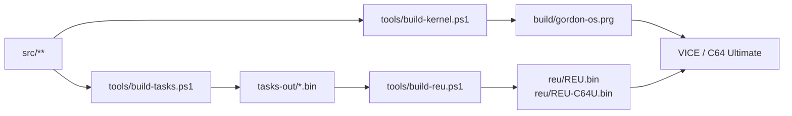

# GordonOS — Development Environment

> How this tree becomes a bootable `.prg` and a REU image: the tools, the three build
> stages, the files that configure them, and the gates that fail the build.
>
> Writing the code itself: [writing-relocatable-tasks.md](writing-relocatable-tasks.md)
> for tasks and commands, [programmers-guide.md](programmers-guide.md) for the runtime
> model, [kernel.md](kernel.md) for the kernel API.

---

## 1. The toolchain

| Tool | Version | What it is for |
|---|---|---|
| VS Code + **VS64** (`rosc.vs64`) | latest | generates `build/build.ninja` from `project-config.json`, supplies the build tasks and the F5 launch flows, and holds the `vs64.*` tool paths |
| **KickAssembler** | v5.25 | the assembler — used for the kernel *and* for every task and library |
| **Java JDK** | 26+ | runs KickAssembler |
| **Ninja** | ships inside VS64 | runs the kernel build |
| **VICE** | 3.10+ (GTK3) | the emulator, `x64sc`, driven with the REU image and `-speed 200` |
| **Python** | 3.9+ in `.venv` | the generator, gate and publish tools |
| **PowerShell** | 5.1 | every script under `tools/` |

Two facts shape everything else:

- **There are two build systems.** The kernel goes through Ninja, from a
  `build/build.ninja` that VS64 generates out of `project-config.json`. The task and
  library binaries and the REU images are built by PowerShell scripts that invoke
  KickAssembler directly. Both routes call `tools/kick.ps1`, so a failed `.assert`
  fails the build either way.
- **Nothing is bundled.** Every tool location is read at build time from
  `.vscode/settings.json`, which is gitignored.



The build scripts run under **Windows PowerShell 5.1** on Windows and under
**PowerShell 7 (`pwsh`)** on Linux/macOS; they resolve the host's own interpreter,
Python and Ninja themselves (`tools/host.ps1`, `tools/toolpaths.ps1`). The VICE
driver helpers (`vice-test.ps1`, `vice-step.ps1`, `drive-string-tests.ps1`) use
Win32 `P/Invoke` and are Windows only.

Per-OS install commands for every prerequisite — VS Code + VS64, Java,
KickAssembler, VICE and PowerShell 7 — are in
[quick-start.md](quick-start.md) → *Option 2: Build from source* → *Prerequisites*.
VICE on Debian/Ubuntu has one extra trap (the distro package ships no C64 ROMs);
the same section covers it.

---

## 2. One-time setup

### `.vscode/settings.json`

It is **gitignored** — it holds this machine's tool locations — so a fresh clone has
none, and the build scripts read the four `vs64.*` paths from it and nowhere else.
Create it from the bundled sample and edit the paths:

```bash
cp .vscode/settings.json.sample .vscode/settings.json           # Linux/macOS
```
```powershell
Copy-Item .vscode\settings.json.sample .vscode\settings.json    # Windows
```

| Setting | Points at |
|---|---|
| `vs64.kickInstallDir` | the KickAssembler **folder** (the one holding `KickAss.jar`) — not the jar |
| `vs64.javaExecutable` | the Java executable that runs it (`.../bin/java.exe`, or `/usr/bin/java`) |
| `vs64.ninjaExecutable` | leave blank to use the Ninja bundled in the VS64 extension; otherwise a `ninja`/`ninja.exe` path |
| `vs64.viceExecutable` | `x64sc.exe`/`x64sc` from a VICE 3.10+ GTK3 install |

`tools/toolpaths.ps1` is the one reader of that file; the VS64 extension reads the
same keys to assemble and launch. `VICE_EXE` / `KICKASS_JAR` / `JAVA_EXE` / `NINJA_EXE`
environment variables override it for ad-hoc runs.

> **The trap:** a missing settings file makes every path come out **empty**, so the
> first build stops with `KickAss.jar not found at:` and no path after it. That message
> means the settings file is missing, not that KickAssembler is.

`build/build.ninja` is generated and gitignored like the rest of `build/` (only
`build/*.prg` is committed), so a fresh clone does not have one either. VS64 writes it
when the folder is opened as a VS64 project; without it the kernel build stops with
`Missing build/build.ninja - run VS64 project generation once before building`.

### Python

The host tools (`gen-corpus.py`, `gen-mus.py`, `gen-sprites.py`, `img2bnr.py`,
`img2pic.py`, `gen-anim.py`, `check-task-headers.py`, `scan-history.py`,
`dis6502.py`, `dis6502-linear.py`, `scan-prg.py`, `publish.py`) run from a
virtualenv in the repo root:

```bash
python3 -m venv .venv     # Linux/macOS
```
```powershell
python -m venv .venv      # Windows
```

`.venv` is gitignored. Three things are needed beyond the standard library — **Pillow**
(`img2bnr.py`, `img2pic.py`, `gen-anim.py`), the **FFmpeg** that `gen-anim.py` extracts a
film's frames with, and **py65** for `dis6502-linear.py` (the disassembler cross-check —
`dis6502.py` and `scan-prg.py` use the standard library only) — so install them into the
venv once:

```bash
python -m pip install Pillow imageio-ffmpeg py65
```

`imageio-ffmpeg` is the recommended FFmpeg because it **vendors a static binary**: there
is no system package to install and nothing to add to `PATH`. A machine that already has
an `ffmpeg` works just as well.

### VS Code extensions

`.vscode/extensions.json` lists what VS Code offers under *Recommended* the first time
the folder is opened: VS64 (**required**), KickAssembler syntax highlighting, and
optionally the PowerShell extension for editing the build scripts.

---

## 3. What configures the build

| File | Role |
|---|---|
| `project-config.json` | the VS64 project: `toolkit: kick`, `build: debug`, and the `sources` array listing every file the kernel build pulls in |
| `build/build.ninja` | **generated** — VS64 writes it from `project-config.json`; its single build edge assembles `src/main.asm` |
| `.vscode/tasks.json` | the build tasks (Terminal → Run Task, and the F5 pre-launch tasks) |
| `.vscode/launch.json` | the F5 launch flows |
| `.vscode/settings.json` | the machine's tool paths — gitignored, created from `.vscode/settings.json.sample` |
| `.vscode/extensions.json` | recommended extensions |
| `.vscode/mcp.json` | empty; the hook for workspace MCP servers |
| `tools/tasks.json` | the task/library manifest (section 5) |

**A new kernel-side `.inc` must be added to `project-config.json` → `sources`.** The
generated `build.ninja` names only `src/main.asm`, so the `.import source` chain behind
it is invisible to Ninja — that array is what VS64 watches to know the project has
changed.

---

## 4. The three build stages

### Stage 1 — the kernel

```bash
pwsh -NoProfile -File tools/build-kernel.ps1                                 # Linux/macOS
powershell -NoProfile -ExecutionPolicy Bypass -File tools/build-kernel.ps1   # Windows
```

What it does, in order:

1. **Three tripwires**, each of which exits non-zero and stops the build:
   `check-fs-offsets.ps1`, `check-lib-ids.ps1`, `check-header-offsets.ps1` (section 6).
2. **Patches the generated `build.ninja`** so its `asm` rule runs
   `tools/kick.ps1` instead of `java -jar KickAss.jar` directly, which is what turns a
   failed `.assert` into a failed build. If the rule is neither the known direct form
   nor the wrapped one, the script throws rather than build something unchecked.
3. **`ninja -C build -t clean` then `ninja -C build`** — a full rebuild, there is no
   incremental kernel build. (The PRG is briefly absent while that runs.)

Output, all in `build/`:

| Artifact | What it is |
|---|---|
| `gordon-os.prg` | the kernel binary — the only build output that is committed |
| `gordon-os.dbg` | KickAssembler's debug dump: every address mapped to its source file (the input to [kernel-fragmentation.md](kernel-fragmentation.md)) |
| `gordon-os.info` | the assembler info file (its `[errors]` / `[files]` sections) |
| `main.sym` | the symbol map — `.label name=$addr` lines, the format the VICE monitor loads to name kernel addresses |

VS64's flags (`-debugdump -asminfo "files|errors" -debug`, with the repo root and
`build/` on the assembler's `-libdir`) come straight from the generated `build.ninja`.

### Stage 2 — the task and library binaries

```bash
pwsh -NoProfile -File tools/build-tasks.ps1                                 # Linux/macOS
powershell -NoProfile -ExecutionPolicy Bypass -File tools/build-tasks.ps1   # Windows
```

1. The FS-offset, library-id and pool-budget tripwires.
2. **Clears the artifacts it is about to write** — `tasks-out/*.bin` and
   `tasks-out/temp/*.bin` — so a binary from an earlier run, or one whose manifest
   entry has been removed, cannot survive as a stale file.
3. **`gen-task-asm.ps1` regenerates two files from the manifest**:
   `tools/assemble-tasks.asm` and `tools/gen-fixups.asm`. They are deterministic, so an
   unchanged manifest rewrites nothing. **Never edit them by hand** — they are checked
   in so a manifest change shows up as a reviewable diff, and the next build reverts
   any manual edit.
4. **Three assemblies** of `assemble-tasks.asm` (`:shift=0/256/512`), writing
   `tasks-out/temp/<name>.{base,shift,check}.bin` per manifest entry.
5. **`gen-fixups.asm` diffs the three code bodies**, derives the high-byte fixup table,
   verifies each fixup satisfies `base + 2 == check` and that every non-fixup byte is
   identical, then writes `tasks-out/<name>.bin` — or the entry's own `out` name, which
   only `fplib` sets (it emits `fp.bin`). A task that is not genuinely
   position-independent fails the build here instead of misbehaving on the machine.
6. **`check-task-headers.py --quiet`** re-derives every header field of every binary
   just written and checks the ABI invariants.
7. **Writes `tasks-out/build.stamp`** — a content hash of `tools/tasks.json` plus every
   `.asm`/`.inc` under `src/`, which is the input set the assembly actually reads (a task
   pulls shared files in with `.import source`, so the manifest's `source` list is not the
   whole story). Stage 3 refuses to seed a set the sources have moved on from, and
   `check-reu-current.ps1` reports it — see `tools/tasks-stamp.ps1`.

The generator prints each task's version, code size and fixup count, and a
`relocation verification OK` line. `tasks-out/` sits outside `build/` so a VS64 clean
build cannot delete it. The manifest order is the FS order — the details are in
[writing-relocatable-tasks.md](writing-relocatable-tasks.md) §10.

### Stage 3 — the REU images

```bash
pwsh -NoProfile -File tools/build-reu.ps1                                 # Linux/macOS
powershell -NoProfile -ExecutionPolicy Bypass -File tools/build-reu.ps1   # Windows
```

It writes **both** shipped images in one pass: the image the parameters describe, and
beside it the same bytes declaring the real-time speed, so a build cannot leave one of
the pair stale.

| Parameter | Default | Meaning |
|---|---|---|
| `-ReuSizeKb` | `16384` | the image size; the FS capacity is derived from it |
| `-Speed` | `200` | the speed the first image declares — written into the `speed` line of `boot.bat` |
| `-Out` | `reu\REU.bin` | the first image to write |
| `-C64UOut` | `reu\REU-C64U.bin` | the second image, declaring `100`; empty writes only the `-Out` image |

Before it writes anything, `tools/build-assets.ps1` re-runs every generator whose
source is in the tree (section 8), so the image always comes from the art as it
stands — a changed BASIC token can never ship a stale `.bas`.

It formats a fresh image and seeds, in this order:

1. every manifest entry, under its `fsName`;
2. an `$assets` array hard-coded in the script — the three `.fnt` charsets, the
   shared sprite sheets (`ball.spr`, `boat.spr`, `gkball.spr`, `gkpad.spr`,
   `godzi.spr`), the pictures `hires.pic` / `mc.pic` / `alf.pic` / `alfgs.pic`, and
   `gpui.bin` / `gpui_mc.bin`,
   grpaint's UI
   band (`tools/gen-ui.py`, the file [gordonpaint.md](gordonpaint.md) reads);
3. every `src/batch/*.bat`, every `src/banners/*.bnr`, every `src/corpus/*.bas`, every
   `music/*.mus`, each under its own filename (delete a file from those folders and it
   leaves the image; drop one in and it ships);
4. `fscross.bin`, the bank-crossing fixture for the `fstest` self-test, placed so its
   test window spans a `$10000` wrap;
5. `buildid` — the build stamp: the date and time this image was written. Digits and
   punctuation only, because `type buildid` writes a file's bytes as they are. It changes
   on every build, so a rebuilt pair differs from the copies in the tree.

The FS layout it writes mirrors the kernel's: a 512 × 32-byte directory at REU bank 5
/ `$9000` (slot 0 is the FS header), file data from bank 5 / `$D000`, names
screen-code encoded and space-padded to 16 bytes, sizes and offsets 24-bit. `.fnt`
files are padded to a bank boundary so a glyph never straddles one. Two images ship and
they differ in one declaration — the `speed` line of `boot.bat` — so the second is written
as a substitution in the finished buffer rather than by seeding the whole image twice:

| Image | Declares | For |
|---|---|---|
| `reu/REU.bin` | `speed 200` | VICE at 200% of real time |
| `reu/REU-C64U.bin` | `speed 100` | a C64 Ultimate (or any real machine) |

> VICE is normally launched with `-reuimagerw`, so it maps the image, writes it back on
> exit and `REU.bin` accumulates live session state. **Close VICE before rebuilding it**:
> the script rewrites the whole 16 MB file, and a mapped file refuses the write. While a
> session holds it, `reu/REU.bin` *is* that session's copy — so the build replaces only
> `reu/REU-C64U.bin` (which no emulator opens), reports which file it could not write and
> exits non-zero; the F5 fresh-REU flow refuses to launch on that, rather than booting the
> old filesystem under a fresh label.

### What depends on what

| You changed | Rebuild |
|---|---|
| a kernel source (`src/main.asm`, `src/kernel/*.inc`, `src/tasks/boot.inc`, `src/tasks/tasks.inc`) | `VS64: Build` |
| a **new** `.inc` for the kernel | add it to `project-config.json` → `sources` first, then `VS64: Build` |
| a task or library source, or **`tools/tasks.json`** | `Build dynamic tasks` then `Build REU` (**`Build dynamic tasks + REU`**) — no kernel rebuild |
| an asset source (charsets, `assets/sprites/*.txt`, `music`, `src/corpus`, `src/banners`) | run its generator (section 8), then `Build REU` |

The kernel does not embed task binaries or a seed table — the boot task loads the shell
from the REU filesystem — so a task change never needs a kernel rebuild. The two
`Build & Launch` F5 flows run the right combination for you (section 7).

---

## 5. Single sources of truth

Each of these is the one place a fact is written down; everything else reads it.

| File | The single source for | Read by |
|---|---|---|
| `tools/tasks.json` | the task and library list: `name`, `source`, `origin`, `out`, `fsName`, `kind`, `note` | `gen-task-asm.ps1` (both generated files) and `build-reu.ps1` (what to seed) |
| `project-config.json` | which files the kernel build is made of | VS64 → `build/build.ninja` |
| `src/kernel/pool.inc` | the pool geometry — `POOL_BASE`, `POOL_END`, `POOL_PAGE_SIZE` and everything derived from it, plus the `poolAsl`/`poolLsr` macros | the kernel build *and* the task build — both import it |
| `src/kernel/task-header.inc` | the task/library header ABI: magic, version, flags, `libMask` bits, the `HDR_*` offsets | the kernel, the task build, `check-task-headers.py` (it parses the constants), `check-header-offsets.ps1`, `check-lib-ids.ps1` |
| `src/kernel/jumptable.inc` | the `$E000` call ABI — every `kXxx` address — plus `syscalls.inc` (the `SYS_*` numbers) | the kernel (which pins the addresses with `.assert`s), the task build, both doc gates |
| `src/tasks/kernel-data.inc` | the kernel-data addresses a task may read (`taskState`, `dynTask*`, `frameCount`, …) | the kernel and the task build |
| `src/tasks/sprite-shadow.inc` | the sprite shadow ABI and its macros | the kernel and the task build |
| `src/kernel/fs-offset.inc` | the REU-FS 24-bit offset macros | the kernel (via `main.asm`) and the task build (via `kernel-data.inc`) |
| `src/libs/fp.inc` | the `fp.lib` opcode and scratch layout | `fp.lib` and its callers |
| `src/libs/mouse.inc` | the `mouse.lib` opcodes and the `kArg` result map | `mouse.lib` and its callers |

**Generated — never hand-edited:** `tools/assemble-tasks.asm`, `tools/gen-fixups.asm`
(from `tasks.json`), the call counts in the two `*-call-inventory.md` documents
(from `tools/gen-call-inventory.ps1`), `build/build.ninja` (from `project-config.json`, and patched by
`build-kernel.ps1` on every kernel build), and everything under `tasks-out/`.

**Plans are working documents, not documentation.** An active plan lives in
`docs/plans/` and is retired to `Documents/GordonOSPlans/` once it is implemented, so the
repo carries only plans that still describe work to be done.

**Two build outputs are tracked on purpose, and both change on every build:**
`build/gordon-os.prg` (the runnable kernel, so a visitor needs no toolchain) and
`reu/REU.bin` / `reu/REU-C64U.bin` (the pre-seeded 16 MB REU images — the tasks,
commands, fonts, banners, sprite sheets and songs live inside them, and the
filesystem only survives if the image is on disk). A rebuild therefore produces a
large binary diff; that is not a mistake, but it does mean the history grows by
~32 MB per rebuild commit. If that becomes a problem the answer is Git LFS or a
release asset, not deleting the images — the no-toolchain quick start depends on
them. Nothing enforces that the committed pair matches the sources:
`check-reu-current.ps1` checks the image against `tasks-out/`, and only a rebuild
refreshes both.

---

## 6. The gates

The build fails loudly on purpose. A mistake these catch is one that would otherwise
show up on the machine as a wrong number, a stale binary or a garbled screen.

**Run by the builds:**

| Gate | Checks | Runs in |
|---|---|---|
| `tools/kick.ps1` | a failed `.assert` — KickAssembler prints `Made N asserts, M FAILED!` and still exits 0, so the wrapper turns that into a non-zero exit | every KickAssembler invocation, both builds |
| `check-fs-offsets.ps1` | 24-bit REU-FS offset arithmetic: a copy of `reuFsPtr` that drops the bank byte, a hard-coded bank byte, or a 24-bit add whose carry never reaches `+2`. A deliberate case is marked `fs-lint: allow` | kernel + task builds |
| `check-lib-ids.ps1` | the `LIB_*` ids in `task-header.inc` against the positional descriptor tables in `src/main.asm` — a reorder would load the **wrong library silently** | kernel + task builds |
| `check-header-offsets.ps1` | a header field read as a bare `+N` on `scratchBuf`/`reuDirBuf` instead of an `HDR_*` constant. No `.assert` can see this (it is an index into a DMA'd page, not a label) | kernel build |
| `check-pool-budget.ps1` | a task's **live footprint** — its code, the libraries it holds while alive (the eager ones its `libMask` names *and* the lazy ones its own code loads: a `$LiveLazy` table, since no header can state that) and the `kMalloc` blocks it holds (`$LiveMallocMusic`, recomputed from each tune file, and `$LiveMallocFixed`, in pages). The loader's pre-need sum counts the eager libraries only, so an over-budget task loads and then dies at the first lazy call | task build |
| `check-task-headers.py` | every built binary's header, re-derived from its bytes: magic, size identity, trailer, fixup bounds and order, the `$FFFF` sentinel, zero padding, page-aligned origin | end of the task build |

**Run by hand:**

| Gate | Checks |
|---|---|
| `verify-map.ps1` | the kernel `Memory Map` block against the free-run totals `memory-map.md` publishes (125 bytes across 22 pockets). It runs the kernel build itself; `-ExpectTotal`/`-ExpectPockets` override the figures for a change that is meant to move them — update the doc in the same commit |
| `verify-jumptable-docs.ps1` | two things: every address in `kernel.md`'s section headings against `jumptable.inc`, and that every entry is headable in **some** doc — `kernel.md`, its owning `lib-*.md`, or an inventory. An entry no document heads is a gap and fails the gate; an entry documented outside `kernel.md` is reported, not failed |
| `verify-inventory-docs.ps1` | every address quoted in `kernel-call-inventory.md` and `library-call-inventory.md` against `jumptable.inc`, and — through `gen-call-inventory.ps1 -Check` — every call count in them against the tree |
| `gen-call-inventory.ps1` | the **numbers** in those two documents: totals, per-file breakdowns and the summary figures. `-Check` reports drift and writes nothing; a rewrite touches no prose and no address, and refuses to write if the result is a different shape |
| `check-reu-fs.ps1` | the image is internally consistent — entries packed, data ending exactly at the allocator's `nextFreeOffset`, no overlap. `-Strict` also forbids gaps (`fscross.bin`'s placement is one) |
| `check-reu-current.ps1` | every `tasks-out/*.bin` is present and byte-identical **inside the image** — the answer to "why is my change not there?". It checks `reu/REU.bin`; pass `-Image reu\REU-C64U.bin` for the other image. It also fails when `tasks-out/` was built from sources that have since changed, which no image comparison can see |
| `scan-history.py` | history-flavoured comment content in code files: bug numbers, dates, phase markers, change narration (Rule 14 categories). It reports per category and skips `docs/`, `reference/`, the generated folders and the vendored ports (`ehbasic.asm`, `sidplay.inc`, `basicedit.inc`, `filesys.asm`), whose comments are their upstream author's. Its report files (`tools/hist_*.txt`) are gitignored |
| `check-ascii.py` | any non-ASCII byte in a code file (Rule 19 — the toolchain is CP1252-hostile, and a non-ASCII character inside a `.text` string emits a wrong screen code). Data files (`src/corpus/*.bas`, `charsets/*`, `src/banners/*`, `music/*`, `reference/**/*.md`) are exempt |

**Run by CI, on every push and pull request:** `check-fs-offsets`, `check-lib-ids`,
`check-header-offsets`, `gen-task-asm -Check`, `verify-jumptable-docs`,
`verify-inventory-docs`, `check-ascii.py`, and `scan-history.py` as a read-out —
the `.github/workflows/gates.yml` workflow, the half of the build that needs no
assembler and no emulator. The rest need built binaries under `tasks-out/` or
`build/`, so they run locally after a build.

> **A check that cannot be shown to fail is not a check.** `tools/probes/` holds the
> negative fixtures: `check-header-offsets.ps1 -Path tools/probes` must exit 1 and name
> both probe lines.

---

## 7. Running, testing and debugging

### F5 launch flows

`.vscode/launch.json`, all launched with `-reuimagerw` so the session writes the image
back:

| Configuration | Builds first | Use when |
|---|---|---|
| **Build & Launch with REU** | the kernel only, plus a refresh of `reu/REU-C64U.bin` | kernel work; the existing `reu/REU.bin` is current |
| **Build & Launch with fresh REU** | kernel → tasks → REU (both images) | **you changed a task** — this is the one you want |
| **Build & Launch with REU (1351 mouse)** | the kernel only, plus a refresh of `reu/REU-C64U.bin` | like *Build & Launch with REU*, for `grpaint`: adds `-controlport2device 1351 -mouse` |
| **Build & Launch with fresh REU (1351 mouse)** | kernel → tasks → REU (both images) | like *Build & Launch with fresh REU*, with the 1351 and the pointer grab |
| **Publish binaries** | the kernel only | publishing (section 9) |

`reu/REU-C64U.bin` is refreshed by **every** VICE flow: VICE opens only
`reu/REU.bin`, so writing the C64 Ultimate image costs neither the session's saved files
nor the live filesystem — and it is the one build output a session cannot regenerate for
itself.

`launch.json` also carries VS64's built-in 6502 debugger configuration. The VICE flows
and `tools/launch-vice.ps1` all pass the same base command line — the two *(1351 mouse)*
flows add `-controlport2device 1351 -mouse`, and **Alt-M** toggles that grab while VICE
runs — and it is worth knowing by heart:

```bash
x64sc -speed 200 -reu -reusize 16384 -reuimage <abs>/reu/REU.bin -reuimagerw build/gordon-os.prg
```

`-reuimage` needs an **absolute** path. `-speed 200` is the speed `REU.bin` declares,
and on a real C64 Ultimate neither the setting nor that image applies — use
`REU-C64U.bin`, which declares 100. See [quick-start.md](quick-start.md) → *speed*.

> **The trap:** *Build & Launch with REU* does **not** rebuild the task binaries. Use
> it after a task change and the previous binary boots — and because the session writes
> the image back, that stale copy persists.

### Tasks (Terminal → Run Task)

| Task | Runs |
|---|---|
| **VS64: Build** | `build-kernel.ps1` — the kernel, assert-safe |
| **Build dynamic tasks** | `build-tasks.ps1` — every task and library |
| **Build REU** | `build-reu.ps1` — reseed `reu/REU.bin` and `reu/REU-C64U.bin` from `tasks-out/` |
| **Build dynamic tasks + REU** | both, in order |
| **Prepare fresh REU** | kernel → tasks → REU |
| **VICE with REU** / **VICE with fresh REU** | the launch flows without F5 (Ctrl+Shift+B runs the default, *VICE with REU*) |
| **Publish binaries** | `publish-binaries.ps1` — no build up front; a *missing* artifact is built |

[writing-relocatable-tasks.md](writing-relocatable-tasks.md) §11.1 has the same table
from the task-author's side, with the add-a-task walkthrough.

### What the binaries repo receives

`publish-binaries.ps1` copies a fixed set and nothing else: the kernel PRG, the two REU
images, five text files, and the screenshots those text files embed.

| In the binaries repo | Copied from | Note |
|---|---|---|
| `gordon-os.prg` | `build/gordon-os.prg` | |
| `REU.bin` / `REU-C64U.bin` | `reu/` | |
| `README.md` | `tools/README.binaries.md` | renamed on the way |
| `quickstart.binaries.md` | `tools/quickstart.binaries.md` | at the root |
| `NOTICE` | `NOTICE` | |
| `LICENSE.md` | `docs/LICENSE.md` | moved to the root |
| `docs/gordonbasic.md` | `docs/gordonbasic.md` | the only doc kept under `docs/` |
| `docs/img/` | `docs/img/` | the screenshots — addressed as `docs/img/<name>` by the two root-level files and as `img/<name>` by `docs/gordonbasic.md` |

The screenshots go to `docs/img/` rather than the root because that is the one place where
**both** spellings resolve: the published `README.md` and `quickstart.binaries.md` sit at
the repo root, while the copied `docs/gordonbasic.md` keeps the relative path its source
already uses. The folder is replaced on every publish, so an image deleted from the source
does not linger in the binaries repo.

The PRG and the two REU images are written with `Split-Path -Leaf`, so all three land at
the binaries repo's **root** — the `build/` and `reu/` directories exist only in the source
repo, and the published text names them without a directory for that reason.

`gordonOS-demo.mp4` sits in the clone but is not in this list. Publishing commits whatever
the clone holds (`git add -A`), so a file placed there by hand survives a publish untouched.

⚠️ **The published text may reference only that set.** The binaries repo carries no other
documentation, so a `docs/kernel.md`, `tools/` or `reference/` pointer in one of those files
is a dead link for every reader who has the binaries and not the source. Where the source doc
said something the binaries reader needs, state it in the file; where the pointer carried
nothing, drop it. Relative links are the second trap: `README.md` and `quickstart.binaries.md`
land at the binaries repo's **root** while `docs/gordonbasic.md` stays under `docs/`, so a
cross-link between them that is correct in one tree is wrong in the other — the published
files avoid linking to each other across that boundary.

### Driving the emulator from a script

`tools/` carries four VICE automation helpers for checking behaviour without typing at
the window. Three drive the running `x64sc` through Win32 `P/Invoke`, so they are
Windows-only, and they press keys slowly and **hold** them: the OS's own keyboard scan
runs at ~60 Hz and misses an instant press.

| Helper | What it does |
|---|---|
| `vice-step.ps1` | `launch` / `keys "text"` / `enter` — a stepwise driver with explicit key events and screenshots |
| `vice-test.ps1` | boots and drives BASIC via SendKeys, taking screenshots |
| `drive-string-tests.ps1` | runs the string-domain regression suite in BASIC |
| `shots.py` | the README's screenshots, on any host: drives VICE's **binary monitor** (`-binarymonitor`), which halts the machine for every command, so a poke into the kernel's key ring or its `keybHeld` level lands exactly as the keyboard IRQ would write it. `python3 tools/shots.py [name...]` re-takes them into `docs/img/`, `--list` names the shots |

⚠️ VICE's own `-keybuf`, and the monitor's `KEYBOARD FEED`, put text in the **KERNAL's**
keyboard buffer at `$0277`. GordonOS replaces the KERNAL and scans the matrix itself, so
both are silently ignored — a driver for this OS has to reach its own input state, which
is what `shots.py` does.

### Reverse-engineering a C64 binary

Three helpers answer "what does this program actually touch?" without typing at an
emulator window. They take a `.prg`, are independent of the build, and pair with each
other - `c1541 -attach <image.d64> -extract` (from the VICE in `.vscode/settings.json`)
gets the file out of a disk image first.

| Tool | What it does |
|---|---|
| `dis6502.py` | recursive 6502 disassembler (`--entry XXXX`): follows JSR/JMP/branches, harvests the handlers a program installs through the KERNAL/hardware vectors (a program that switches handler per mode keeps them there, and an IRQ entry is unreachable any other way), then reports the address ranges nothing reaches and every decoded instruction that touches VIC/CIA/SID/KERNAL. `--all` prints the listing; **`--asm`** writes the listing to keep - instructions where the walk reached them, `.byte` runs elsewhere - which is how `reference/sideditor64.asm` was produced |
| `dis6502-linear.py` | the same bytes through **py65**'s disassembler (`pip install py65`), walking linearly - full coverage, and the independent check on `dis6502.py`'s opcode table |
| `scan-prg.py` | byte-pattern scan: every occurrence of an interesting address pair with its surrounding bytes, plus the ASCII strings |

The recursive walk is the trustworthy one but partial: code entered through a
`JMP (indirect)` table is invisible to it, so a hit that only `scan-prg.py` sees is worth
checking by hand before believing it. The same applies to the `.byte` runs in an
`--asm` listing: they are the bytes the walk did not classify, which is not the
same as data - a routine entered only from a jump table appears there as bytes.

### Auditing the kernel's claims and the pool's state

Two helpers check things the build cannot, both by reading the **built** kernel
(`build/gordon-os.prg` and `build/main.sym`) rather than the source alone — so build
first; the clobber auditor warns when a source file is newer than the PRG it is reading.
Neither is a build gate: each produces judgement calls a human confirms, and the answer
is usually a corrected comment rather than changed code.

| Tool | What it does |
|---|---|
| `audit-clobbers.py` | checks the kernel's X, Y and A preservation claims against the emitted code, with a path-sensitive walk of the control-flow graph; `--all` lists the claims that hold, `--callers` flags a carried register read after a call, `--probe NAME` prints one routine's verdicts, `--selftest` re-checks the analysis itself |
| `vsf-pool-audit.py` | reads a VICE `.vsf`, prints the pool's owners and cross-checks them against the pool **bitmap**; `--diff A.vsf B.vsf` compares two snapshots, `--list` prints the module directory |

**A clobber list is a contract, and the assembler cannot check one** — it sees no
registers. `audit-clobbers.py` extracts the claims from the headers in `src/kernel/` (X,
Y and A, in the phrasings the kernel uses: a `Clobbers:` list that omits the register,
"X and Y preserved", "Returns length in Y") and searches the graph from each claimed
routine: a register writer makes the path dirty (`tax`/`tsx`/`ldx`/`inx`/`dex` for X,
`tay`/`ldy`/`iny`/`dey` for Y, the accumulator reads for A); the save/restore idioms
clean it again per path (`stx addr` ... `ldx addr`, `sty`/`ldy`, `pha` ... `pla`, and the
`txa/pha` ... `pla/tax` pairs); a `jsr` to a routine that clobbers the register dirties
it, resolved recursively through `$E000` jump-table entries; and the claim is **SUSPECT**
when some exit (`rts`/`rti`/`brk`, or an indirect `jmp`) is reached dirty. A claim is only
attached to the label directly below it — nothing but comments and directives in between
— so a call-site note is never read as a later routine's header.

`--callers` asks the other half of the question. For every `jsr` to a routine that
clobbers X or Y it looks for a *read* of that register before any reload, which is the
shape of a caller keeping a live value where the callee does not preserve it. It scans
the addresses reachable from the symbol table, never the image linearly — a data block
desynchronises a linear decode into phantom calls — and annotates each hit with the
callee's own header line naming the register, because the common false positive is a
value the callee *returns* (`kGetCursor` gives row in Y, `kByteToDec` the length in Y,
`scanKeyboardHw` the key index in X). A is left out of that mode: nearly every
instruction reads A, so no window test can tell a carried value from a scratch one.

`--probe NAME` prints one routine's verdicts per register, and `--selftest` re-checks the
analysis against a table of routines settled by hand: the known clobberers must still
classify as clobbering and the known preservers as preserving, so a toolchain change
cannot quietly turn the screener into a rubber stamp. It judges claims, not code — a
routine that promises nothing is not audited, an unrecognised tail call is invisible, and
only the phrasings it knows are matched, so a SUSPECT is a reading list and never a
verdict. The kernel writes no A-preservation claim at all, so that pass reports zero.

**`pool` cannot see a placement fault: its rows come from the tables, and the bitmap is
the only witness.** `vsf-pool-audit.py` parses a save-state's module directory (which
starts at the `MAINCPU` name; each module is a 16-byte NUL-padded name, a 2-byte version
and a u32 LE size that includes the 22-byte header), locates C64 RAM inside the `C64MEM`
module by comparing the image at `$0801` against the built PRG, and prints the scalars,
the task slots and the owners — dynamic tasks with their code range and program RAM,
libraries, malloc blocks. It then cross-checks those owners against the bitmap:

- **STOLEN** — a live owner's page the bitmap calls free. The next allocation hands it
  out and writes over its owner's code.
- **STRANDED** — a used page no live owner claims: pool space lost until a reboot.

A task in `TA_SWAPPED`/`TA_DEAD` holds no pages, and a malloc block with `mallocSwapped`
set had its pages freed on swap-out, so both are excluded — otherwise every ordinary
swap-out would read as a fault. `--diff` is what makes a fault the tables hide visible:
it prints the RAM differences, the scalars that moved, the **owner-table rows** that
changed and the pool report for each snapshot, so an unchanged table beside a bitmap
that gained a used page is a leak, and an owner whose range the bitmap no longer marks is
a theft.

### In the running system

The shell is the first debugging tool: `ps` (ids, addresses, sizes, `shared`/`swp`),
`pool` (the pool map), `dir` / `type` (the REU filesystem), `view <id>` (switch the
display to a task's screen), `kill` / `pause` / `resume` / `prio`, and `speed`.

Three runtime self-tests ship in the image and are worth running after a change to the
subsystem they cover:

- `fstest` — the FS bank-boundary test, which exercises the chunked DMA paths and
  the 24-bit offset arithmetic against `fscross.bin`.
- `ipctest` — the `ipc.lib` channel test: two thread producers, both consumed
  interleaved, so backpressure and channel recovery after a sleep are exercised. The
  expected result is `ipc PASS`.
- `mtest` — the 1351 readout (`docs/lib-mouse.md`): the POT registers, the
  position's low six bits, the distance moved since the last sample and the button
  lines, refreshed while it runs. It talks to the hardware itself, so it is the check
  for the machine side of the mouse, which no amount of reading can settle.

For a fault the shell cannot reach (a hang before the prompt), `build/gordon-os.dbg`
maps every address to its source file and `build/main.sym` holds the symbols.

> A `$D020` write is repainted by the scheduler every tick, so it is not a usable
> breadcrumb from kernel code — use a freeze trace (`sei` / `jmp *`), guarded so it
> skips the first boot instance.

---

## 8. Assets and their generators

The data that ships in the image is generated from something readable, and every
generator lives in `tools/`:

| Asset | Source of truth | Generator | Seeded by |
|---|---|---|---|
| Charsets `charsets/*.fnt` | the C64 chargen ROMs (`chargen-901225-01.bin`, `pet80col-901640-01.bin`) | `seed-font.ps1` | `$assets` in `build-reu.ps1` |
| Sprite sheets `assets/sprites/*.spr` | the ASCII art `assets/sprites/*.txt` | `gen-sprites.py` | `$assets` in `build-reu.ps1` |
| Music `music/*.mus` | the generator's own score format (`--build`), a MIDI file (`--from-midi`), or `--decode` to read one back | `gen-mus.py` | every `music/*.mus` |
| BASIC corpus `src/corpus/*.bas` | the plain-text BASIC program | `gen-corpus.py` | every `src/corpus/*.bas` |
| Banners `src/banners/*.bnr` | an image file | `img2bnr.py` (Pillow) | every `src/banners/*.bnr` |
| Pictures `assets/pics/*.pic` | the source image `assets/pics/*-src.png`, which names its own conversion: `-mc-` before `-src` (or a leading `mc-`) is multicolour, `-dither-` error-diffuses (optionally `-dither45-` for 45%) | `img2pic.py` (Pillow) | `$assets` in `build-reu.ps1` |
| UI band `assets/ui/gpui.bin`, `gpui_mc.bin` | the ASCII art `assets/ui/gpui.txt`: one 16x16 picture a tool, the last two being the MODE tile's two faces | `gen-ui.py --mode std` / `--mode mc` | `$assets` in `build-reu.ps1` |
| Animation `assets/anim/<film>/*.anm` + `<film>.inf` | a video that is **not** in the tree — see below | `gen-anim.py` (Pillow; the frames are extracted with an FFmpeg first), which is also where the colour / greyscale / tone-curve choice lives | every `assets/anim/*/` `*.anm` and `*.inf` |
| Batch scripts `src/batch/*.bat` | the script itself, one command per line | — | every `src/batch/*.bat` |

Four of those folders are swept by filename, so adding a file is enough. A charset or
a **shared** sprite sheet has to be added to the `$assets` array in `build-reu.ps1` as
well — that array is the only hard-coded asset list.

**`tools/build-assets.ps1` re-runs every generator whose source is in the tree, and
`build-reu.ps1` calls it before it seeds.** That is what makes F5's "fresh REU" flow
write an image from the art as it stands now — charsets, sprite sheets, the UI band,
the pictures and the BASIC corpus — instead of seeding whatever the committed binaries
happened to be. It draws the line between two failures: a generator that ran and FAILED
means the source is malformed and stops the build, while a missing interpreter (or
Pillow, which only `img2pic.py` and `img2bnr.py` want) only skips that step, so a clone
without Python still builds from the committed files.

Three artefacts are **not** regenerated, because the tree holds no source for them:
`music/*.mus` (written from a score or a MIDI that is not committed), `src/banners/*.bnr`
(written from an image that is not committed) and the animation chunks under
`assets/anim/` (converted from a video that is not committed). Their committed files are
what ships, and `build-assets.ps1` says so on every run rather than passing over it in
silence.

Regenerating a film is therefore a host-side job: extract the frames with an FFmpeg, then
run `tools/gen-anim.py` over them. The full recipe — including how to produce a film in
**colour**, in **greyscale** and at different **tone curves** — is in
**[pic-format.md](pic-format.md)** → *The `.anm` film container*.

---

## 9. Common jobs

**Add a task or a command** — write the wrapper `.asm` and the body `.inc`, add **one**
entry to `tools/tasks.json`, then `Build dynamic tasks + REU`. Full walkthrough:
[writing-relocatable-tasks.md](writing-relocatable-tasks.md) §8 (a `.tsk`), §9 (a
`.com`), §10 (the manifest); a guided version of the same thing is
[tutorial.md](tutorial.md).

**Add a library** — the same manifest entry with `kind: "lib"`, plus an id in
`task-header.inc` and its row in the descriptor tables in `src/main.asm`;
`check-lib-ids.ps1` fails the build if the two disagree. See
[dynamic-libraries.md](dynamic-libraries.md).

**Add or change a kernel routine** — put it in the owning `.inc`, add the jump-table
entry in `src/kernel/jumptable.inc`, and pin its address with an `.assert` in
`src/main.asm`. Then update the heading in `kernel.md` and the row in
`kernel-call-inventory.md` — `verify-jumptable-docs.ps1` and
`verify-inventory-docs.ps1` are the gates. Watch where the bytes go:
[kernel-fragmentation.md](kernel-fragmentation.md) has the free runs, and
`verify-map.ps1` pins the totals.

**Change an `.inc` that the kernel imports** — add it to `project-config.json` →
`sources` if it is new, then `VS64: Build`.

**Check the image really holds your build** — `check-reu-current.ps1` (and
`check-reu-fs.ps1` for its internal consistency).

**Rebuild everything** — the **Prepare fresh REU** task, or F5 →
*Build & Launch with fresh REU*.

**Publish** — the **Publish binaries** task, or the F5 configuration, which snapshots
`build/gordon-os.prg`, `reu/REU.bin` and `reu/REU-C64U.bin` (so a kernel build running
beside it cannot half-remove one), copies them plus the published README/quick-start,
`NOTICE`, `LICENSE.md` and `gordonbasic.md` into a local clone of the public binaries
repo, commits and pushes. `-SkipPush` commits without pushing.

---

## 10. Troubleshooting

| Symptom | Cause |
|---|---|
| `KickAss.jar not found at:` with an **empty** path | `.vscode/settings.json` is missing — copy the sample (section 2) |
| `VICE not found at: ... (vs64.viceExecutable)` | the same file, with a path set but wrong |
| VICE starts and vanishes in a moment (F5 looks like it does nothing) | VICE cannot load its C64 ROMs — it exits with `Couldn't load kernal ROM`. Debian/Ubuntu's `vice` is `+dfsg` and ships none: install them where VICE looks (`~/.local/share/vice/C64/`) or pass `-directory` via `vs64.viceArgs` (quick-start.md → *Prerequisites*). VS Code running as a **snap** also hides `~/.local/share/vice` because its `XDG_DATA_HOME` is redirected, so the same failure is likely there |
| `Missing build/build.ninja` | the project has not been generated by VS64 yet (`build/` is gitignored) |
| `build/build.ninja asm rule is not recognized` | VS64 changed the rule it generates; update `tools/build-kernel.ps1` |
| A change has **no effect at all** | the REU image is stale — the launch flow you used does not rebuild tasks, and VICE wrote the old image back on exit. Use *fresh REU*, or `del <name>` and re-seed |
| `? no fs or not found`, or an old binary runs | the same cause; `check-reu-current.ps1` confirms it directly |
| an old binary still runs after you edited a task | `tasks-out/` was stale: `build-reu.ps1` refuses to seed it and `check-reu-current.ps1` prints `STALE` — run `build-tasks.ps1`, then `build-reu.ps1` |
| `? no space in pool` while `pool` shows free pages | a *placement* problem, not a space one — `pool`'s rows come from the tables, not the bitmap. See [programmers-guide.md](programmers-guide.md) § Pool fragmentation and [limitations.md](limitations.md) §3 |
| `REU required` at boot | no REU attached; the REU image is not attached either |
| Rewriting the image fails | VICE still has it open — close the emulator |
| The build stops at a lint | read the message: it names the line and, where there is one, the constant to use. `fs-lint: allow` marks a deliberate FS-offset case |
| `Made N asserts, M FAILED!` in the output but the exit code is 0 | you invoked KickAssembler directly — go through `build-kernel.ps1` / `build-tasks.ps1`, which route through `tools/kick.ps1` |

---

## Where to go next

| Topic | Document |
|---|---|
| What the OS offers | [features.md](features.md) |
| Running it, command by command | [quick-start.md](quick-start.md) |
| Learning to write a task, step by step | [tutorial.md](tutorial.md) |
| Writing a task or a command | [writing-relocatable-tasks.md](writing-relocatable-tasks.md) |
| The runtime model | [programmers-guide.md](programmers-guide.md) |
| The kernel API and its clobbers | [kernel.md](kernel.md) |
| How it is put together | [architecture.md](architecture.md), [memory-map.md](memory-map.md) |
| Where kernel code can live | [kernel-fragmentation.md](kernel-fragmentation.md) |
| Dynamic libraries | [dynamic-libraries.md](dynamic-libraries.md) |
| The `.pic` picture format | [pic-format.md](pic-format.md) |
| What could come next | [future-improvements.md](future-improvements.md) |
