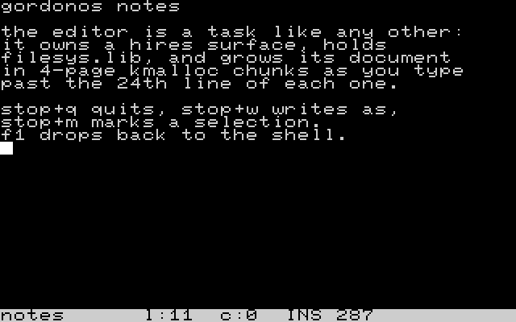

# `edit` — the full-screen text editor

> A 25×40 text editor for the REU filesystem, run from the shell as
> `run edit <file>`. It takes a screen of its own, grows a document on demand, and
> saves back to the same name.

| | |
|---|---|
| **Binary** | `edit.tsk` — relocatable, `KF_TAKES_ARGS \| KF_RE_RUNNABLE \| KF_NOT_EVICTABLE` |
| **Start** | `run edit <file>` (opens or creates it) · `run edit` prints a usage line on the shell's screen and exits |
| **Screen** | its own hires surface: rows 0-23 are the document window, row 24 is a reverse-video status bar |
| **Libraries** | `filesys.lib` (the REU FS is the document store) |
| **Document** | up to **192 lines × 40 columns**, CR+NUL line endings, filenames of 1-11 characters |
| **Source** | `src/tasks/dynamic/edit.inc`, wrapped by `edit.asm` |



The editor is also the OS's best working example of a **long-lived task that owns a
screen and a lot of runtime memory**: read it alongside the tutorial's §5-§7 and §12 if
you want to see `kMalloc` chunks, a partial redraw and a modal prompt used for real.

---

## How to use it

### Starting it

```
run edit notes          ← opens notes if it is there, else starts blank
run edit                ← no name: usage line on the shell's screen, then exit
```

`run edit` with no argument does **not** take a screen: it shares the shell's, prints
`? edit <filename>`, and exits. (It draws that line cell by cell with `kPrintCharAt`
rather than `kPrintString`, because `run` does not wait for the task — the shell's prompt
races the cursor, and a string printed at the cursor would start mid-line and wrap.)

A file that exists is **loaded**; a file that is not there is a blank document under that
name, saved to that name when you ask. Names are the filesystem's: 1-11 characters, no
directories.

### The screen

```
row  0 ┐
  ...  │  the document window — lines winTop .. winTop+23, up to 40 columns
row 23 ┘
row 24  notes      l:12  c:7   INS  1234    s(w) sa
        └─ 0-10 ──┘└─ 11-21 ──┘ └22-24┘└26-31┘└33-39┘
```

Row 24 is the status bar, in reverse video, in five fields:

| Columns | Shows |
|---|---|
| 0-10 | the filename, space-padded |
| 11-21 | `l:NNN c:NN` — the cursor's line and column, taken from the **document state**, not from the kernel cursor |
| 22-24 | `INS` / `OVR` |
| 26-31 | **the size the file will be** — characters plus a CR+NUL per line, less the trailing blank lines the save stops before, so a blank line counts as two bytes |
| 33-39 | a short hint |

Each field is rewritten in full — and space-padded — rather than cleared first: a clear
pass on a reverse-video bar is a solid block, which is exactly what a flashing cursor move
would look like. Prompts and messages are written over **cols 12-39**, so the filename
stays visible while you answer; the position field comes back on the next cursor move,
because it is derived from the document rather than remembered from what was on the screen.

### The keys

| Key | Does |
|---|---|
| any printable key | inserts at the cursor (or overwrites, in OVR) |
| **RETURN** | splits the line at the cursor |
| **DEL** | erases the character to the left |
| **← → ↑ ↓** | move; ↑/↓ keep a *preferred column*, so a short line does not pull the cursor left permanently |
| **HOME** | column 0 |
| **INST** | toggles insert ⇄ overwrite |
| **STOP** | the command prefix: **STOP alone shows the command list**; STOP again, or any other key, cancels it |

The STOP commands:

| Command | Does |
|---|---|
| **STOP+S** | save to the current name — **an empty document deletes the file** |
| **STOP+W** | write as: prompts for a name on the status bar and refuses one that already exists |
| **STOP+X** | save, then exit |
| **STOP+Q** | quit — asks first if the document has been modified |
| **STOP+C** | clear the document (asks for confirmation: press `C` again) and keeps the filename |
| **STOP+M** | mark mode on/off |
| **STOP+Y** | copy the selection to the clipboard |
| **STOP+K** | cut the selection |
| **STOP+P** | paste the clipboard at the cursor (insert semantics) |

**F1/F3/F5/F7** switch the display back to the shell while the editor keeps running —
that is what its display-ownership test is for (below). `kill <id>` is the way to get rid
of it for good; take the id from `ps`.

### Mark mode and the clipboard

STOP+M anchors a selection at the cursor. The cursor keys then extend it, and the
selected characters are drawn in reverse video. With a selection, STOP+Y copies it and
STOP+K cuts it; STOP+P pastes it at the cursor (insert semantics). The clipboard is a
`kMalloc` block of its own, holding lines separated by CR+NUL exactly as the file does,
so it survives every edit you make after the copy; a new copy releases the old one, and
the task's own death releases the last.

### Files, and what a save does about failure

The document is written as CR+NUL line endings: a CR starts a new line, a NUL terminates
the file. **A save cannot lose the previous file.** The editor measures the new image
first; if it fits the existing file it rewrites in place and NUL-fills the tail; if the
document has *outgrown* the file it writes a temporary name, renames the old file aside,
swaps the temporary into place, and only then drops the backup. A failure leaves the old
file intact and the editor bound to it, with the reason on the status bar.

Saving an empty document deletes the file, which is the only way the editor removes one.

---

## How it works

### The document model — fixed records in 4-page chunks

A line is a fixed **41-byte record**: `record[0]` is the length (0-40) and `record[1..40]`
are the screen codes. Records are packed **24 per chunk**, so a chunk is 984 bytes and
fits the **4-page** `kMalloc` block it is allocated in (1024 bytes). Up to **8 chunks**
= **192 lines**. The chunk bases live in a table in the instance buffer, and a record's
address is resolved through that table **on every access** rather than cached.

Growth is incremental: typing past the 24th line of the last chunk `kMalloc`s the next
4-page block, and deleting back down **frees** it again, so a small document does not hold
a large block. When the pool cannot give 4 contiguous pages the grow **fails with a
message on row 24** and the document keeps the size it had — you keep typing until you
run out of room, and `pool` names the owners if you want to see why. At *startup* there is
no document to fall back to, so the same failure reports, waits for a key, hands the
display back and exits.

Because the document is unsaved work, `edit` is **`KF_NOT_EVICTABLE`**: `dlEvict` never
swaps it out (see [dynamic-libraries.md](dynamic-libraries.md)). The consequence is worth
knowing: if every resident task is pinned, a load that needs the pool fails with
`? no space in pool` rather than evicting one of them.

### Editing at a full line

The interesting case is typing on a **full** (40-column) line, because there is nowhere
for the character to go: the character lands at the cursor and the line's **last**
character cascades to the line below — and when the cursor is in the last column, the
cursor follows the cascade down. At the last column of a *not-full* line the character
simply appends and the cursor wraps to a fresh line. DEL is the mirror image, with a
cascade of its own so a backspace at the start of a line pulls the previous line's tail
down.

### The window, the redraw and the display

Rows 0-23 are a window over `winTop..winTop+23`; scrolling moves `winTop` and the window
is redrawn, so the editor never moves the document in memory to scroll.

Drawing is deliberately **not** the char shadow: the body is blitted with `kBlitChar`
(the status bar with `kBlitCharRev`), and the cursor is the kernel's own, positioned with
`kSetCursor` and refreshed with `kBlinkReset`. Two rules make it survivable on a
multitasking machine:

- **A row-24 write starts at a frame edge** (the status bar is gated on `frameCount`), so
  the bar cannot be caught half-drawn by the raster.
- **Nothing is drawn unless this task's surface is displayed** — the check is
  `kSurfDisplayed`. An F-key that shows the shell instead does not make the editor draw
  into somebody else's screen; it marks the window dirty and redraws when it is shown
  again. That is why the editor keeps running on a screen you are not looking at.

### The modal STOP protocol

STOP switches the editor into a small modal state machine (edit / command / confirm-quit
/ name-input / confirm-clear). While a STOP prompt is up the editor **parks its blinking
cursor** and restores it when editing resumes — otherwise the kernel would blink the text
cursor in the middle of a prompt. Any task that reuses its screen for modal UI should
follow the same rule.

### Loading

`kReuOpen` gives the record, then the file is streamed in through a **128-byte window**
(`kReuReadAt`), so the code image holds no buffer for the document. The parser treats a
CR followed by a NUL as a line break, a CR followed by anything else as the C64's RETURN
glyph shown literally, and a NUL as a skip. Lines longer than 40 columns are
**hard-wrapped**, and everything past line 192 is **discarded** — the file is not
rejected, so a larger file is truncated (and a save then writes the truncated document).

---

## Limits

- **192 lines × 40 columns.** Larger files load truncated, and saving writes what is on
  screen.
- **One document per instance, but several instances are allowed** (`KF_RE_RUNNABLE`):
  two `run edit` invocations are two independent editors with their own documents,
  cursors and clipboards.
- **No search, no filename completion, no directory listing** — the name is a filesystem
  name of 1-11 characters, and `dir` at the shell is how you list them.
- Pinned against eviction, which is what keeps unsaved work safe but also what can make a
  later load report `? no space in pool`.- **A copy of a full document can be refused.** The clipboard is sized to the selection
  (about 32 pages for all 192 lines), and it is a second block on top of the document's own
  32, so `STOP+Y` on everything in the largest document can report `no space` — the copy
  fails, the document is untouched. Boxes smaller than the whole document are never a
  problem.
---

## See also

- [quick-start.md](quick-start.md) — `run edit` as a shell command, and `type` for reading a file back
- [dynamic-libraries.md](dynamic-libraries.md) — eviction, `libMask` and what `KF_NOT_EVICTABLE` costs
- [lib-filesys.md](lib-filesys.md) — the calls a load and a save are built on
- [gordonbasic.md](gordonbasic.md) — the other full-screen application in the image
