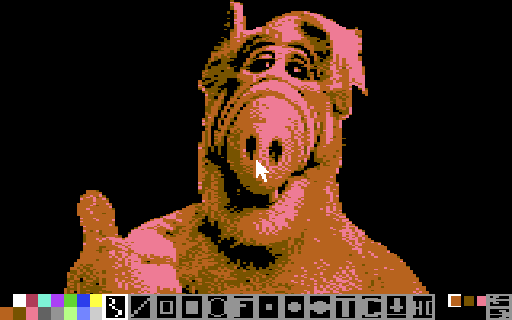

# GordonPaint — the 1351 paint program

> A full-screen hires/multicolour paint program driven by a 1351 mouse, run from the
> shell as `run grpaint <name>`. Its palette, thirteen tools and undo/redo arrows are a
> band over the canvas's bottom two cell rows; pictures are `.pic` files.

| | |
|---|---|
| **Binary** | `grpaint.tsk` — relocatable, **single-instance** (no `KF_RE_RUNNABLE`) |
| **Start** | `run grpaint <name> [border bg fg \| border bg c1 c2 c3]` |
| **Input** | a **1351 mouse on control port 2** — without it the program refuses to start |
| **Display** | its own **bitmap** surface, the whole screen, with the band over the bottom two cell rows |
| **Files** | `<name>.pic` (10,032 bytes — [pic-format.md](pic-format.md)); the band's own face is `gpui.bin` / `gpui_mc.bin` |
| **Libraries** | `gfx.lib`, `sprite.lib`, `mouse.lib`, `filesys.lib` |
| **Footprint** | **71 of the pool's 109 pages** when running (31 code + 27 gfx + 1 sprite + 2 mouse + 10 filesys) |
| **Source** | `src/tasks/dynamic/grpaint.inc`, wrapped by `grpaint.asm` |




---

## How to use it

### Starting it

```
run grpaint shot 1 1 0            ← hires:    border 1, paper 1, ink 0
run grpaint shot 1 1 2 7 15       ← multicolour: border+background 1, c1/c2/c3 = red, yellow, light grey
run grpaint shot                  ← no colours: the black-and-white defaults
run grpaint                        ← usage: ? grpaint <name> - 7 chars, no .pic
```

**The number of colour arguments *is* the mode.** Three values are hires (border, paper,
ink), five are multicolour (border, background, c1, c2, c3), none keeps the defaults, and
any other count is refused (`? 3 colours for hires, 5 for mc`). The `.pic` suffix is
appended, so the base name is at most **7 characters**.

An existing `<name>.pic` is **loaded**, and **its own mode and colours win** — a colour
argument against an existing picture is refused rather than silently dropped
(`? the picture has its own colours`). A name that is not there is the blank canvas the
allocator has just handed over.

The mouse must be declared **before** the program starts: without it grpaint prints
`? mouse off - run 'mouse 1351'` on the *shell's* screen and leaves, having taken no
surface at all. Under VICE that means `-controlport2device 1351 -mouse` (both flags); on a
C64 Ultimate it is a real 1351 in port 2 (an Ultimate 64 Elite can swap the ports with
`C= + J` if the mouse is in port 1). The bundled image's `boot.bat` already runs
`mouse 1351`.

It is **single-instance**: a second `run grpaint` gets `? already running`.

### The band

The canvas is the whole screen; the UI is a band over its **bottom two cell rows**, and
it is **up** when the program starts.

| Gesture | Does |
|---|---|
| **right press** anywhere | toggles the band up/down |
| **left press** on an entry | takes that entry, and leaves the band up |
| **left press** off the entries | dismisses the band, and the press lands on the canvas |

### The palette and the ink

Sixteen swatches, two rows of eight, in the C64's own colour order; a press sets the ink.

- **Hires:** the **first swatch (colour 0) is the eraser.** The drawing calls read colour
  0 as *clear*, so it takes a pixel off to the cell's own paper without re-colouring the
  cell.
- **Multicolour:** four **slot chips** choose which of a cell's four colour sources a mark
  claims, and slot 0 — the background — erases the same way.

### The thirteen tiles

| Tile | Does |
|---|---|
| **pencil** | freehand, one pixel per frame |
| **line** | two clicks: the first anchors, the second draws and becomes the next anchor |
| **box**, **filled box** | press, drag, release |
| **circle** | press, drag, release |
| **flood fill** | one press: fills the region it lands on |
| **three brushes** | freehand, three blob sizes |
| **text** | a text pen — click the canvas and type |
| **clear** | a command, run on the press |
| **save** | a command, run on the press |
| **MODE** | a command: switches hires ⇄ multicolour in place |

A **shape previews live** while you drag, drawn as a kernel XOR band, and commits on the
release. The **text pen** takes the keyboard: glyphs are XORed so they stay legible over
existing work, DEL takes one back and RETURN starts a line. **CLEAR** blanks the canvas
and puts the picture's palette back, leaving the tool and the ink alone. **SAVE** writes
`<name>.pic` and its tile is marked **only while the canvas has changed** — a press on an
unmarked one does nothing, because there is no message on success.

### Undo and redo

Press **`u`** to step back and **`r`** to step forward — the same two steps the band's
stacked arrows take: **the top cell row is undo, the bottom one redo**. An arrow is
**white while it has a step to take**, and shows its grey band face when it does not.

While the text pen is down every key is text, so `u`/`r` type letters there; the arrows
are unaffected, being mouse presses. One press is one step, and there are **five steps
each way**.

A stroke, a shape's commit, a fill, a text entry put away, CLEAR, a palette press and a
MODE switch are each one step. A line's **first** click only *anchors* and is **not** a
step — so `u` after it takes the anchor's dot off without touching the history.

### Leaving

**`q` asks before it loses work.** With nothing drawn since the last save it leaves at
once; otherwise the band comes up and the **SAVE tile flashes** (0.64 s marked, 0.64 s
dark) until either

- you press the SAVE tile — which saves and **stays** in the program, or
- you press `q` again **while the band is up** — which leaves as it is.

Dismissing the band hides the warning, so the next `q` raises it again.

The only other keys are `u` and `r`; **the mode is the MODE tile, not a key.** (While the
text pen is down every key is text — including `q`.)

---

## How it works

### The canvas

`kAllocScreen` takes a bitmap surface, and the program takes the display with the
`kBlinkReset` + `kSwitchView` pair, so the shell's block cursor is erased before the
framebuffer is copied into the shell's saved image and cannot come back as a phantom.

**Only `SYS_EXIT` at the end — never `kFreeScreen`.** `sysExit`'s `transferFocusAway` runs
while the surface still exists and hands the display to another owner; exiting
*surfaceless* is the broken state (the display blanks and `kbFocus` goes to `$FF`).

A failed allocation is still reported: there are 28 surface slots and the shell holds one,
so a leak elsewhere makes this reachable — the message goes on the **shell's** screen,
because our own surface is exactly what could not be taken. A failure *after* the canvas
exists hands the display back first, for the same reason in reverse.

### The pointer

The pointer is **two sprites** (`pointer.spr`), because every sprite call requires
`curTask == kbFocus` and the setup therefore has to sit *after* the display hand-over. The
interior shows the ink (or the colour of the swatch you are hovering); the ring is a fixed
colour, so the pointer reads against any ink.

It is positioned **once per displayed frame**, not once per scheduler tick: the tick is
59.2 Hz against a 50.1 Hz display, so a per-tick pointer is sampled 1.18 times a frame —
some frames two steps, the next none. `frameCount` is the frame clock, and it is compared
for *change* (it is 8-bit and wraps).

Two more rules make the motion clean:

- **No single pot sample is trusted.** The 1351's pot noise lands in the raw byte's low bit
  — the qualifier the protocol says to drop — except that a +1 on an odd byte carries into
  the position field. The noise only ever *adds*, so the **smallest** reading in a frame is
  the true one, and the frame moves the pointer by the change in that minimum rather than
  by its last sample.
- **The stroke is drawn once per displayed frame, not once per read** — from the
  noise-corrected endpoint, since the per-read positions still carry the ±1 jitter.
  Painting from them would bake into the canvas exactly what the tracker keeps out of the
  pointer. `kPlot` draws it, setting the pixel *and* its cell's colour.

The pointer is clamped to the canvas, so the sprite cannot be dragged off the edge.

### The band is a file, not code

The palette and the tools are an image: `gpui.bin` for hires, `gpui_mc.bin` for
multicolour, generated from `assets/ui/gpui.txt` by `tools/gen-ui.py`. Both are resolved
**once, at startup**, so the MODE tile never has to run a directory scan on a press — a
scan is a frame long, a frame the pointer is not sampled over, which is a press that never
happened. The band's drawn copy is then saved (its pixels and its matrix), so raising it
again is a copy rather than a file read, and the code image holds no picture at all.

A missing band file for the mode in hand is an install error: it is reported on the shell's
screen and leaves before any surface is taken. The *other* mode's is not fatal — the MODE
tile simply refuses to go there.

### The history ring

A **state** is the canvas plus the two things a picture owns that its pixels do not carry:
the **mode** and the four **palette colours**. The pixels go in at the same offsets a `.pic`
file holds them at, so a snapshot is three copies and no second table is needed —
**10,039 bytes**, `$2800` apart in the REU's top full bank.

The ring holds **six states**, which is what makes redo free: it keeps the states *before*
the one on screen as well as the ones after it, so undo and redo are the same walk in
opposite directions and neither needs a stack of its own. Six states are five steps each
way; the seventh push drops the oldest. A state's mode rides in the snapshot, which is why
a MODE switch is itself a step.

`GP_U_HEAD` is *the state the canvas on screen is* — that is the invariant the rest is
built on: a push stores the canvas at the state after HEAD and moves HEAD onto it, and a
step moves HEAD and shows the state it lands on. Nothing else writes HEAD, and at the ends
of the ring a step is a no-op rather than a corruption.

Every entry point is **display-guarded**: a snapshot *reads* the framebuffer, the video
matrix and the colour RAM, which are the canvas only while the canvas is the surface on
screen — so an action taken while another task's screen is up is not a step, and a step
cannot be taken while another screen is up. That is the price of a snapshot that costs the
task no memory at all: 10 KB fits nowhere in it.

If the reserved bank is not there, the program runs **without history** — it does not
refuse, and it promises nothing.

### Loading and saving

`<name>.pic` is the 10,032-byte format [pic-format.md](pic-format.md) describes: the mode
and the four colours are in its header, and the three payload regions are DMA'd straight
in — which is also why the canvas is allocated in its **final** mode: the picture's own
mode and colours are settled from the file (or from the command line) *before* the surface
exists.

A save failure says so (`? save failed - press a key`) rather than leaving a wrong picture
on disk.

### Where the state lives

`gpArg` copies the picture's name up to `GP_NAME` *first*, before `gpCols`/`gpCanvas` run.
That is not tidiness: the loader delivers a task's arguments into the **first 65 bytes of
the instance buffer**, and those are exactly the fields the canvas and the init path write
— so a field the startup path does not explicitly set would be a leftover argument byte
read back as a colour or a mode.

---

## Limits

- **A 1351 is the only drawing input, by decision** — with no mouse declared the program
  refuses to start rather than offer a joystick or a keyboard cursor.
- **Single-instance, and 71 of 109 pages while it runs.** A second copy would have to
  evict the one you are drawing in, which is why the binary does not set `KF_RE_RUNNABLE`.
- **The history needs the REU's top full bank**; without it everything else works and there
  is simply no undo.
- **The MODE tile refills cells from the palette**, so a mode switch reinterprets the same
  bytes rather than converting the picture — see [pic-format.md](pic-format.md).
- **The flood fill reads the region out of the canvas**, and it only arms while the band is
  *down* — an armed fill with the band up would treat the band as part of the picture.
- **View it with `grview`** (`run grview hires` opens `hires.pic`: the suffix is appended,
  as `sidplay` appends `.mus`).

---

## See also

- [pic-format.md](pic-format.md) — the `.pic` file the program saves, byte by byte
- [lib-mouse.md](lib-mouse.md) — the 1351 the pointer is read from, and the noise it brings
- [lib-sprite.md](lib-sprite.md) — the sprite calls the pointer is drawn with
- [lib-gfx.md](lib-gfx.md) — `kPlot`, the flood fill and the rest of what draws the canvas
- [quick-start.md](quick-start.md) — `run grpaint` as a shell command, and the VICE 1351 flags
