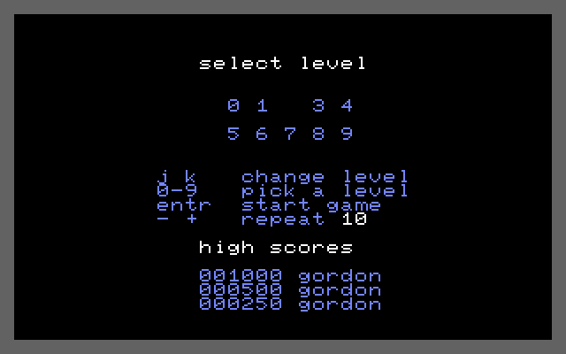

# `gortris` — Tetris

> A full-screen Tetris for the shell, run as `run gortris`. Four attract screens, a level
> select, ten-line levels, three hi scores in the REU filesystem, and its own music.

| | |
|---|---|
| **Binary** | `gortris.tsk` — relocatable, **pinned** (`KF_NOT_EVICTABLE`), **single-instance** |
| **Start** | `run gortris` — **no arguments** |
| **Input** | the keyboard, or a joystick on **control port 2** |
| **Display** | its own surface, whole screen (row 24 included), own colours |
| **Files** | `gortris.hi` (3 × 10 bytes); the tune `tetris.mus` |
| **Libraries** | `filesys.lib` (lazy: the hi-score table) + `sid.lib` (lazy: the music) |
| **Footprint** | 24 code pages + 10 + 13 + a 4-page tune buffer ≈ **51 of the pool's 109 pages** |
| **Source** | `src/tasks/dynamic/gortris.inc`, wrapped by `gortris.asm` |

**Provenance.** The game logic is a port of Wiebo de Wit's `wiebow/tetris.c64` (MIT) — the
reference sources are in `reference/tetris/` and the upstream notes are in
`reference/tetris/UPSTREAM.md`; credit and licence text: [../NOTICE](../NOTICE). The chrome,
the glyph art, the scoring plumbing, the music
and the hi-score file are this port's own: the reference draws in PETSCII, this draws every
cell itself.

**What the port changed** (each one is deliberate, and the reference's own file is the
comment): the collision test answers only in carry; the fall delay is recomputed from the
level rather than adjusted in place; the level select repaints all ten digits instead of
tracking the previous one; a hard drop pays 2 a row, added one row at a time; the game-over
animation holds the filled well; and the hi-score check is here rather than in the reference's
compare flags.




---

## How to use it

### Starting it

```
run gortris          ← attract screens; any key (but q or m) goes to the level select
```

It takes **no arguments**. `? already running` means a copy is live — `ps` will show it.
If every surface slot is taken it prints nothing at all: it idles until you `kill` it, which
is its way of staying visible in `ps` rather than failing silently.

### The screens

| Screen | Shows | Leaves on |
|---|---|---|
| **Attract** (4) | title, credits, the control list, and the level select drawn statically — each held ~20 s | any key except `q` and `m` |
| **Select** | the ten levels in a grid, the flash on the chosen one, the repeat setting, and the hi-score table | RETURN / CRSR / `s` starts; a digit picks a level outright |
| **Play** | the well, the panel, the next-piece box | a piece that does not fit at spawn → game over |
| **Over** | the well fills a row per frame, holds ~3 s, empties, then `game over` / `press key` inside it | a key, but only once the text is up |
| **Hi-score entry** | the select screen with the table and `new high score - entr done` | RETURN (only RETURN) |

`q` quits from **every** screen and `m` toggles the music from every screen — both are
handled before the mode is even looked at.

### Controls

| Key | Does |
|---|---|
| **`j`** / **`k`** | move left / right |
| **`a`** / **`s`** | turn counter-clockwise / clockwise |
| **RETURN** or **CRSR** | step down one row (soft drop) |
| **SPACE** | drop to the floor (hard drop) |
| **`p`** | pause |
| **`q`** | quit |
| **`m`** | music on/off |

On the **select** screen: `0`-`9` pick a level outright, `j`/`k` step the level, `-`/`+`
set the input repeat (1-30, default 10), and RETURN / CRSR / `s` start the game. The chosen
level is remembered for the next game.

The **keyboard repeat is gortris's own**, not the kernel's: a different key acts at once, the
same key is ignored until its timer expires, and the drop keys repeat at **half** the
configured interval. A held `m` is ignored for ~1 s, so it cannot toggle the music five
times a second.

### Joystick (control port 2)

| Stick | Does |
|---|---|
| left / right | move |
| up | turn counter-clockwise |
| down | soft drop |
| fire | turn clockwise — and starts a game from the attract/select screens |

The keyboard is read first; the stick only when the keyboard was empty. **This path has
never been played-tested** — the development machine has no stick — so treat it as
implemented but unverified.

### Pause, and losing the screen

`p` pauses: the field freezes and `paused` appears on the panel. **An F-key switch to the
shell pauses the same way** — the game sets its paused flag, **hushes the music** (twice, to
cover the sliver where the music thread has read the request but not yet taken the SID), and
idles until the display comes back. On return the frame gate is resynced and gravity gets a
full delay before it resumes; the music **starts again from the top of the tune**.

### The panel

```
gortris        ← title
score  123400
lines  37        next  ┌────┐
level  4               │ ■■ │
                       └────┘
j k  move
a s  turn
entr step
spac drop
p q  stop
```

`music off` appears only while the music is muted, and `paused` only while paused — both
belong to the play panel, which is why they are printed by the mode that owns it.

### Hi scores

Three scores in `gortris.hi`, shown on the select screen (and so on the last attract screen).
A qualifying score takes a row and opens the **name editor**: type up to 7 characters, DEL to
take one back, RETURN when you are done. `q` is an ordinary letter there. An exact tie does
**not** displace the score already on the table.

---

## How it works

### The screen

A hires surface in the shell's own mode, taken with the SEI-wrapped `kBlinkReset` +
`kSwitchView` pair so the shell's block cursor is un-drawn before the framebuffer is copied
into its saved image. Colours: field and gutters black, walls and floor dark grey, panel text
light blue, flashes and the title white. **The char shadow is never used** and the kernel
cursor is disabled — it comes on only inside the name editor, and it is switched off *before*
the block is erased there (`kDisableCursor` then `kBlinkReset`), so no IRQ tick can draw it
back.

Geometry: board 10×20 at screen columns 10-19 and rows 3-22, walls at columns 9 and 20, floor
at row 23, panel text from column 23, next-piece box at (10,24). The frame runs the whole
40×25 surface, **row 24 included**.

⚠️ Every fixed cell goes through **`kPrintGlyphAt`**, never `kPrintChar`/`kPrintString`: those
advance the cursor, and writing the last cell of the last row wraps — `wrapClamp` then scrolls
the whole surface, and no re-positioning afterwards puts it back. `gortris` draws its entire
frame, row 24 and all, with the fixed-cell writer for exactly this reason.

### The board, and the pieces

The board is **the authority**: `gtBoard` is 200 bytes in the image (10 × 20, `0` = empty, else
`piece+1`), and the drawn cells are presentation — a collapse or a new game repaints the field
from the board, and nothing ever reads the screen back. `gtRowLo` turns a row into row × 10, so
no multiply is ever needed.

Piece ids 0-6 are **J T L S Z I O**. Each piece is a run of frames **from the reference's own
4×4 art** — J 0-3, T 4-7, L 8-11, S 12-13, Z 14-15, I 16-17, O 18 — and **a rotation is a walk
inside that run** (`s` forward, `a` back), so there is no rotation arithmetic and no wall-kick
table. O has a single frame; I has two. A move is *erase → move → test → put back if it does
not fit*, and a piece that fails the test downward **locks**. Spawn is centred at board column
4-5 — and if the piece does not fit at spawn it is drawn anyway (so you can see why) and the
game is over. **There are no lives.**

### Gravity, levels, scoring

- Gravity moves the piece after `gtFallDelay` displayed frames, where
  `delay = max(4, 70 − 4 × level)` — recomputed from the level rather than adjusted in place,
  because adjusting in place oscillates around the floor of 4.
- **10 lines a level**; each level also adds one to the score multiplier.
- **Line values:** 1 line 40, 2 lines 100, 3 lines 300, 4 lines 1200 — and a line score is
  added **level + 1 times** (the classic table times the level). Soft drop pays 1 a row; hard
  drop pays 2 a row, **added one row at a time** — the count is never doubled with `asl`,
  because `adc` under `sed` needs a valid BCD addend and a doubled binary count is not one.
- Score is 6-digit BCD, and the only arithmetic done on it is BCD addition.
- A clear is the reference's sequence: mark the full rows, flash them **3 times** (solid white,
  blank) at 6 displayed frames each, collapse, repaint.

### Randomisation

There is **no bag**. A new piece is `kRandom & 7`, rejected and retried while it is 7, so the
seven ids stay even. Before a game the generator is **advanced** by `frameCount` steps — human
timing, so runs differ — and the seed is never written: `kRandom` is a Galois LFSR whose state
0 is the lock-up. It deliberately does not sample SID noise, because the music thread may own
the chip.

### The hi-score file

`gortris.hi` is **30 bytes**: three 10-byte records of **3 BCD score bytes (most significant
first) then 7 name cells** — no padding, no terminator. A first session has no file, so the
table starts as three house scores of `001000` / `000500` / `000250`, each named `gordon `.

A score is compared byte by byte from the most significant down, and the check **runs when the
game-over screen is left** — the screen is where the player reads the result. An insert shifts
the rows below the taken slot down and fills the name with `.` placeholders for the editor to
type over.

The save is **find → delete → save**, because `kReuSave` refuses a duplicate name; the
filesystem's delete is a **tombstone** (it frees the name only), so every save costs one
directory slot and 30 fresh bytes, and only `format` reclaims them.

The name editor is a **yielding loop**, not `kReadString` — `kReadString` spins without
yielding, which would freeze the whole machine. It echoes each character itself, accepts the
letters as **screen codes** (`$01-$1A`, and `$41-$5A` shifted), and rejects `$00`, `$1B-$1F`
and `$80+`. DEL needs a **second** cursor move after it prints its `.` placeholder, because
`kPrintChar` always advances one cell: without it every key typed after a DEL lands one cell
right of its slot.

### The music

`tetris.mus` — this port's own three-voice arrangement of *Korobeiniki* — is loaded **once**
by the task (4 pages of `kMalloc`), and played by a **thread child**: `kSidPlay` blocks, so the
game loop cannot call it. The child declares its own ZP window (`$02-$0A`, sid.lib's scratch)
and is handed the tune; it plays with **repeats = 0, which means the player repeats it** —
`tetris.mus` has no HED/TAL loop, which is why `run sidplay tetris` plays once and stops while
the game gets it again and again. Do not add a loop to the file, or the voices never all halt.

Switching the music off is **`kSidHush`, not just a flag** — the child is parked inside the
player's sleep loop and the hush is what breaks it out. Leaving is: set the quit flag, hush,
**reap the child** (up to 60 yields, then `SYS_KILL`), and only then free the tune buffer —
the child may still hold the pointer, and a thread child shares this code page, so it must not
outlive the task. `m` is a player preference: the music stays off across a focus regain or a
mode change.

If another task holds the SID, the child drops the request and the game asks again the next
time it takes the display.

### Timing

Everything is paced on **`frameCount`**, the kernel's display clock, compared for *change* —
never on the scheduler tick, which is 59.2 Hz against a 50.1 Hz display and would sample a
frame 1.18 times, reading as a stutter. It is 8-bit and wraps. All game waits are scaled to the
machine's **declared speed**, so the game plays at the same real pace on a 200 % emulator as on
a real C64, and every wait yields.

### Leaving

`q` → stop and reap the music, hand the display back to the parent (`kSwitchView`), then
`kFreeScreen`, then `SYS_EXIT`. **The hand-over must come first** — freeing the surface while
it is the displayed one leaves the display pointing at a gone screen. `kill gortris` from the
shell is the blunt version: the kill cascade clears the SID for a task that declared `sid.lib`,
so no drone is left behind, but the music child is parked rather than reaped gracefully.

---

## Limits

- **Pinned and single-instance.** It owns the display and holds its board, so eviction is not
  an option — the loader's restore would restart it cold. A second `run gortris` gets
  `? already running`.
- **≈51 of the pool's 109 pages while it is live** (24 code + 10 `filesys.lib` + 13 `sid.lib`
  + a 4-page tune buffer), and it holds both libraries for the whole session because the
  hi-score table has to be *written* — which is what `tools/check-pool-budget.ps1` reports:
  **51** (24 code + 10 `filesys.lib` + 13 `sid.lib` + a 4-page tune block).
- **No lives, and no lock delay:** a blocked soft drop locks on the next frame, and a piece
  that does not fit at spawn ends the game at once.
- **Levels can pass 9 in play** (the delay floors at 4, and the two-digit printer handles
  0-99); the select screen still caps the choice at 9.
- **`tetris.mus` must stay loop-free** — the repetition is the player's.
- **The joystick path is untested.**
- **Pace is frame-based**, so the game runs ~19 % faster on an NTSC machine; at 400 % speed a
  fall delay of 70 frames saturates rather than scaling further.
- **No message if the surface cannot be allocated** — it idles, and `ps` is where you find it.

---

## See also

- [quick-start.md](quick-start.md) — `run gortris` as a shell command
- [lib-sid.md](lib-sid.md) — the player the music child calls, and the SID claim
- [programmers-guide.md](programmers-guide.md) — gortris as the worked example for a music thread child, a yielding prompt and the joystick read
- [writing-relocatable-tasks.md](writing-relocatable-tasks.md) — the flags a pinned, non-re-runnable task sets
- [../reference/tetris/UPSTREAM.md](../reference/tetris/UPSTREAM.md) — the reference this port came from
