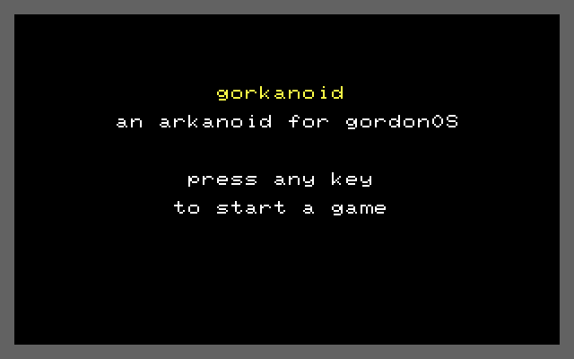

# `grknoid` — Gorkanoid, an Arkanoid for GordonOS

> A full-screen paddle-and-ball game, run as `run grknoid`. Five levels that loop, five
> lives, three hi scores in the REU filesystem, and a SID tune per mode. The title screen
> calls it **gorkanoid**.

| | |
|---|---|
| **Binary** | `grknoid.tsk` — relocatable, **pinned** (`KF_NOT_EVICTABLE`), **single-instance** |
| **Start** | `run grknoid` — **no arguments** |
| **Input** | the keyboard, or a joystick on **control port 2** |
| **Display** | its own hires bitmap surface, whole screen, border blue |
| **Files** | `grknoid.hi` (3 × 10 bytes); the sheets `gkpad.spr` / `gkball.spr`; the tunes `katmand.mus`, `immig.mus`, `firstdt.mus` |
| **Libraries** | `sprite.lib` (eager) + `filesys.lib` and `sid.lib` (lazy) |
| **Footprint** | 19 code pages + 1 + 13 + 10 + an **18-page** tune buffer ≈ **61 of the pool's 109 pages** |
| **Source** | `src/tasks/dynamic/grknoid.inc`, wrapped by `grknoid.asm` |

**Provenance.** Unlike `gortris`, nothing here is ported: the game, the art and the chrome
are this tree's own, which is why no upstream source sits in `reference/`. Its **music** is
not this tree's — the three `.mus` files are Compute's Gazette Sid Collection tunes played as
published, credited in [../NOTICE](../NOTICE).




---

## How to use it

### Starting it

```
run grknoid          ← attract screens; any key starts a game
```

It takes **no arguments**. `? already running` means a copy is live. If every surface slot
is taken it prints nothing and idles — it is still there in `ps`.

### The screens

| Screen | Shows | Leaves on |
|---|---|---|
| **Attract** (4) | title, controls, credits, and the hi-score table — each held ~20 s | any key starts a game |
| **Play** | the frame, the HUD, the wall, the paddle and the ball | the last life → game over; `q` quits |
| **Paused** | `paused` at row 18 over the field frozen | `p` |
| **Over** | `game over`, the final score, `press key` | a key, or the one-shot tune ending |
| **Hi-score entry** | the table and `new high score - entr done` | **RETURN only** |

`q` quits from every screen. The sprites are switched off on the attract and game-over
screens, so only the play screens drive the paddle and ball.

### Controls

| Key | Does |
|---|---|
| **`j`** / **`k`** | paddle left / right (held) |
| **SPACE** | serve the ball (and nothing else — the ball serves to the right, upward) |
| **`p`** | pause on/off |
| **`q`** | quit |

A **direction is a level**: while it is held the paddle moves every motion frame. A
**button is an edge**: the action comes from the newly-pressed bits, so one press is one
action and a held key cannot retrigger — which is why a held SPACE serves once.

The paddle reads `keybHeld` rather than key events: the kernel's repeat cadence (~10 a
second) would make a single press step several times and would follow the emulator clock,
so `keyrpt` must not be retuned while a game is on.

### Joystick (control port 2)

Left, right and fire, read as three separate bits so left and right are distinguishable
within one frame. As with `gortris`, **this path has never been played-tested** — the
development machine has no stick.

### The play screen

```
score 00000        bricks 48          lives 5    lev 1
 ┌──────────────────────────────────────────────┐
 │ ▓▓▓▓  ▓▓▓▓  ▓▓▓▓  ▓▓▓▓  ▓▓▓▓  ▓▓▓▓  ▓▓▓▓  ▓▓▓▓ │   ← 6 rows of 8 bricks
 │                                              │
 │                                              │
 │                  ●                           │
 │                 ▄▄▄▄▄▄                       │
 └──────────────────────────────────────────────┘
```

- **The wall is 48 bricks** (8 across, 6 rows), and **each brick's colour and pattern say how
  much is left**: 3 hits solid, 2 chipped, 1 cracked, 0 blank. The hues alternate in a
  chequerboard — (yellow, cyan), (light green, green), (red, orange) — so two neighbouring
  bricks of the same strength are never the same colour.
- **The ball pulses** through a five-shade ramp as it travels, one shade every 8 frames: it is
  presentation only, and every collision test is colour-blind.
- **The paddle accelerates**: a fresh press moves 1 px a frame, and holding the same direction
  gains a gear every 16 frames up to 3 px a frame. Letting go or reversing drops it straight
  back to 1, so the speed is in your hands rather than in a physics model.

### Scoring, lives and levels

| Event | Points |
|---|---|
| A brick broken outright | **10 × the level** — 10, 20, 30, 40, 50 |
| A hit that damages a brick | 5 |

**Five lives.** A life is lost when the ball's top edge reaches the death line at the bottom
of row 24 — one pixel row under the paddle. The wall, the score and the level survive: only
the life and the ball change, and the ball goes back onto the paddle ready for SPACE.

**Clearing the wall moves to the next level** — five levels, and **the fifth wraps back to
level 1**: there is no victory state. Each level brings a new wall *and* a faster serve. The
launch angle never changes, only the speed, and the serve always goes to the right.

| Level | Wall | Ball vx |
|---|---|---|
| 1 | every brick 1 hit | 0.75 px/frame |
| 2 | a hard top row over single-hit bricks | 0.94 |
| 3 | a chequerboard of 1s and 2s | 1.13 |
| 4 | 3s and 2s above 1s — softest at the bottom | 1.31 |
| 5 | hard corners around a soft middle | 1.50 — twice level 1 |

### Hi scores

Three scores in `grknoid.hi`, shown on the last attract screen and on the entry screen. A
qualifying score takes a row and opens the **name editor** — the same 7-character editor as
`gortris`'s (deliberately shared in shape: 3 BCD score bytes then 7 name cells). DEL takes a
character back, RETURN finishes, and **RETURN is the only way out** — this screen never times
out, because it is data entry and `q` is just a letter here. An exact tie does not displace
the score already on the table.

### Music

Three tunes, **one per mode**:

| Mode | Tune | Plays |
|---|---|---|
| attract | `katmand` | repeats |
| play | `immig` | repeats |
| game over | `firstdt` | **once** — and that one pass *is* the game-over screen's clock |

On the game-over screen the game waits for the tune to finish rather than for a countdown;
the countdown is only the fallback for when there is no tune to wait for, so the screen
leaves when the music says so (or at once on a key). Losing the display freezes the game but
**lets the music play on** — deliberate, and the opposite of `gortris`, which hushes on the
way out.

---

## How it works

### The screen

A hires bitmap surface in the shell's own mode (border blue, backgrounds black), taken with
the SEI-wrapped `kBlinkReset` + `kSwitchView` pair, so the shell's block cursor is un-drawn
before the framebuffer is copied into its saved image. The kernel cursor is disabled; it
comes on only inside the name editor, and is switched off *before* the block is erased there.

The play field's frame is the top row plus the two side columns down to row 24, at cell
columns 0 and 39. The death line is one pixel row drawn across row 24 — where a lost ball
lands, right under the paddle. The attract screens use a **closed** box instead (all four
sides), because they are not a play field.

⚠️ Every fixed cell goes through **`kPrintGlyphAt`**. A cursor-carrying print advances, and
writing the last cell of the last row wraps — `wrapClamp` then scrolls the whole surface, and
no re-positioning afterwards puts it back. The wall, the frame, the death line and the HUD are
all drawn cell by cell for that reason.

The cell grid is in sprite coordinates throughout: column 0 is sprite x 24, row 0 is sprite y
50, and **sprite y is one less than the raster line** — which is why the ball's bounds are 65
and 249 rather than 66 and 250.

### The wall is a table, not the screen

`gkBoard` — 48 bytes in the task image — is the authority: **0 a gap, 1-3 the hits left**, and
the drawn cells are presentation. A level is **24 bytes of nibbles**, two bricks a byte, so the
five walls cost 120 bytes in the image, and a level is decoded into the board *and* the screen
when it starts.

A brick hit drops a hit point, and at zero the brick is counted out and blanked. Its response
comes from **which axis the hit cell differs from the ball's centre cell** — a different column
reverses `vx`, a different row `vy`, a corner both. (Reversing `vy` alone would be cheaper and
is wrong: a ball entering a brick's side would be sent back where it came from.) A box that is
already *inside* a brick — reachable when a new wall is built around a still ball — reverses
both axes.

### The paddle

Sprite 0, `gkpad.spr`, **X-expanded**: 24 px of art drawn 48 px wide. Its position is stored as
`x − 32`, so the whole 32..287 run fits one byte and the ninth bit of x is the carry out of the
add that rebuilds it. The art is a bar at the **top** of the sprite box, which is the surface
the ball meets.

The step is 1 px on a new press and gains a gear every **16 frames** the *same* direction is
held, to 3 px. Two details make that work: the counter remembers **which direction it belongs
to**, so a release resets the step even though "nothing held" matches neither direction; and
the gear tick is a power of two tested on the counter's low bits, not a compare. The rate is
deliberate — 16 frames is ~0.32 s, and the next step up (32) reads as twitchy. **The maximum is
a time budget, not taste**: a ball descent is 168 px, and a 3 px step crosses the field in 85
frames; the step also may not exceed the paddle's own width, or it could skip the ball.

### The ball

Sprite 1, `gkball.spr` — an 8×8 disc in the sheet's **top-left corner**, so the sprite position
*is* the collision box and no offset arithmetic exists anywhere. Position is 8.8 fixed point
with the sign carried through every byte above the fraction; the integration is a straight
`adc` chain and a bounce is a two's-complement negation, so there is no multiply, divide or
square root anywhere — `fp.lib` is not needed.

The launch takes the level's `vx` and **derives `vy = −2·vx`**, which holds the angle constant
while the speed ramps. Level 1's `vx` is exactly the floor used after a paddle hit, which is
what makes a dead-centre bounce from level 1 the same speed as the serve. Level 5's `vy` is
3.0 px/frame, asserted to stay under 8 so the ball cannot skip an 8-px brick cell.

### The bounce

- **Only a descending ball is tested** — otherwise the paddle re-triggers on the next frame.
- The ball is tested while its top edge is in the 13-row band around the paddle's bar, chosen
  so that even the fastest fall cannot skip it.
- On a hit: mirror `vy` (up, same speed), **lift the ball clear** so the overlap cannot
  re-trigger, and then bend it. The bend is `(d − bias) × 8`, where `d` is the ball's centre
  minus the paddle's centre and `bias` is the paddle's half-width less the ball's radius — so
  the **paddle's centre sends the ball nearly straight up** and its edges send it away at up
  to ~0.8 px/frame, which is the classic Arkanoid feel.
- **English**: the ball keeps the `vx` it arrived with, and the direction the paddle *actually
  travelled this frame* adds or subtracts a **fixed 0.5 px/frame**. Fixed, never a share of
  the paddle's step, and from the **direction** rather than the distance — so a faster paddle
  does not kick harder, it only arrives sooner.
- `|vx|` is **capped at 3.0** (a player chasing the ball would otherwise ratchet it up for
  ever) and **floored at 0.75**, applied to the sum's own sign — so a bounce never climbs
  straight up, and a reversal is never floored back the way it came.

### Lives, and the level wrap

The ball's top edge reaching the death line costs a life; at zero the game ends. Otherwise the
ball is parked back on the paddle. Clearing the wall advances the level, and **level 5 wraps to
level 1** — the five walls loop.

### The music

One **thread child** plays all three tunes, for the same reason `gortris` has one: `kSidPlay`
blocks, so the game loop cannot call it. The child declares its **own** ZP window (`$02-$0A`,
sid.lib's scratch) — a parent's window cannot protect a child's.

Its buffer is **one 18-page `kMalloc` block, taken once at startup and freed on quit** — the
size of the largest tune. Cycling 18/4/2-page blocks through the pool on every mode change
would fragment it until the *largest* request failed, so the block is held for the session
instead; the parent owns it and the child only ever loads *into* it. A tune that will not load
— missing, unreadable, or **bigger than 18 pages** — is **refused rather than allowed to
overflow the block**, and the child falls back to the attract tune once, then to silence. It
does not retry on a timer, and none of this ever prints an error: the worst case is a quiet
game.

Switching tunes is `kSidHush` **plus** a changed request — the child is inside the player's
sleep loop, so only the hush makes it return and re-read. The child notes which tune is loaded
**only after a successful load**, so a failed load leaves the previous bytes playing. If
another task holds the SID, the child keeps its tune, pauses ~1 s and asks again.

Leaving is ordered: set the quit flag, hush, **reap the child** (20 yields, then `SYS_KILL`),
then free the buffer — the child shares this code page and must not outlive the task, and
freeing first would leave it holding a freed pointer.

### Timing

Everything is paced on **`frameCount`** — the display's own clock, compared for change, never
the scheduler tick (59.2 Hz against 50.1 Hz reads as a stutter; the counter is 8-bit and
wraps). On a faster machine the game **skips frames** rather than moving everything a shorter
distance, and the ball and paddle skip the *same* frames, so their order within a frame is
always the 100 % order. Countdowns are scaled as they are **set**, not as they are counted.
Every loop yields.

### Leaving

Stop and reap the music, free its buffer, hand the display back to the parent, `kFreeScreen`,
`SYS_EXIT` — the hand-over before the free, because a freed surface that is still the
displayed one leaves the display pointing at nothing. Sprites need no teardown: they are
switched off per screen, and the kernel swaps the whole per-task sprite state with the display.

---

## Limits

- **Pinned and single-instance.** Pinning is the point: an eviction would cold-restart a live
  game. A second `run grknoid` gets `? already running`.
- **≈61 of the pool's 109 pages at peak** (19 code + 1 `sprite.lib` + 13 `sid.lib` + 10
  `filesys.lib` + the 18-page tune buffer). `tools/check-pool-budget.ps1` reports **61** for
  it, the tune block included: 19 code + 1 `sprite.lib` + 10 `filesys.lib` + 13 `sid.lib`
  + the 18-page `kMalloc`.
- **The joystick is implemented but untested.**
- **Five levels, then back to level 1** — there is no win screen.
- **A tie does not displace a hi score**, and **every hi-score save appends**: the filesystem's
  delete is a tombstone, so each save costs a directory slot and 30 fresh bytes, and only
  `format` reclaims them.
- **A tune larger than 18 pages is silently refused** — a bigger `.mus` needs the buffer raised
  and gortris-style re-checking.
- **The name-entry screen cannot be escaped except with RETURN** (`q` types a letter).
- **Losing the display freezes the game but the music keeps playing** — unlike `gortris`.
- **The launch always goes up and to the right.**
- **The brick colouring assumes eight bricks a row** — widening the wall means changing the
  chequerboard derivation with it (there is an assert on it).
- **No message if the surface cannot be allocated** — it idles, and `ps` is where you find it.

---

## See also

- [quick-start.md](quick-start.md) — `run grknoid` as a shell command
- [lib-sprite.md](lib-sprite.md) — the sprite calls the paddle and ball are built on, and how the state is swapped with the display
- [lib-sid.md](lib-sid.md) — the player the music child calls, and what happens when another task holds the chip
- [../NOTICE](../NOTICE) — the Compute's Gazette Sid Collection credit for the three tunes
