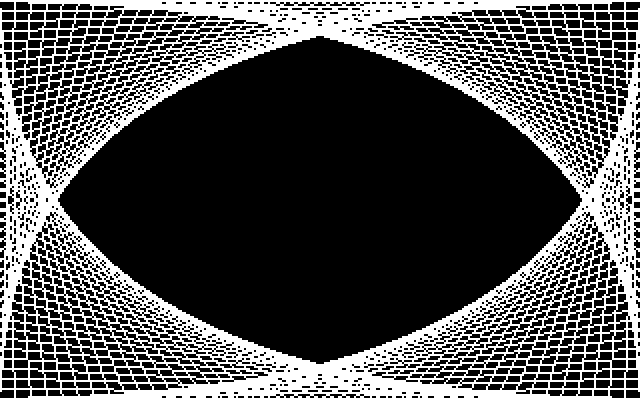

# `gfx.lib` — Library Reference




Bitmap drawing: pixel plot, lines, boxes, circles/ellipses, flood fill,
and pixel-positioned glyph text. The kernel's graphics group routes
straight through this lib.

| | |
|---|---|
| Lib ID | 2 |
| Entries | 13 (`plot`, `line`, `box`, `fillBox`, `circle`, `ellipse`, `floodFill`, `getPixel`, `clearBitmap`, `setGfxColor`, `char`, `string`, `fillMatrix`) |
| Load policy | **eager** — declare `libMask` bit 2 (value `$0004`) in your task header |
| Call indices | 12–24 (jump entries patched via `libJumpLo/Hi` + `libInitLo/Hi`) |
| Kernel entry points | `kPlot` ($E0C3), `kLine` ($E0C6), `kBox` ($E0C9), `kFillBox` ($E0CC), `kCircle` ($E0CF), `kEllipse` ($E0D2), `kFloodFill` ($E0D5), `kGetPixel` ($E0D8), `kClearBitmap` ($E0DB), `kSetGfxColor` ($E0DE), `kGfxChar` ($E0E1), `kGfxString` ($E0E4), `kFillMatrix` ($E10A) |
| Source | `src/libs/gfx.asm` |

## Calling

The kernel jump-table entries for the graphics group are **eager** — each
is `jmp libTrap` until `gfx.lib` loads, when `libLoad` patches it in place
to `jmp <routine>`. There is no lazy stub. That means:

- **`gfx.lib` must be resident before you call.** Declare `libMask` bit 2
  (`$0004`) in your task header (eager load at spawn), or ensure another
  resident task has it loaded. If the lib is not loaded the entry is still
  `jmp libTrap` (returns with C=1).
- All drawing acts on **the calling task's own bitmap** (`curTask`).
  If the task has no bitmap surface (`screenKind` < `BMPMODE_STD`), the
  calls are no-ops.
- If the task's surface is currently displayed, pixels are written to the
  live C64 bitmap; otherwise they go to the task's REU surface slot and
  appear when the surface is shown (`kSwitchView`).
- Every entry does its own `sei`/`cli` — callers need no SEI/CLI.
- Pixels outside the visible area (hires x ≥ 320, MC x ≥ 160, y ≥ 200)
  are silently dropped by the pixel writer.

## Coordinates and color

- **X** is 16-bit (`lo`/`hi`) in most calls; 0–319 valid. **Y** is 0–199.
- **Color** is passed in **A**: `0` clears, `1–15` sets the pixel. The
  pixel writer does NOT write the matrix — pre-fill the matrix (and colour
  RAM) first. In standard (hires) mode the pixel is 1 bit, so the *curve*
  is monochrome; the matrix high nibble colours `1`-bits and the low
  nibble colours `0`-bits.
- Multi-color mode (`screenKind = BMPMODE_MC`) uses 2-bit values `0–3`:
  `0` → `$D021`, `1` → matrix high nibble, `2` → matrix low nibble,
  `3` → colour RAM (`$D800`). Pre-fill with `kFillMatrix` (packed byte
  `(v1<<4)|v2`) and `kFillColorRam` (v3).
- **Pixel op.** `kSetGfxColor` selector 4 sets a mode byte the pixel writers
  honour: `0` (the default) sets or clears on the colour, non-zero **XORs** the
  pixel. Every entry that writes pixels honours it — plot, line, box, fill box,
  circle and ellipse — so one shape drawn twice with the op set comes off the
  picture again, which is what a live preview needs (no copy of the surface, no
  saved band of bytes). The op is **kernel** state, not per-task: set it, make
  the call, clear it. In multi-color mode the XOR is on the pixel's 2-bit
  **value**, and the value the call carries is what is XORed into it — the second
  pass restores the value exactly, while the colour the toggled pixel shows is the
  cell's colour for `value XOR k`: the pen's colour over background, another of
  the cell's sources over drawn work, and nothing where that lands on 0. An MC
  call with `A = 0` toggles nothing.

## Entries

### `kPlot` — set/clear a pixel

- **Input:** `X` = column low byte, `Y` = row (0–199), `A` = color
  (hires: 0 = clear, 1–15 = set; MC: 0–3 = 2-bit value), **Carry** = column high byte
  (0 = col 0–255, 1 = col 256–319).
- **Output:** none.
- **Clobbers:** A, X, Y, `kPtr`; `kArg`+0…+7 when writing to a REU slot.

```asm
lda #1                  // white
clc                     // col < 256
ldx #lo(col)
ldy #row
jsr kPlot
```

### `kLine` — Bresenham line (all octants)

- **Input:** `A` = color; `kArg`+0/1 = X1 (lo/hi), `kArg`+2 = Y1,
  `kArg`+3 unused, `kArg`+4/5 = X2, `kArg`+6 = Y2.
- **Output:** none.
- **Clobbers:** A, X, Y, `kPtr`; `kArg` block when drawing to a REU slot.
- **⚠️ x is UNSIGNED 16-bit and only the POSITIVE end is clipped.** A negative
  x (`$FFxx`) is read as "x >= 256": the walk goes the long way round -- tens
  of thousands of steps, with SEI held for all of them -- and `gxPix` plots it
  at column `256 + lo` whenever the low byte is under 64, so a segment running
  off the LEFT edge streaks pixels along the right of that row. Clip negative x
  in the caller (bit 7 of the high byte is set only for a negative x), or draw
  somewhere x cannot go negative.
- **⚠️ Load `kArg` and call in ONE IRQ-free window.** The timer IRQ's
  per-switch cursor sync rewrites `kArg`+4 -- X2's low byte -- so an
  unprotected load-then-call can be preempted and hand this routine a
  corrupted endpoint.

```asm
lda #1                  // color
lda #<x1; sta kArg
lda #>x1; sta kArg+1
lda #y1; sta kArg+2
lda #<x2; sta kArg+4
lda #>x2; sta kArg+5
lda #y2; sta kArg+6
lda #1
jsr kLine
```

### `kBox` — rectangle outline

- **Input:** `A` = color; `kArg`+0/1 = X1, `kArg`+2 = Y1,
  `kArg`+4/5 = **width**, `kArg`+6 = **height** (1-based; the box spans
  X1…X1+width−1 and Y1…Y1+height−1).
- **Output:** none.
- **Clobbers:** A, X, Y, `kPtr`; `kArg` block on REU paths.
- **Notes:** pixels only — the matrix is not written, so in hires the shape
  shows the colour its cells already carry. A caller that wants the shape in
  an ink of its own must set those cells itself, one `kPlot` per cell the
  shape crosses (the rule under *Coordinates and color*).

### `kFillBox` — filled rectangle

- **Input / output / clobbers:** identical to `kBox`, but the interior is
  filled.

### `kClearBitmap` — clear the task's bitmap

- **Input:** `A` = pixel fill byte — `$00` clears all pixels, `$FF` sets
  all pixels; the color matrix is always zeroed.
- **Output:** none.
- **Clobbers:** A, X, Y, `kPtr`, `kArg`+0…+4.
- **Notes:** fastest way to blank the surface (REU fill); works on the
  displayed surface or the task's slot.

### `kCircle` — midpoint circle (8-way symmetry)

- **Input:** `A` = color (0=clear, 1-15=set pixel bit); `kArg`+0/1 = centre X
  (lo/hi), `kArg`+2 = centre Y (0-199), `kArg`+3 = radius (0-255).
- **Output:** none.
- **Clobbers:** A, X, Y, `kPtr`, `kArg` block.
- **Notes:** 16-bit decision term (exact for all radii); `R=0` plots the
  centre pixel. Off-screen pixels are clipped. Writes the pixel bit only
  (no matrix nibble) — pre-fill the matrix. Holds SEI for the whole loop;
  displayed surface → framebuffer, background → REU slot. Honours the pixel
  op in both paths, so a circle drawn with the op set toggles its rim.

```asm
lda #160; sta kArg       // centre X lo
lda #0;   sta kArg+1     // centre X hi
lda #100; sta kArg+2     // centre Y
lda #50;  sta kArg+3     // radius
lda #1                   // colour
jsr kCircle
```

### `kEllipse` — midpoint ellipse (4-way symmetry)

- **Input:** `A` = color (0=clear, 1-15=set pixel bit); `kArg`+0/1 = centre X
  (lo/hi), `kArg`+2 = centre Y (0-199), `kArg`+3 = RX (0-255), `kArg`+4 = RY
  (0-255).
- **Output:** none.
- **Clobbers:** A, X, Y, `kPtr`, `kArg` block.
- **Notes:** 32-bit decision terms (exact for all radii); `ry=0` draws a
  horizontal line, `rx=0` a vertical line. Off-screen pixels are clipped.
  Writes the pixel bit only (no matrix nibble) — pre-fill the matrix.
  Holds SEI for the whole loop; displayed surface → framebuffer, background
  → REU slot. Honours the pixel op in both paths, so an ellipse drawn with
  the op set toggles its rim.

```asm
lda #160; sta kArg       // centre X lo
lda #0;   sta kArg+1     // centre X hi
lda #100; sta kArg+2     // centre Y
lda #160; sta kArg+3     // RX
lda #100; sta kArg+4     // RY
lda #1                   // colour
jsr kEllipse
```

### `kFloodFill` — scanline flood fill (hires + MC)

- **Input:** `A` = fill color (0=clear bit, nonzero=set bit; MC: 2-bit
  value 0-3); `kArg`+0/1 = seed X (lo/hi), `kArg`+2 = seed Y (0-199).
- **Output:** none.
- **Clobbers:** A, X, Y, `kPtr`, `kArg` block.
- **Notes:** Fills the contiguous region whose pixels match the seed bit,
  replacing them with the fill bit (boundary = the other bit; fills
  `clear→set` or `set→clear`). In MC mode the fill treats matching 2-bit
  nibbles as the same colour. 768 B span-seed stack (X lo, X hi, Y) in
  kernel data, bounded at 255 entries. Writes the pixel bit only (no
  matrix nibble) — pre-fill the matrix. Holds SEI for the whole fill.

```asm
lda #160; sta kArg       // seed X lo
lda #0;   sta kArg+1     // seed X hi
lda #105; sta kArg+2     // seed Y
lda #1                   // fill colour
jsr kFloodFill
```

### `kGetPixel` — read a pixel (hires + MC)

- **Input:** `X` = column low byte, `Y` = row (0-199), **Carry** = column
  high byte (0 = col 0-255, 1 = col 256-319; MC: col 0-159, Carry ignored).
- **Output:** `A` = 0 (pixel clear) or non-zero (pixel set — the bit
  mask); in MC mode `A` = the 2-bit pixel value (0-3). `Carry` = 0 if
  valid, 1 if no surface / off-screen (A = 0 then).
- **Clobbers:** A, X, Y, `kPtr`, `kArg` block (REU path).

```asm
ldx #160               // column lo
ldy #105               // row
clc                    // column < 256
jsr kGetPixel          // A = 0 (clear) or non-zero (set)
```

### `kSetGfxColor` — set a per-task VIC colour, or the pixel op

- **Input:** `X` = selector (0 = border `$D020`, 1 = background
  `$D021`, 2 = `$D022`, 3 = `$D023`, **4 = the pixel op**); `A` = the value
  (colour 0-15, or the op value for selector 4).
- **Output:** none.
- **Clobbers:** A, X, Y, `kPtr`.
- **Notes:** selectors 0-3 write the calling task's
  `taskGfxBorder`/`Bg0`/`Bg1`/`Bg2` entry (applied by `doGfxSwitch` on view
  switch). When `curTask == kbFocus` the hardware register is also written
  immediately. `X=2`/`X=3` require `screenKind[curTask] == BMPMODE_MC`; in std
  mode they are no-ops. **Selector 4 is not a VIC register** — it is the pixel
  write op: `A=0` sets/clears on the colour, non-zero XORs the pixel. It is
  kernel state, not per-task, and the scheduler clears it on every context
  switch, so set it, make the drawing call, and clear it. **`X >= 5` is
  rejected (no-op)** — the per-task offset `selector*24` would leave the
  four-array colour block. Only `$D020` and `$D021` are read by the VIC in
  bitmap modes — `$D022`/`$D023` are written but never read (extended-colour
  mode, which GordonOS does not use). The multicolor palette is `$D021`
  (value 0), the matrix nibbles (values 1/2) and colour RAM (value 3).

```asm
lda #7                // yellow
ldx #0                // border
jsr kSetGfxColor      // border ← yellow now (if focused)
```

```asm
lda #1                // op = XOR
ldx #4                // the pixel op, not a VIC register
jsr kSetGfxColor
// ... kBox / kCircle / kFillBox here: the shape toggles its pixels ...
lda #0                // back to set/clear
ldx #4
jsr kSetGfxColor
```

### `kGfxChar` — glyph at an arbitrary pixel position

Draws an 8×8 font glyph with its top-left corner at pixel (x, y), plotting
**only the glyph's set pixels** — the background is transparent and existing
pixels are never cleared (OR). In hires the glyph is 8×8 and drawn in the
set-pixel colour; in MC it is 8 wide × **16 tall** (each glyph row drawn
twice, so the aspect ratio matches the double-width MC pixels) and drawn in
a 2-bit colour 0–3.

- **Input:** `X` = char (screen code), `A` = colour (hires 1–15, MC 0–3);
  `kArg`+0/1 = x (lo/hi), `kArg`+2 = y.
- **Output:** none.
- **Clobbers:** A, X, Y, `kPtr`, `kArg` block.
- **Notes:** off-screen pixels clip (hires x < 320, MC x < 160, y < 200).
  Reads the REU-only font — glyph DMA'd from the FS (`fontRec*` record,
  switched by the shell's `setfont`).

```asm
lda #0; sta kArg       // x lo
lda #0; sta kArg+1     // x hi
lda #50; sta kArg+2    // y
lda #1                 // colour (hires 1-15; MC 0-3)
ldx #'A'               // screen code
jsr kGfxChar
```

### `kGfxString` — string at an arbitrary pixel position

Prints a null-terminated screen-coded string, one char at an 8-pixel
horizontal pitch, via `kGfxChar`. Same transparent/OR behaviour and the
same hires/MC rules (MC height doubling) as `kGfxChar`.

- **Input:** `A` = colour (hires 1–15, MC 0–3); `kArg`+0/1 = x (lo/hi),
  `kArg`+2 = y; `kPtr` = null-terminated screen-coded string.
- **Output:** none.
- **Clobbers:** A, X, Y, `kPtr`, `kArg` block.

```asm
    lda #<msg; sta kPtr
    lda #>msg; sta kPtr+1
    lda #0; sta kArg; sta kArg+1   // (0,0)
    lda #0; sta kArg+2
    lda #2                         // colour
    jsr kGfxString
...
msg: .text "HELLO"; .byte 0
```

### `kFillMatrix` — fill the whole video matrix

- **Input:** `A` = raw byte to write into all 1000 matrix slots. For MC
  bitmap pack both nibbles: `(value-1 colour << 4) | value-2 colour`.
- **Output:** none.
- **Clobbers:** A, X, Y, `kPtr`, `kArg`.
- **Notes:** displayed surface → framebuffer matrix `$0400`; background →
  REU slot `+$2000`. The VIC reads the high nibble for MC pixel value 1
  and the low nibble for value 2.

```asm
lda #$57               // value-1 = 5 (green), value-2 = 7 (yellow)
jsr kFillMatrix        // every cell's matrix byte ← $57
```

## Example — pixel-by-pixel curve (from `fpdemo`)

```asm
// plot (xlo, y) — carry = col hi
    lda #1                  // white
    lda xhi
    clc
    beq fpPlotGo
    sec
fpPlotGo:
    ldx xlo
    ldy y
    jsr kPlot
```

See also [`dynamic-libraries.md`](dynamic-libraries.md) for the loader
side and `gfxdemo`/`fpdemo` sources for full consumers.
