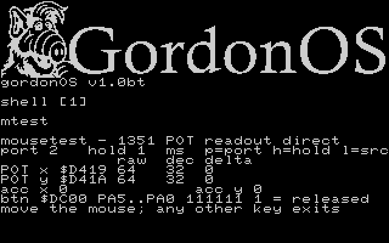

# `mouse.lib` — the Commodore 1351



The proportional mouse, read through the SID's analog POT lines. **Control port 2
is fixed** — a 1351 in port 1, and the 1350/joystick, are out of scope; the target
machines are VICE and the C64 Ultimate, both of which can present a 1351. VICE needs
two flags for it (`-controlport2device 1351` for the device, `-mouse` for the
host-pointer grab, since the device alone leaves the POT bytes frozen); the Ultimate
gives it either from a real 1351 on a joystick port — the board handles the POT lines
itself — or from a **USB mouse**, which the machine presents to the C64 as a 1351.
While VICE runs, **Alt-M** toggles that grab on and off (`Command-M` on macOS — VICE's
`mouse-grab-toggle` hotkey).

Two halves are deliberately separate, and the split is the whole design:

| | where | what |
|---|---|---|
| the **device** | `mouse.lib` (lib id 8, call index 41 `kMouseCall`) | reads the hardware and publishes signed deltas against the position it remembers. No policy, and it never reads `mouseKind` |
| the **policy** | the `mouse` command → the kernel byte `mouseKind` (`$E530`, 0 = off, 1 = 1351) | *whether* this machine has one, which the consuming task reads at start-up |

The library is **one dispatching call** — `kMouseCall` (call index 41), eager,
opcode in `A`, the `kFpCall` pattern — because the call-index space is spent: one
entry leaves the room a later addition needs, and a second would nearly exhaust
it. The opcodes and the `kArg` field offsets are in `src/libs/mouse.inc`.

| opcode | out |
|---|---|
| `MOUSE_READ` | `kArg+0..3` = raw x, raw y, **signed** delta x, **signed** delta y; `A` = the buttons (PA5..PA0, 1 = released); `C=0`. `C=1` = the reader is disabled and nothing was written |
| `MOUSE_ENABLE` | start tracking: the next read primes the position and reports delta 0, so a consumer never sees a jump |
| `MOUSE_DISABLE` | stop tracking; `MOUSE_READ` then refuses |

Anything else in `A` returns `C=1` and changes nothing. `kArg` is a per-call
scratch, so a consumer copies the block immediately and keeps what must survive in
its own instance data.

Three properties matter to a consumer, and each is a deliberate choice:

- **The state is PER TASK.** A library's `.byte` variables are one copy for every task
  that declares it, so the reader keeps one 4-byte record per task, indexed by
  `curTask`: the flags, the last position each axis was sampled at, and the button byte
  that sample read. That is what lets **two tasks read the mouse at once** — a pot
  reports an ABSOLUTE position, so each reader differences against its own last sample
  and neither one consumes the other's movement. The device is still one stream: two
  readers see the same travel, which is the truth of one mouse. A consumer that wants
  its own total integrates the deltas itself, which is also what lets it clamp.
- **`MOUSE_ENABLE` and `MOUSE_DISABLE` are per task too**: one task stopping does not
  stop another, and a task that is enabled and then disabled does not disturb the task
  beside it. A hidden instance keeps tracking (its own pointer follows the mouse while
  its screen is not the displayed one), which is what makes a display hand-over land the
  pointer where the mouse is rather than where it was when the task lost the screen.
- **The delta is signed** (−32..+31). The reported position is mod 64, so the
  direction is ambiguous at 32: values 33..63 are one step *back*, folded to
  −31..−1. `& $3f` recovers the unsigned distance for a display.- **The two axes do not share a handedness.** `MOUSE_DELTA_X` increases to the
  right, but `MOUSE_DELTA_Y` increases *toward the top* of the picture -- the
  opposite of the screen's row index. A consumer that folds both deltas the same
  way moves its pointer vertically backwards; `grpaint` negates the y one before
  folding it (`eor #$ff` / `clc` / `adc #1`) -- see [gordonpaint.md](gordonpaint.md). The library reports the device as it
  finds it and leaves the picture's orientation to the consumer.
- **A single reading can be one count high.** VICE adds a random 0-or-1 to every
  pot sample it latches (`makepotval`, `src/sid/sid.c`). That is aimed at the raw
  byte's low bit -- the 1351's qualifier, which the decode drops -- but a +1 on an
  **odd** byte carries into the position field, so a sample can decode one count
  high. The noise only ever ADDS, so a consumer removes it by taking the
  **smallest** reading over a window and moving by the change in that, rather than
by the newest reading: `grpaint` does exactly that over one displayed frame.
A median or a debounce cannot -- a level noise at half duty
  is indistinguishable from a genuine one-count move.- **A read holds CIA #1 port A for ~570 cycles**, inside `SEI` (the read sequence
  below). One keyboard scan is skipped, and a raster commit that lands past its
  deadline misses a frame; both recover on the next tick.

`mousetest.asm` exercises both paths: its `l` key switches between the direct read
above and `mouse.lib`, so the two fill the same fields and a disagreement is
visible field by field on the screen. It declares `LIB_MOUSE` for that and still
never reads `mouseKind` — and neither does the library, which is what keeps the
device and the policy apart.

## The `mouse` command

The policy side is one command, in the mould of `speed` / `blink` / `keyrpt`:

```
mouse 1351      set the machine's pointer to a 1351 (writes mouseKind = 1)
mouse off       back to the default (mouseKind = 0)
mouse           print the current setting: "mouse 1351" or "mouse off"
```

Setting it is silent. Anything unrecognised prints `? mouse 1351 off` and leaves
the byte alone — the word's **end** is checked, so `13513` and `offside` are
refused rather than read as `1351` and `off`. Both printed forms — the setting and
the refusal — end with a blank line, like the other setting commands.

`mouseKind` is a kernel byte (`$E530`), not task state: the writer is a command
that exits and the reader is a task that starts later. It rides in the keyboard
block's address-stability sled, so it costs the kernel no space and no task
allocates it (`src/tasks/kernel-data.inc` aliases it).

**The kernel's default is `off`**: a program
that needs a 1351 refuses to start with a message rather than running with a frozen
pointer. `boot.bat` is where a machine declares what it has, so the shipped image
carries `mouse 1351` and the pointer is live from the first prompt; delete that
line to go back to the default. `speed` is declared in the same file the same way
-- and `build-reu.ps1` rewrites only the `speed` line, so the `mouse` one is
however you leave it. Nothing else persists the setting.

## Checked facts

These are what the code may rely on, and the register pair is the one that is
easiest to get wrong.

| fact | value | source |
|---|---|---|
| POT registers | **`$D419` (POT X) / `$D41A` (POT Y)** — *one* pair, whichever port the select has routed to them | VICE `sid/sid.c`: the pots are sampled and returned only `if (chipno == 0 && (addr == 0x19 || addr == 0x1a))` |
| which port's ADCs are read | **PRA `$DC00` bits 6/7** — 7=0,6=1 selects port 1; 7=1,6=0 selects port 2 | c64-wiki *Paddle*; `set_joyport_pot_mask((b >> 6) & 3)` |
| the SID's conversion | resampled every **512 cycles**, and a value read within 511 cycles of a select change is not a settled one — so the wait after the select must exceed 512 | VICE `sid/sid.c` (`port_changed_diff_clk > 511`, `pot_cycle`) |
| arming it | the mask must **change**: writing the same select on consecutive reads arms nothing, so every read writes `$C0` and then the select it wants | measured on the machine (`store_ciapa` -> `set_joyport_pot_mask`) |
| the latched value's noise | **a random 0-or-1 is added to every sample**, re-rolled at each 512-cycle latch. Aimed at bit 0, but it carries into the position field on an odd byte, so a sample can decode one count high -- one-sided, so a minimum over a frame removes it | VICE `sid/sid.c` `makepotval`; measured on the machine |
| 1351 proportional byte | bit 7 unused, **bits 6-1 = P5..P0 = position mod 64**, bit 0 = a qualifier the reader shifts out and ignores | c64-wiki *Mouse 1351* (the manual's driver listing) |
| 1351 buttons | left = fire; right = the joystick *up* line (other sources put it on pin 9) | c64-wiki *Mouse 1351* |
| proportional mode needs the analog lines | a SID replacement without them cannot serve a 1351 at all | the 1351's compatibility note |

**There is no per-port paddle register.** `$D41B` and `$D41C` — which sit next to
`$D419`/`$D41A` and are easy to mistake for them — are **OSC3 and ENV3**, the
addresses `sprdemo.inc` and `sidplay.inc` read for voice 3. With voice 3 idle they
read **0 forever**, so a reader pointed at them shows constant zeros while the
mouse moves and nothing looks wrong: the buttons still answer, because they are
`$DC00`'s low lines and never touch the SID.

## The read sequence

The mouse hardware lives in the port the keyboard scan owns: the IRQ's scan
**writes** `$DC00` to drive the matrix columns, so a plain read returns the driven
column, not the device. The buttons share that port with the two select bits,
which is why `gkJoyBits`' whole-port `DDRA = 0` is not enough here — the direction
byte has to go **per bit**.

Every read is therefore:

1. `php` / `sei` — nothing may scan in the window;
2. save `$DC02` (DDRA) and `$DC00` (PRA);
3. `DDRA = %11000000` — PA7/PA6 out for the select, PA5..PA0 in for the buttons;
4. write the select in **two** stores -- `$C0` first and then the one wanted
   (`$40` for port 1, `$80` for port 2) -- because it is the *change* of the port
   mask that arms the conversion (next paragraph);
5. wait -- the SID needs its ~512-cycle conversion before the ADC value is settled;
6. read `$D419` (POTX) and `$D41A` (POTY), then `$DC00` for the buttons;
7. put **both** port registers back, and `plp`.

**The second store is not decoration.** The SID's pot latch is armed by a
*change* of the mask that `$DC00` bits 6/7 select (`store_ciapa` ->
`set_joyport_pot_mask((b >> 6) & 3)`), so a reader that writes the same select on
every sample arms nothing after the first one: `$D419`/`$D41A` go on returning
what they last held -- with a 1351 attached that is a near-centre pair, which
decodes to **zero movement on both axes** while the **buttons stay live**, since
PA5..PA0 are read from the same port directly. Writing `$C0` and then the wanted
select makes the mask change on every read, for one extra store.

It matters most to a task that **owns the display**: the kernel's keyboard scan
writes `$DC00` on every tick to drive the matrix columns, so a `.com` sharing the
shell's screen is carried by that traffic and cannot show the fault at all.

Then, per axis: `lsr` (drop the qualifier) → `and #$3f` (the position mod 64) →
`(new - old) & $3f` (the distance moved since the last sample) → add it to a 16-bit
total, and keep the new position as the old one.

**The 1351 reports an absolute, wrapping position — not a delta.** A dropped sample
is a lost delta and nothing can recover it, and a flick crossing more than 64
counts between samples aliases. One sample per few displayed frames is well inside
that. `mtest` samples every `MT_REFRESH` (4) displayed frames rather than every
scheduler tick: the tick is 59.2 Hz against a 50.1 Hz display, and the readout is
about thirty kernel prints, so a per-tick refresh would both stutter and cost more
than it is worth.

## The readout — `mtest`

`mtest.com` is a `.com` command: type **`mtest`** (`run` is for `.tsk` tasks). It
shares the shell's screen like every other command — the readout is written where
the shell's cursor already is and updated in place, and the shell's prompt comes
back below it — and it prints, refreshed while it runs:

```
mousetest - 1351 POT readout
port 2   hold  1ms  p=port h=hold
            raw  dec delta
POT x $D419 123  45  7
POT y $D41A 231  12  1
acc x 1234          acc y 5678
btn $DC00 PA5..PA0 111110  1 = released
```

| field | what it is |
|---|---|
| `raw` | the POT byte exactly as the SID returned it |
| `dec` | bits 6-1 of it: the position mod 64 |
| `delta` | `(dec - the previous dec) & $3F` — how far it moved since the last sample |
| `acc` | the running total of `delta` |
| `btn` | PA5..PA0 of `$DC00`, most significant bit first: **1 = released** |
| `hold` | how long the read waits after the select changes, in ms |

`p` switches the port being read (the totals restart — they are the *selected*
port's) and `h` cycles the hold; any other key exits. The buttons are CIA #1
port A's low six lines, so they are the same six lines whatever the select is
doing.

**The hold is a knob, not a constant, because it is one of the things `mtest`
exists to measure.** `h` cycles four settings — the printed milliseconds are
1, 5, 20 and 79 — which are an outer-loop count (1, 4, 16, 62) times 256 inner
`dey`/`bne` iterations at 5 cycles each, i.e. 1280 cycles an outer pass. One of
them being the first at which `raw` tracks the mouse *is* the answer to item 1
below. The wait runs inside the read's `SEI` window, so the longest setting stalls
the kernel's tick for 80 ms; that is why the hold belongs to the diagnostic and
not to a library routine.

**Measured on the machine (VICE, 1351 in port 2):**

| button | line | readout |
|---|---|---|
| left | **PA4** — the fire line | `101111` |
| right | **PA0** — the joystick *up* line, **not** pin 9 | `111110` |
| — | idle | `111111` |

A frozen `raw` **with live buttons** is a specific fault, and it is not a fault
in the read — the two travel by different paths in VICE:

- **The buttons are events.** GTK3 queues them (`mouse_button` →
  `mouse_button_head`) and `mousedrv_poll` dispatches them to the device's
  callbacks (`mouse_1351_button_left`/`_right` → `mouse_digital_val`), which
  `joyport_mouse_value` returns as `~mouse_digital_val`. They arrive whether or
  not the pointer is captured.
- **The position is a driver reading.** `mouse_get_1351_x` returns
  `(last_mouse_x & $7f) + $40` — the *last* position the GTK3 driver recorded —
  and the driver only records motion while VICE holds the pointer
  (`mousedrv_mouse_changed` → `ui_mouse_grab_pointer` / `ui_mouse_ungrab_pointer`).

So live buttons with a still `raw` mean the pointer is not captured: the host
cursor is still visible and moving about over the emulation window, and nothing
is feeding the emulated mouse. Take the pointer back — click into the window, or
VICE's mouse-grab toggle (**Alt+M** in the GTK3 builds, `hotkeys.vhk`) — and it
should start tracking. A `raw` of **0 or 255** is a different fault again: the
SID is not being fed at all, so the select is not reaching the 1351.

### Reading a key from a shared screen

`kScanKeyboard` answers `$FF` to a task that does not hold `kbFocus`, and a task
that merely shares the shell's screen does not — so `mtest` takes the focus with
`kSwitchView` to itself, which is the pattern `format.com` uses: the task's
surface **is** the shell's, so the switch changes nothing on screen. Two details
go with it, both from `shell.inc`'s treatment of a foreground child:

- `kDisableCursor` at entry and `kEnableCursor` at exit. `cursorOn` is
  **per-surface**, so disabling it turns off the *shell's* block; the pair is what
  gives it back, and the block then reappears at the prompt, below the readout.
- `kBlinkReset` inside the entry's `SEI` window, before the switch: the shell's
  block is drawn into framebuffer pixels, and the switch's `surfSave` would bake
it into the surface.
The readout starts at the shell's cursor row when the remaining rows hold it
(MT_ROWS = 8), otherwise at row 17 — nothing scrolls the shell's screen, so the
text above the readout stays put. It is updated in place, so on exit the cursor is
advanced past the block first: that is what puts the prompt underneath it.

## What to expect under VICE

Checked against VICE's own source (`vice/src/joyport/mouse_1351.c`,
`joyport.c`), because it changes what "working" looks like:

- **The POT byte is `(mouse position & $7f) + $40`** — so a live 1351 under VICE
  reads **$40..$BF (64..191)**, never near 0, and `dec` (bits 6-1) moves in
  half-steps of the host mouse. A `raw` of 0 means the SID is not being fed at
  all; a `raw` stuck at 64 means the device is attached but its position is not
  moving.
- **Selecting the device is not enabling mouse emulation.** The control-port
  device (`Mouse (1351)`) tells VICE what is plugged in; the `Mouse` resource —
  the command-line `-mouse`, described as *"Enable mouse grab"* — is what feeds
  the host pointer into the emulated machine. With mouse emulation off, the POT
  bytes stay frozen at their reset value and `joyport_mouse_value` returns
  `$ff`, so **the buttons read released and do nothing**. Both are needed:

  ```
  x64sc -controlport2device 1351 -mouse -speed 200 -reu -reusize 16384 `
        -reuimage reu\REU.bin -reuimagerw build/gordon-os.prg
  ```

  `tools/launch-vice.ps1 -Mouse1351` adds exactly those two options, and does
  nothing else differently. The F5 dropdown has the same thing as launch
  configurations: **Build & Launch with REU (1351 mouse)** and
  **… with fresh REU (1351 mouse)** — pick one of those and the emulator comes up
  with the mouse attached and grabbed. While it is grabbed the emulation window
  keeps the pointer: VICE's mouse-grab toggle, **Alt+M** in the GTK3 builds
  (`hotkeys.vhk`), gives it back.
- **Attach it before the machine starts, or reset afterwards.** VICE's own note
  on this device: *"do not work if the mouse is inserted (as in enabled) after it
  has started. so either enable mouse emulation on the commandline, or (re)start
  (or reset ...) after enabling it in the gui"* (`mouse_1351.c`).
- **The value is the driver's last recorded position, not a live poll.**
  `mouse_get_1351_x`/`_y` call `mouse_get_last_int16(&last_mouse_x, &last_mouse_y)`,
  so they hand back whatever the GTK3 mouse driver last stored — and it stores
  motion only while VICE holds the pointer. Check that the emulation window has
  taken the pointer: it disappears into the window when VICE holds it.
- **The select bits are confirmed:** `store_ciapa` does
  `set_joyport_pot_mask((b >> 6) & 3)`, and the read path maps mask 1 → port 1,
  mask 2 → port 2. So PRA bit 6 (`$40`) reads port 1 and bit 7 (`$80`) reads
  port 2 — which is what the readout's `p` toggles between.

## The protocol, settled

Three questions were open when the reader was written. All three are answered, and
`mtest` is what answered them — it is kept for that reason.

1. **The select alone suffices, and the wait is what matters.** No POT write is
   needed to latch a conversion, but the value must be given time: VICE's model
   resamples the pots every 512 cycles and returns an unsettled value within 511
   cycles of a select change (`pot_cycle`, `port_changed_diff_clk > 511` in
   `sid/sid.c`), so the read must follow the select by **more than 512 cycles**.
   `mtest`'s `h` key cycles 1, 5, 20 and 79 ms of hold and shows which is in
   force; every setting clears 512 cycles, so the shortest is the one to use —
   the longer settings buy nothing and the longest stalls the kernel's tick for
   80 ms.
2. **One conversion latches both axes.** Both `raw` values answer the same
   movement, neither lagging the other by a sample.
3. **The button lines** — left = PA4 (fire), right = PA0 (the joystick *up* line,
   not pin 9). See the measured table above.

A machine whose SID replacement does not implement the analog lines shows POT bytes
that never move: that is the hardware check behind `grpaint`'s start-up gate.

## Related

- [`dynamic-libraries.md`](dynamic-libraries.md) — how libraries are loaded and held
- [`lib-sprite.md`](lib-sprite.md) — the pointer sprite `mousetest` does not need
  but `grpaint` will
