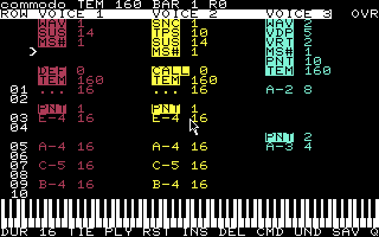
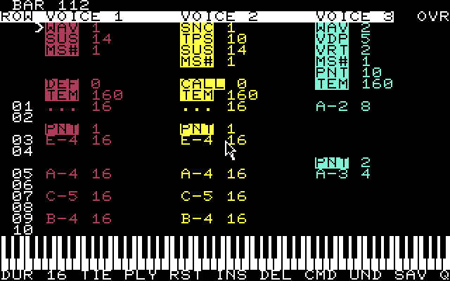
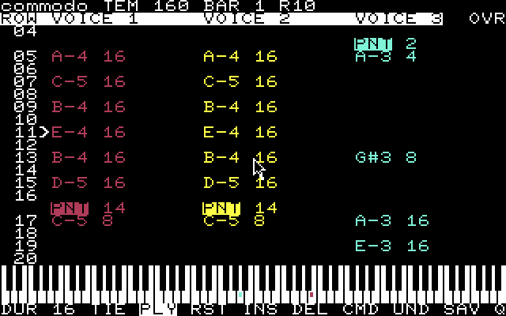
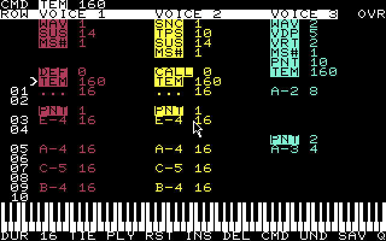
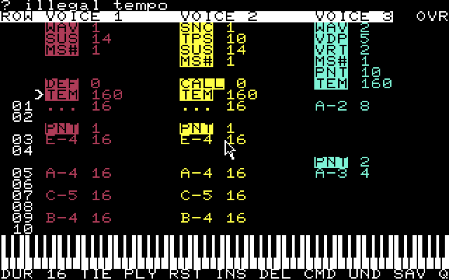

# `musedit` — writing music on GordonOS

`musedit` is GordonOS's music editor. It writes and edits COMPUTE!'s Enhanced Sidplayer
tunes — the `.mus` files that `sidplay`, `godzi`, `gortris` and `grknoid` play — and it auditions
them through the very same player those tasks use, so what you hear while you work is what will
ship.

The file is never converted. `musedit` opens the `.mus` image exactly as it is, works out when each
event plays, and draws that as a three-lane tracker grid: the tune's own time running down the
screen, the three SID voices side by side, and a piano across the bottom. Every edit is written back
as the 2-byte event pairs the format already uses, which means a tune you open and save untouched
comes back byte for byte identical, and **any** well-formed `.mus` can be opened, read and changed —
including tunes written years ago by some other editor.



**And a tune is no longer limited by the machine's own memory.** The original Sidplayer had to hold
the song and the editor in the C64's 64 KB together, so a long tune was entered in pieces and merged
afterwards. GordonOS keeps its music in the **REU filesystem**, and `musedit` works on a 65 KB
scratch copy of the tune — more memory than the whole of the C64's RAM, and something the old
players could not offer because they never touched the REU at all.

That is not only an editor convenience. A tune is *streamed*: `godzi`, `gortris` and `grknoid` keep
three 256-byte windows of the tune they are playing and refill them from the REU as the music moves
on, so what a game spends on music is a buffer of a few hundred bytes rather than the size of the
tune. With megabytes of REU against tunes of a few kilobytes, a game can carry a whole library of
music for the price of one — which is the kind of thing this machine makes possible and a stock
C64 could not. (`sidplay` is the simple case: it loads the one tune it is given whole.)

## Contents

- [Before you start](#before-you-start)
- [A quick lap round the editor](#a-quick-lap-round-the-editor)
- [The screen, piece by piece](#the-screen-piece-by-piece)
- [Reading a lane](#reading-a-lane)
- [Moving around](#moving-around)
- [Entering notes](#entering-notes)
- [Editing the timeline](#editing-the-timeline)
- [Playing](#playing)
- [Commands: envelopes, waveforms, vibrato, filter and the rest](#commands-envelopes-waveforms-vibrato-filter-and-the-rest)
- [A few habits that make a tune sound better](#a-few-habits-that-make-a-tune-sound-better)
- [Advanced techniques](#advanced-techniques)
- [Undo and redo](#undo-and-redo)
- [Saving, quitting, and what is left behind](#saving-quitting-and-what-is-left-behind)
- [When musedit says no](#when-musedit-says-no)
- [What the `.mus` format supports, and what it does not](#what-the-mus-format-supports-and-what-it-does-not)
- [Limits you might meet](#limits-you-might-meet)
- [Appendix: instrument recipes](#appendix-instrument-recipes)
- [Where some of this comes from](#where-some-of-this-comes-from)

## Before you start

**You need a 1351 mouse.** A note is entered by clicking a piano key, so with no mouse in the
system there is no editor to work in: it refuses with `? no mouse - mouse 1351 first`. Run
`mouse 1351` from the shell first — it is already in `boot.bat` — and start the editor again.

Start it from the shell with a tune's name:

```
run musedit commodo
```

That opens `commodo.mus` from the REU filesystem. **The base name is at most 7 characters**; `.mus`
is appended for you. A name that does not exist starts a **new tune** — three voices holding
nothing but their `HLT`, an empty description and the usual load address — so `run musedit mysong`
is how you begin from scratch.

```
run musedit
run musedit toolongnm
```

are refused on a screen of their own with the usage line, `? name - run musedit <name>`, and a
reminder that the name is up to 7 characters. Press any key to go back to the shell.

Two things you cannot do at the same time:

- **One `musedit` at a time.** A second one answers `? already running`.
- **`sid.lib` belongs to one task.** While another task is playing (`sidplay`, `godzi`, `gortris`,
  `grknoid`) the shell refuses the launch with `? sid.lib in use`. Stop the other player first —
  `S` in `sidplay` stops the tune — and the editor starts normally.

## A quick lap round the editor

If you would rather learn by doing than by reading, this is the whole loop:

| what you want | how |
|---|---|
| hear the tune | `SPACE` (the bar's `PLY` does the same) |
| put a note in | click a cell in a lane, then click a piano key |
| change a note's pitch | click the cell, then click another key — the length stays as it was |
| make a note longer | put a rest where it should end: `I` opens a row; the note now ends there |
| turn a note into a rest | `INST/DEL` |
| remove a note and close the gap | `SHIFT`+`INST/DEL` |
| change the instrument or add vibrato | put the cursor on the note's row and press `C` |
| take the last thing back | `Z` |
| save | `SHIFT`+`S` |
| leave | `Q` |

Nothing is written to disk until you save, and everything you do can be undone, so the safe way to
learn the editor is to play.

## The screen, piece by piece

The screen is a head, a grid, a piano and a control bar. Nothing else — there are no panels to open
and no mode to be in.

```
commodo  TEM 160  BAR 1 R0                    <- row 0: the head
ROW VOICE 1     VOICE 2     VOICE 3   OVR     <- row 1: the lanes, and the entry mode
    WAV 1        WAV 1        WAV 1           <- a row's command lines: no row number,
    SUS 14       SUS 14       SUS 14              one line per depth
    TEM 160      TEM 160      TEM 160
>01 ...    16    ...    16    ...    16        <- the row's own line: numbered, and what
 02 ...    16    ...    16    ...    16           each voice plays on it
 03 A-4    16    A-4    16
[rows 21-23: the piano, eight octaves]
DUR 16 TIE PLY RST INS DEL CMD UND SAV Q      <- row 24: the control bar
```

### Row 0 — the head

`commodo  TEM 160  BAR 1 R0` is the tune's name, the **tempo in force at the cursor's row** in
decimal, and the bar and row the cursor is on. When the music is playing those last two are what
the playhead is following, so they are the fastest way to tell where you are in a long tune. When
the pointer is over a piano key, or the cursor stands on a note, the right-hand end of the row also
names that pitch — `C-4`, `C#4` — so you always know what a click will write.

The tempo figure matters more than it looks: it is the one a note entered *here* will be measured
against, so in a tune that changes tempo you can watch it change as the cursor crosses the change.

When you are in a prompt the head becomes the prompt instead — `CMD TEM 160`, `BAR 12` — and when
the editor has something to tell you, its message takes the row over for a moment. Both fade back
to the tune's name by themselves.

### Row 1 — the lanes, and OVR/INS

`ROW VOICE 1     VOICE 2     VOICE 3` names the three lanes, in the SID's own voice order. At the
right, `OVR` or `INS` says what the next note entry will do (overwrite, or insert) — and likewise
whether adding a command replaces one of its kind already on that row or adds a second.

That readout is also a **button**: the pointer reverses it while it is over it, and a click toggles
the mode — the `M` key by another route. Because the readout *is* the button, what it says and what
the next entry does cannot disagree.

### Rows 2–20 — the grid

Nineteen rows of time, and the only part of the screen that scrolls.

Each row is **one step** of the tempo in force there — the shortest ordinary note that tempo allows
— so a whole note (one 4/4 bar) is 8, 16, 32 or 64 rows depending on the tempo. A `TEM` part way
through a tune starts a new bar and re-scales the rows from that point on, which means the rows a
bar has can differ between one part of a tune and another. The numbers down the left are rows
counted from the bar's own first row.

A row can have **several lines**: the row's own numbered line, plus a command line above it for each
depth of command that comes into force there. A command line carries **no row number**, because it is
not a point in time — and one line carries all three voices' commands at that depth, each in its own
lane and colour, so three commands on the same row take one line, not three. See
[Reading a lane](#reading-a-lane).

### Rows 21–23 — the piano

Three rows holding **all eight octaves**, C0 to B7, on one screen. The 56 white keys share the
320-pixel width, so a key is about 5.7 pixels wide; the black keys are short bars on the boundaries,
two rows tall. The key under the pointer is highlighted, and its pitch is named on row 0.

While the music plays, a **dot per voice** sits on the key that voice is sounding — **red** for
voice 1, **yellow** for voice 2, **cyan** for voice 3 — so a chord reads at a glance and you can
tell which voice is which. Each dot comes from the pitch the grid walker recorded for the event at
the playhead, so it always agrees with the note shown in the lane. A voice that is resting has no
dot, and the dots go when the tune stops. A natural's dot sits on the white part of its key, below
the black keys; an accidental's sits up on the black key itself.

While you are editing, pointing at a key puts a dot there in the colour of the lane the cursor is
in: that is the voice a click would write to. It answers "which voice am I about to write?" — and it
moves off the key as soon as you leave it.

### Row 24 — the control bar

`DUR 16 TIE PLY RST INS DEL CMD UND SAV Q`. The labels are short so that all ten fit on one row,
and each does the work of the key it names:

| cell | what it does |
|---|---|
| `DUR` | steps the armed length on through whole, half, quarter, 8th, 16th, 32nd and 64th; the dot or triplet mark rides along, so only the class changes |
| `TIE` | arms or drops the tie, and stays reversed while it is set — the `,` key |
| `PLY` | plays and stops, and stays reversed for as long as the tune plays |
| `RST` | turns the event on the cursor's row into a rest — the `INST/DEL` key |
| `INS` | opens one row of silence in all three voices — the `I` key |
| `DEL` | removes the command on the line, else the event, and closes the gap — `SHIFT`+`INST/DEL` |
| `CMD` | authors the row's command line, the `C` key |
| `UND` | undoes the last action, the `Z` key |
| `SAV` | saves, `SHIFT`+`S` |
| `Q` | quits, and asks `? unsaved - q again` first if there are changes |

The item under the pointer shows in reverse video and goes back to plain when the pointer leaves
it, so the bar always says where the pointer is as well as what is running.

`RST`, `INS` and `DEL` are what make an editing session possible **without the keyboard**: with the
piano below for pitches and the grid for the cursor, entering notes, inserting time, changing one,
resting it, deleting it, undoing and saving all happen from the pointer alone.

## Reading a lane

A lane is one voice's stream of events, laid out against time. Between them the three lanes say
everything about the tune that the file contains.

| mark | meaning |
|---|---|
| `C-4 16` | a note starts here, and its duration is a sixteenth |
| `C-4 16.` | ...dotted; `:` is double-dotted and `*` is a triplet |
| `C-4 16. TIE` | the tie flag is set on this event, so the note carries on from the one before it instead of being struck again |
| `C-4 16  ?` | the note's onset falls between two rows, so the row it is drawn on is not where it starts |
| `... 4` | a rest starts here, lasting a quarter |
| `DEF 3` | a command, on a line of its own (see [Commands](#commands-envelopes-waveforms-vibrato-filter-and-the-rest)) |

The duration is written in the format's own numbers, on the note's own row: a whole note, a half, a
quarter, an 8th, a 16th, a 32nd and a 64th read `1`, `2`, `4`, `8`, `16`, `32`, `64`. A utility
length prints no number, because its length is whatever `UTL`/`UTV` set.

A dot or a triplet is a **mark right after that number** — the same three marks the control bar's
dot cell uses: `.` dotted, `:` double-dotted, `*` triplet. Nothing is printed for a plain note, so
`8` is an eighth and `8.` is a dotted eighth: two different lengths, so read them as two different
things. All three come from the duration byte itself (bit 5 the dot, bit 7 the triplet, or the
second dot with bit 5), which means the mark is the format's own information and not a note the
editor keeps on the side. A note whose onset did not land on a row takes no mark: its lane ends in
the `?` instead, which is the more important thing about it.

**The 64th is the one length that always wears its dot.** Its class bits are zero, so a plain
`$00` byte is the one value the player never reads as a length — it skips that event before it
looks at the class. The dot bit is what makes the byte non-zero, and the player ignores the dot for
a 64th: it grants the tempo's own short length, which is exactly what a 64th is. So `DUR` landing on
`64` writes `$20`, the grid draws it as `64.`, and the dot changes nothing about its length — a
64th is only longer when the triplet mark replaces it.

`TIE` comes straight after the duration, and it means "hold, do not restrike": the player carries
the sound through into the next event. It is the duration byte's bit 6.

A command line prints its mnemonic in reverse video and its operand plain, so the value is easy to
read, and it never fills the row-number column — a command is not a point in time, so the row's own
line below it is the numbered one. A row's **sound** commands (envelope, wave, filter and the rest)
take the lines furthest from it and its **structural** ones — `TEM` `UTL` `UTV` `HED` `DEF` `CALL`
`TAL` `HLT` `END` — the lines nearest it, so a row's control flow always sits right above the note it
governs.

Each lane is drawn in its own voice's colour — red, yellow, cyan — the same colours as that voice's
dots on the piano, so a note and the dot that follows it are one thing seen twice. The row numbers,
the lane headers and the head stay white.

The cursor marker `>` is drawn in the free cell immediately **left of the lane the cursor is in** —
column 3, 15 or 27 — so it says which voice a key will act on as well as which line you are on.

## Moving around

| action | how |
|---|---|
| place the cursor | click a cell in the grid |
| move one row | cursor up / down; at the bottom the window scrolls a line, at the top it moves back a whole page |
| move a whole page | `SHIFT`+`,` a page back, `SHIFT`+`.` a page on |
| step a bar | `SHIFT`+`N` the bar after this one, `SHIFT`+`P` the one before |
| go to a bar by number | `SHIFT`+`B`, then type it |
| change voice | cursor left / right, or click a cell in another lane |

A page on lands on the row the window's own bottom line holds, so the next page starts on a row you
were already looking at and no row is missed. A tune that ends inside the window has no page on, and
the key does nothing. A page back is the same distance counted back from the window's top row — 19
rows, the number the grid holds — and it stops at the tune's first row. Both move the window under
the cursor: the cursor keeps its line on the screen, and the row under it changes with what the
window now holds.

**While the tune is playing the cursor is the playhead**, so `CRSR-UP`/`CRSR-DOWN`, the page keys
and the bar keys are refused — the follow would drag the marker straight back. `CRSR-LEFT` and
`CRSR-RIGHT` still work, and are the useful pair while playing: they move the dots to another
voice, so you can see which note that voice is sounding. Editing does not work while the tune plays
either; stop first (`? stop first`).

### Jumping to a bar

A bar jump is **exact**, and it is counted by walking the tune rather than dividing the row number,
because a tempo change can cut a bar short: the only truthful count is the one the tune's own walk
makes as it goes.



`SHIFT`+`B` opens a prompt in row 0 showing `BAR` and the bar you are on, with the blinking block on
the value. As in a command line the **first** digit replaces the number and later digits extend it;
`INST/DEL` backs one digit out, and once the field is empty it does nothing, there being no
mnemonic step to step back to. `RETURN` goes there and `STOP` leaves you where you were.
`SHIFT`+`N` and `SHIFT`+`P` step a bar at a time without the prompt.

A bar the tune never reaches answers `? no such bar` and leaves the view alone. Otherwise the cursor
lands on the row's **own line** — the note line, not one of the command lines above it — with the
window following, so you arrive where the music is, ready to edit it.

A jump needs no marker in the tune. `MS#` measure markers exist for an editor that could only search
for a number you had written on the grid (see *Misc*, below); this one counts the bars as it walks, so
every bar is a destination.

## Entering notes

The piano at the bottom of the screen is how notes go in.

1. **Click a cell in the grid.** The cursor goes there and row 0 shows the row and voice.
2. **Point at a key.** Row 0 names the pitch under the pointer (`C-4`, `C#4`) and the key is
   highlighted, so a click is never a guess.
3. **Click.** With the cursor on a row where a note starts, the event's pitch becomes the key's and
   its length is kept, so nothing below it moves. A rest is the exception — it has no length worth
   keeping, so the new note takes the armed duration. Inside a longer note the note is split; past
   the last event, or in an empty voice, rests are filled in so the note lands on the cursor's row.

**A note key also moves the cursor on.** In overwrite mode (`OVR`, the default) each note you play
from the keyboard leaves the cursor on the next row, so a run of notes goes down in one pass instead
of you moving the cursor between them. It is still overwrite: a note typed on a row that already
holds one replaces it, and nothing below is pushed down. A row's **command** lines are passed over on
the way — a command takes no time, so the next note belongs on the row's own line below them — and
the window scrolls a line at a time once the cursor reaches the bottom of the band. Clicking a key on
the piano does **not** move the cursor, because a click is a deliberate "make *this* cell this
pitch".

**The pitch sounds as you point at it.** Hovering a key — or pressing a note key — plays it for a
tenth of a second, so a tune can be found by ear before anything is written; a click still just
enters the note. It is a bare sawtooth, not the instrument the tune gives that voice: it answers "is
this the note I meant", nothing more. The pitch is the one the tune would sound — the editor applies
the machine's declared speed (`speed 200` on the shipped VICE image) exactly as the player does, so
the audition and playback agree on what `C-4` is. If another task's music is running the keyboard
stays silent rather than cutting into it, and the dots stay away, because the dots on the keys
belong to whoever is playing. During our own playback a click enters nothing (`? stop first`).

A command has a line of its own above the row it belongs to, and that line holds no note: with the
cursor on a command's line a note key is refused (`? no event here`), so an entry can never rewrite
the row below the one the cursor is on. Move down to the row's own line — the one with the row
number — and the note goes in there.

The keys are narrow — about 5.7 pixels per white key — because all eight octaves share the
320-pixel width. The black keys are short bars on the boundaries: C# between C and D, D# between D
and E, F# between F and G, G# between G and A, A# between A and B. The B–C boundary has none: that
is where one octave ends and the next begins. Pointing at a key names its pitch on row 0, so even a
four-pixel black key is never a guess.

**Every pitch the format allows is on screen at once** — there is nothing to page, scroll or
transpose to reach one.

### From the computer keyboard

The piano can be played from the computer keyboard too, which is quicker once you know a tune. The
home row is the white keys — `A S D F G H J` is one octave, C to B, and `K L ;` carry on into the
next at C, D, E — while `W E T Y U O P` play the black keys between them (C#, D#, F#, G#, A#, and
the next C#, D#). The map starts at octave 4; `-` and `+` move it. A note key enters its pitch at
the cursor exactly as a click does, and the pointer still works alongside it.

### Length, dots and the tie

| key | action |
|---|---|
| `1` … `7` | duration: whole, half, quarter, 8th, 16th, 32nd, 64th |
| `8` / `9` | duration: the `UTL` / `UTV` utility length |
| `.` | cycle the dot state: none → dotted → double-dotted → triplet |
| `,` | arm or drop the tie (the bar's `TIE` cell) |
| `-` / `+` | octave for the computer-keyboard note map (0 to 7) |

The armed values show on the control bar and stay armed until you change them. The editor starts
with a plain 16th armed.

The armed duration applies to **every** note a note key writes — one entered where no note starts,
where a rest stands, inside a longer one, or over a note already there. A note already in the grid
keeps its pitch only if you leave it alone; typing a pitch re-times the event to the armed value, so
the rows below move to suit.

**Triplets** need a tempo in one of the bands listed under
[which lengths a tempo can hold](#which-lengths-a-tempo-can-hold) — elsewhere the entry is refused
with `? illegal duration`, and a tune that needs them usually wants a multiple of 48. **Dotted** and
**double-dotted** lengths are refused when the tempo cannot express them as whole jiffies: a dotted
note needs an even base length, a double-dotted one a base divisible by four.

**The tie** joins a note to the one after it into a single sound. It is armed with `,` or by clicking
`TIE` in the bar — both toggle the same flag, so the cell lights whichever way you armed it. It
rides the armed value the way the dots do, so it reaches every note a note key writes, including one
written into an empty row, where the length may be laid down as two tied pairs of its own. The grid
shows it as `TIE` after the duration, which is also how a tied event already in a tune reads — a
dotted, tied note reads `C-4 8. TIE` and is the duration byte's bits 6 and 5 together. A rest never
carries a tie, and entering a rest clears the bit from a note that had one.

When you tie notes of **different** lengths, put the shorter one first. A tied note does not release,
so the release can only begin at the last note of the chain — and with a larger `PNT` the release
would otherwise have started inside the long note and been pushed later than the music wants.

### Utility lengths

`8` arms the **`UTL`** length and `9` the **`UTV`** length. A note entered with one of these takes
its duration from the `UTL` command (all voices) or the `UTV` command (this voice) instead of from
its own duration bits — useful for a delayed or gated voice. Both forms round-trip as ordinary
notes.

**`UTL 0` is 256 jiffies**, like every other byte-valued length here: the player decrements and
tests, so zero means "all the way round". A tune that never sets `UTL` starts at **12 jiffies**,
which is an eighth triplet at 100 quarter notes a minute, and the value stays put until a `UTL`
changes it.

That is what the utility length is really for: **a length the tempo cannot express.** An eighth
triplet needs a third of a quarter's jiffies, and many tempi do not divide by three. Take a tempo
whose quarter is 28 jiffies: three notes in that quarter cannot be 9⅓ each, so put `UTL 9` in front
of two of them and `UTL 10` before the third — 9 + 9 + 10 = 28, and the triplet is exact.
The same arithmetic writes sixteenths in a tempo that refuses them, and a **grace note**: shorten
the note before it and enter the grace note with the remainder.

Because the value is a count of *jiffies* and not of rows, a **tempo change does not restate it**:
the same 12 jiffies is a different fraction of a beat at a different tempo, so a triplet or grace
note built this way has to be recomputed when the `TEM` under it changes. That is also why these
lengths are set by commands rather than stored in the note — one `UTL` moves every note written
with that length.

### Sharps, flats, and pitches that cross an octave

A note key enters a black key as the **sharp** of the letter below it (`C#4`) — that is how the editor
writes one. The format can spell the same pitch as a flat (`Db4`) instead; a tune that uses one is
read, shown and played correctly, but entering that note again writes it as a sharp.

A spelling that runs past the end of its octave is shown as the note it sounds, because that is what
the player makes of it: a note stored as a B sharp reads as the next octave's C, and one stored as a
flat C reads as the B of the octave below.

### When a note does not land on a row

A triplet or a double-dotted note can be shorter than one step, so its onset falls between two rows.
Such an onset is drawn on the row it falls in, with `?` at the right edge.

`SHIFT`+`U` refines the grid until every onset has a row of its own: a half, a third, or a single
jiffy per row, taking only the steps that divide the tempo's own unit exactly — a tempo whose unit
is 9 jiffies offers three (16, 48 and 144 rows to the bar), because 9 does not halve. Each press goes
one step **finer** and, past the finest, wraps back round to the plain grid, so the states cycle
rather than stop. A tune that contains a triplet is already refined at the third when it opens,
which means the first press takes you to the finest and the second wraps to plain. Where a later
tempo cannot divide the chosen refinement, that part of the tune keeps the plain grid rather than a
broken one.

Like every other edit it needs the music stopped: the grid is drawn in the unit that was in force
when it was painted, so refining it mid-pass would leave the rows and the playhead apart. It answers
`? stop first`.

## Editing the timeline

The grid is time, and a note's length is the distance to the next note or rest in its voice. That one
fact explains everything the editor does when you enter a note:

- **Entering on a note** replaces it. The rows below do not move.
- **Entering on a rest** replaces it and takes the armed duration, so the rows below come up by the
  difference.
- **Entering inside a longer event** splits it: the rows above your note keep the event's pitch, the
  new note takes the armed duration and lands on the row you clicked, and what the event had left
  keeps that pitch again behind the note. A part that is not one legal length is written as several
  tied events. The three runs together last exactly as long as the event did, so the rest of the tune
  does not shift.
- **Entering where no duration reaches** fills the gap with rests first. Rests are ordinary events;
  you will see `...` where they were inserted.
- **Entering past the end of a voice** fills up to the cursor and inserts before the `HLT`.

To change a note's length you do not edit the note — **you move the next event**. Insert a note or a
rest at the row where the note should end and the length follows. That is how the format itself
works, and it is why the grid never shows overlaps.

| key | action |
|---|---|
| `INST/DEL` | replace the note at the cursor with a **rest** of the same length |
| `SHIFT`+`INST/DEL` | **delete** the event and close the gap; on a command line it removes that command |
| `I` | **insert a row** at the cursor, pushing everything below down |
| `SHIFT`+`I` | **insert a bar** (the rows a bar has at the tempo in force where the cursor is) |
| `R` | **delete a row** at the cursor, in all three voices |
| `SHIFT`+`R` | **delete a bar** — the same rows `SHIFT`+`I` would open |
| `M` | **insert/overwrite mode** for entering notes and for adding a command (the `OVR`/`INS` readout) |
| `C` | **write or edit the command** at the cursor — on a row's own line it adds one, on a command line it edits that one |
| `SHIFT`+`D` | **follow a phrase**: from a `CALL` to its `DEF`, from a `DEF` to the next `CALL` |
| `Z` / `X` | undo / redo |

The `HLT` that ends a voice cannot be deleted; it can be pushed down by inserting before it.

### Inserting time

Everything you enter goes **on** the grid as it is. When you need more room — to put a note where
another one already sits, or to open a bar in the middle of a tune — insert instead:

- **`I` opens one row.** Everything below the cursor moves down one row, in **all three voices**, so
  the voices stay lined up. A note that is already sounding is cut on the cursor's row; it resumes
  on the same pitch after the gap with a fresh attack.
- **`SHIFT`+`I` opens a whole bar** — 8, 16, 32 or 64 rows, whichever a bar is at the tempo in force
  where the cursor is. A tune that changes tempo has bars of different lengths, and the bar inserted
  is the one that fits the part you are in, so every bar number before it is unchanged.
- **`M` switches note entry to insert** — as does a click on the `OVR`/`INS` readout. The same mode
  decides whether **adding** a command replaces one of its kind already on that row (`OVR`) or adds a
  second pair (`INS`); it never changes what editing an existing command line does. With `INS`
  showing, entering a note writes it **after** the event the cursor's line holds, opening that
  note's length in **that voice only** so its later events move down, and the cursor follows the new
  note. The other two lanes keep exactly the events they had, so a voice you have not written to yet
  stays empty. Entering notes one after another therefore builds the tune forward, in the order you
  play them. `M` again returns to `OVR`, where entering a note replaces or splits.

Inserting **time** — `I`, `SHIFT`+`I`, `INS` — is the operation that touches all three voices: the
three lanes are one timeline, so opening rows in one lane alone would slide it against the others
with nothing to line it up again. Inserting a **note** in `INS` mode is that voice's own edit and
leaves the other two untouched.

The mode is only about the *next* note: switching it changes nothing in the file.

### Deleting time

Deleting is the same operation backwards: **`R` closes one row** at the cursor and **`SHIFT`+`R`** the
whole bar there, in all three voices, so the lanes stay lined up. A voice with nothing sounding on
the row is left alone — there is nothing there to close.

An event that runs **past** the row is refused instead, and the message names the voice —
`? a note in voice 2 spans the row`. A row boundary in the middle of a note is not a row to remove,
because closing it could only make that note shorter. Shorten the note first (a rest on the row
where it should end) and delete again. A row or a bar goes in one `Z`, however many events it took
out.

### Phrase bodies

A `DEF` body is not a separate region of the grid: it plays **inline**, where the definition stands,
so each of its rows is drawn once, in order, with the `DEF` on the command line above the first of
them. A `CALL` elsewhere plays the same body again at the call site, which is what makes phrases
worth having — and it is why editing a body is editing **every** place that plays it.

The editor tells you when the cursor is on one: the status line says **`phrase 3 x5`** — the phrase
number, and how many `CALL` sites play it, counted across all three voices (a body is global, so any
voice's `CALL` can play it). It says so again each time a note is entered there, because that is the
moment the change reaches every call site.

Moving **time** in or out of a body is refused instead: the rows below would shift inside the body,
so the phrase would come back longer or shorter everywhere it is played. Inserting and
`SHIFT`+`INST/DEL` therefore answer `? phrase 3 x5` there and write nothing. Changing a pitch, a
command or a duration affects every call site too, and is allowed — that is how you change a phrase
everywhere at once.

### Following a `CALL` to its `DEF`

The command lines above a row are the tune's own control flow: a `CALL` plays a phrase whose `DEF`
sits somewhere else in the same voice, and a big tune like `immig` has sixty-five of them, so
reading one half of a pair means finding the other.

Put the cursor on a command line and press **`SHIFT`+`D`**:

- on a **`CALL`** it moves the cursor to that phrase's **`DEF`** — the line carrying the definition,
  not the row's own numbered line;
- on a **`DEF`** it moves to the **next `CALL` of that phrase below the cursor**, and once there is
  none below it wraps round to the first one in the tune — so pressing it again and again tours the
  call sites.

The window follows: the found row becomes the top of the grid, the line carrying the command is
brought into the band, and the head's `BAR`/`R` show where you are. Anything else on the line — an
`ATK`, a `TEM`, or a row's own numbered line — answers `? not a phrase` and moves nothing.

**`SHIFT`+`D` acts on the lane the cursor is in.** A line carries one command per lane, so the lane
decides which one is followed — and the `>` marker in the gap left of the lane tells you which lane
that is. If the lane has no command on that line the key answers `? not a phrase`: move the cursor
left or right into the lane that shows the command.

### Illegality is caught where it happens

A duration the current tempo cannot express is refused with `? illegal duration`, and nothing is
written. The classic cases are a 32nd at a tempo that is not a multiple of 32, a 16th at one that is
not a multiple of 16, and a triplet at a tempo outside the ten bands
[which lengths a tempo can hold](#which-lengths-a-tempo-can-hold) lists. Choose a longer value, or
change the tempo first — and if the piece needs both 16ths and triplets, make the tempo a multiple of
48 so neither is refused.

One corner a foreign file can carry: a note pair whose duration byte is exactly `$00`. It is not a
length at all — the player tests for it *before* it reads the class and **skips the event**: no time
passes and the note is never gated, so nothing sounds and the next pair is read at once. The grid
skips it the same way, so a converted tune can show every one of its bars while a few rows carry no
note. Such a pair is left exactly as it is, but **musedit will not write a new one**: a length the
tempo grants is always stored under a byte the player grants, and the 64th therefore arms as `$20`
— on a 64th the dot is the encoding, not a longer note.

## Playing

`SPACE` (or `PLY` on the control bar) starts the tune **from the row the cursor is on**, and stops it
again. The tune plays through `sid.lib`, the same player `sidplay` uses, so what you hear is what
will ship.



The **cursor is the playhead**: while the music plays it moves down the grid with it, the window
scrolls a line at a time to keep it on the middle row, and the head spells out that row's bar and
row. It shows the **call site** while a phrase is playing rather than the phrase body. When you stop,
the cursor stays where the music stopped — that is where editing resumes, and the next `SPACE`
carries on from there rather than starting over.

**Starting part way through is silent, and it takes a moment.** The format has no seek: a voice is a
stream of events, so the player reaches a row only by playing everything before it. `SPACE`
therefore runs the pass from the first row with the volume masked, at full speed and without sound,
until the music reaches the cursor's row. Every command takes effect on the way — waveform, pulse,
ADSR, filter, tempo and the transposes are the tune's own at that point — which is what makes a
start mid-tune sound like the tune. The score holds the cursor's row while this happens, so it does
not scroll away and back, and the length of the wait is the music's own elapsed time at that row:
about a second for the first screenful, a few seconds for a row an ordinary tune reaches in the
middle, and the tune's whole length for its last row. `SPACE` at row 1 costs nothing at all.

What it cannot reproduce is the SID's own envelope: a note already sounding when the sound comes up
is caught earlier in its envelope than a pass played in real time would leave it, so it may sound a
little different for a moment. Everything the tune itself sets is exact.

The player publishes the number of jiffies it has played in this pass, and a grid row is a fixed
number of jiffies at the tempo in force, so the cursor's row is that count divided by the row's
length. Nothing is predicted between events and nothing is re-anchored: a note that lasts 128 rows
simply stays on each row for its share of the count. A scroll down redraws only the newly
revealed bottom line — the rows above are moved by the kernel's REU screen scroll. Scrolling up moves the window back a whole band, because the line above the
window has not been walked yet. Either way the window remembers *which of a row's lines* it is
standing on, not just the row: a repaint for an edit, an undo or a change of row unit puts the score
back exactly as it was, and the cursor's row is read from the same map the screen was drawn from.

The tune **loops only if it says so**: a section is a `HED` and the `TAL` that closes back to it, and
the player honours that inside a pass, so a tune written to repeat repeats by itself and one with no
section ends at its last row, where the music stops and the score rewinds to the beginning, cursor
and all, ready for the next `SPACE`. While a section loops the score keeps **counting up**: the walk
executes the same `HED`/`TAL`, so each time round is walked as later rows with later clocks rather
than jumping back to the section's first row. The cursor keeps following the music, and the row
numbers keep climbing, with the bar number climbing with them.

Only one player can own the SID. If the chip is taken **while** you are editing (a task loaded from
the shell, say), `SPACE` reports `? no player` for a moment and play stays unavailable until
`musedit` is restarted; the same message appears if `sid.lib` cannot be loaded because the pool is
full. Editing carries on either way.

## Commands: envelopes, waveforms, vibrato, filter and the rest

Commands are the sound of the tune: everything a note is played *with*, and everything that changes
as the music goes along. A `.mus` command is a 2-byte event placed **before** the note it affects,
and it stays in force until something changes it.

`musedit` groups them by the note they belong to: every command that comes into force at a note's
onset gets **a line of its own above that note's row**, and the cursor passes over those lines on its
way down. A command pair takes no time of its own — it comes into force at the onset of the next note
or rest, which is why a command line only ever sits above a note or a rest. There is no place
"inside" a duration to put one, and the editor refuses a row in the middle of a note rather than
splitting it.

### Writing a command line

Put the cursor on a **note's own row** and press `C` (or click `CMD` on the control bar). The head
row becomes the prompt:



| key | in the prompt |
|---|---|
| CRSR up / down | choose any of the 49 commands the picker offers, in the format's own order |
| `RETURN` | take it, then finish its value — or write it straight away for `TAL`, `HLT`, `END` |
| digits | build the value in decimal, never past what that command takes |
| `INST/DEL` | back one digit out; on a field you have emptied, back to the mnemonic |
| `STOP` | cancel, and the grid comes back as it was |

The list runs from the tune's own settings — `TEM` `UTL` `UTV` `HED` `DEF` `CALL` `TAL` `HLT` `END` —
through every sound command the format defines, ending with `MS#`, `FLG` and `AUX`. The pair is
written at the boundary the cursor's row starts, so every row stays where it is and nothing needs
renumbering.

**Values.** The prompt takes the value in decimal, up to whatever that command allows: most take
0–255, the one-bit commands (`SNC`, `FLT`, `RNG`, `3-O`, `BMP`, `F-X`, `LFO`, `P&V`) take 0 or 1,
`WAV` and `F-M` 0–7, the envelope nibbles 0–15, `RUP`/`RDN` 0–31, and three take more than a byte —
`MS#` up to 999, `P-W` and `DTN` up to 4095, `POR` up to 16383. A value the command cannot hold is
clamped to its maximum rather than refused, so what the prompt shows is always what gets written.

The field opens showing the value the command already has, `0` included, and the **first** digit you
type **replaces** it — re-entering `VOL 7` and typing `3` gives `3`, not `73`; type `37` to get `37`.
Backing out the last digit leaves the field genuinely empty rather than showing a `0`, and one more
`INST/DEL` then steps back to the mnemonic so you can pick a different command. The blinking block
sits where the next digit goes, so the prompt waiting for a value never looks like a prompt waiting
for a mnemonic.

The prompt takes **digits only** — there is no minus key — and it shows and stores the number the
player itself reads. For the commands whose effect is a signed number that is not the number you
have in mind; *Signed operands*, below, gives the conversion for each of them.

**Writing `TEM` is the one that catches people out.** The first `RETURN` chooses the mnemonic and the
second writes the value: the head shows you where you are, and once you have taken the mnemonic the
digits you type build the number that will be written. If the number you write makes the tune
unplayable, the editor says so and puts everything back — see below.

**Overwrite or insert** — the `OVR`/`INS` mode reaches command entry too, but only for a command you
are **adding**: when the row already carries one of that kind, `OVR` replaces it where it stands and
`INS` adds a second pair. It does not apply to *editing*. `C` on an existing command line always
changes **that** pair, in either mode, because the line you are pointing at is the one you meant to
change. So to give a row a second command, put the cursor on the row's own numbered line and press
`C` there; pressing `C` on the command already there edits it instead.

**Where a new pair goes.** A command takes no time, so it is written at the end of the row's command
run, immediately before the note or rest itself: it is the last thing the voice does before that note
sounds. Adding several commands to one row therefore lays them out in the order you added them — the
first ends up furthest from the note and the last nearest. What the lines *show* is grouped by kind
rather than by order: the row's sound commands sit on the lines further above the note and the
structural nine on the lines nearest it.

A row only has a boundary if an event *starts* there, so a row in the middle of a longer note cannot
take a command — the format has no way to split the note, and the editor answers `? no event here`
rather than writing a pair that would fire at the wrong moment. Put the command on the row the note
starts on instead; a command there applies from that note's onset.

**Editing and removing** — put the cursor on an existing command line and `C` opens the prompt *on
that line*, already filled in and ready to change; `SHIFT`+`INST/DEL` removes that pair and closes
the gap. `Z` takes either back, like any other edit.

### A written pair the tune cannot play is refused, and taken straight back

After writing, the editor walks what it wrote — it has to, because a command can make the rest of the
tune unreadable without touching the row you edited. If that walk stops, the edit is undone on the
spot, the redo is withdrawn, and row 0 says which:



- `? illegal tempo` — the tempo now leaves some note length inexpressible (the classic case: a 16th
  at a tempo that is not a multiple of 16, or a triplet at one outside the ten bands — see
  [which lengths a tempo can hold](#which-lengths-a-tempo-can-hold)).
- `? the tune cannot play that` — anything else the walk tripped over: a `CALL` to a phrase with no
  `DEF`, a call stack one frame too deep, a `TAL` whose `HED` belongs to another phrase.

Either way the grid comes back exactly as it was, and **there is nothing left to undo** — a value
that cannot work never costs you a `Z`. You do not have to remember to undo it, and you cannot
accidentally save it.

A file that was **already** unwalkable when you opened it keeps that state: the refusal only fires
for a pair that the write itself broke, so a damaged or foreign file can still be opened, inspected
and edited.

### One command per lane

**A line carries one command per lane, and `C` acts on the lane the cursor is in.** Aim at the lane
that shows the command you mean — the one you last moved into with `CRSR-LEFT`/`CRSR-RIGHT`, or the
one the click landed in. On a line whose lanes have nothing for the cursor's voice the editor answers
`? no command in this lane` rather than opening an empty prompt.

That matters most for the settings a whole tune shares — the tempo above all. The player keeps
**one** tempo, but each voice's stream sets it with its own `TEM` pair, so a tune normally carries
the same `TEM` in every voice, and the value in force is whichever pair that row's walk reaches last.
Change one lane's copy and the others still stand, so change the `TEM` line in each voice that shows
one. The same goes for `UTL`, and for any command a tune repeats per voice.

### Tempo is a point in the tune, not a property of the file

A `TEM` at any row takes effect **there** and holds until the next one, so a tune can change tempo as
often as you like, and the tempo is not something you set once at the top.

What the grid does about it: from the row a `TEM` sits on, the rows are the new tempo's own step and
a bar is one whole note counted in those rows, so **a bar's row count can change at a change** — a
tune at tempo 144 (16 rows to the bar) that moves to 192 has 64 rows to the bar from there on. A
change that lands between bar lines cuts that bar short; a change on a bar line starts the next one.
The head's tempo figure, `SHIFT`+`I`'s "one bar" and the duration checks all follow the row the
cursor is on rather than the tune's opening tempo.

`TEM` is one register in the player, so two voices that set different tempos on the **same row** do
not run at two tempos: each lane's own note is measured with the value that lane set, and from the
next row the tempo is the **last** of them (voice 3's, since the player processes the voices in
order). Rows that become illegal because of a tempo change are flagged on the grid rather than
silently kept.

Put a tempo change where all three lanes **start** a note. Each voice's note length is worked out when
its note begins, so a change that lands in the middle of a held note leaves that lane finishing its
note at the old tempo while a lane that changed on time has already moved — the three drift apart by
the difference, and they stay apart. A change on a row where every lane begins a note keeps them
together.

### Reading a command

A command line is a mnemonic and a number, both in decimal: `TEM 160`, `P-W 2048`, `F-C 40`. The
mnemonic is what the line *is* — the `C` prompt lists all 49 of them in the order below — and the
number is its operand. The picker runs through the ten groups in the player's own order:

`TEMPO` `VOLUME` `REPEAT` `PHRASE` `ENVELOPE` `WAVE` `FREQ` `FILTER` `MOD` `MISC`

Two things are worth knowing before the details:

- **A command stays in force.** There is no "off": a value set on one row governs every row after it
  until another command of the same kind changes it. That is why a tune's opening lines matter so
  much — they are the instrument setup for the whole tune.
- **Commands are per voice, even when the chip is not.** `VOL`, the filter and the tempo are one set
  of registers for all three voices, but the file stores a `VOL`, an `F-C` or a `TEM` in each voice's
  own stream. A tune normally repeats those in every lane; change one lane's copy and the others
  still stand. An envelope or a waveform, by contrast, really is per voice, so each lane's `ATK` or
  `WAV` is its own.

Each group below says what every member does, what its operand means, and how you would actually use
it.

### Signed operands, and how they are written

Seven commands mean a *signed* number — a sweep that can go either way, a detune, a transpose — and
the prompt writes the field the player reads rather than the number you have in mind. The four that
are a plain byte work exactly as a signed byte does: **256 + the value**.

| commands | what the prompt takes | examples |
|---|---|---|
| `P-S`, `F-S`, `AUT` | 0-255 | `F-S 3` opens the filter 3 a jiffy and `F-S 253` closes it at the same rate; `AUT 20` brightens the high notes and `AUT 236` darkens them; `P-S 2` widens the pulse and `P-S 254` narrows it |
| `SCA` | 0-7 up, 249-255 down | `SCA 3` multiplies the modulation by 8, `SCA 253` divides it by 8 |
| `DTN` | 0-4095, a 12-bit signed field | **4096 + the value** here: `DTN 256` is 256 sharp, `DTN 3840` is 256 flat, and `DTN 2048` is the -2048 floor |
| `TPS`, `RTP` | 0-255 | not a sign at all but a packed interval: `TPS 176` is +95, `TPS 15` is -95, `RTP 91` is "no change" |

The rule for a byte is **`256 + the value`**, which makes the negative half of the range the top half:
-1 is 255, -10 is 246, -128 is 128. `DTN` is twelve bits, so the same idea with 4096 instead of 256;
and `TPS`/`RTP` are not signed numbers at all but three fields packed into one byte, which *How a
transpose operand is built* above decodes into an interval.

The byte-wide ones in one line, for the values you are most likely to want:

| value | -128 | -64 | -16 | -10 | -3 | -1 | 0 | +1 | +3 | +10 | +127 |
|---|---|---|---|---|---|---|---|---|---|---|---|
| write | 128 | 192 | 240 | 246 | 253 | 255 | 0 | 1 | 3 | 10 | 127 |

Everything else on the grid is a plain count, and the prompt clamps a too-large value to the
command's own maximum rather than refusing it — so what the prompt shows is always what gets
written. Two ways to get a value right without doing arithmetic: open a line that already carries
the value you want (the prompt shows the number that line holds, and taking it writes the same pair
back), or copy the line from a tune that already sounds the way you want.

### Tempo — `TEM`, `UTL`

| name | operand | what it does |
|---|---|---|
| `TEM` | 1-255, where 0 means 256 | sets the tempo. The operand is divided into **14,400** and the quotient is quarter notes per minute, so a *bigger* number is *slower*: `TEM 144` is 100, `TEM 160` is 90, `TEM 240` is 60 |
| `UTL` | 0-255 | the **utility length**: how many jiffies a note written with the `UTL` length (key `8`) lasts, in all three voices |

`TEM` is the one command whose arithmetic surprises people. It is a *divisor*, not a rate — the
classic tempo table in the original editor steps in eighths — `F0` is 60 a minute, `E0` is 64, `10` is
900 and `08` is 1800 — because each step of 8 in the operand is one step in the table. The player
turns the value into a length in jiffies by shifting it down (four shifts for a 16th, five for a
32nd), which is why the grid's rows re-scale when a tempo changes and why some values cannot express
a short note at all. The subsection below is the whole picture, and it is the one place a tempo's
limits are worth looking up.

Two details: `TEM 0` does **not** mean "stop" — zero is read as 256, which is 56 quarter notes a
minute, the slowest the table goes. And because the operand is a plain byte, a tune cannot be
"in 6/8" or "swing": what you get is a steady row clock, and the feel comes from where you put the
notes.

**A tune need not open with a `TEM`.** The player starts at `$90` — `TEM 144`, 100 quarter notes a
minute — and holds that until the first `TEM` arrives, so a tune with no tempo line plays at that
speed. `VOL` and `UTL` start the same way, at 8 (`mf`) and at 12 jiffies: see
[Volume](#volume--vol-bmp) and [Utility lengths](#utility-lengths).

`UTL` is the global utility length; its per-voice twin `UTV` lives at the end of the picker (it is
in the *Misc* group, below). Both are for notes whose length comes from elsewhere, and that is
what makes a delayed or gated voice possible: enter notes with key `8` or `9`, and move one `UTL`
to change the length of all of them.

```
TEM 160
UTL 12
```

#### Which lengths a tempo can hold

A tempo is a byte, and most of its 256 values cannot express every length. Two different rules
decide it, and they are why `? illegal duration` arrives for one note and not another.

**Plain, dotted and double-dotted lengths are the tempo divided down.** A quarter is the tempo
shifted right twice, an 8th three times, a 16th four times and a 32nd five times, and a shift that
would drop a bit is refused. So the tempo has to be divisible by the length: 8ths need a multiple of
8 (`TEM 120`, `144`), 16ths a multiple of 16 (`TEM 96`, `144`, `240`), and 32nds a multiple of 32
(`TEM 96`, `192`). A dotted length additionally needs an even base, and a double-dotted one a base
divisible by four. This is where an odd tempo bites: `TEM 145` plays a whole note and **nothing
shorter**, and `TEM 146` manages a half — a tempo nudged off a round number loses most of its grid.

**A triplet length comes from the player's own tempo table**, which is indexed by the tempo's top
five bits — so the low three bits do not affect it at all — and which holds an entry only every third
index. A zero entry is a refused triplet. Triplet-capable tempi are therefore **ten bands of eight**:

| tempo | quarter notes a minute | finest triplet |
|---|---|---|
| 24-31 | 600 | 16th |
| 48-55 | 300 | **32nd** |
| 72-79 | 200 | 16th |
| 96-103 | 150 | **32nd** |
| 120-127 | 120 | 16th |
| 144-151 | 100 | **32nd** |
| 168-175 | 86 | 16th |
| 192-199 | 75 | **32nd** |
| 216-223 | 66 | 16th |
| 240-247 | 60 | **32nd** |

Everything in one band has the same triplets; only the plain lengths differ. The bold bands can hold
a triplet 32nd, the rest stop at a triplet 16th.

Put the two rules together and the useful tempi are almost all **multiples of 48**:

| `TEM` | quarter notes a minute | quarter is | finest plain note | triplets up to |
|---|---|---|---|---|
| 48 | 300 | 12 jiffies | 16th | 32nd |
| 96 | 150 | 24 | 32nd | 32nd |
| 144 | 100 | 36 | 16th | 32nd |
| 192 | 75 | 48 | 32nd | 32nd |
| 240 | 60 | 60 | 16th | 32nd |

Those five hold 16ths *and* triplets, which is what most tunes need. If a tune wants triplets but no
16ths, `72`, `120`, `168` and `216` are the alternatives — 8ths and longer, plus triplets up to a
16th. And if a tune never uses a triplet, the multiples of 32 give the finest grid without one: `32`,
`64`, `128`, `160` and `224` all reach 32nds.

Two traps worth knowing. **`TEM 0` is 256**, which lands on index 0 of the triplet table — an empty
entry, so no triplet at all — while its plain grid is very fine (a quarter of 64 jiffies, a 16th of
16, a 32nd of 8, a 64th of 4); only a whole note is out of its range. And **most values are
in-between**: `TEM 25`, `27`, `29` and `31` lie in a triplet band but are not divisible by 8, so they
can write a triplet while refusing an 8th — a combination that is legal and almost never useful.

If a tune changes tempo part way through, each section answers for itself: the bands are a property
of the `TEM` in force at that point, not of the file.

### Volume — `VOL`, `BMP`

| name | operand | what it does |
|---|---|---|
| `VOL` | 0-15 | the chip's master volume. It touches only the volume bits of the SID's volume/filter register, so the filter settings are left alone |
| `BMP` | 0 or 1 | 0 steps the volume **up** one, 1 steps it **down** one; at 15 or 0 it does nothing |

Volume is one value for the whole SID, not one per voice, so a `VOL` in any lane sets the same
register — writing it in voice 1 is enough. Per-voice loudness is the envelope's job (`SUS` and the
attack/decay shape), which is why a tune that "has no volume left" for a solo usually needs a smaller
`SUS` rather than a bigger `VOL`.

`BMP` is a nudge rather than a set, so a fade is a run of them:

```
VOL 15
...
BMP 1
BMP 1
```

Two things follow from the volume being chip-wide. **Use it in one lane only.** A `VOL` in two
lanes writes the same register twice, which is harmless, but a `BMP` in two lanes on the same row
bumps the volume twice. And a fade is better written as one long `RLS` on the last note than as a
run of `BMP`s: each bump moves in a visible step, while a release glides.

The format's own table describes the down value as "volume − group", i.e. dropping several steps at
once; in this player both values move exactly one step.

#### Dynamics, from sheet music to `VOL`

Sheet music marks loudness with letter pairs. The chip's 0–15 range maps onto them like this:

| marking | `VOL` | |
|---|---|---|
| `fff` | 12 | as loud as it is safe to go |
| `ff` | 11 | |
| `f` | 10 | |
| `mf` | 8 | what a tune starts at when it sets no volume |
| `mp` | 7 | |
| `p` | 5 | |
| `pp` | 4 | |
| `ppp` | 3 | |

**12 is the practical ceiling.** Higher levels drive the chip hard enough that a busy three-voice
arrangement distorts, which is why the loudest marking stops at 12 rather than at 15.

A **crescendo or decrescendo** is a run of `BMP 0` or `BMP 1` every few bars: the volume moves in
steps, which is what a *gradual* marking asks for, and a fade-out at the end of a repeating section
is the same run of `BMP 1`. Where the change can be a single drop, the one long `RLS` described
above is smoother. Either way, as with `VOL`, keep it in **one lane only** — two lanes bumping on
the same row move the volume twice.

### Repeat — `HED`, `TAL`

| name | operand | what it does |
|---|---|---|
| `HED` | 0-255 | opens a repeat section. The operand is how many times the section plays **in total** — `HED 3` means three plays, not an intro plus three repeats — and 0 means forever |
| `TAL` | — | closes the section: the player goes back to just past the `HED` and counts one off, and when the count is used up it falls through and the tune carries on |

A section is the pair, and each pair loops **its own voice's stream**. The three lanes are
independent, so they do not have to carry the same pairs: the bundled tunes mostly have a
different number of sections in each lane, because each lane's phrases repeat at their own
length. What keeps them together is that a lane's whole section lasts the same number of rows as
the others — a lane whose section is shorter comes round early. And a `HED` with no `TAL` after
it never loops at all: on its own it is only a marker.

Two things are worth knowing before you type one:

- **`HED 0` never ends.** The pass plays forever; you stop it with `SPACE` and you cannot reach
  anything after the `TAL`, because the music never gets there.
- **Loops cannot be nested.** The player remembers one head per voice, so a `HED` inside an open
  section overwrites the outer one and the outer loop comes round to the wrong place. Two sections
  in one lane are fine as long as they meet end to end; one inside the other is not.
- **The count is total plays, including the first.** To write "play this section twice", the operand
  is 2. A `TAL` has to close a `HED` in the same body: put the two in different phrases and the
  section is not a section at any call site, which is why the editor refuses it with
  `? the tune cannot play that`.

```
HED 3
...
TAL
END
```

### Phrases — `DEF`, `END`, `CALL`

| name | operand | what it does |
|---|---|---|
| `DEF` | 0-23 | starts a phrase definition. The body follows and **plays inline, in place**, every time the player walks past it |
| `END` | — | ends the body |
| `CALL` | 0-23 | plays that phrase here |

A phrase is the format's only compression, and it is a good one: the body is written once and a
`CALL` costs 2 bytes, so a four-bar riff that comes round six times is written once. Twenty-four
phrases fit in the command byte, and any voice may call any of them — a body is global, not per
voice.

Because a phrase exists as soon as the player has walked past its `DEF`, a second voice can call it
**the same row** the first voice defines it: one lane carries the notes and the others join in by
calling the same body, with their own `DTN`, `TPS`, `WAV` or `VOL` in front of the `CALL`. That is the
cheapest way to get two voices playing exactly the same line — the recipe the chorus effect below is
built on — and it keeps them identical by construction rather than by hand-copying.

The subtlety is that **the definition is also a play site**. `DEF` does not mean "store this for
later"; the player walks into the body, plays it, and comes out at the `END`. So a tune's first
"verse" is usually the body at its `DEF`, and the later verses are `CALL`s to it. That is also why
the editor says `phrase 3 x5` while the cursor is inside a body: the rows you are looking at are the
rows five call sites play, and any edit there is an edit to all five.

`SHIFT`+`D` moves between the two halves — from a `CALL` to its `DEF` and from a `DEF` to the next
`CALL` — so finding the partner of either is one keystroke. Nesting is allowed (a body may call
another phrase) but the per-voice call stack is a fixed size, and a call one frame too deep is
refused rather than allowed to run off the end.

```
DEF 3
...
END
...
CALL 3
```

### Envelope — `ATK`, `DCY`, `SUS`, `REL`, `PNT`, `HLD`

| name | operand | what it does |
|---|---|---|
| `ATK` | 0-15 | attack: how quickly the note reaches full volume |
| `DCY` | 0-15 | decay: how quickly it falls from full volume to the sustain level |
| `SUS` | 0-15 | sustain: the level it holds at while the note lasts |
| `REL` | 0-15 | release: how long it takes to fade after the gate drops |
| `PNT` | 0-255 | **release point**: the voice's gate is dropped when the note has this many jiffies left, so the release happens inside the note's own time. The player's default is 4 |
| `HLD` | 0-255 | **hold time**: the first `HLD` jiffies of a note ignore the release point, so a short note still speaks fully before it begins to fade. Default 0 |

These are the four SID envelope nibbles — bigger is longer for `ATK`, `DCY` and `REL`, and bigger is
louder for `SUS` — and they are the whole of a voice's "instrument", along with the waveform. A
plucked sound has a fast attack, a decay to a low sustain and a short release; a pad inverts all
four, with a slow attack, a high sustain and a long release.

`PNT` and `HLD` are what make that envelope sit on the grid. The player drops the gate `PNT` jiffies
before the note ends, so the release fades *out of* the note instead of spilling into the next one:
raise `PNT` towards the note's length for a softer, more legato line, and lower it for a tight one.
`HLD` is the opposite guard, for staccato: it holds the note at full gate for its first `HLD` jiffies,
so a very short note is not released before it has been heard.

⚠️ **`PNT` has to be shorter than the shortest note in the lane.** The release point is a count back
from the end of every note, so a note shorter than `PNT` is released the instant it starts: it either
never speaks or gives a click. When one lane mixes long notes and short ones, either keep `PNT` below
the shortest of them, or set `HLD` to cover the short notes' opening jiffies — that is what `HLD` is
for.

**A note and a rest of equal length are one longer note.** In a lane that alternates, say, quarter
notes and quarter rests in a bass line, write the pair as a single note of the combined length and put
the release where the rest used to begin: `PNT` = the rest's length plus the release you wanted. A
36-jiffy note, a 36-jiffy rest and `PNT 4` become one 72-jiffy note with `PNT 40`. The lane then
carries half the rows, and the sound is the same.

Three habits are worth keeping. `PNT 0` never releases a note at all, which
is the cheapest legato there is — a run of notes with `PNT 0` sounds as one continuous line without a
tie on every event. `ATK 0` is worth avoiding when all three voices start notes together, because the
chip can then fail to gate them at once and one voice will speak first; `ATK 1` costs nothing. And a
release of 0 sometimes cuts voices off unevenly, so 1 to 15 is safer. `SUS` is the only per-voice
volume there is, so a harmony voice one level below the melody is what lets the melody sit on top,
and a slow `DCY` softens the drop from the attack's peak to that sustain level.

```
ATK 1
DCY 9
SUS 4
REL 8
PNT 12
```

### Waveform — `WAV`, `P-W`, `P-S`, `PVD`, `PVR`, `SNC`, `RNG`

| name | operand | what it does |
|---|---|---|
| `WAV` | 0-7 | which of the SID's waveforms the voice uses. The value is a **bitmask** — 1 triangle, 2 sawtooth, 4 pulse, added together — except that 0, which no combination can make, stands for noise: so 3 is triangle plus sawtooth, 5 pulse plus triangle, 6 pulse plus sawtooth and 7 all three |
| `P-W` | 0-4095 | pulse width, a 12-bit value. 2048 is a square wave; towards 0 or 4095 the pulse thins out, and at the ends there is almost nothing to hear |
| `P-S` | 0-255, as a signed byte | pulse-width **sweep**: added to the width every jiffy, positive widening and negative narrowing, and it keeps going until something changes it |
| `PVD` | 0-127 | pulse-width vibrato depth |
| `PVR` | 0-127 | pulse-width vibrato rate |
| `SNC` | 0 or 1 | oscillator sync |
| `RNG` | 0 or 1 | ring modulation |

`WAV` is where a voice's character starts: triangle for a flute or bass, sawtooth for strings and
brass, pulse for anything hollow or reedy, noise for drums and wind. The numbers are the chip's own
waveform bits, so 1, 2 and 4 are the three tonal shapes and the values between them are the mixtures —
3 is triangle plus sawtooth, 5 pulse plus triangle, 6 pulse plus sawtooth, 7 all three. The mixtures
are the chip's own odd sounds rather than "two instruments at once": 5 (triangle plus pulse) is the one
that is loud enough to use, 6 (sawtooth plus pulse) is a quiet, thin variation, and 3 and 7 are
metallic specials. The noise waveform is worth more than it looks: it has no pitch of its own, but its
*character* changes with the note — high notes hiss, low ones rumble — which is what makes a percussion
line out of it.

`P-W` only means something on a pulse waveform. It is the width of the pulse, so 2048 is an even
square wave and the further you move from the middle the thinner and more nasal the tone. `P-S` is
the classic moving-pulse effect: the width walks by that much every jiffy, so `P-S 2` creeps upwards
and `P-S 254` creeps back down (254 being -2), a small value gives a slow, wide sweep and 8 or more
the fast shimmer of a dance lead. `PVD`/`PVR` are the gentler version of the same
thing — depth and rate of a vibrato applied to the *width* rather than the pitch, which is what makes
a held lead sound alive without going out of tune.

**A combined waveform is quieter, and on 5 the width sets the volume.** `WAV 5` (triangle plus pulse)
is the one combination loud enough to be worth using: at the top of the range it sounds like a pulse
wave, and it takes on body as the note falls. On that waveform the pulse width acts as a **volume
control** — lower is louder — and it must stay below 2048 to be heard at all, which means a `P-W`
sweep on `WAV 5` fades the tone away instead of sweeping its timbre. `WAV 6` (sawtooth plus pulse) is
much quieter; it is occasionally useful for a thin, reedy line, again with a low width. `WAV 3` and
`WAV 7` are the chip's own odd mixtures and are not two instruments at once.

Three practical notes on the pulse. Some chips play it noticeably out of tune in the bottom octaves,
so keep it out of octaves 0 and 1. A width much below about 100 (or above about 4000) is near silence
on some chips, so stay nearer the middle — a width under 100 with no sweep running is inaudible on
most machines. And a big `P-S` rate can carry the width past 4095, where it wraps — the wrap is an
audible pop, so either slow the sweep or split the note. A `PVD`/`PVR` pair with a slow rate is the
neat fix for the second problem: the pulse width still moves, but it turns round before it can wrap.

**Put a `WAV` change before a note, not before a rest.** A rest is silence the player writes, not
silence the chip makes, so a note released into a rest is still fading while the rest is under way. A
`WAV` command sitting immediately before that rest changes the waveform under the fading tail and cuts
it audibly short. The same command placed before the *next* note does the same job and lets the
release finish.

```
WAV 4
P-W 2048
P-S 3
```

### Sync and ring modulation — `SNC`, `RNG`

These two switches make a voice use **another voice's oscillator** as well as its own. The pairing is
fixed by the chip and by nothing in the tune:

| the switch is written in | uses the oscillator of |
|---|---|
| voice 1 | voice 3 |
| voice 2 | voice 1 |
| voice 3 | voice 2 |

So either effect costs a **pair** of voices out of the three, and the pair has to be playing at the
same time: one voice carries the sound you hear, the other is the modulator. That is why they turn up
on a lead over a bass line, or in a two-voice tune, and rarely anywhere else. In practice the pair is
**voice 1 and voice 3** — the modulator sits in the lane you can most easily spare, and `3-O 1` in
that lane is what keeps it out of the mix.

**`SNC 1` — oscillator sync.** Every time the other oscillator finishes a cycle, the sounding
voice's oscillator is forced back to the start of its own. The ear hears the sounding voice locked to
the modulator's rate, which turns a smooth waveform into a hard, reedy, metallic tone; the classic
sync lead is made by *sweeping the modulator's pitch* under a held note, which drags the timbre with
it. Raising the sounding voice's own pitch as well moves it up in steps rather than smoothly. Two
voices an octave apart sync by themselves, which is why an octave or two of `TPS` gives a rich, warm
doubling and a third or a sixth gives a sour one — with `SNC 1` that sour interval becomes the
metallic timbre instead.

**`RNG 1` — ring modulation.** The two oscillators are multiplied together instead, which replaces
the tone with the sum and difference of their frequencies: inharmonic, bell-like, clangorous. It is
the sound of a Dalek or a struck bell rather than of a note, and moving the modulator's pitch moves
the whole timbre rather than tuning it. Three things follow from that, and they are what make the
effect work:

- **The sounding voice wants a triangle.** Ring modulation only sounds clean when the voice carrying
  it is on `WAV 1`, and a non-sustaining envelope (`SUS 0`, a short `DCY`) suits the percussion and
  bell sounds it is used for.
- **Its pitch can come out flat, and the fix is to transpose both voices.** Transposing only the
  modulator moves the timbre *and* detunes the result by a few semitones; transposing both by the
  same amount keeps the timbre and puts the pitch back. Only some intervals give a usable sound, and
  they are found by ear rather than by rule — try a fourth, a fifth, an octave, an octave and a
  fourth, then the intervals above two octaves. The ones that come out thin or squeaky are exactly
  the ones the low-pass filter cleans up.
- **The same interval sounds different in a different octave.** Transposing the pair up an octave
  keeps the ring-modulation interval and changes the tone, which is a cheap second sound from the
  same notes.

**The modulator must run, but it must not be heard** — otherwise it doubles the melody in its own
voice. The format has a command for exactly that: `3-O 1` in voice 3's lane sets the chip's
voice-3-disconnect bit, so voice 3 keeps its oscillator (and so keeps supplying the second frequency)
while its output stays out of the mix. `3-O 0` puts it back — the demonstrations below use that to let
voice 3 be heard once the ring-modulated voice is on its way, and giving voice 3 the same waveform and
envelope as voice 1 instead of muting it makes the same tone noticeably fuller-bodied.

**Both switches together** is a third sound rather than a doubled effect: set voice 1 to `WAV 1` with
`RNG 1` and `SNC 1`, set a `TPS` interval, and let voice 3 call the same phrase behind `3-O 1`. The
triangle is still required, any interval is usable (the two effects keep the result in tune), and the
timbre changes with every interval you try. A ring-modulated tone that comes out thin or squeaky can
also be passed through the low-pass filter, which removes the extra high tone that some intervals
produce.

Two of them ship with the machine — the Sidplayer demonstration tunes from the Compute's Gazette Sid
Collection, whose credit is in [`../NOTICE`](../NOTICE) — so you can open them and walk down their
command lines yourself (or just `run sidplay ringmod` to hear one without the editor):

- **`run musedit ringmod`** puts the melody in voice 1 with `WAV 1` and `RNG 1`, and the same melody
  in voice 3 behind `3-O 1`, transposing voice 3 with `TPS` before each repeat — so every pass is
  the same notes with a different clang. At the end `3-O 0` lets voice 3 be heard, and the
  ring-modulated voice carries on underneath.
- **`run musedit syncmod`** calls the same phrase in voices 1 and 2, sets `SNC 1` in voice 2, and
  changes voice 2's `TPS` and `WAV` section by section: one melody, a row of different tones.

Both effects are plain 0/1 switches, so a tune can turn them on for a section and off again with a
single pair.

### Frequency — `VDP`, `VRT`, `POR`, `P&V`, `DTN`, `TPS`, `RTP`

| name | operand | what it does |
|---|---|---|
| `VDP` | 0-127 | vibrato depth: how far the pitch swings either side of the note |
| `VRT` | 0-127 | vibrato rate: how many jiffies each step of the swing takes |
| `POR` | 0-16383 | portamento: the pitch slides into a new note instead of jumping to it. The operand is the step size — how far the frequency moves each jiffy |
| `P&V` | 0 or 1 | keeps the vibrato running during a portamento slide |
| `DTN` | 0-4095, as a 12-bit signed field | detune: a fixed offset to the whole voice, in the player's frequency units, so a second voice on the same line drifts a little sharp or flat of the first. `256` is 256 sharp, `3840` is 256 flat |
| `TPS` | 0-255, the format's **packed** interval | transpose: every later note moves by a number of semitones, until the next `TPS` |
| `RTP` | 0-255, the format's **packed** interval | transpose relative to the note before it |

`VDP` and `VRT` are the ordinary pitch vibrato: depth is how wide the swing is and rate how fast it
runs, and a little of both on a held lead is usually all a tune needs. Depth is in the player's
frequency units rather than in semitones, so the same depth is a wider interval low down than high
up — turn it down when you move the tune up an octave.

⚠️ **Vibrato only runs while a note is sounding.** A rest is silence the player writes, so a note that
is released into a rest loses its vibrato part-way through its fade — audible as the wobble stopping
dead while the sound is still going. The cure is the release point: delete the rest, add its length to
the note, and raise `PNT` by the same amount, so the note fades *through* what used to be the rest
with the vibrato still running.

`POR` is how a slide is written: with it in force, a new note does not jump to its pitch, and the
voice moves from the note it was playing towards the new one by `POR` frequency units every jiffy
until it arrives. A small operand is a slow bend, a large one a swoop, and `P&V 1` keeps the vibrato
going during the slide. Because it is a step per jiffy, a slide takes twice as long at half the
value.

`DTN` shifts the whole voice, so two voices playing the same line with opposite small detunes give
the classic chorus: `DTN 256` on one and `DTN 3840` (which is -256) on the other thickens a single
line into two. Small values are the ones to start with — around **50** is a gentle chorus near middle
C, and a value large enough to reach a quarter tone is a different, far more sour effect. `TPS`
transposes everything after it, which is how a tune changes key for a last chorus; `RTP` works from the
note before it instead, so the same value follows the melody rather than the tune's own key.

Because a frequency offset is what it is, `DTN` also reaches **pitches the keyboard has no key for**:
take the nearest note and add the difference. A voice's frequency word is its frequency in hertz
divided by the machine's clock over 2^24 — about 0.061 on an NTSC machine and 0.059 on a PAL one — so
on NTSC a target of 500 Hz is a word of 8201, B4's word is 8101, and `DTN 100` before B4 plays 500 Hz.
The player's own table is the authority for the note you start from, and it is chosen by video
standard; only the *sign* of the operand matters for direction, so the same value flat is `DTN 3996`
(4096 - 100). It is the same lever as the quarter tone above, used deliberately.

A **`TPS` of ±12 is how a written 8va is played**: enter the notes as written and put the octave
offset at the start of the passage rather than hunting for the leger lines. Two voices on the same
notes, one of them an octave or two up, is the rich doubling the sync section above is built on.

A transpose cannot extend the SID's range: past B7 the notes clamp to octave 7, so a `TPS` that
overshoots plays the same pitch an octave lower than you asked for. Negative transposes can reach
into octave -1, which is rarely useful but is legal.

Both transposes pack their interval into one byte (sign, octaves, semitones), so the operand is not
a semitone count: `TPS 15` is -95 and `TPS 176` is +95, and `RTP`'s 91 is "no change at all".
*Signed operands* above has the details, and the practical way to write an interval in between is to
copy a line that already transposes the way you want.

There is no fractional transpose. `TPS` and `RTP` move a voice by whole semitones and no operand gives
half of one. Half a semitone is a `DTN` instead: 50 cents is about 3% of the note's own frequency word,
which is `DTN 130` around middle C, `DTN 260` an octave higher and `DTN 65` an octave lower. Because it
is a frequency offset rather than an interval, the same number is a wider detune the lower the note, so
one `DTN` cannot hold a fixed quarter tone across a wide range — and the player picks its frequency
table by video standard, so the size of the interval varies by a few percent between a PAL and an NTSC
machine.

#### How a transpose operand is built

`TPS` is one byte holding **three fields**, which is why the numbers look arbitrary and are not:

```
bit  7 6 5 4 | 3 2 1 | 0
     semitones  octaves  direction       (0 = up, 1 = down)
```

- **bit 0** is the direction: 0 transposes up, 1 down.
- **bits 1-3** are the octaves, and they are written as an index rather than a count: transposing up
  they are counted **down from seven** (000 means seven octaves, 110 one, 111 none), and transposing
  down they are counted **up from zero** (000 none, 001 one).
- **bits 4-7** are the semitones inside the octave: the count itself going up, and **11 minus** the
  count going down.

So the operand is arithmetic, not a lookup — **each octave is worth 2** in the low nibble:

| the interval you want | the operand |
|---|---|
| up, o octaves and s semitones (0-11) | `16 x s + 14 - 2 x o` |
| down, o octaves and s semitones (1-11, or 0 when o is 1 or more) | `16 x (11 - s) + 2 x o + 1` |

Within one octave the octave field contributes nothing, so the two rules reduce to **`16n + 14` up**
and **`177 - 16n` down**, and the whole table falls out of them:

| semitones | up: `16n + 14` | down: `177 - 16n` |
|---|---|---|
| 1 | 30 | 161 |
| 2 | 46 | 145 |
| 3 | 62 | 129 |
| 4 | 78 | 113 |
| 5 | 94 | 97 |
| 6 | 110 | 81 |
| 7 | 126 | 65 |
| 8 | 142 | 49 |
| 9 | 158 | 33 |
| 10 | 174 | 17 |
| 11 | 190 | 1 |

The octave field is what takes it past an octave, and it is the only reason `TPS 12` (one octave up)
is a *smaller* number than `TPS 190` (eleven semitones up):

| interval | operand | built as |
|---|---|---|
| none | 14 | 0 octaves, 0 semitones — what a key change ends on |
| +12 | 12 | 1 octave up, 0 semitones: `0 + 14 - 2` |
| -12 | 179 | 1 octave down, 0 semitones: `16 x 11 + 2 + 1` |
| +13 | 28 | 1 octave and 1 semitone up: `16 + 14 - 2` |
| -13 | 163 | 1 octave and 1 semitone down: `16 x 10 + 2 + 1` |
| +24 | 10 | 2 octaves up: `0 + 14 - 4` |
| -24 | 181 | 2 octaves down: `16 x 11 + 4 + 1` |
| +95 | 176 | the limit: 7 octaves and 11 semitones |
| -95 | 15 | the limit the other way |

A transpose cannot extend the SID's range: past B7 the notes clamp to octave 7, so a `TPS` that
overshoots plays the same pitch an octave lower than you asked for. Negative transposes can reach into
octave -1, which is rarely useful but is legal.

⚠️ **`TPS 0` is not "no transpose".** It is seven octaves up — bits 1-3 are `000`, and up they count
down from seven. The value that means *no change* is **`TPS 14`**. Values outside the ranges in the
table are not intervals at all but accidents of the fields: `TPS 177` is "minus zero semitones" and
plays as no transpose, the same as 14, and anything past ±95 wraps into one of those duplicates
instead of reaching further.

`RTP` counts from where the voice already is rather than from the tune's own key, and packs its byte
the same way round but with different offsets: **`8 x (semitones + 11) + (octaves + 3)`**, where
`octaves` is a signed -3 to +4. Three semitones up is `8 x 14 + 3` = `RTP 115` and three down is
`8 x 8 + 3` = `RTP 67`. That formula makes `RTP 91` (0 semitones, 0 octaves) "change nothing", and the
player reads exactly that as *throw the relative changes away and go back to the tune's own `TPS`*.

```
VDP 8
VRT 4
POR 40
```

### Filter — `F-M`, `F-C`, `F-S`, `AUT`, `RES`, `FLT`, `F-X`

| name | operand | what it does |
|---|---|---|
| `F-M` | 0-7 | filter mode, a bitmask: 1 low-pass, 2 band-pass, 4 high-pass, added together for combinations, 0 for off |
| `F-C` | 0-255 | cutoff frequency |
| `F-S` | 0-255, as a signed byte | cutoff **sweep**: added to the cutoff every jiffy |
| `AUT` | 0-255, as a signed byte | key-follow: the cutoff is derived from the note's own pitch, and this offsets the result, so `20` is brighter and `236` (which is -20) darker |
| `RES` | 0-15 | resonance: the peak at the cutoff |
| `FLT` | 0 or 1 | routes **this voice** through the filter |
| `F-X` | 0 or 1 | routes the external audio input through the filter |

The filter is the part of the SID that varies most between machines — the same cutoff that opens a
sound beautifully on one chip barely moves on another — so it is worth hearing a filtered sound on
more than one machine before leaning on it.

⚠️ **Only one voice should be filtered at a time.** There is one filter for the whole chip, and two or
three voices through it at once can drive it into an unpleasant buzz rather than a stronger effect. A
`FLT 1` in one lane and `FLT 0` in the others is the normal arrangement; the exception is a passage
where the extra buzz *is* the sound.

The filter is one block for the whole chip: `F-M`, `F-C`, `RES` and `F-X` are chip-wide, while `FLT`
decides which voices are fed into it. That is why a filtered bass and an unfiltered lead can coexist —
the bass lane carries `FLT 1` and the lead lane `FLT 0` — but they share one cutoff.

`F-S` is the classic filter sweep, drifting the cutoff by that much every jiffy until something
changes it: `F-S 3` opens, `F-S 253` closes, and the bigger the number the faster it travels. Values
much past 10 either run away or wrap the cutoff round the top of its range, which sounds like a click
rather than a sweep. `AUT` is key-follow: it sets the cutoff from the note's own pitch, so high notes
come out brighter than low ones, and the operand offsets that whole curve — `AUT 20` a little brighter
everywhere, `AUT 236` (which is -20) a little darker. It is what keeps a bass line from disappearing
behind a lead. Resonance is the character of the sweep, and a lot of it is loud — drop `VOL` when you
raise `RES`.

When a voice stops being filtered, stop the sweep with it: `FLT 0` plus `F-S 0` (and `AUT 0` if
key-follow was in use). A sweep left running belongs to the whole chip, so it carries on dragging the
cutoff under whatever is filtered next.

`F-X` — the external audio input — is worth one line of its own because of a quirk: with the input
connected the chip picks up less of the machine's own electrical noise, so **this player starts with
`F-X` on**, and that is the cleaner default the original's manual recommends. A tune that turns it off
gets the harsher tone back, which is occasionally what a particular effect wants.

```
F-M 1
RES 6
F-C 40
F-S 3
FLT 1
```

### Modulation — `LFO`, `RUP`, `RDN`, `MAX`, `SRC`, `DST`, `SCA`

The modulation group is not a SID feature at all. It is a small oscillator the **player** runs in
software: it produces one number that rises and falls, and each voice can add that number to one
thing of its choosing. Because the chip does none of the work, it costs nothing to run and can be
aimed at all three voices independently — which is why it takes several commands to set up.

| name | operand | what it does |
|---|---|---|
| `LFO` | 0 or 1 | which shape the oscillator runs: 0 a **ramp** that climbs and falls, 1 a **pulse** that switches between two levels |
| `RUP` | 0-31 | with `LFO 0`: how much the value climbs each jiffy. With `LFO 1`: how many jiffies it stays high |
| `RDN` | 0-31 | with `LFO 0`: how much it falls each jiffy. With `LFO 1`: how many jiffies it stays low (0 means 32 in pulse mode) |
| `MAX` | 0-255 | the top of the range: the ceiling the climb turns round at, and the level a pulse sits at when it is high. **0 switches the effect off** |
| `SRC` | 0-2 | what a voice reads: 0 the software oscillator above, 1 the chip's own oscillator 3 output, 2 its envelope 3 output. Nothing above 2 is a source — the player reads a three-byte table and walks off its end |
| `SCA` | 0-7 up, 249-255 down | how much of that reading the voice takes, as a shift: each step up doubles it, each step down halves it, 3 is eight times and 253 an eighth |

`SCA` is a signed byte like the sweeps, so the down half of the range is `256 + the value`: 255 is -1
and halves the reading, 254 is -2 and quarters it, and so on. The steps are powers of two and therefore
not evenly spaced in effect, which is why the table is worth having:

| operand | 0 | 1 | 2 | 3 | 4 | 5 | 6 | 7 |
|---|---|---|---|---|---|---|---|---|
| multiplies the reading by | 1 | 2 | 4 | 8 | 16 | 32 | 64 | 128 |
| operand, going down | — | 255 | 254 | 253 | 252 | 251 | 250 | 249 |
| divides the reading by | — | 2 | 4 | 8 | 16 | 32 | 64 | 128 |
| `DST` | 0-3 | where the voice adds it: 0 nowhere, 1 to its frequency, 2 to its pulse width, 3 to the filter cutoff |

**The two shapes work differently, and that is the thing to know.** With `LFO 0` the value walks: it
starts at 0, adds `RUP` every jiffy until it reaches `MAX`, turns round, subtracts `RDN` every jiffy
until it is back at 0, and turns round again — a triangle, with `RUP` and `RDN` as *speeds* in
units per jiffy. Setting one of them to 0 gives a one-way ramp instead, because the value snaps back
to the other end as soon as it arrives: `RDN 0` is a rising sawtooth and `RUP 0` a falling one.

With `LFO 1` the value does not ramp at all: it jumps to `MAX`, stays there for `RUP` jiffies, drops
to 0, stays there for `RDN` jiffies, and repeats. Here `RUP` and `RDN` are *durations*, not speeds,
and 0 means 32 jiffies. A whole cycle is `RUP + RDN` jiffies, so `RUP 8` and `RDN 8` is a pulse of
about 3.7 cycles a second at the machine's 60 Hz tick.

**The value is never negative.** All three destinations are *added* to, so the modulation moves a
voice one way only — upward from the note as written, wider on the pulse, brighter on the cutoff.
For a wobble that goes both ways you want the pitch vibrato (`VDP`/`VRT`), not this.

**Where it lands matters too.** On the frequency and the pulse width the scaled value is a straight
offset, so the modulation is heard at once. On the cutoff it is added into the filter's *sweep*, so
the cutoff drifts up at a rate set by the value rather than being shifted — which makes `DST 3` a
hands-free sweep, the same idea as `F-S` but driven by the oscillator.

**`SRC` chooses what the voice reads.** 0 is the oscillator described above. 1 is the output of the
chip's own oscillator 3, sampled once per jiffy — so with voice 3 running slowly the modulation
follows that instead of a clock, and with voice 3 in noise mode the register reads as a random
number, which gives a random wobble. 2 is voice 3's envelope output, a shape that follows a
note's attack and decay rather than a steady cycle. Whichever you choose, the reading is scaled
by `SCA` and added to `DST` the same way, one way only.

The three entries sit at the head of a block of the player's work bytes, so a larger `SRC` reads one
of the next ones instead: 3, 4 and 5 are the three voices' own source selections, and 6 and 7 are
voice 1's and voice 2's destinations — 7 is the largest the command can hold. Every one of those
holds a number of 0 to 3, so what a voice adds becomes a small fixed lift instead of anything that
moves: a tune that sets `SRC 7` is detuning slightly, not modulating, whatever it meant to say.

`run musedit daytrip` is a tune that reads a source rather than the oscillator: its second voice sets
`SRC 2`, `DST 1` and `SCA 3`, so it is voice 3's *envelope* that moves voice 2's pitch — a wobble
that follows the shape of voice 3's notes instead of a cycle of its own.

**How tunes actually use it.** One ships with the machine: `run musedit layla` opens a tune whose
third voice is the effect at work. It starts with `LFO 1`, `RUP 3`, `RDN 3`, `SRC 0`, `DST 1` and
`SCA 3`, and then keeps rewriting `MAX` (`207`, `136`, `242`, `148`, ...) and `SCA` (`3`, `2`) as it
plays: a pulse aimed at the frequency, with the depth set per note, so each note carries its own
accent and none of them re-wires the oscillator. `MAX 0` is how a tune of this kind turns the effect
off for a note — the archive's `Dream_on` alternates `MAX 136` and `MAX 0` throughout. Setting `MAX`
is the cheap way to perform it: one command per note.

Note also that this voice modulates *itself* in the sense that it needs no **partner** voice — unlike
`SNC` and `RNG` below, which each consume two voices. The oscillator is not per voice, though: the
player runs **one** of them for the whole tune and advances it once per jiffy, so every voice reading
`SRC 0` reads the same number. What each voice keeps for itself is how much of it to take (`SCA`) and
where to put it (`DST`); the shape, the rates and the ceiling (`LFO`, `RUP`, `RDN`, `MAX`) are one set
for the tune. Two voices on `SRC 0` therefore move together, and changing `MAX` for one changes it for
both.

**Choose the scale with the destination in mind.** `SCA` only doubles and halves, so a workable range
is usually found by picking the shift first and using `MAX` to trim it: each step up is a **doubling**
— `SCA 1` is twice, `SCA 2` four times, `SCA 3` eight times — and 6 or 7 make the number so large that
a frequency wobble becomes a siren. As a rough guide, frequency modulation stays musical at 3 or below,
the pulse width above 3 gets extreme, and the cutoff rarely wants more than 2. And because there is one
filter, only one voice should have `DST 3` at a time.

Two worked settings:

```
LFO 0
RUP 2
RDN 2
MAX 60
SCA 2
DST 2
```

A slow shimmer on a held pulse note: the value climbs 2 a jiffy to 60 (about half a second), falls
back the same way, and the voice sees up to 240 units of pulse width (60 doubled twice).

```
LFO 1
RUP 8
RDN 8
MAX 30
SCA 3
DST 2
```

A pulse-width tremolo instead: the width jumps between its written value and that value plus 240
(30 eight times) about four times a second — a much harder sound, useful on a bass.

### Misc — `MS#`, `UTV`, `FLG`, `AUX`, `3-O`, `HLT`

| name | operand | what it does |
|---|---|---|
| `MS#` | 0-999 | a measure marker: the tune's own numbering of its bars, which is a jump target for an editor that searches for it. Nothing in this player reads it, so it is written and kept but has no effect on the sound |
| `UTV` | 0-255 | **this voice's** utility length, the per-voice twin of `UTL` (see *Tempo*, above) |
| `FLG` | 0-255 | the tune's **flag byte**: the player publishes it as `sidFlag`, a fixed byte any task can read, so a program running alongside the music can follow it (change the border, start an animation, switch a screen). See *FLG, the tune's flag* below |
| `AUX` | 0-255 | the "auxiliary" escape hatch: each player gives it its own meaning, and GordonOS's gives it none — **no effect**. See *Commands that are kept but do nothing here* |
| `3-O` | 0 or 1 | disconnects **voice 3's output** from the chip's mixer, or reconnects it. Its oscillator keeps running, so voice 3 can modulate voice 1 in silence. `3-O 1` = off |
| `HLT` | — | stops this voice. Every voice must end on it |

`UTV` sits at the end of the picker rather than beside `UTL`, which surprises people looking for it:
the two do the same thing, one for all voices and one for the lane it is written in. A voice therefore
has **two** utility lengths available at once, `UTL`'s and its own, and a note written with the
utility length takes whichever one the lane last set. One consequence catches people out: when a lane
calls a phrase defined in another lane, the utility-length notes inside it play at the **calling**
lane's `UTV`, not the defining lane's — so a phrase meant to work from any voice should carry its own
`UTV` at the top of the body.

`MS#` is a label rather than a control. Its job was navigation: you numbered a tune's measures by hand,
wrote a marker before each one, and the editor could search for a number and move there. Nothing in
this player reads the value, so a `MS#` is preserved, drawn on its own line and otherwise ignored.

Nothing here needs it either. A bar jump counts the bars as the tune walks them, so any bar is a
destination without a marker, and there is no numbering to keep in step with a bar that was inserted or
deleted (see *Jumping to a bar*, above). A tune that carries `MS#` markers keeps them, and they cost it
nothing.

`3-O 1` is the one MISC command that changes what another lane sounds like, and it does it in a way
worth knowing exactly: it sets **bit 7 of the SID's volume/filter register** (`$D418`), which
**disconnects voice 3 from the audio output** while leaving its oscillator running. It does not stop
voice 3 and it does not stop the player writing voice 3's registers — the note still plays, it is just
not mixed in. `3-O 0` puts it back. `VOL` and `F-M` write other bits of that same register and leave
this one alone, so a later `VOL` does not undo it.

That gives it two uses:

- **A modulator nobody hears.** Voice 1's ring modulation and sync take their second frequency from
  voice 3, so with `3-O 1` in voice 3's lane, voice 3 supplies the modulator and stays silent. This is
  what `ringmod` does; *Sync and ring modulation* above has the detail.
- **Voice 3 for something else.** A tune that uses two voices leaves voice 3 free, and `3-O 1` keeps
  it quiet while a program — a game's sound effects, say — drives the chip's third voice. That only
  works once the tune's own voice-3 lane has **stopped** (`HLT`), because until then the player keeps
  rewriting voice 3's frequency and control registers under whatever the other program wrote.

Every voice ends on its `HLT`, and the editor keeps it — it cannot be deleted, only pushed down,
because removing it would leave that voice's stream running into the next one's bytes.

`FLG` and `AUX` are the format's two hooks out to the player's host. `FLG` reaches
one here — see *FLG, the tune's flag* below. `AUX` does not: it jumped to a routine
the host had installed, and this player's jump lands on a bare `RTS`. It cannot be
aimed at a task either, because the hook address is a byte in the player's own work
memory, inside the one shared copy that every task playing a tune uses, so a task
that wrote it would be steering all of them. `AUX` is still offered, written and
kept; see
[Commands that are kept but do nothing here](#commands-that-are-kept-but-do-nothing-here).

### FLG, the tune's flag

`FLG` is the one command that does something outside the music. Its operand is
written to a fixed byte in kernel memory, and **any task can read it** as `sidFlag`
— so a program can follow the tune without being the task that is playing it. This
is the same channel the original player gave the program running alongside it: a
routine watched the flag and changed the border, ran an animation or printed a line
of words. Here it would be a game changing its palette at a section, a demo
switching screens on a chorus, or a drawing task that repaints when the tune says so.

The value is zeroed when a player claims the SID, so every tune starts at 0, and
nothing resets it when the tune ends — the last value stays readable. Two things to
keep in mind when writing a tune that uses it:

- **It is a level, not a queue.** Two `FLG`s with no read between them leave only
  the second, so a reader cannot count them. Use it to say *where in the tune we
  are*, not *how many times something happened*.
- **Nothing makes it happen at the exact jiffy you wrote it.** The write lands when
  the player reaches that line, and the reader sees it at its own next poll, so a
  flag meant for the downbeat of a bar is best written a line or two early.

A tune that carries `FLG` plays exactly the same with nothing reading it, so a flag
costs the music nothing.

### The one command with no line: `JIF`

`JIF` is the only command in the format that the picker does not offer and the grid never draws. It
would rescale the jiffy, and in the Enhanced player that was a real facility: the tempo table fixes
which note lengths a tempo can express, and a `JIF` shifted the jiffy so that a tempo could carry
lengths its own table had no entry for — which is why a tune converted from another music system
sometimes carries one. Here the jiffy is the scheduler tick, which a task cannot reload, so the pair
is decoded, its operand consumed, and nothing follows from it.

It is left out of the picker rather than offered as a dead entry because its operand is not a plain
number: the value is the operand times four plus the top two bits of the command byte, a 10-bit
signed range from -200 to 757. Drawing that truthfully would mean a signed field four times the
size of every other operand on the grid, for a command that changes nothing. A `JIF` already in a
tune is kept and written back untouched.

## A few habits that make a tune sound better

None of this is about the format; it is what the people who wrote tunes for this player learned, and
it is worth ten minutes before you start writing something long.

- **Do not leave all three voices on the default waveform and envelope.** The defaults are a plain
  square wave and an organ-like envelope, chosen to be neutral: a whole tune of them sounds flat no
  matter how good the notes are.
- **Spend your time on the envelope.** It is the most ignored part of a tune and the one that
  changes the character most: two voices with the same `WAV` and different `ATK`/`DCY`/`SUS`/`REL`
  sound like two instruments.
- **Do not let two voices play exactly the same pitch with the same waveform at the same moment.**
  They can cancel each other out and vanish. If you want them together, detune one (`DTN`) or give
  them different wave shapes.
- **Use vibrato and pulse sweeping sparingly.** They are the two easiest effects in the format, and a
  tune built on them sounds like a demonstration rather than a piece.
- **Leave a rest after the last note of each voice.** A voice that stops dead on its last note cuts
  that note's release; one row of rest is enough to let it fade.
- **Bass lines vanish on a television.** The lowest octaves are mostly felt rather than heard on a
  small speaker, so check a mix on something better than the monitor before deciding a bass part is
  too quiet.

## Advanced techniques

Everything above is one command at a time. These are the things the commands are combined into: each
recipe is a handful of lines in a lane, and none of them needs a command this guide has not already
described.

### Percussion from the noise waveform

`WAV 0` has no pitch, but its character follows the note: high notes hiss like a hi-hat, low ones
rumble like a drum. A percussion line is therefore a noise voice playing **short** notes at chosen
pitches, with an envelope that does not sustain — the pitch is the timbre, so the line never clashes
with the melody's key. Repeat the phrase every bar or two and it becomes a rhythm rather than a
random effect.

The filter is what turns one noise into several. The same noise through a high-pass is a snare-like
click, unfiltered it is a shaker, and moving `F-C` under it turns a hit into a sweep.

```
WAV 0
ATK 0
DCY 6
SUS 0
REL 4
PNT 1
F-M 4
FLT 1
```

### A drum and a bass line on one voice

The two parts do different jobs, but they need not occupy different voices. Write the drum as a
**phrase** whose body sets the noise envelope and waveform, plays one note, and then sets the bass
envelope and waveform back; the bass lane then plays its notes with a `CALL` to that phrase between
them. Every call plays the body inline, so the drum lands exactly where the call sits.

### An echo

Two voices play the same notes (the phrase trick above gets them identical), one of them detuned
slightly so the copies are distinguishable, and the second lane starts with a **very short rest** —
a utility length of a jiffy or two. The result reads as an echo rather than a canon: the same sound
again, just late enough to be heard as a repeat. A longer delay turns the effect into a round, which
is a different thing entirely.

### Two voices for one long line

A voice can only start a note when the previous one has ended, and the release of the first note is
what makes a fast line sound clipped. Split the line **between two voices**: voice 1 takes the first
note, voice 2 the second, voice 1 the third, and so on. Each new note starts while the previous one is
still fading, so the line sounds continuous even with a short release. It also halves the work each
lane does, which leaves room for a wider range without the notes running into one another.

In `musedit` the split is done by hand: copy the lane's events into an empty voice, then turn every
second event into a rest of the same length in one voice and the opposite events into rests in the
other. Keep the two envelopes identical, or the alternation will be audible as a change of tone
rather than as one instrument.

### A vibrato that deepens

Vibrato depth is a command, so it can change during a note. Break a long note into four tied notes of
equal length, put an increasing `VDP` before the second, third and fourth (the note is still one
sound, because the ties keep the gate open), and leave the last one untied. The wobble grows into the
note instead of starting at full depth, which is what a singer does. Reset `VDP` before the next note.

### A glide longer than any note

`POR` slides by its operand every jiffy, so a long slide needs time as well as a small step. When no
note length in the tempo is long enough, use a **utility-length** note: `UTL`/`UTV` go up to 255
jiffies, well past the longest duration a tempo offers, so the slide can take as long as it needs.

### A voice that is quieter without `VOL`

`VOL` is the whole chip's volume, so it cannot make one voice quieter. Two things can: `SUS` — a
harmony voice one or two levels below the melody sits behind it instead of competing — and a slower
`DCY`, which softens the drop from the attack's peak so the note is less biting without being quieter
at all. A third lever is the attack itself: with a slow `ATK` and a `HLD`/`PNT` pair that drops the
gate before the attack reaches its peak, the note never gets loud, which is the soft, breathy attack
flutes and strings want.

### Fitting four parts into three voices

Most keyboard music has more parts than the chip has voices, and something has to go. In order of how
little it is missed: a bass note that is also played an octave or two up in the treble (drop the
treble copy), an inner harmony note (keep the top and the bottom of a chord and drop the middle), and
anything in the accompaniment that the melody already implies. A melody plus a bass line leaves a
whole voice for harmony or percussion, which is usually worth more than a fuller chord.

## Undo and redo

`Z` undoes the last action and `X` redoes it. One action is one thing you did — entering a note that
split a longer one undoes as a single step, not one per event it wrote. A long run of recent actions
is held; opening a tune resets the history.

The history lives in this task's own 4 KB REU workspace — the private block the kernel gives every
task slot — so it costs the filesystem nothing: there is no file to create, no directory slot for
`compact` to reclaim, and nothing left behind when you quit. It costs the same space however much you
edit, and a task is spawned into a zeroed workspace, which is why opening a tune starts with an empty
history.

## Saving, quitting, and what is left behind

`SHIFT`+`S` (or `SAV` on the control bar) saves to the same name. If the tune has grown beyond the
room the file was given, the editor recreates the file with room to spare; otherwise it writes in
place. A failed save reports `? no space` or `? dir full` and leaves the old file untouched. A save
**while the tune is playing** is refused with `? stop first`: the player and the save both set the
transfer registers up around their own REU work, so overlapping them could corrupt one of the two.

The description that ships inside the file — the text `sidplay` can print — is preserved exactly,
including any bytes after its terminator. It is not editable; see
[What the `.mus` format supports](#what-the-mus-format-supports-and-what-it-does-not).

`Q` quits. It does not quit **while the tune is playing** (`? stop first`: the player would be pulled
out from under the music, so every action that must not run during a pass says the same). Nor does it
quit with unsaved changes: the status line warns with `? unsaved - q again`, and you either
`SHIFT`+`S` to save or `Q` again to discard them.

While you edit, the tune you are working on lives in a scratch copy called `<name>.wrk`; the
`<name>.mus` itself is only touched by a save. The scratch is removed when you quit, so it does not
clutter `dir` — and because a deletion only tombstones a file's space, the REU filesystem gives that
space back when you run `compact`.

**To take a tune off the machine**, it has to come out of the REU image, because that is where the
filesystem lives. Two host-side programs ship with the image for that: `reufs.py get <name>.mus
<file>` writes a tune out and `reufs.py put <file> --name <name>.mus` puts one back, while
`reufs-gui.py` does the same from a two-pane window. Close VICE first — the emulator holds the image
mapped, so both refuse to change it while it runs (reading is fine, so a tune saved from a running
session can still be pulled out). A name is at most 11 characters including the extension, and
`.mus` base names are capped at 7, so a tune out of this editor is a file the machine will accept
straight back.

## When musedit says no

Every message the editor can print, and what to do about it:

| message | meaning |
|---|---|
| `? name - run musedit <name>` | no name given, or the base name is too long (`up to 7 characters` on the next line) |
| `? already running` | another `musedit` is resident |
| `? sid.lib in use` | another task has `sid.lib` loaded (a player is running) — printed by the shell before `musedit` starts; stop the player first |
| `? no space` | the pool cannot hold the tune's new size; nothing was changed |
| `? no windows` | the pool could not seat the three read windows, and the grid cannot be read without them — nothing was opened |
| `? no player` | the SID was taken by another task during playback, or `sid.lib` could not load |
| `? stop first` | an edit, a save, a jump or a quit was attempted during playback |
| `? illegal duration` | the current tempo cannot express that note length |
| `? illegal tempo` | a command write left a length the tempo cannot express; the editor **took the pair straight back** — the tune is exactly as it was, with nothing to undo |
| `? the tune cannot play that` | a written command left the tune unwalkable in some other way — a `CALL` to a phrase with no `DEF`, a call stack one frame too deep, a `TAL` whose `HED` is in another phrase. The pair was taken straight back |
| `? no event here` | the rest or delete key needs the cursor on a row where an event starts |
| `? a note in voice 2 spans the row` | `R` or `SHIFT`+`R` met a note that runs past that row, so the row cannot be closed without shortening it — shorten the note first, then delete |
| `? hlt ends the voice` | `SHIFT`+`INST/DEL` on an `HLT` line: that pair is what ends the voice, so removing it would leave the voice unreadable — delete the events above it instead, or retype the line |
| `? phrase 3 x5` | an insert or a delete was attempted on a row inside phrase 3's `DEF` body, which 5 `CALL` sites play — move off it, or edit the phrase deliberately with a note |
| `? nothing to undo` | `Z` with no action behind it — a freshly opened tune, or everything already undone |
| `? nothing to redo` | `X` with nothing undone since the last edit |
| `? no definition` | `SHIFT`+`D` on a `CALL 3` line when the tune has no `DEF 3` at all |
| `? no call` | `SHIFT`+`D` on a `DEF 3` line that no `CALL` in the tune plays |
| `? no command in this lane` | `C` on a command line, in a lane that has no command on it — a line carries one command per voice, so the cursor must be in the lane that shows the one to change |
| `? no such bar` | a bar jump asked for a bar the tune never reaches — the tune's own walk counts the bars, so the last bar is the last one it opens |
| `? not a phrase` | `SHIFT`+`D` on a line with no `CALL` or `DEF` in the cursor's lane — move into the lane that shows one |
| `? no pointer art` | the mouse is on but the pointer sprites could not be resolved — the REU image is stale |
| `? no mouse - mouse 1351 first` | the system has no 1351: run `mouse 1351` from the shell, then start the editor again |
| `? no fs` | the REU image has no filesystem signature — the shipped image always has one, so this is another build or a wiped image: put the shipped image back |
| `? no scratch` | the scratch copy `<name>.wrk` could not be opened or made — it is 255 pages, 65,280 bytes, so the REU filesystem needs that much free — or the tune is larger than it can hold |
| `? dir full` | the REU filesystem's directory has no free record for a new file — delete a file you no longer need, then save again |
| `? write failed` | the REU filesystem refused a transfer: a save failed part way (the working file still holds the image, so save again), or a page of the working copy could not be moved, which means the edit on screen may not be in the file — save soon and check the result |
| `? not a valid .mus file` | the file is either too short to hold a tune header, or one of its voices does not end on its `01 4F` terminator — a stream of two-byte commands that ends anywhere else has lost or gained a byte, so every pair after that point would read as a command the tune never wrote |
| `? saved` | the tune was written — a report, not a refusal |
| `? unsaved - q again` | `Q` with edits that are not saved: `SHIFT`+`S` saves them, or `Q` again quits and discards them |

## What the `.mus` format supports, and what it does not

`musedit` is only ever as capable as the file it edits, so it is worth knowing what a `.mus` file
*is*. Knowing this is what turns a refusal from a mystery into an answer.

### The shape of the file

A `.mus` file is a PRG, and it is almost all command stream:

| bytes | what |
|---|---|
| 0–1 | load address (ignored by every editor and player) |
| 2–7 | the byte length of each of the three voice streams |
| then | voice 1, voice 2, voice 3 |
| then | the song description, NUL-terminated |

Each voice is a stream of **2-byte pairs**, and every voice must end with `01 4F` — the `HLT` that
stops it. A pair is either a **note** (the command byte's low two bits are zero) or a **command**.
The bits are interleaved across the two bytes rather than split cleanly into "command" and "value":
`POR` is 2 bits of command and 14 bits of value, taken from both bytes, and a note's duration byte
carries the length, the dot, the tie and the triplet flag.

That is the whole file. There are no instrument definitions, no pattern table, no timing map, no
names, no comments — **only the pairs and a line of description text**.

### Three voices, one clock

Everything the format describes happens on a timeline shared by the three voices: a pair's duration
is the gap to the next pair *in its own voice*, and the player advances all three together. Three
consequences follow, and each of them explains something the editor does:

- **A voice is monophonic.** One pitch at a time: a chord is three voices, or nothing.
- **There are no overlaps.** A note ends where the next event in its voice starts, which is why the
  editor lengthens a note by moving the next event rather than by editing its length.
- **There is no seek.** Nothing in the file says "from here, the tune sounds like this", so reaching
  a row means playing the ones before it. That is the silent fast-forward in
  [Playing](#playing), and it is a property of the format, not a shortcut the editor did not take.

### Everything you can tell the player

The format's commands group in eights by the command byte, and the picker lists them in that order.
If you know what you want musically, this is the map:

| you want | what to use |
|---|---|
| a different instrument | `ATK` `DCY` `SUS` `REL`, then `WAV` and `P-W` |
| vibrato | `VDP` `VRT`, or `PVD` `PVR` for the pulse width |
| a sweep that moves by itself | `P-S` (pulse width) and `F-S` (cutoff), added every jiffy |
| a filter that follows the note | `AUT`, with `F-C` `RES` `F-M` `FLT` |
| a slide into the next note | `POR`, or `P&V` to keep the vibrato too |
| transpose a passage | `TPS` (absolute) or `RTP` (relative to the previous note) |
| detune | `DTN` |
| cycling modulation | `LFO` `RUP` `RDN` `SRC` `DST` `SCA` `MAX` |
| repeat a section | `HED` … `TAL` |
| reuse a passage without copying it | `DEF` … `END`, played by `CALL` |
| a delayed or gated voice | `UTL` / `UTV` with the utility note lengths |
| a silent modulator for `RNG`/`SNC` | `3-O 1` in voice 3 — it mutes voice 3's output and its oscillator keeps running |
| a sound effect on voice 3 | stop that lane (`HLT`) and `3-O 1`, then drive the chip's third voice from the program |

### Commands that are kept but do nothing here

Three commands have no effect in the GordonOS player. All three are decoded and preserved in the
file, and two of them are offered by the picker like any other:

- **`JIF`** — "jiffy clock adjust". In the Enhanced player it earned its keep: the tempo table fixes
  which note lengths a tempo can express, and `JIF` rescaled the jiffy so a tempo could carry lengths
  its own table had no entry for. Here the jiffy is the **scheduler tick**; a task cannot reload it,
  so the pair is decoded, its operand consumed, and nothing follows. It is also the one
  command the picker does not offer, because its value is not the operand alone but the operand times
  four plus the top two bits of the command byte: a 10-bit signed number that the grid's small
  decimal fields cannot draw truthfully. A `JIF` already in a tune is kept and written back
  untouched.
- **`AUX`** — the "auxiliary" command, which is an escape hatch rather than an effect: the
  pair carries a number and each player decides what the number means. The original C64 players
  used 0-15 to set the colour of that voice's key on the on-screen piano (0 black, 2 red,
  7 yellow, 14 light blue — the defaults for voices 1, 2 and 3), and the MIDI player used
  16-31 for the voice's MIDI channel, 32-35 for the channel modes, 48+ for portamento time,
  64+ for velocity and 128-255 for a program (tone) change. GordonOS's player defines none of
  them, so every value is decoded and dropped — but the pair is written and preserved, so a
  tune made for those players keeps the numbers it was written with. In the original it was also
  a *call*: the player jumped to a routine the host had installed. Here that jump lands on a bare
  `RTS`, and the address cannot be aimed at a task — it is a byte in the player's own work memory,
  inside the one shared copy every task playing a tune uses.
- **`MS#`** — a measure marker: the tune's own numbering of its bars, which the original editor
  searched to move about a voice. Nothing in this player reads it, and a bar jump needs no marker, so
  it is a label: written, kept, and drawn on its own line in the grid, with no effect on the sound.

### What the format has no room for

These are things other trackers do and this format simply cannot express, so `musedit` does not
pretend to:

- **Per-frame instrument tables.** No pattern-programmed waveform, pulse or filter sequences: a
  command is a single value in force until the next one. The nearest equivalents are the sweeps
  (`P-S`, `F-S`) and the software LFO (`LFO` … `MAX`).
- **Hard restart** — forcing the envelope to zero before a note's gate opens, so the attack does not
  click. It is not a command.
- **Multispeed**, and **per-voice tempo.** There is one clock, so "this voice runs twice as fast" has
  nowhere to live.
- **Lyrics or `.wds` words**, printing, playlists.

### What editing is refused, and why

`musedit` refuses a few edits, and each refusal protects the file rather than the editor:

| refusal | why |
|---|---|
| a duration the tempo cannot express (`? illegal duration`) | the format stores a length *class*, not a jiffy count, so a length the tempo's table has no entry for would be written as some other length — [which lengths a tempo can hold](#which-lengths-a-tempo-can-hold) is the list |
| a pair that leaves the tune unwalkable (`? illegal tempo`, `? the tune cannot play that`) | a `CALL`, `TAL` or tempo can break the *rest* of the tune; the walk finds it and the pair is taken back |
| inserting or deleting time inside a `DEF` body (`? phrase 3 x5`) | the body plays at every `CALL` site, so the row count change would land in all of them |
| deleting a row through a note (`? a note in voice 2 spans the row`) | closing the row could only shorten the note, and the format has no way to say "the same note, one row shorter" |
| removing an `HLT` (`? hlt ends the voice`) | that pair is what ends the voice; without it the stream runs on into the next voice's bytes |
| any edit during playback (`? stop first`) | the grid is drawn from the walk the player is running, so the two would part company |

### What `musedit` does not offer

A raw event view, a sections or patterns map, block copy and paste, instrument macros, jam
recording, mute and solo, and editing the tune's description text. They are absent for three
different reasons, and it is worth being straight about which is which:

- **Room.** `musedit` is one of the largest tasks on the machine — about 18 KB of code — its own
  code page is packed to the last few bytes, and the pool it loads into has only a few pages to spare. A
  raw event view, a sections map, a clipboard for blocks, a text editor for the description and a
  jam recorder are all things the file would allow; each is another screen and several hundred
  more bytes of the walker, and there is nowhere to put them without taking room from something
  else.
- **The format has nothing to hold them.** Instrument macros are the clear case: a `.mus` file is a
  stream of command pairs, with no place to store a named instrument, so a macro could only be
  expanded into commands as you insert it and could never travel with the tune.
- **The player has nothing to offer.** Mute and solo need the player to silence a voice while the
  music runs. It has no such control: the nearest things in the format are `3-O`, which is voice 3
  only, and turning the volume down, which is not a mute.

The description is the odd one out: the file **does** hold that text, so nothing but room keeps it
out of the editor.

None of this is a refusal on principle. The features that room and the player would allow may
arrive later; the ones the format cannot express never will.

## Limits you might meet

Two numbers bound what you can build, and neither is in the file:

- **A tune can grow to about 65 KB.** The editor works on a 65,280-byte scratch copy of the tune in
  the REU filesystem, and a fresh one takes that room when the tune is first opened, whatever the
  tune's size. That is fourteen times the largest bundled tune, so it is not a limit you will meet by
  writing, and the space comes back on `compact` once you stop editing. `? no space` means that cap,
  not the pool.
- **A voice must end on its `01 4F` terminator.** A `.mus` whose voice ends anywhere else has lost or
  gained a byte and cannot be read as the format says, so the editor refuses it at open with
  `? not a valid .mus file` rather than draw commands the tune never wrote. All the bundled tunes are
  well formed; a file that is not is damaged or came from something else.

And the format's own ceilings, which you will meet long after the two above:

- **24 phrases** (`CALL`/`DEF` 0–23), each with a fixed-size per-voice call stack, so nesting has a
  ceiling and a call one frame too deep is refused.
- **`MS#` up to 999** — four values of the command byte's high bits.
- **A 7-character tune name**, because the editor appends `.mus` (or `.wrk`) to it and the REU
  filesystem's names stop at 11 characters.

## Appendix: instrument recipes

Thirty-five starting points, one per instrument: somewhere to begin a lane from rather than a sound to
match note for note. Each row is a set of the commands the sections above describe, and it goes in the
lane that wants the sound, before the notes that should use it. The notes do not change, so a lane is
re-voiced by writing one row over another.

A dash is **not** a zero. It means no command is written for that field, so the field keeps whatever it
already held — which is what keeps a row short, and why a row can be dropped onto a voice that already
has its own waveform, filter or vibrato without resetting them. `DEFAULT` is the row that fills in the
most: it resets the envelope, the waveform, the filter and the modulation, so writing it puts a voice
back to the player's own starting state.

Three notes on the numbers:

- **`WAV` and `F-M` are written as the numbers those commands take.** `WAV` 4 is pulse, 1 is triangle
  and 2 is sawtooth; `F-M` 1 is low-pass, 2 band-pass, 4 high-pass, and 3 is low-pass plus band-pass.
- **The signed fields are the value you type**, so `AUT 246` is -10, `AUT 236` is -20 and `AUT 216` is
  -40; the *Signed operands, and how they are written* section above has the rest of the pattern.
- **`TPS` is the packed interval**, not a semitone count: `TPS 14` is no transpose, `TPS 12` is an octave
  up, `TPS 179` is an octave down and `TPS 126` is seven semitones up; *How a transpose operand is built*
  above shows how each of those is assembled from the three fields in the byte. `DTN` beside it is a
  plain number.

### Envelope and waveform

| Instrument | ATK | DCY | SUS | REL | PNT | WAV | P-W | P-S |
|---|---|---|---|---|---|---|---|---|
| DEFAULT | 2 | 0 | 15 | 5 | 4 | 4 | 2048 | 0 |
| VIOLIN | 0 | 0 | – | – | 4 | 4 | 800 | – |
| CELLO | 5 | 0 | 12 | 4 | 4 | 4 | 2048 | – |
| BASS (pluck) | 1 | 10 | 0 | 10 | 1 | 4 | 1800 | – |
| HARP | 0 | 9 | 0 | 0 | 1 | 1 | – | – |
| BANJO | 1 | 8 | 0 | 0 | 1 | 4 | 100 | – |
| MANDOLIN | 1 | 8 | 0 | 0 | 1 | 4 | 500 | – |
| BAZOOKI | 1 | 10 | 0 | 0 | 1 | 4 | 1000 | – |
| LUTE | 0 | 8 | 0 | 0 | 1 | 1 | – | – |
| KOTO | 0 | 8 | 0 | 0 | 1 | 4 | 300 | – |
| SITAR | 2 | 10 | 12 | 12 | 7 | 4 | 100 | 10 |
| FLUTE | 3 | 0 | 14 | 4 | 1 | 1 | – | – |
| PICCOLO | 3 | 0 | 14 | 4 | 1 | 1 | – | – |
| RECORDER-ALTO | 3 | 0 | 14 | 4 | 1 | 1 | – | – |
| CLARINET | 3 | 0 | 14 | 4 | 1 | 4 | 2048 | – |
| OBOE | 7 | 0 | 15 | 2 | 1 | 4 | 700 | – |
| BASSOON | 7 | 8 | 14 | 4 | 1 | 4 | 700 | – |
| BAGPIPE | 2 | 0 | 15 | 5 | 1 | 4 | 200 | – |
| HARMONICA | 5 | 0 | 8 | 4 | 4 | 4 | 2048 | – |
| ACCORDION | 2 | 0 | 15 | 4 | 4 | 2 | – | – |
| SHAWM | 2 | 2 | 14 | 2 | 1 | 4 | 100 | – |
| TRUMPET | 5 | 0 | 15 | 4 | 1 | 2 | – | – |
| TROMBONE | 9 | 0 | 15 | 4 | 1 | 2 | – | – |
| TUBA | 9 | 0 | 15 | 4 | 1 | 2 | – | – |
| HARPSICHORD 4' | 0 | 12 | 8 | 9 | 8 | 4 | 100 | – |
| HARPSICHORD 8' | 0 | 12 | 8 | 9 | 8 | 4 | 300 | – |
| ORGAN: FLUTE | 3 | 0 | 14 | 4 | 1 | 1 | – | – |
| ORGAN: PRINCIPAL | 3 | 2 | 10 | 4 | 1 | 4 | 2048 | – |
| ORGAN: REED | 3 | 0 | 14 | 4 | 1 | 4 | 200 | – |
| ORGAN: TRUMPET | 3 | 0 | 15 | 4 | 1 | 2 | – | – |
| CALLIOPE | 0 | 12 | 13 | 5 | 4 | 4 | 2048 | – |
| FINGER DRUM | 0 | 9 | 0 | 0 | 1 | 1 | – | – |
| BELLS | 0 | 10 | 0 | 10 | 1 | 1 | – | – |
| CHIMES | 0 | 10 | 0 | 10 | 16 | 4 | 2048 | – |
| WOOD BLOCK | 0 | 2 | 0 | – | – | 1 | – | – |

`P-W` only means something on a pulse waveform, which is why the triangle rows carry it as a dash and
`DEFAULT`'s 2048 is the square wave the others start from. `SUS 0` on a plucked instrument is not a
mistake: the note is heard through its decay.

### Filter

| Instrument | F-M | AUT | RES | FLT | F-S |
|---|---|---|---|---|---|
| DEFAULT | – | 0 | 0 | 0 | 0 |
| VIOLIN | – | – | – | – | – |
| CELLO | – | – | – | – | – |
| BASS (pluck) | 1 | 246 | 9 | 1 | – |
| HARP | 3 | 255 | 15 | 1 | – |
| BANJO | 2 | 3 | 12 | 1 | 5 |
| MANDOLIN | 4 | 236 | 12 | 1 | – |
| BAZOOKI | 4 | 236 | 12 | 1 | 5 |
| LUTE | 1 | 216 | 15 | 1 | – |
| KOTO | 1 | 246 | 15 | 1 | 20 |
| SITAR | 4 | 236 | 15 | 1 | 5 |
| FLUTE | – | – | – | – | – |
| PICCOLO | – | – | – | – | – |
| RECORDER-ALTO | – | – | – | – | – |
| CLARINET | – | – | – | – | – |
| OBOE | 2 | 236 | 15 | 1 | – |
| BASSOON | 2 | 236 | 15 | 1 | – |
| BAGPIPE | – | – | – | – | – |
| HARMONICA | – | – | – | – | – |
| ACCORDION | – | – | – | – | – |
| SHAWM | 2 | 5 | 15 | 1 | – |
| TRUMPET | 1 | 20 | 15 | 1 | 1 |
| TROMBONE | 1 | 1 | 15 | 1 | – |
| TUBA | 1 | 10 | 15 | 1 | – |
| HARPSICHORD 4' | – | – | – | – | – |
| HARPSICHORD 8' | – | – | – | – | – |
| ORGAN: FLUTE | – | – | – | – | – |
| ORGAN: PRINCIPAL | – | – | – | – | – |
| ORGAN: REED | – | – | – | – | – |
| ORGAN: TRUMPET | – | – | – | – | – |
| CALLIOPE | – | – | – | – | – |
| FINGER DRUM | – | – | – | – | – |
| BELLS | – | – | – | – | – |
| CHIMES | – | – | – | – | – |
| WOOD BLOCK | – | – | – | – | – |

`FLT 1` is what puts the voice through the filter, so every row that sets a mode or a resonance sets it
too. `AUT` is key-follow: the rows that carry it have a cutoff that tracks the note, which is what keeps
a low line dark and a high one bright without a sweep.

### Pulse sweep, vibrato and tuning

| Instrument | SNC | RNG | VDP | VRT | TPS | DTN |
|---|---|---|---|---|---|---|
| DEFAULT | 0 | 0 | 0 | 0 | 14 | – |
| VIOLIN | – | – | 30 | 2 | 12 | – |
| CELLO | – | – | 20 | 2 | 179 | – |
| BASS (pluck) | – | – | – | – | 179 | – |
| HARP | – | – | – | – | – | – |
| BANJO | – | – | – | – | – | – |
| MANDOLIN | – | – | – | – | – | – |
| BAZOOKI | – | – | – | – | – | – |
| LUTE | – | – | – | – | – | – |
| KOTO | – | – | – | – | – | – |
| SITAR | – | – | – | – | – | – |
| FLUTE | – | – | – | – | – | – |
| PICCOLO | – | – | – | – | 12 | – |
| RECORDER-ALTO | – | – | – | – | – | – |
| CLARINET | – | – | – | – | – | – |
| OBOE | – | – | – | – | – | – |
| BASSOON | – | – | – | – | 179 | – |
| BAGPIPE | – | – | – | – | – | 70 |
| HARMONICA | – | – | 20 | 2 | – | – |
| ACCORDION | – | – | – | – | – | 70 |
| SHAWM | – | – | – | – | – | – |
| TRUMPET | – | – | – | – | – | – |
| TROMBONE | – | – | – | – | – | – |
| TUBA | – | – | – | – | – | – |
| HARPSICHORD 4' | – | – | – | – | – | – |
| HARPSICHORD 8' | – | – | – | – | – | – |
| ORGAN: FLUTE | – | – | – | – | – | – |
| ORGAN: PRINCIPAL | – | – | – | – | – | – |
| ORGAN: REED | – | – | – | – | – | – |
| ORGAN: TRUMPET | – | – | – | – | – | – |
| CALLIOPE | – | – | – | – | 12 | 70 |
| FINGER DRUM | – | – | – | – | – | – |
| BELLS | – | 1 | – | – | 126 | – |
| CHIMES | – | – | – | – | – | 70 |
| WOOD BLOCK | – | – | – | – | – | – |

`SNC` is the empty column: not one of these rows uses sync, because sync is a two-voice effect rather
than a property of one instrument — the neighbour's oscillator does the switching, which is what the
*Sync and ring modulation* section above is about. Ring modulation (`RNG`) is the same kind of switch,
and only the bells use it.

### How a few of them are built

- **The plucked strings** — `BASS`, `HARP`, `BANJO`, `MANDOLIN`, `BAZOOKI`, `LUTE` — are one recipe:
  `SUS 0` with a decay of 8 to 10, and `PNT 1` so the gate is held for the note's whole length and the
  note dies of its own decay rather than of the release. `BASS` adds a low-pass with `AUT 246`, `HARP`
  and `LUTE` are that envelope on a triangle, and `KOTO` is the same envelope on a narrow pulse
  (`P-W 300`).
- **The winds** — `FLUTE`, `PICCOLO`, `RECORDER-ALTO`, `CLARINET`, `OBOE`, `BASSOON` — hold a high
  sustain, so the note speaks at one level for as long as it lasts, and put the character in the
  waveform: triangle for flute, recorder and piccolo, a 50% pulse for the clarinet, and a narrow pulse
  (`P-W 700`) with a slow attack for the double reeds.
- **The brass** — `TRUMPET`, `TROMBONE`, `TUBA` — is sawtooth with a slower attack (`ATK 5` to `9`),
  which is the rise you hear at the start of a note, plus a low-pass that follows the keyboard.
- **`SITAR`** is the loudest use of the filter here: high-pass at `RES 15` with a pulse sweep of
  `P-S 10` and a fast decay, so the buzz moves while the note dies.
- **`BELLS`** is the one row that turns `RNG 1` on: the voice is ring-modulated against another and
  transposed seven semitones, so the two frequencies do not line up and the tone clangs rather than
  blends.
- **`DTN 70`** on `BAGPIPE`, `ACCORDION`, `CALLIOPE` and `CHIMES` is a slight sharp detune. Two voices
  on one line, one of them detuned and (for the calliope) an octave up, is the cheapest way to thicken
  a drone.

One row written out in full, `SITAR`, shows what a line of the tables turns into — an envelope, a
waveform, and a filter that sweeps:

```
ATK 2
DCY 10
SUS 12
REL 12
PNT 7
WAV 4
P-W 100
P-S 10
F-M 4
AUT 236
RES 15
FLT 1
F-S 5
```

## Where some of this comes from

`musedit` writes the command format of a C64 music player from the mid-1980s, and part of what this
guide says about it is drawn from the two books that document that player, both by Craig Chamberlain
and published by COMPUTE! Publications:

- ***All About the Commodore 64, Volume Two*** (1985) — the player and its editor. The instrument
  recipes in the appendix, what a tune starts out with, the dynamics-to-`VOL` table and the
  utility-length arithmetic come from here.
- ***COMPUTE!'s Music System for the Commodore 128 & 64: The Enhanced Sidplayer*** (1986) — the same
  player extended. The chapter on waveforms is where the pulse-width-as-volume behaviour of the
  combined waveforms and the percussion use of the noise waveform come from; the envelopes chapter
  gave the release-point rules (the note-and-rest merge, `HLD` as the guard for short notes); the
  frequency chapter the detune-as-chorus and transposition-for-ring-modulation advice; the
  modulation chapter the meanings of `SRC`, `DST`, `SCA`, `MAX` and the two `LFO` shapes; and the
  hints chapter most of the practical habits — one filtered voice at a time, the tempo change where
  the lanes start notes, no nested repeats, the shorter note first in a tie.

Everything about names, controls and behaviour is this system's own, and where a book and our player
differ the guide follows the player. Two of those books' commands are worth naming here because the
guide treats them differently: `JIF` (which retunes the jiffy so any duration can be played at any
tempo) has nothing to grip in GordonOS, where the jiffy is the scheduler's tick; and the
absolute-set-pitch command, the one that makes the books' pitch-bend and pitch-while-fading effects
possible, is not in this format at all — nothing here sets a voice's pitch without a note to hang it
on.
