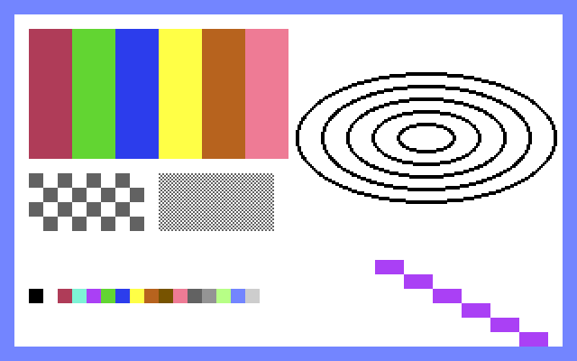
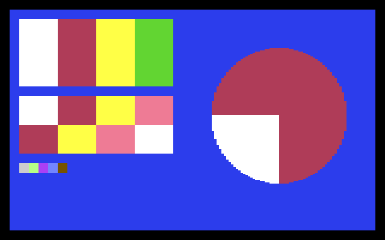

# The `.pic` picture format

GordonOS's picture file: a fixed **10,032-byte** image, uncompressed and mode-tagged. Three
consumers share it — `grpaint` writes it ([gordonpaint.md](gordonpaint.md)), `grview` reads it,
and the host tool `tools/img2pic.py` writes it from a PNG so that pictures can be made off the
machine.





Nothing ever decodes anything. The payload is stored in the display's own layout, so a load is
three DMAs straight to their homes with no staging buffer, and a save is three reads back out.
REU space is ample and the file's own length is fixed, so the size *is* the layout: a file of
any other length is refused before a byte of it is read.

The authoritative definitions live in the code: `GPIC_*` and `gpPicCheck`/`gpPicTab` in
`src/tasks/dynamic/grpaint.inc`, the reader in `grview`, and the writer in `tools/img2pic.py`.

## Layout

| Offset | Bytes | Field | |
|---|---|---|---|
| +0 | 4 | magic | `'G' 'P' 'I' 'C'` — ASCII, so it reads in a hex dump |
| +4 | 1 | version | `1` |
| +5 | 1 | mode | `2` = hires (`BMPMODE_STD`), `3` = multicolour (`BMPMODE_MC`) |
| +6 | 1 | flags | bit 0 = full screen — the only layout defined |
| +7 | 1 | pad | `0`; keeps the 16-bit fields on even offsets |
| +8 | 2 | cells across | `40`, little-endian |
| +10 | 2 | cells down | `25`, little-endian — the whole screen |
| +12 | 4 | palette | border, bg0, bg1, bg2 — the surface's own VIC colours |
| +16 | 16 | label | NUL-terminated, **screen-coded**, zero-padded |
| +32 | 8000 | pixels | the bitmap, byte for byte |
| +8032 | 1000 | matrix | the video matrix |
| +9032 | 1000 | colour RAM | the MC value-3 colour; unread in hires |
| | **10032** | | the whole file |

The three payload regions land at the surfaces' fixed addresses: `+32` → `$2000`, `+8032` →
`$0400`, `+9032` → `$D800`. The same three offsets relative to the payload land in an REU
surface slot (`+0` / `+$2000` / `+$2400`), so an off-screen load is the same shape.

## Validation

A reader checks the record's stored length against 10,032 and then compares the header's **first
12 bytes** — the magic, the version, the flags and the 40×25 cell grid — against the format's
constant half. The **mode byte is the one field the file chooses**, and it must be `2` or `3`;
either loads, and the task adopts the file's tag, palette and display mode afterwards. Nothing
else in the header is fixed, because the palette and the label are the picture's.

## Modes

Both modes use the same three regions — 8000 / 1000 / 1000 — so a mode is a tag rather than a
different file, and only the *interpretation* of the bytes differs:

- **hires (`mode 2`)** — one bit a pixel. A set pixel takes its cell's matrix **high** nibble,
  a clear pixel the **low** nibble (VIC-II §3.7.3.3; colour RAM is unused in this mode). A
  hires picture therefore holds at most two colours per cell: `bg0` in the header is the whole
  surface's paper (`$D021`) and each cell carries its own ink, packed as
  `(ink << 4) | bg0`. The colour RAM region is present but unread.
- **multicolour (`mode 3`)** — two bits a pixel, selecting one of four sources: `0` = `$D021`,
  `1` = the cell's matrix high nibble, `2` = its low nibble, `3` = the colour RAM. The matrix
  is `(c1 << 4) | c2` and the colour RAM carries `c3`, so a cell holds `c1`/`c2` and a third
  colour of its own. `$D022`/`$D023` are stored per surface and never read in a bitmap mode.
  MC pixels are double-wide, so a host tool samples a source at 160×200 and each sample
  becomes two screen pixels — the 8000-byte bitmap is unchanged.

The palette is in the file because it is **not part of the bitmap**: the border and the four
background registers are per-surface state, so a picture without them loads with whatever
background and border the task happened to have. `tools/img2pic.py` writes them, and a
`grpaint` save carries the loaded picture's own palette through.

## The label

16 bytes, NUL-terminated and zero-padded, holding up to 15 characters. It is **screen-coded**,
exactly as the filesystem encodes a name (`a`–`z` → `$01`–`$1A`, `A`–`Z` → `$41`–`$5A`, digits
and punctuation unchanged), so a task can hand it straight to a print call with no conversion.
⚠️ A host tool that writes ASCII into it produces a label that prints as garbage.

An empty label is a single zero byte, which a reader takes as "nothing to print". **Nothing
prints it today**: a 1-bit glyph blit is unreadable on a multicolour surface, and on either mode
it would overwrite the picture it came with. It is metadata, held for a future title bar or file
list, and it survives an edit — `grpaint` carries a loaded label through to the next save, so a
picture keeps its title, and only a brand-new picture starts with an empty one.

## Names

One file per picture, suffix `.pic`. The suffix is appended when a task opens a picture the way
`sidplay` appends `.mus`, so the base name is at most **7 characters** — the filesystem's own
limit, and a name with a dot in it is refused. Saving over an existing picture **writes it in
place** rather than deleting first: a delete would tombstone both the directory slot and the
10,032 bytes.

## Making one from a host

```
python tools/img2pic.py in.png out.pic                 # hires
python tools/img2pic.py in.png out.pic --mode mc       # multicolour
python tools/img2pic.py in.png out.pic --mode mc --dither   # error-diffused
python tools/img2pic.py in.png out.pic --mode mc --dither 0.45   # ...at 45%
python tools/img2pic.py in.png out.pic --mode mc --bg0 0 --gamma 1.4   # fixed paper, darker
python tools/img2pic.py in.png out.pic --mode mc --gray   # greyscale
python tools/img2pic.py in.png out.pic --label "shot"  # a title for the header
```

Requires Pillow. Every run reads its own output back and compares the header and all three
regions byte for byte before reporting success, so a file a viewer would mis-read fails on the
host instead of on the machine. The colour model matches the kernel's own painter — a picture
this tool writes and a picture the OS draws use one encoding.

`--dither [AMOUNT]` (multicolour only) error-diffuses the samples over each cell's own four
colours instead of matching each one flat. A cell can only ever hold its four, so the trade is
flat patches for a mixed tone: a gradient or a highlight the cell has no colour for becomes a
stipple of the two it has, which is what a photograph on this machine needs. Flat art, where
the cell's colours already cover its content, comes out the same either way. `AMOUNT` scales the
error passed on — `1` is ordinary Floyd–Steinberg, and lower values leave the picture flatter,
with dots appearing only where a tone has strayed far enough from the nearest colour.

A colour **slot the cell does not need** — one no pixel of it uses — is still a colour: a paint
program shows it as a slot and offers it as a pen. The converter fills those from elsewhere in
the picture, and never with a colour that cell's own samples contain, which is what keeps a
spare slot from ever capturing a pixel; the bitmap is the same either way, but even a cell with
no art at all carries colours drawn from elsewhere in the picture.

**The four options that grade the source**, applied in this order before the match:

| Option | What it does |
|---|---|
| `--gray` | desaturates the samples to their luma **and holds the match to the palette's grey ramp** (0, 1, 11, 12, 15). Both halves are needed: an unweighted RGB match leaves the ramp at both ends. A dark neutral matches brown (9) and a bright one light green (13) — so a picture made from pure grey samples still comes out with browns and greens in it unless the candidates are restricted |
| `--gamma G` | curves the mid-tones: above 1 darkens, below 1 lightens. The palette is fixed, so the source is the **only** place a picture's overall lightness can move — the matcher will otherwise hold a pale, hazy source with the bright entries (white, light grey, light green) however flat it looks |
| `--bg0 N` | the paper (`$D021`). Defaults to the picture's commonest colour |
| `--border N` | the border (`$D020`). Defaults to the commonest colour along the outer frame |

`--bg0` and `--border` are the two colours that belong to the **surface** rather than to a cell —
the other three multicolour colours are per cell, in the matrix's two nibbles and colour RAM — so
a sequence of frames must be given one of each. And `--bg0` is worth choosing deliberately: a
frame's commonest colour is often a *dither artefact* (a pale sky) rather than the flat region a
paper wants to be. On the shipped film the automatic choice measured **27.4** cells of 1000
needing more colours against **14.9** for a paper picked by hand.

Four samples are written this way and seeded into the REU image: `hires.pic` and `mc.pic`, so
`run grview hires` / `run grview mc` (and `run grpaint mc`) have something real to open, and
`alf.pic` and `alfgs.pic` — one photograph converted to multicolour, which is the hardest case
the format has to carry, twice: in colour, and as a monochrome print in the three greys. Both
are images of ALF, included non-commercially — see `NOTICE` for the credit and the fair-use
statement. A conversion is only as good as the colours it is given, and the palette a photograph
asks for is not the palette that suits flat art, so the pair also shows what grading the source
does: their
sources are tone maps of the ramp's own colours rather than quantised posters — a photograph
quantised to four colours asks the converter for no error, so it comes back flat — and both are
diffused at 45%, which is where a gradient stipples without the picture turning into static.

`tools/build-assets.ps1` regenerates each sample from the `*-src.png` beside it. The source's
own name carries the conversion, and the markers are not part of the picture's name: `-mc-`
before `-src.png` is multicolour, `-dither-` error-diffuses the samples (with an optional
two-digit strength, as in `-dither45-`), and everything else is hires with flat matching. So
`alf-mc-dither45-src.png` writes `alf.pic`, multicolour and diffused at 45%, and `mc-src.png`
writes `mc.pic`, multicolour and flat.

## The `.anm` film container

A film is **not** one file per frame: the filesystem caps a name at 11 characters and packs 512
directory entries, so a film ships as a handful of **chunks** plus a manifest.

```
llama.inf     the 64-byte manifest
llama00.anm   6 consecutive .pic records (60,192 B)   frames   0-  5
llama01.anm                                           frames   6- 11
...
llama59.anm                                           frames 354-359
```

A chunk is **raw concatenated `.pic` records** with no container header of its own, so a single
frame can still be cut out of one and opened on its own. A chunk is *not* a picture: `grview`
cannot read one, and `gen-anim.py --pic N` is how to get at a frame as a `.pic`.

The manifest — `<base>.inf`, 64 bytes, little-endian:

| Offset | Size | Field |
|---|---|---|
| +0 | 4 | magic, `GANM` |
| +4 | 1 | version (1) |
| +5 | 1 | mode (3 = multicolour) |
| +6 | 1 | frames per chunk |
| +7 | 1 | chunk-number width (the digits used in the names) |
| +8 | 2 | frame count |
| +10 | 2 | rate × 256 (24 fps = 6144) |
| +12 | 4 | border, `bg0`, `bg1`, `bg2` — the surface's palette |
| +16 | 4 | frame bytes (10,032) |
| +20 | 4 | chunk bytes |
| +24 | 12 | the first chunk's name, **screen-coded**, NUL padded |
| +36 | 28 | reserved (zero) |

The name is screen-coded because that is what the filesystem stores and what `kReuOpen` takes,
so the player hands it over unchanged and reaches the **next** chunk by incrementing the digits
in place — no number formatting anywhere on the 6502. `granim` is the player
(`run granim <base>`); [features.md](features.md) lists it.

⚠️ **The base name is the film's own**, and the digits have to fit what the 11-character limit
leaves: `llama` + two digits + `.anm` is exactly 11. `gen-anim.py` uses as few digits as the
chunk count needs (never under two) and **refuses a base that will not fit**, saying how much
room there is — so a film long enough to need a third digit must shorten its base or be split.

### How the player draws a frame

`granim` owns no interrupt and calls nothing raster-specific: the raster belongs to the kernel.
`rasterCommit` runs from the VIC raster IRQ at raster line 0 and increments `frameCount`
(`$CFFF`) there — once per displayed frame, and *before* its own deadline guard, so the clock
ticks even on a frame where the sprite commit is skipped. It is an internal kernel routine, not
a jump-table entry, so a task cannot call it ([kernel.md](kernel.md) → *Frame commit*), and
writing `$D012` would move the kernel's compare line. The player therefore **polls**: it compares
`frameCount` for change (8-bit, it wraps), never for elapsed time, and steps the film from that.

The poll is cooperative: one look per pass, then `SYS_YIELD` — never a spin on the counter, and
never on `$D012` (this is the pattern [kernel.md](kernel.md) gives for any `frameCount`-paced
task). A look that finds the same value steps nothing, and one that finds a different value steps
the film at most once however long the gap — so a busy machine makes the film run **slower in real
time rather than skipping frames**.

The film's own rate is then matched to the display's in two stages: `sysSpeedShift` masks the
clock so it steps on one frame in `2^shift` (the machine's declared speed), and a fractional
accumulator carries the remainder, so 24 fps over a 50.1 Hz display alternates two and three
steps a film frame instead of quantising to a fixed count and drifting into a stutter.

The frame is six `kReuReadAt` calls, and **their order is what keeps it from tearing**: the
matrix and colour RAM first, then the bitmap in four quarters of 2,000 bytes. The beam reads a
line's matrix and colour *before* that line's pixels, so writing in the beam's own order keeps
every write ahead of it — and the DMA outruns the beam it is racing, a byte a cycle against a
63-cycle PAL raster line, so it never falls behind. A 10,000-byte rewrite of the whole screen
therefore completes with no seam, and the film is smooth at its full rate rather than merely
tearing rarely. Tearing would need the writer to be *slower* than the raster — not merely to
outlast the border — which is why this design needs no blanking and no wait for the vertical
blank. The 2,000-byte step is a separate limit: it is the longest window the filesystem holds
interrupts off for, and each pixels quarter covers exactly 50 rows, so a region never straddles
the rows it paints.

### Generating a film from a video

Frames are prepared on the host and the film is generated from them. The download and the
frames are **scratch**; only the chunks and the manifest are committed.

```bash
# 1. one PNG per source frame, already cropped and scaled to what the converter samples
ffmpeg -ss 44 -t 15 -i source.mp4 \
    -vf "crop=1440:1080:240:0,scale=160:200:flags=lanczos" frames/f%04d.png

# 2. the film: six frames per chunk, plus the manifest
python tools/gen-anim.py frames assets/anim/<name> \
    --base <name> --fps 24 --dither 0.45 --border 0 --bg0 0 --gray --gamma 1.6
```

⚠️ **Crop and scale on the host, not in the converter.** `img2pic.py` samples multicolour sources
with `Image.NEAREST` on purpose — a filtered blend along a hard edge invents a colour the cell does
not have — so a 320-wide frame handed to it is column-decimated and aliases. `scale=160:200` at
the extraction step leaves it a 1:1 source. `crop=1440:1080:240:0` is the 4:3 fit for the C64's
320×200 area, which is what a PAL CRT shows; a square-pixel display instead wants
`crop=1728:1080:96:0`.

**Colour, greyscale, and the curve** are the three choices, and they are independent:

| | |
|---|---|
| **colour** | the options above and no more |
| **greyscale** | add `--gray`. It quantises *better* than the colour version of the same film — the palette's grey ramp is evenly spread where its colours are clumpy |
| **the tone curve** | `--gamma G`, one number. It is worth comparing a bracket as stills before committing: 1.0 hazy, 1.4 richer, 1.6 darker still, 2.0 muddy is what one film measured |

**Darker is not automatically more expensive.** On a colour film the curve *costs* quantised
cells, because the coloured entries cluster in the mid-tones and darkening pushes samples onto
them; held to the grey ramp it *gains* them, because the ramp's dark end is well populated and
darkening pushes samples off it onto a grey that fits. Measured on the shipped film, mean cells
needing more colours went **8.7 → 6.7** of 1000 from gamma 1.4 to 1.6.

A **darker paper** (`--bg0`) is the other lever, and it is not a substitute for the curve: it
darkens only the cells that use it, so it leaves a pale sky pale, where the curve moves
everything together.

## Nothing in a `.pic` is a user interface

The canvas is the whole screen: no rows are reserved and no rows are excluded. The paint
program's UI band is an overlay over the bottom two cell rows, and it is restored before a save,
so what lands in a file is only ever the picture.

## See also

- [gordonpaint.md](gordonpaint.md) — the paint program that writes these files: the band, the tools, the undo ring
- [quick-start.md](quick-start.md) — `run grview`, `run granim` and `run grpaint`, command by command
- [features.md](features.md) — the task list, `granim` among them
- [lib-filesys.md](lib-filesys.md) — the filesystem calls a load and a save are built on
- [lib-gfx.md](lib-gfx.md) — the bitmap calls that write the pixels and the matrix
