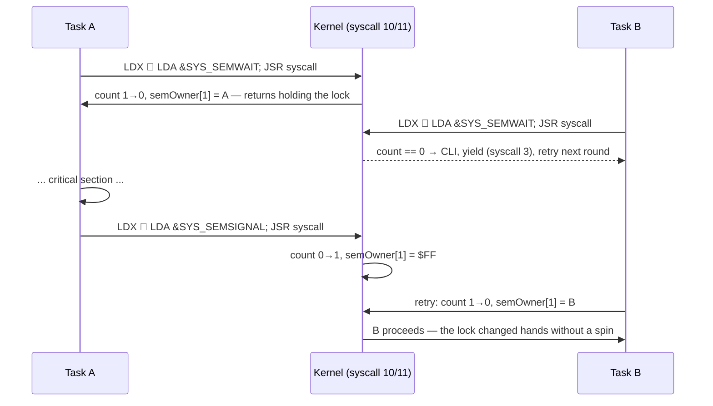

# GordonOS — Programmer's Reference

> How to write, add, and manage tasks on the GordonOS kernel
>
> For the kernel utility library API (screen, keyboard, strings, math, time), see **[`kernel.md`](kernel.md)**.

---

## Quick Start

> **Start here:** **[writing-relocatable-tasks.md](writing-relocatable-tasks.md)**
> is the step-by-step guide to writing a task or command — the task header,
> which version to choose, the fixup table and its budget, complete `.tsk` and
> `.com` boilerplate, the build manifest, and a troubleshooting table. This
> guide covers the runtime model around them.
>
> Setting up the toolchain and building the tree: **[development.md](development.md)**.
>
> Learning the ropes by writing code: **[tutorial.md](tutorial.md)** — a guided path
> from an empty file to a shipped task or command.

Tasks are preempted by the CIA timer, so they do not need to yield — but a task
with nothing to do should sleep (`syscall 13`) or yield (`syscall 3`) rather
than spin, and a task must never return with `rts`: it loops or `exit`s.

---

---

## Tasks vs Commands

GordonOS stores two kinds of relocatable binaries on the REU filesystem. They are
structurally identical (same 256-byte header + code layout, built by the
same fixup pipeline) — the only difference is the naming convention and
how the shell runs them.

### Tasks (`.tsk`) — long-running

Started with `run <name>` (the shell appends `.tsk`). The shell spawns
the task and returns to the prompt immediately; the task keeps running
until it calls `exit` or is `kill`ed. Each task is an independent
schedulable entity with its own stack and, if it calls `kAllocScreen`,
its own screen. Relocatable tasks can run multiple instances
side-by-side; reentrant tasks share code with per-instance data.

> ⚠️ A task must give the user a way out — since the shell itself can be evicted,
> a task that cannot end can strand the machine. See *A task must be able to end*
> under **Task Lifecycle Patterns** below.

While spawning, the shell disables its cursor (`kDisableCursor` before
`kDynLoad`) and re-enables it when the spawn returns — success or
error — so a spawned task that takes its own surface leaves no phantom
cursor when the user F-keys back to the shell.

Tasks may also receive arguments: `run <name> <args>`. When a binary
sets the `KF_TAKES_ARGS` header flag (`$08`), the loader copies the
argument string (leading spaces skipped, capped at 64 bytes) into the
new instance's data buffer at offset 0, null-terminated, before the
task is scheduled. Binaries without the flag are untouched. The shell
sets the flag, so a second shell can be launched with a startup
command. The args execute **once, at the initial spawn** — after pool
eviction/restore the instance buffer is reset and the shell returns to
a clean prompt.

```text
run clock           → [clock] started      (prompt returns at once)
run maze            → [maze] started
run shell ps        → second shell runs `ps` once, then prompts
run spirog 80 35 45 → a spirograph from the ring/rolling/pen radii
ps                  → all listed as running
```

### Commands (`.com`) — foreground

The utility words `ps`, `dir`, `time`, `kill`, `pause`, `resume`,
`prio`, `format`, `type`, `setfont`, `banner`, `rename`, `copy`, `del` and
`compact` are external **commands**. When you type one, the
shell's dispatcher loads `<word>.com`, runs it to completion, and only
then re-enters the prompt. A command:

- **shares the shell's screen** — it finds its parent slot
  (`gettid` → `taskParent[own]` = the shell) and calls `kShareScreen`;
  interactive commands then `kSwitchView` to take keyboard focus;
- **reads its arguments** from the kernel buffer `cmdArgsBuf` (40 bytes
  at `$42DC`) — everything after the command word;
- **exits** when finished (`syscall #0`); the shell's wait loop notices
  the DEAD slot and returns to the prompt.

```text
kill 3              → shell loads kill.com, waits, prints, returns
```

### Built-in vs external words

| Kind | Words | Implemented in |
|---|---|---|
| Built-in (no file loaded) | `help` `clear` `view` `run` `exit` `print` `fsinfo` `save` `load` `runbatch` `pool` `ver` `me` `wait` | `src/tasks/dynamic/shell.inc` (`pcHelp`…`pcWait`) |
| External (`.com` files) | `ps` `dir` `time` `kill` `pause` `resume` `prio` `format` `type` `setfont` `banner` `rename` `copy` `del` `compact` | `src/tasks/cmd/*.asm`, loaded by `pcFgPs` |

The shell keeps one command string table (`cmdsBlock`) and one
14-entry handler table (`handlerOffTab`). Any other word falls through
to `pcFgPs`, which appends `.com` to the typed word and `kDynLoad`s it.

### Batch files — `runbatch <name>`

`runbatch` executes a batch file `<name>.bat` from the REU filesystem
line by line, exactly as if each line had been typed at the prompt:

- **Lines** are ≤ 79 characters plus a CR+NUL terminator: CR (`$0D`)
  is the *display* separator (`type` shows a newline there) and NUL is
  the *real* terminator `runbatch` splits on — so lines may contain
  `m` (`$0D` is its screen code) and every command (`run maze`,
  `time`, `format`…) works. `runbatch` strips the display CR before
  executing. Empty and space-only lines are skipped. The file is
  **streamed** in 80-byte windows, so there is no file-size limit.
- **Errors stop the batch silently**: the failing command prints its
  normal error message (e.g. `? unknown`) and the batch ends. This
  includes `? line too long` for lines with no NUL before 80 bytes.
- **Nested `runbatch` works** — the outer batch's position is saved on
  the stack, so a batch can run another batch and continue afterwards.
  An error in the inner batch also stops the outer one.
- **Interactive commands behave naturally** — `time`, `ps`, `exit`, etc.
  do what they do at the prompt.
- File names are ≤ 7 characters (`.bat` is appended, like `run` appends
  `.tsk`); explicit extensions are refused (`? runbatch: no extension`).

Create a batch by saving memory that contains screen-code text with
CR+NUL (`$0D $00`) after each line, e.g. from BASIC:

```text
save demo.bat <start> <end>
runbatch demo
```

`runbatch` reads the file directly through REU DMA (`kReuDirEntry` +
`kReuToC64`), using the per-instance batch state at data offsets
91-96 (`BATPOS`/`BATSIZE`/`BATOFF`) and the `BATERR` byte at offset 80.

**`boot.bat` is special**: the boot task spawns `shell.tsk` with the
startup args `runbatch boot` (the same args mechanism as `run shell ps`),
so the first shell executes `boot.bat` once before its prompt. It is the
bootstrap hook for initial tasks — it currently contains `run shell` +
`exit`, and lives as the editable text file `src/batch/boot.bat`, which
`tools/build-reu.ps1` screen-code encodes when seeding the FS.

### Writing a command

See **[writing-relocatable-tasks.md](writing-relocatable-tasks.md) §9 "Part B —
writing a `.com` command"** for the full walkthrough: the wrapper, sharing the
shell's surface via `gettid` → `taskParent` → `kShareScreen`, reading arguments
from `cmdArgsBuf`, and why a command must `exit` on every path.

The short version: a command is a relocatable binary in `src/tasks/cmd/`, named
`<word>.com` in the manifest, flags `$01`, shares the shell's screen, reads its
arguments from `cmdArgsBuf`, and exits (`syscall 0`) when done.

**Rule of thumb:** leaves something running → *task* (`.tsk`); does a
job and comes back → *command* (`.com`).

### The `.bnr` banner format

`banner <file> <row> <col>` draws a custom-glyph banner file from the
REU FS. `.bnr` layout: byte 0 = columns c (1–40), byte 1 = rows r
(1–25), then c·r glyph definitions of 8 bytes each (one byte per pixel
row, bit 7 = leftmost pixel, `1` = ink — the same layout `kPrintGlyph`
blits). The banner is drawn at (row, col) with the shell's text colour;
placement that would wrap or scroll past the 25×40 screen is refused
with an error.

---

## Zero Page & DMA Preservation

By default, ZP `$02-$EF` is **not preserved** across context switches — every task shares the same physical ZP bytes. This is fine for tasks that only use ZP for temporary scratch within a single timeslice. (`$F0` is a kernel global — `blinkRate`, the cursor blink interval — never use it in task code.)

If your task needs **persistent ZP state** (e.g. an interpreter like BASIC, a compiled language, or any code ported from a single-tasking environment), declare a ZP save region in the task binary's header (`zp_base` at header+8, `zp_len` at header+9):

```asm
// wrapper .asm — declare that myTask owns ZP $02-$2F (46 bytes)
.byte $02, $2e         // zp_base, zp_len (header fields +8/+9 — HDR_ZP_BASE/HDR_ZP_LEN)
```

The scheduler **DMAs** this region to/from a per-task REU shadow on every context switch. Tasks with `zp_len=0` pay zero overhead — the DMA is gated. The ZP region must be contiguous and must not overlap kernel ZP (`$F0-$FF`): `base + len ≤ $F0`. `spawnCore` validates this and clamps invalid declarations. That shadow is per **slot** and it outlives its task, so `spawnCore` **zeroes it when a task is spawned** (`clearSlotShadows`): your window always starts on zeros, never on the state the slot's previous occupant left behind.

**Example — two tasks sharing the same ZP location** (works because DMA preserves each independently):

```asm
// mytask.inc — counts in ZP $02
myTask:
    inc $02
    inc $d020
    lda #3; jsr syscall
    jmp myTask

// maze.inc — uses ZP $02 for a scroll counter
maze:
    inc $02
    ; ... use $02 for pattern ...
```

Both tasks write to ZP `$02` concurrently, but each sees only its own value. The scheduler saves $02 to REU on switch-out and restores from REU on switch-in — independent per-task state from a single physical ZP byte.

**Constraints:**
- ZP `$00-$01` are the 6510 port registers — never use them
- ZP `$F1-$FF` is owned by the kernel and saved/restored separately
- The ZP region must be contiguous (one `base` + `len` pair per task)
- Maximum region size: 240 bytes (`$00-$EF`)
- DMA cost: ~1 cycle per byte (REU DMA), paid only when switching to/from a task with a non-zero ZP region

---

## Syscall Reference

All syscalls are invoked via:

```asm
    LDA #syscall_number
    JSR syscall
```

### Syscall 0 — `exit`

Terminate the current task. Marks it DEAD and immediately switches to the next ALIVE task. **Does not return.**

```asm
    lda #0
    jsr syscall         ; never returns
```

### Syscall 1 — `spawn`

Create a new task at runtime. Set `spawnPtr` ($F7-$F8) to the task address and `taskNamePtr` ($F3-$F4) to a null-terminated screen-code name string. Optionally set `kArg+6` (ZP base) and `kArg+7` (ZP length) to declare a per-task ZP DMA region.

```asm
    lda #<myTask
    sta spawnPtr
    lda #>myTask
    sta spawnPtr+1
    lda #<nameMyTask
    sta taskNamePtr
    lda #>nameMyTask
    sta taskNamePtr+1
    lda #0; sta kArg+1      // no reentrant data buffer
    lda #$02; sta kArg+6    // ZP base (0 = no ZP DMA)
    lda #$2e; sta kArg+7    // ZP len  (0 = no ZP DMA)
    lda #1
    jsr syscall             ; prints "[name] started"
    bcs spawnFailed
```

On success the carry is clear (`C=0`) and the task starts immediately. On failure carry is set (`C=1`) and `kArg` holds the reason:

| `kArg` | Meaning |
|---|---|
| 0 | No free task slot (all 23 spawnable slots in use) |
| 1 | Instance-data heap exhausted (`$1D40-$1FFF` full — only after the size-class scavenge found no recyclable buffer) |

**ZP DMA fields** (`kArg+6`/`kArg+7`): Set `kArg+6` = ZP base address, `kArg+7` = length in bytes (0 = no ZP save). Constraints: `base + len ≤ $F1` (must not overlap kernel ZP), max 240 bytes. See "Zero Page & DMA Preservation" above.

```asm
    bcc spawnOk
    lda kArg
    bne heapFull        ; kArg=1 → heap exhausted
    ; kArg=0 → no free slot
```

**Note:** The spawned task must exist in the binary. Each task file should define its own `nameXxx` string in screencode_mixed encoding.

### Syscall 12 — `threadSpawn`

Spawn a child task with auto-generated naming. Unlike `spawn` (#1), you do not set `taskNamePtr` — the kernel generates the name automatically as `parent.N` (e.g. `godzi.0`, `godzi.1`) and allocates zero private data (`kArg+1=0`). The child inherits the caller as its parent, which enables **cascading kill**: killing the parent terminates every child it spawned. ⚠️ **`kArg+6`/`kArg+7` (zpBase/zpLen) are the CALLER's to set** — a thread may declare its own ZP window exactly as `spawn` does. It has to be the thread's *own* registration, because the scheduler's ZP save and restore are gated on the **switching task's own** `taskZpLen` and use its own REU shadow: a window declared by the parent cannot cover a child, since the parent's restore DMAs the parent's shadow straight over the child's live ZP while the child's own restore is skipped at length 0. Set both to `0` for a thread with no ZP state; **nothing clears them for you**, so a caller that forgets inherits whatever they held last.

```asm
    lda #<thInc; sta spawnPtr
    lda #>thInc; sta spawnPtr+1
    lda #0
    sta kArg+6; sta kArg+7  // no ZP window — REQUIRED, nothing clears these for you
    lda #12; jsr syscall    // child named "parent.N"
    bcs noSlots             // C=1, kArg=0 → no free slot
```

**Worked example — a parent with two worker children.** The parent spawns two children, then stays alive yielding; the scheduler interleaves all three:

```asm
parent:
    // --- spawn the first child -> "parent.0" ---
    lda #<wInc; sta spawnPtr
    lda #>wInc; sta spawnPtr+1
    lda #0
    sta kArg+6; sta kArg+7      // no ZP window (the caller must always set these)
    lda #12; jsr syscall        // threadSpawn

    // --- spawn the second child -> "parent.1" ---
    lda #<wDec; sta spawnPtr
    lda #>wDec; sta spawnPtr+1
    lda #0
    sta kArg+6; sta kArg+7
    lda #12; jsr syscall        // threadSpawn

    // parent stays alive — yields to let the children run
parentIdle:
    lda #3; jsr syscall         // yield
    jmp parentIdle

wInc:                           // child "parent.0"
    inc $d020                   // a visible side effect: the border colour
    lda #3; jsr syscall         // yield
    jmp wInc

wDec:                           // child "parent.1"
    dec $d020
    lda #3; jsr syscall         // yield
    jmp wDec
```

`godzi` and `gortris` spawn a child exactly this way (their music/cleanup worker), so that is the pattern to copy for a real task. Inspect the result with the shell:

```text
run mytask           → mytask and its thread children start
ps                   → all of them appear; note the IDs in the id column
kill 2               → cascade: parent AND both children die (thread-spawned only)
kill 1               → kills only the shell; other `run`-spawned tasks survive
```

> **Cascade detail:** `kill <parent id>` marks the parent DEAD, then walks the task table killing every thread child (`taskThreadNameReuHi != 0`) whose `taskParent` points at it — recursively, so grandchildren die too. This only applies to tasks spawned via `threadSpawn` (syscall 12). Tasks created with `spawn` (syscall 1) have `taskParent = $FF` (no parent) and are unaffected; `run`-loaded tasks set `taskParent` to their spawner (for screen-sharing) but are still exempt. Killing an individual child (its own ID, from `ps`) removes only that child; the parent and sibling keep running.
>
> **A thread child never runs without its parent.** It has no dyn entry and runs the parent's *code pages*, so the kernel has three layers for it: `kill` cascades (above); pool eviction refuses to *swap* a task with live thread children (it kills the task and its subtree instead); and `findNextAlive`'s `childGate` refuses to schedule a thread child whose parent is `TA_DEAD` or `TA_SWAPPED` — a swapped parent's children are held and resume when it is restored, and an *exited* parent's children are simply never scheduled (they keep their TCB slot, so **a task that spawns children must reap them before it exits**).

> **Naming note:** The generated name `parent.N` is what appears in `ps`; the commands themselves take the **slot ID**, so a child is addressed by its own ID and not by its name. `kill <parent id>` still cascades to every child.

### Syscall 2 — `kill`

Terminate another task (or self). Pass the target task index in the X register. Killing a task also kills all thread-spawned children (cascading kill). Tasks spawned via `run`/`spawn` are independent and unaffected.

```asm
    ldx #3              ; kill task index 3 (and its children)
    lda #2
    jsr syscall
```

If the killed task is the caller, this behaves like `exit` and does not return.

### Syscall 3 — `yield`

Voluntarily give up the current timeslice. The task resumes at the instruction immediately after `JSR syscall` on its next turn through the scheduler.

```asm
    inc $0400
    lda #3
    jsr syscall         ; yield — resume at next instruction
    inc $0400           ; executes on next turn
```

Useful for cooperative patterns: a task that finishes early, a task waiting for I/O, or any situation where the task doesn't need its full slice.

> **A yield always hands over immediately, at any priority.**
> The scheduler keeps the CPU on the same task while its quantum has slices left,
> which is what a priority > 1 *means* for a timer preemption, so a voluntary yield
> has to reset the slice counter itself. Without that, a task that raised its
> priority loses cooperative hand-over, and since `semWait`'s busy path is
> yield-and-retry, waiting on a semaphore becomes polling with a full context
> save/restore per retry. `yield` forces the switch regardless of priority;
> CPU *share* is still weighted by priority, only the hand-over is unconditional.

**Note:** All syscalls are atomic — the dispatcher disables interrupts on entry. Returning syscalls (`spawn`, `kill`-other, `pause`-other, `resume`, `setprio`, `gettid`, `semSignal`) re-enable before `RTS`. Non-returning syscalls (`exit`, `kill`-self, `yield`, `pause`-self) re-enable via the restored SR in RTI or via CLI before RTS. **Syscalls 8 and 9 are inert** — no-op `CLI; RTS` (use `kAllocScreen`/`kFreeScreen`). **10 and 11 are counting semaphores** for task synchronisation; `semWait` blocks by yielding and returns only once it holds the semaphore.

### Syscall 4 — `pause`

Suspend a task. Pass the target task index in the X register. If pausing self, behaves like `yield`-to-sleep and does not return until resumed. The task's stack is preserved in its TCB.

**State guard:** a target that is already **DEAD** or **SWAPPED** is left exactly as it is — the call is a silent no-op. This matters because `taskState` is the only record of a task's residency: `TA_SWAPPED` means its code pages have been handed back to the pool, and `TA_DEAD` is a slot that must stay dead until something legitimately re-uses it. Never overwrite either from outside the scheduler/loader.

> ℹ️ **Self-pause saves the frame:** it goes through the `sysYield` path, so the task resumes at the instruction after the `jsr syscall` — with A=0 and Y=`syscall#*2`, the same return contract a `yield` has — and only once something resumes it. A self-pause that jumped straight to the scheduler would store nothing, and the task would come back at its **last preemption point**, silently replaying the work since.

```asm
    ldx #3              ; pause task index 3
    lda #4
    jsr syscall
```

```asm
    ldx curTask         ; pause self
    lda #4
    jsr syscall         ; never returns until resumed
```

### Syscall 5 — `resume`

Resume a paused task. Pass the target task index in the X register.

```asm
    ldx #3              ; resume task index 3
    lda #5
    jsr syscall
```

### Syscall 6 — `setprio`

Set a task's scheduling priority. Pass the target index in X and the new priority in `kArg+1`.

| Value | Effect |
|---|---|
| 0 | Pause the task (routes through `sysPause`, so a **DEAD/SWAPPED** target is left untouched). Task stays paused until explicitly **resumed** — changing priority back to 1–5 does **not** un-pause it. |
| 1–5 | Valid priority (higher = more CPU slices). Default for new tasks is 1. |
| >5 | Clamped to 5. |

```asm
    lda #3
    sta kArg+1          ; priority 3 (3× CPU slices)
    ldx #2              ; target task index
    lda #6
    jsr syscall         ; setprio
```

```asm
    lda #0
    sta kArg+1          ; 0 = pause
    ldx #2
    lda #6
    jsr syscall         ; pauses task 2
```

### Syscall 7 — `gettid`

Return the current task's index (0 to `MAX_TASKS`-1) in the A register. Useful for self-identification in IPC, logging, or indexing per-task data arrays.

```asm
    lda #7
    jsr syscall         ; A = this task's index (e.g., 2)
    tax                 ; X = my task ID
    jsr kGetTaskName    ; kPtr → my task's name
    jsr kPrintString    ; prints my task's name
```

### Syscall 13 — `sleep`

Put the current task to sleep for a specified number of IRQ ticks (~60 Hz, ~16.7ms per tick). The task blocks — full state is saved — and resumes at the instruction after `JSR syscall` once the tick count expires.

```asm
    lda #30
    sta kArg+1          ; sleep ~500ms (30 ticks × 16.7ms)
    lda #13
    jsr syscall         ; resumes here after 30+ ticks
```

Sleep is a **minimum** duration — scheduling latency may extend it. Use 0 (clamped to 1) for a one-tick yield with a guaranteed switch-away.

```asm
    ; Periodic blinker — flash border every 0.5s
blink:
    inc $d020
    lda #30; sta kArg+1
    lda #13; jsr syscall
    jmp blink
```

**Difference from `yield` (syscall 3):** `yield` gives up the current timeslice and is immediately eligible for scheduling on the next round. `sleep` removes the task from scheduling entirely for N ticks, guaranteeing it won't be scheduled during that window.

---

## Error Handling & Return Conventions

Syscalls signal success or failure through the **carry flag**, with a numeric detail code in `kArg` where applicable. Always test carry immediately after the returning `JSR syscall`, before any instruction that touches flags.

| Syscall | Success | Failure |
|---|---|---|
| `spawn` (1) | `C=0`, task started | `C=1`, `kArg`=0 (no slot) or 1 (heap full) |
| `threadSpawn` (12) | `C=0`, child started | `C=1`, `kArg`=0 (no slot) |
| `kill`/`pause`/`resume` (2/4/5) | returns (or does not, if self) | out-of-range/dead target is a silent no-op |
| `semWait` (10) | blocks by yielding until the count is available, then returns holding it — there is no failure return |
| `semSignal` (11) | never blocks; increments the count (caps at 255) — no failure return |

**Argument-passing summary (the syscall ABI):**

| Register / byte | Role |
|---|---|
| `A` | Syscall number (consumed by the dispatcher) |
| `X` | Target task index for `kill`, `pause`, `resume`, `setprio` |
| `kArg` (`$4000`) | Scratch input/output byte (e.g. `spawn` error code) |
| `kArg+1` | Secondary input (e.g. `setprio` value, `spawn` data size) |
| `spawnPtr` (`$F7-$F8`) | Task entry address for `spawn`/`threadSpawn` |
| `taskNamePtr` (`$F3-$F4`) | Task name string for `spawn` |

> **Do not rely on `Y`** for any syscall input or output — it is not part of the ABI. The dispatcher is a jump table indexed via `Y`, and it deliberately preserves `X` so X-input syscalls receive the caller's target index unchanged.

> ⚠️ **The `kArg` block is global scratch, not task state.** It is one 8-byte
> block (`$4000-$4007`: `kArg` + `kResult`) shared by every task, and the kernel
> rewrites it freely: `kArg+3`/`kArg+4` are the **DMA length lo/hi** of every
> `kReuToC64`/`kReuFromC64`/`kReuFill*` call (so `kArg+4` is `0` for any transfer
> under 256 bytes and `1` for a page), and `dynFree` → `dlRestore` clobbers
> `kArg+3..+7`. Conversely the kernel keeps its own values out of the block
> where another task's copy is live — `surfDisplayed`, which the scheduler calls
> from the timer IRQ and `sysExit` calls during a parked task's syscall, uses a
> private byte for exactly that reason. So use `kArg` only as a scratch *within
> one call* (set it, call, read it). Anything that must survive a `yield`, a
> `sleep` or any blocking call belongs in your instance buffer, a declared ZP
> window, or your task's own stack — the shell keeps its foreground child slot in
> its own instance byte (`PCFG`) for that reason.

**Idiomatic failure handling** — retry-or-report on a full task table:

```asm
    lda #1
    jsr syscall
    bcc spawned             ; C=0 → success
    lda kArg
    cmp #1
    beq reportHeapFull      ; kArg=1 → instance heap exhausted
    ; kArg=0 → no free slot; caller may yield and retry later
    lda #3; jsr syscall     ; yield, then try again
    jmp trySpawn
spawned:
```

---

## Task Lifecycle Patterns

### Finite-lifetime task

```asm
finiteTask:
    ldx #$40            ; do work for a while
loop:
    inc $0478
    ldy #0
delay:
    dey
    bne delay
    dex
    bne loop
    lda #0
    jsr syscall         ; done — exit
```

### Spawn-then-die task

```asm
spawnerTask:
    ldx #$20
loop:
    inc $04a0
    ; ... delay ...
    dex
    bne loop
    ; spawn child
    lda #<childTask
    sta spawnPtr
    lda #>childTask
    sta spawnPtr+1
    lda #1
    jsr syscall
    ; then exit
    lda #0
    jsr syscall

childTask:
    ldx #$10
    ; ... work ...
    lda #0
    jsr syscall
```

### Killer task

```asm
killerTask:
    ldx #$30
    ; ... run for a while ...
    ldx #2              ; kill task index 2
    lda #2
    jsr syscall
    lda #0
    jsr syscall         ; then exit
```

### A task must be able to end

A task that cannot be left can strand the whole machine, because the **shell is
evictable**: another task's load — or a `kMalloc` that has to make room — can swap
the shell's code out, and the kernel only restores swapped tasks **when a task
exits** (`dynFree` → `dlRestore`). A task that never ends can therefore leave the
shell swapped out and unreachable: there is no prompt, and `ps`, `kill` and `view`
are shell commands, so they cannot help. The F-key screen cycle (*Screen Patterns →
Pattern 4: View switching via F-keys*, below) only changes what you see and where
you type — it does not run the shell.

Two more costs:

- a `KF_NOT_EVICTABLE` task can never be swapped out, so its pool pages come back
  only when it *ends* — its own `exit`, or a `kill` from a shell that is still
  reachable;
- a `.com` runs in the **foreground** — the shell waits in `pcFgWait` until the
  child's `taskState` is 0 — so a command that never exits blocks the shell
  outright.

**So every interactive task must end itself** on a key the user can find (the `q`
key in the demos, `STOP+Q`/`STOP+X` in `edit`, the `exit` command in BASIC), print
that key somewhere while it runs, and call `SYS_EXIT` on both the quit path and the
normal completion path. `SYS_EXIT` frees the surface and hands the display back,
which is also what returns the shell. A deliberately endless task is acceptable
only when it never takes the display and never pins its pages (`clock`, or
`sidplay` with an endless repeat count) — see
[writing-relocatable-tasks.md](writing-relocatable-tasks.md) §7.

---

## Screen Lock

When multiple tasks write to the same screen, multi-step screen operations must be atomic
or the cursor and kernel state can be corrupted by an interrupting task.

### The Problem

Screen variables like `cursorCol`/`cursorRow` are shared across all tasks. If Task A is
mid-operation (e.g., set cursor, print, restore cursor) and gets preempted, Task B's
screen output moves the cursor. When Task A resumes, it prints at the wrong position.

> **Note:** `kPtr`, `srcPtr`, `kArg`, and `dataPtr` are all saved/restored per-task by the scheduler.
> They are safe across context switches without explicit locking.
> Only cursor position still needs protection on shared screens.

### The Solution: `kLockScreen` / `kUnlockScreen`

Wrap multi-step screen operations in a lock. The lock uses semaphore 0 — if another
task holds the lock, the caller **yields** its timeslice and retries on the next
schedule. Other tasks (non-screen) keep running while a screen lock is held. `kPtr`
and `kArg` are saved to per-task arrays so they survive the yield.

```asm
    jsr kLockScreen             ; acquire screen semaphore, save kPtr/kArg
    ldx #0
    ldy #0
    jsr kPrintTime              ; blit time at (0,0) — no cursor/shadow
    jsr kUnlockScreen           ; restore kPtr/kArg, release semaphore
```

**Rules:**
- Keep locked sections **short**. Other screen tasks yield-wait; non-screen tasks are unaffected.
- Always save/restore the cursor position inside the lock if you move it.
- `kLockScreen` and `kUnlockScreen` must always be paired.

---

## REU DMA — Hardware-Accelerated Transfers

Tasks with their own screens automatically get per-task color RAM (the scheduler saves/restores `$D800-$DBE7` on context switches when the task owns the displayed screen). For general-purpose REU DMA, use the kernel REU calls. See [`kernel.md`](kernel.md) for the complete API.

### Copying Data Between C64 and REU

```asm
    ; copy surface slot to REU for later restore
    lda #<$2000; sta kPtr        ; C64 source
    lda #>$2000; sta kPtr+1
    lda #<$1000; sta kArg        ; REU dest (bank 0:$1000)
    lda #>$1000; sta kArg+1
    lda #0; sta kArg+2            ; bank 0
    lda #<$03e8; sta kArg+3       ; 1000 bytes
    lda #>$03e8; sta kArg+4
    jsr kReuFromC64              ; C64 → REU

    ; ... later: restore surface slot from REU ...
    lda #<$2000; sta kPtr
    lda #>$2000; sta kPtr+1
    ; kArg already set from above
    jsr kReuToC64                ; REU → C64
```

### Swapping Buffers (Double-Buffering)

Not provided as kernel calls: swap buffers with two transfers
(`kReuToC64` then `kReuFromC64`).

> ⚠️ **Do not fire two REU DMAs close together.** The scheduler's stack save DMAs only the used portion of the stack. Always wait for one DMA to complete (all kernel REU calls poll `$DF00` internally) before starting another.

---

## Virtual Screens

Tasks can request private surfaces via `kAllocScreen` (REU slots, 28 max). Each surface stores its own cursor position, colors, and glyph set — the cursor state in the slot's matrix tail, the colors per-task. The scheduler brings a task's surface into the framebuffer when it gains focus — tasks just use the normal `kPrint*` routines.

### Allocating a Screen

```asm
    lda #$0b; sta kArg       ; border = dark grey
    lda #$00; sta kArg+1     ; bg0 = black
    lda #$00; sta kArg+2     ; bg1
    lda #$00; sta kArg+3     ; bg2
    lda #0                   ; mode 0 = hires-text
    jsr kAllocScreen         ; carry set = no free slot
```

### Viewing a Screen

Use the `view` command at the shell:

```
view 2          — show task 2's screen (run `ps` to find the ID)
view 1          — back to the shell's screen
```

### Tasks Without Screens

Tasks that don't call `kAllocScreen` render
into the shared framebuffer `$2000`. Their output is overwritten when a
surface-owning task takes focus. Per-surface state (cursor position,
enable, saved glyph) lives in the surface slot's matrix tail
(`slot + $23E8`), mirrored in the framebuffer matrix tail while the
surface is displayed.

### Screen Colors

Surface colors are passed to `kAllocScreen` in `kArg`
(border, bg0, bg1, bg2) and stored per-task in `taskGfxBorder/Bg0/Bg1/Bg2`.
`doGfxSwitch` applies them to `$D020-$D023` whenever the surface becomes
the displayed one; hires text foreground comes from the video matrix
high nibble (`taskTextColor`), and `taskCursorColor` drives the blink.
(`$D022`/`$D023` are written but never read by the VIC in bitmap modes —
they belong to extended-colour mode, which GordonOS does not use. The
multicolor palette is `$D021`, the matrix nibbles, and colour RAM.)

Change colors at runtime with kernel routines:

```asm
    lda #$05                ; green text
    jsr kSetTextColor
    lda #$01                ; white cursor
    jsr kSetCursorColor
```

Colors persist across context switches (stored per-task in `taskGfx*`/`taskTextColor`/`taskCursorColor`) and scrolls (`kScrollScreen` moves the video matrix with the pixels). Default colors are defined by `DEFAULT_BORDER_COLOR`, `DEFAULT_BG_COLOR`, `DEFAULT_TEXT_COLOR`, and `DEFAULT_CURSOR_COLOR` in `kernel.inc`.

> **All-bitmap note:** `$D018` is fixed (`GFX_D018`) — there is no
> per-surface charset. GordonOS uses a single lowercase/uppercase font
> (no glyph-set switching).

### Syscall 8 — `allocscreen` (inert)

**This syscall number is a no-op.** Allocate a surface with a direct call to
`kAllocScreen`: the mode goes in **A**
(0 = hires-text, 1 = mc-graphics) and the colours in `kArg`..`kArg+3`. There are
28 REU surface slots (10 KB each).

```asm
    lda #$0b
    sta kArg                ; border
    lda #0
    sta kArg+1              ; bg0
    sta kArg+2              ; bg1 (unused in hires)
    sta kArg+3              ; bg2 (unused in hires)
    lda #0                  ; mode: 0 = hires-text
    jsr kAllocScreen
    bcs noFreeSlots
```

### Syscall 9 — `freescreen` (inert)

**This syscall number is a no-op.** Release the current task's screen with
`jsr kFreeScreen`. If sharing another task's screen, this just detaches — the owner's buffer stays intact.

```asm
    jsr kFreeScreen
```

### Syscall 10 — `semWait`

Acquire a counting semaphore. Pass the semaphore index in X. Semaphore 0 is the screen lock (`kLockScreen`); **1-3 are free for task synchronisation**.

Returns only when the semaphore is held — if the count is 0 the calling task **yields** and retries on its next timeslice, so the holder always gets the CPU and other tasks keep running. There is no timeout.

```asm
    ldx #1                  ; semaphore 1
    lda #SYS_SEMWAIT
    jsr syscall             ; blocks (yields) until acquired
```

### Syscall 11 — `semSignal`

Release a counting semaphore. Pass the semaphore index in X. Increments the count (caps at 255 — a release of an already-full semaphore is a harmless no-op). When the count transitions 0→1 the ownership record is cleared. The releasing task never blocks.

```asm
    ldx #1                  ; semaphore 1
    lda #SYS_SEMSIGNAL
    jsr syscall             ; release one slot
```

---

## Semaphores

GordonOS semaphores are **counting** (0-255), and there are four of them (`MAX_SEMAPHORES = 4`). Index **0 is the screen lock** — `kLockScreen`/`kUnlockScreen` own it and a task should never touch it. Indices **1-3 are yours**, reached with syscalls 10 (`semWait`) and 11 (`semSignal`), index in **X**.

On a mutex acquire (count 1→0) the kernel records the owner, so it can release the lock if that task dies; for a counting semaphore (count > 1) no owner is recorded — the kernel never corrupts multi-slot state, but it also cannot return a unit held by a task that dies.

`semCount` (`$E120`, 4 bytes) and `semOwner` (`$E124`) are published to tasks by `src/tasks/kernel-data.inc`, so a task initialises its own semaphore with a plain store — one byte, atomic on a single CPU:

```asm
    ; ---- one-time setup, BEFORE any task that uses it can run ----
    lda #1
    sta semCount+1          ; semaphore 1 = mutex (1 slot)
```



> ⚠️ **Call these with interrupts enabled** — the normal task state. The kernel
> routines bracket their critical section with `sei`/`cli` and return with IRQs
> enabled, so they are not for use inside an `sei` block.

### Mutex (Mutual Exclusion)

Initialise a semaphore to 1. The first task to `semWait` gets the lock; every other task that asks while it is held yields *inside* `semWait` and retries on its next timeslice. That is the crucial property for a preemptive system: a **low-priority** task can hold the lock while a **high-priority** one waits, and the holder still gets the CPU — nobody spins.

```asm
; ==========================================
;  Lock helpers. Pair them on every path, and
;  never take a lock you will hold across a
;  yield, a long REU transfer or a screen switch.
; ==========================================
SEM_MUTEX = 1                             ; semaphore 1

semLock:
    ldx #SEM_MUTEX
    lda #SYS_SEMWAIT
    jsr syscall                           ; returns only when the lock is ours
    rts

semUnlock:
    ldx #SEM_MUTEX
    lda #SYS_SEMSIGNAL
    jsr syscall                           ; never blocks
    rts

; ==========================================
;  Two tasks doing read-modify-write on shared
;  state — an FS record, a shared scratch block,
;  a counter both of them bump. Without the lock,
;  both can read the same value and the second
;  write silently drops the first one's change.
; ==========================================
bumpShared:
    jsr semLock                 ; ---------- enter ----------

    jsr readShared              ; load the shared value (FS read, REU copy, …)
    bcs bumpFail                ;    C=1: it was not there — still release!
    clc
    adc #1                      ; change it
    jsr writeShared             ; store it back — nobody can slip a write between

bumpFail:
    jsr semUnlock               ; ---------- leave ---------- (on BOTH paths)
    lda #SYS_EXIT
    jsr syscall
```

`readShared`/`writeShared` are yours — the only rule the example is making is that
nothing of the other task's work can land between the read and the write.

> **Initialise before you spawn.** A semaphore starts at 0 (unavailable), so the
> `sta semCount+1` with 1 has to happen *before* the first user task can run. Doing
> it in a parent before `spawn` is enough; a dynamic task cannot initialise a
> semaphore on behalf of a task that is already running.

### Throttle (counting semaphore)

Initialise to N and at most N tasks can be inside the guarded section at once — the right shape when a resource is finite but not exclusive (REU bandwidth, a shared scratch buffer, a region of the bitmap pool).

```asm
    ; ---- setup: three concurrent slots on semaphore 3 ----
    lda #3
    sta semCount+3

heavyStep:
    ldx #3
    lda #SYS_SEMWAIT                      ; waits for one of the three slots
    jsr syscall

    jsr doTheHeavyWork                    ; DMA, blitting — whatever competes

    ldx #3
    lda #SYS_SEMSIGNAL                    ; return the slot
    jsr syscall
    jmp heavyStep
```

Because the count is > 1, `semOwner[3]` is **not** updated and the kernel will not
reclaim a slot if a task is killed mid-section — the count leaks one slot per death.
Keep the guarded section short, or treat a `kill` as costing one slot until reboot.

### Producer-Consumer (Bounded Buffer)

The classic two-semaphore pattern: one counts **empty** slots, one counts **filled** slots, and the buffer itself is a plain ring the pair owns. Note the ordering — wait on `empty` *before* writing, signal `filled` *after* — and that each task signals the **other** semaphore.

> **Do you need this?** If the payload is a byte stream, [`ipc.lib`](lib-ipc.md) does the same job in one primitive: it keeps four independent 128-byte rings in the library's shared data (X selects the channel) and `kIpcPost` blocks while the target ring is full, so no semaphores are needed at all. Reach for the pattern below when you need *structured* slots (records, several consumers) or when the two tasks are already synchronising for another reason.

```asm
BUF_SLOTS = 8

    ; ---- setup, before either task runs ----
    lda #BUF_SLOTS
    sta semCount+1          ; semaphore 1 = empty slots
    lda #0
    sta semCount+2          ; semaphore 2 = filled slots

    ; ---- producer ----
produce:
    ldx #1
    lda #SYS_SEMWAIT        ; wait until there is an empty slot
    jsr syscall

    ldy bufHead             ; index the ring (power of two → mask, not modulo)
    jsr nextItem            ; returns the item in A
    sta bufRing,y
    lda bufHead
    clc
    adc #1
    and #BUF_SLOTS-1
    sta bufHead

    ldx #2
    lda #SYS_SEMSIGNAL      ; one more item is ready
    jsr syscall
    jmp produce

    ; ---- consumer ----
consume:
    ldx #2
    lda #SYS_SEMWAIT        ; wait until an item is ready
    jsr syscall

    ldy bufTail
    lda bufRing,y           ; take the item
    sta sinkData
    lda bufTail
    clc
    adc #1
    and #BUF_SLOTS-1
    sta bufTail

    ldx #1
    lda #SYS_SEMSIGNAL      ; hand the slot back
    jsr syscall
    jmp consume
```

Each semaphore has exactly one signaller: the producer signals `filled`, the consumer signals `empty`. Writing the *other* task's semaphore directly (a `sta semCount+1` in the consumer, say) double-counts a slot and corrupts the ring arithmetic — the two `inc`-side stores are the only ones allowed, and only once, at setup.

### Dos and Don'ts

| Do | Don't |
|---|---|
| Initialise the count **before** any user task runs | Rely on the 0 default — the first `semWait` then blocks for ever |
| Pair every acquire with exactly one release, on every path | Release without a matching acquire — that inflates the count |
| Keep the guarded section short, lock and unlock adjacent | Hold a semaphore across a `SYS_SLEEP`, a `kReuLoad` or a screen switch |
| Use indices 1-3 | Touch index 0 — that is the screen lock |
| Release in the same task that acquired | Rely on `semOwner` for application logic; it is a death-recovery hint |
| Use a throttle (count N) when N tasks may proceed | Use a mutex when you wanted parallelism |

**Limits worth knowing before you design around semaphores:**

- **No timeout, no cancellation.** A task inside `semWait` stays there until someone signals — there is no wait-with-deadline (that would need the signal mechanism of [`future-improvements.md`](future-improvements.md) §2). A task that can never be signalled should be `kill`ed.
- **A dead holder is auto-released only for a mutex** (count was 1). A task that dies holding one slot of a counting semaphore leaks that slot.
- **No priority inheritance.** A waiter burns one timeslice per retry, so a high-priority waiter is re-scheduled and re-checks often. It cannot starve the holder, but the retry loop is not free.
- **Count caps at 255**, and a release of a full semaphore is a silent no-op — so an unbalanced extra `semSignal` never errors, it just hides a bug.
- **The screen lock is a semaphore too.** If a task holds semaphore 0, screen output from other tasks waits — which is why `kLockScreen` sections are kept to a few characters' worth of work.

> **Note:** `semOwner[x]` is only set when the semaphore transitions 1→0 (mutex acquire). For counting semaphores with count > 1, `semOwner` is left unchanged — the kernel's cleanup guard (`semCount == 0`) prevents corrupting multi-slot state.

### Taking Ownership of Another Task's Screen

When a task wants to take over another task's screen (e.g., a child inheriting a
parent's screen before the parent exits), use `kTakeScreenOwnership`:

```asm
    ldx #PARENT_SLOT             ; parent's task slot
    jsr kTakeScreenOwnership     ; transfer screen to this task
    bcs noScreen                 ; parent had no screen
    jsr kEnableCursor
```

This transfers the screen from the parent's `screenAlloc`/`screenOwner`/`screenBase`
fields to the calling task, cleaning the parent's slot so it can be reused.

> **Note:** In the current design, each task allocates its own screen via
> `kAllocScreen`. `kTakeScreenOwnership` is for special cases where screen
> hand-off between tasks is needed — not the default startup path.

### Switching Display from Task Code

A task can switch what the user sees via `kSwitchView`:

```asm
    lda #7; jsr syscall         ; gettid → A
    tax
    jsr kSwitchView             ; show my screen to the user
```

This also transfers keyboard focus to the calling task. Use F-keys or the `view` command at the shell to switch back.

### Sharing a Screen

A task can attach itself to another task's surface via `kShareScreen`. Both
tasks then write to the same surface — ideal for overlay displays.

```asm
    ldx #1                  ; shell's task index
    jsr kShareScreen        ; now shares shell's $2000
    bcs noScreen            ; branch if target has no screen
```

**Rules:**
- Only the **owner** (the task that called `kAllocScreen`) can free the buffer
- A **sharer** can detach with `kFreeScreen` — the owner's buffer stays intact
- A task that owns a screen and calls `kShareScreen` gives up ownership — the old buffer is freed

### Bitmap Graphics

GordonOS supports bitmap graphics as a first-class surface type alongside text screens. Bitmap surfaces occupy the full `$2000-$3FFF` VIC bank with the video matrix at `$0400-$07FF`.

**Allocating a bitmap:** Call `kAllocBitmap` with mode in A (0=standard hires, 1=multicolor) and border/bg0/bg1/bg2 in `kArg`/`kArg+1`/`kArg+2`/`kArg+3`. On success (C=0), `screenKind[curTask]` is set to `BMPMODE_STD` (2) or `BMPMODE_MC` (3).

```asm
    lda #0          ; 0 = standard bitmap
    ldx #1          ; border = white
    stx kArg
    ldx #0          ; bg0 = black
    stx kArg+1
    stx kArg+2      ; bg1 = black ($D022 — stored, never read in bitmap)
    stx kArg+3      ; bg2 = black ($D023 — stored, never read in bitmap)
    jsr kAllocBitmap
    bcs noSlot      ; carry set = no free slots
```

**Drawing:** Call `kPlot` with X=column low byte (0-255), Y=row (0-199), and Carry = column high bit (CLC for 0-255, SEC for 256-319 with X = col-256). Hires: A=0 clears, any non-zero sets the pixel. Multicolor: A is the 2-bit pixel value 0-3. The pixel colour always comes from the pre-filled matrix (and colour RAM in MC) — the drawing routines never write the matrix. When the task's surface is displayed the pixel lands in the framebuffer; otherwise it lands in the task's REU slot (visible after the next surface switch). `kLine`/`kBox`/`kFillBox` follow the same rule.

**Pixel visibility — the matrix nibble rule:** the drawing routines
(`kPlot`/`kLine`/`kBox`/`kFillBox`/…) write only pixel bits; the pixel's
colour comes from the cell's video matrix nibbles (and colour RAM in MC).
On a fresh surface the matrix is `$00`, so pixels are black-on-black and
invisible. Pre-fill the matrix first: `kFillMatrix` fills all 1000 slots
with the raw byte in A (pack `(value1<<4)|value2` for MC); the slot copy
lives at slot `+$2000` and the framebuffer copy at `$0400`. gfxdemo fills
its slot's matrix with `$10` (white fg) after allocating — that is why its
primitives are visible.

**Sharing the displayed surface:** a task that wants to draw on the
screen currently in view should `kShareScreen` the task that owns
keyboard focus (`kbFocus`), not a hardcoded slot — after `boot.bat`
the boot-spawned shell (slot 1) exits and the live shell is slot 2.
Shared-surface writes route to the framebuffer while the owner is
focused.

    ; plot white pixel at (160, 100)
    ldx #160; ldy #100
    clc; lda #1; jsr kPlot

**Switching views:** `kSwitchView` swaps surfaces via `doGfxSwitch`, which saves the framebuffer back to the outgoing task's REU slot (`surfSave`) and loads the incoming task's slot into the framebuffer (`surfLoad`).

**⚠️ Taking the display copies the framebuffer verbatim — erase the blink block first.**
The block cursor is drawn *into the pixels*, so if `kSwitchView` runs while the
outgoing task's block is on screen, `surfSave` bakes that block into the outgoing
surface and `cursorVisible` is cleared, leaving a block that nothing will ever
restore. It comes back as a phantom cursor at the cell the previous owner's cursor
was on, and only a pixel write (a screen clear, or text printed over it) removes
it. `kBlinkReset` un-draws the block at the *displayed* surface's saved position —
hold `sei` across the erase **and** the switch, because an IRQ tick in between
draws it straight back, and use no syscall inside that window (the dispatcher
re-enables IRQs):

```asm
    php
    sei
    txa; pha               ; kBlinkReset clobbers A, X, Y, kPtr, kArg+7
    jsr kBlinkReset        ; un-draw the live block (no-op if the blink is OFF)
    pla; tax                ; X = the task to display
    jsr kSwitchView
    plp
```

This is a mitigation: `doGfxSwitch` is shared by every display-taking task, so the
bake can happen outside the sprite demos too.

**Text/bitmap coexistence:** Every surface — text or graphics — lives in its own 10 KB REU slot (pixels + matrix + MC color RAM). Only the focused surface occupies the framebuffer. `$C400-$C7FF` scratch belongs to the dynamic loader, not to display.

**Clearing:** `kClearBitmap` fills the bitmap surface: pixels are filled with the byte in A (`$00`=clear, `$FF`=all set) and the video matrix (and MC color RAM, if applicable) is cleared to `$00` via REU DMA. When the surface is displayed the framebuffer is filled directly; otherwise the REU slot is filled.

**Graphics routines:** `kPlot`, `kLine`, `kBox`, `kFillBox`, `kCircle`,
`kEllipse`, `kFloodFill`, `kGetPixel`, `kSetGfxColor`, `kFillMatrix` are
implemented for **both hires and multicolor** modes (see `gfxdemo` and
[lib-gfx.md](lib-gfx.md)). In multicolor mode (`kAllocBitmap` with A=1,
or `kSetGfxMode` with A=1 on an existing surface) the coordinate space is
160×200 and colour is a 2-bit pixel value 0–3 with this palette:

| Value | Source | Set with |
|---|---|---|
| 0 | `$D021` (background 0) | `kSetGfxColor` X=1 |
| 1 | video-matrix high nibble | `kFillMatrix` high nibble |
| 2 | video-matrix low nibble | `kFillMatrix` low nibble |
| 3 | colour RAM (`$D800`) | `kFillColorRam` |

**Pixel-positioned text:** `kGfxChar` draws an 8×8 glyph with its top-left
corner at an arbitrary pixel (x, y); `kGfxString` prints a null-terminated
screen-coded string at an 8-pixel pitch. Both plot only the glyph's set
pixels (transparent background — they never clear), and clip at the screen
edge. In multicolor mode the glyph height is doubled to preserve its aspect
ratio.

```asm
    ; print "HELLO" in white at pixel (100, 50)
    lda #<msg; sta kPtr
    lda #>msg; sta kPtr+1
    lda #100; sta kArg; lda #0; sta kArg+1; lda #50; sta kArg+2
    lda #1
    jsr kGfxString
...
msg: .text "HELLO"; .byte 0
```

**Known limitations:** 28 bitmap slots available (REU banks 1+). Only one bitmap can be displayed at a time.

---

## Sprites

> ✅ **READ FIRST — sprite state is per task, and it travels with the display.**
> The VIC's sprite register set is a single global resource: eight art slots and five
> control bytes that are each a bitmask over all eight sprites. The kernel therefore runs
> it as a **swapped** resource — exactly one task's sprite state is live at a time, the
> task whose surface is **DISPLAYED** — and saves the outgoing owner's state, loading the
> incoming owner's, whenever the display changes hands (art included).
> So: **you own all eight slots while you are displayed**, two sprite tasks run together
> without knowing about each other, and whichever surface is on screen shows its own art,
> positions, colours and modes. There is no allocation, no claim, no `? sprites busy`, and
> nothing to re-assert when you get the display back.
> The calls are **`sprite.lib`** (eager — declare `libMask` bit 7 = `$0080`): the full
> reference is **[lib-sprite.md](lib-sprite.md)**, and the kernel side is
> [`kernel.md`](kernel.md) → *Sprites*.

Eight hardware sprites whose VIC registers are owned by the kernel's per-frame
commit. `src/tasks/dynamic/sprdemo.inc` is a complete worked example (eight
coloured balls, wall and ball-ball collisions, integer physics) and
`src/tasks/dynamic/godzi.inc` a second, smaller one — four sprites (the walker is
two overlapping sprites, so it can carry two colours), a walk whose x crosses
256, and an animation done entirely through the **enable mask** (both poses
loaded once, never reloaded). Two sprite tasks can be resident at the same time,
each showing its own art and its own settings.

### The model

- **8 slots** — the VIC's maximum, and every one is an ordinary task sprite:
  `SPR_SLOT0..SPR_SLOT7` = `$02C0 $0300 $0340 $0380 $03C0` (the low band, below
  the video matrix) and `$0F00 $0F40 $0F80` (the high band). A slot is a fixed
  64-byte-aligned block in VIC bank 0 holding **exactly one frame**; slots are
  neither allocated nor moved, and nothing can replace them (`$1000-$1FFF` is
  char ROM *to the VIC* — sprite fetches included — and `$2000-$3FFF` is the
  framebuffer). **You name a slot by its number, and all eight are yours while
  you are displayed** — two tasks may use the same number without colliding,
  because only one of them is installed at a time.
- **The art lives in the REU FS** as a *sheet*: a plain file of consecutive
  64-byte frames, frame *N* at offset *N*×64 — the same shape as the REU font.
  `kSpriteSheet` resolves the file once per sprite; `kSpriteFrame` DMAs one
  frame into that sprite's slot — and **records which frame**, which is how the
  kernel puts your art back when you take the display again.
- **Your interface is the shadow**, a 39-byte RAM block the kernel publishes to
  `$D000-$D02E` once per frame in the vertical blank. Tasks never write the VIC's
  registers. Why: the VIC latches a sprite's X position as it draws it, so a
  write to `$D000-$D00F`/`$D010` mid-frame shows the old position above and the
  new one below — a torn sprite.
- **Your state is saved per task slot**: the sheet records, the shadow and the
  frame indices — 71 bytes — live in the REU for every slot and are moved in and
  out with the display. That is the whole concurrency story: nothing is shared,
  so nothing can be corrupted, and nothing is lost when your surface goes away.

### Two tasks at once

Because the sprite register set is global but the *state* is per task, the rules a sprite
task has to know are short:

- **You may drive sprites only while your surface is displayed.** Every call opens with
  the guard `curTask == kbFocus` and returns `C=1` having written nothing otherwise — no
  claim, no refusal message, no need to check first. A background sprite task therefore
  simply does not animate while it is not displayed: its calls are rejected, its state
  waits in the REU, and it picks up exactly where it left off when the display comes back.
  (Compute on `frameCount` and call the setters unconditionally; the `C=1` is the normal
  case for a background task, not an error.)
- **Nothing is inherited and nothing is cleaned up.** A new task's block is zeroed when
  the slot is reused (`clearSlotSprite`), so you start with no enable, no expansions, no
  priority, no MC mode and no sheet. There is no `sprShadowInit` to call and no
  `? sprites busy` to print — the previous occupant's X-expansion cannot reach you.
- **Take the display before you resolve your sheets.** `kSpriteSheet`/`kSpriteFrame` are
  focus-guarded like every other call, so the order is: `kAllocScreen` → `kSwitchView` →
  resolve sheets → position → `sprOn(...)`. Both demos do exactly this.
- **A second instance of your own task is fine, and so is any other sprite task.** They
  never share a live register set, so there is nothing to guard against. Two instances of
  one task each keep their own positions and modes; the displayed one's are what you see.
- **Collisions are dropped on a hand-over.** The latches describe one task's sprites, so
  `kSpriteCollide`'s masks are cleared whenever the display changes hands — the new
  owner's first call can never report the previous owner's collisions.
- **The MC palette (`$D025`/`$D026`) is global hardware, per-task in effect**: it is
  published from the shadow like every other setting, so whichever task is displayed owns
  it.

> **What it costs.** A hand-over is a save, a load, and a re-DMA of each resolved frame
> (up to eight 64-byte transfers), once per display change — not per frame. The tick-side
> check that triggers it is a compare and an `rts`.

### Sprite art: the `.spr` format, the FS, and the loader

**1. The `.spr` format — 64 bytes per frame, nothing else.** A `.spr` file is a
bare sequence of frames, and each frame is the 64-byte block the VIC fetches from
a slot. There is **no header, no index, no frame count and no trailer**: the file
*is* the frames, back to back. Frame *N* therefore starts at file offset **N × 64**,
which is exactly the arithmetic `kSpriteFrame` uses.

```
frame N (64 bytes)
  byte  0.. 2   row 0    — 3 bytes = 24 pixels, left to right
  byte  3.. 5   row 1
       ...      ...
  byte 60..62   row 20
  byte 63       pad — never fetched by the VIC; $00 in every shipped sheet
```

Each row is 24 pixels, and the two modes pack those 24 pixels differently — but
both come to **504 bits = 63 bytes**, which is why one sheet can be shown in
either mode (only `$D01C` decides how the VIC reads it):

```
hires  (24 pixels/row x 1 bit)     1 byte = 8 pixels, MSB = leftmost
   bit   7 6 5 4 3 2 1 0
         p p p p p p p p          1 = sprite colour ($D027+n), 0 = transparent

MC     (12 pixels/row x 2 bits)    1 byte = 4 double-wide pixels, MSB pair = leftmost
   bits  7-6 5-4 3-2 1-0
         p   p   p   p            00 = transparent   01 = $D025
                                  10 = $D027+n       11 = $D026
```

So: **21 rows × 3 bytes = 63 bytes of pixels, plus 1 pad byte per frame.** The pad
byte is why a frame is 64 bytes and not 63 — it keeps every frame at a 64-byte
boundary, so `sheet + N*64` needs no multiply or table. (The VIC's sprite data
counter stops at 63 lines' worth of fetches, so the pad is never read as pixels.)
A task that generates art at runtime only has to satisfy this layout: write 63
bytes of pixels, put anything in byte 63, and `kReuSave` the result as the file.

**2. Authoring is optional.** `tools/gen-sprites.py` builds a `.spr` from ASCII
art, `assets/sprites/<name>.txt` → `<name>.spr`:

- **hires** source: 24 columns × 21 rows, one character per pixel —
  `.` transparent, `#` sprite colour.
- **MC** source: 12 columns × 21 rows, one character per 2-bit pixel —
  `0` transparent, `1` sprite colour, `2` `$D025`, `3` `$D026`.
- Frames are separated by **one or more blank lines**; `;` lines are comments.
- The file is encoded as **one** mode for all its frames: the generator picks MC
  if any `1`/`2`/`3` appears, otherwise hires.
- Rows must be exactly 24 (hires) or 12 (MC) wide and 21 tall, else the generator
  errors — which is the point of generating rather than typing 504 characters.

The `.txt` is the committed source of truth, like `charsets/*.fnt` and
`src/banners/*.bnr`, so a fresh clone builds without Python.

**3. Get it into the REU FS.** For a shipped asset, add it to the `$assets` array
in `tools/build-reu.ps1` and rebuild the REU:

```powershell
$assets = @(
    @{ name = "gordon.fnt"; file = "charsets\gordon.fnt" },
    @{ name = "c64uppr.fnt"; file = "charsets\c64uppr.fnt" },
    @{ name = "c64low.fnt";  file = "charsets\c64low.fnt" },
    @{ name = "ball.spr";    file = "assets\sprites\ball.spr" },
    @{ name = "boat.spr";    file = "assets\sprites\boat.spr" },
    @{ name = "godzi.spr";   file = "assets\sprites\godzi.spr" }
)
```

That array is **explicit** — unlike `src/banners/*.bnr`, `src/corpus/*.bas` and
`music/*.mus`, which the script globs — so a `.spr` file that is not listed never
reaches the image. Then run *Build REU*, or *Build dynamic tasks + REU* (F5). FS
names are capped at 11 characters, so keep the base name ≤ 7 to leave room for
`.spr`.

A task can also make a sheet at runtime: build the 64-byte frames in its own
memory (procedurally, or from a font glyph) and `kReuSave` them —
`kPtr`/`kPtr+1` = first byte, `kArg`/`kArg+1` = name pointer, `kArg+2`/`kArg+3` =
last byte — then resolve that file exactly like a shipped one. Nothing about a
sheet requires the build host.

**4. Resolve once, then load frames.**

```asm
    lda #<sheet; sta kPtr
    lda #>sheet; sta kPtr+1     ; FS filename, in YOUR memory
    lda #2                      ; the SLOT NUMBER 0-7 — NOT SPR_SLOT2, which is
    jsr kSpriteSheet            ; that slot's address; C=1 → 8+, not found, <64B
    bcs noArt
    lda #2
    ldx #0
    jsr kSpriteFrame            ; frame 0 → slot 2  (64B REU DMA)
sheet: .text "ball.spr"; .byte 0
```

> ⚠️ **A slot is named by its number, never by its address.** `kSpriteSheet` and
> `kSpriteFrame` take `A` = **slot number 0-7**; `SPR_SLOT0..SPR_SLOT7` are the
> slot *addresses* in VIC bank 0 (`SPR_SLOT2` = `$0340`), which as a slot number
> is 8+ and is rejected. `kSpritePos` is the confusing one: its `X` is also a
> plain number 0-7, so the same "2" is written `#2`, not `#SPR_SLOT2`.

| Call | What it does | What to know |
|---|---|---|
| `kSpriteSheet` | finds the FS file and stores its **24-bit data offset** in `spriteSheetLo/Mid/Hi[slot]` | ~1,000-3,000 cycles with interrupts off (it wraps `kReuFindFile`, whose offset lives in a *shared* register, so find + copy must be atomic). **Once per sprite, never per frame.** It **preserves `kPtr`**, so one filename pointer can resolve several slots — reload A and call again. A *failed* resolve leaves the slot's previous record intact, so a task that re-resolves and fails keeps showing the old sheet |
| `kSpriteFrame` | computes `sheet[slot] + frame*64` and DMAs 64 bytes into the slot | **synchronous** — the DMA happens inside the call (SEI'd, multi-bank safe), not at vblank. `C=1` if the slot is 8+ **or if no sheet was ever resolved for that slot** (its record's high byte is still `$FF`). This is the call that tells you whether art actually loaded |

**Two things nothing checks for you:**

- The frame index is accepted as 0-255 and is **not** range-checked against the
  file's length. Frame 30 of a 4-frame sheet reads 64 bytes from offset 30×64,
  which is simply whatever the FS holds there. Track the frame count yourself
  (or recover it from `kReuDirEntry`/`kReuSave`'s size field).
- A slot holds **one** frame, so a sheet is not a cache: two sprites drawn from
  the same sheet need two slots, or they must take turns loading frames.

### Coordinates — the display window, not 0..320

| Axis | Range for a 24×21 sprite | Why |
|---|---|---|
| x | **24..320** | the 40-column window's left edge is sprite x = 24, its right edge x = 344, so a sprite's left edge belongs in 24..320 |
| y | **50..229** | a sprite at y = 50 is displayed from raster line 51, which *is* the window's first line |
| x ≥ 256 | carry flag | `kSpritePos` takes the X high bit in the carry, matching `kGetPixel`'s column-high convention |

Sprite space is not bitmap space: sprite x = 24 is bitmap x = 0. Getting this
wrong is visible twice over — at x = 0 the sprite sits half in the left border,
and at x = 296 it stops a full sprite width short of the right edge.

### The five calls

| Call | Input | Rejected (`C=1`, nothing written) |
|---|---|---|
| `kSpriteSheet` | A = slot, `kPtr` = FS filename | slot 8+, not the display owner, file missing or without a whole frame |
| `kSpriteFrame` | A = slot, X = frame (0-255) | slot 8+, not the display owner |
| `kSpritePos` | X = sprite, A = x low, Y = y, **C** = x high bit | slot 8+, not the display owner |
| `kSpriteReg` | A = value, X = shadow offset (`SPR_SHD_*`, 0-38) | offset ≥ `SPR_SHD_SIZE`, not the display owner |
| `kSpriteCollide` | — | not the display owner; otherwise A = `$D01E` mask, X = `$D01F` mask, **both then cleared** |

**Focus policy.** Every accessor is guarded: only the task whose surface is
*displayed* may write the shadow. Losing the display **hides** your sprites —
the kernel masks the enable at publish time — but does not forget them: take focus
back and they reappear at their old positions with your enable mask on the next
frame. Nothing to re-assert, nothing to poll for.

**Never call `kSpriteSheet` in a loop.** It does an REU directory search and a
header DMA, ~1,000-3,000 cycles with interrupts off. Resolve each sprite's sheet
once at startup, then use `kSpriteFrame`.

### The shadow ABI and its macros

Offsets come from `src/tasks/sprite-shadow.inc`, which `tools/assemble-tasks.asm`
imports globally — every task sees them without declaring anything (task wrappers
must **not** redefine them). Prefer the macros over raw `kSpriteReg`:

```asm
    sprColour(2, WHITE)         ; sprite 2's own colour        -> $D027+2
    sprOn(%00000101)            ; enable sprites 0 and 2       -> $D015
    sprPriority(%00000100)      ; 1 bit/sprite: 1 = behind fg  -> $D01B
                                ;   (see "In front of, or behind, the graphics")
    sprMode(%00000100)          ; 1 bit/sprite: 1 = multicolour -> $D01C
    sprMcColour(0, GREEN)       ; $D025 (MC code 01) — global, all sprites
    sprMcColour(1, RED)         ; $D026 (MC code 11) — global, all sprites
```

The shadow is a **sink, never a query**: masks are the caller's property (pass
the value you want and keep it), and nothing reads the shadow back. To learn
where a sprite is, track it yourself — never read `$D000`.

### In front of, or behind, the graphics

`sprPriority` is the layering control — one bit per sprite in `$D01B`:

```asm
    sprPriority(%00000000)      ; all eight in FRONT of the graphics (the default)
    sprPriority(%00000100)      ; sprite 2 BEHIND the foreground graphics
```

- **bit = 0** — the sprite is drawn in front of everything except the screen
  border.
- **bit = 1** — the sprite is drawn behind the **foreground** graphics, but
  still in front of background pixels.

So the whole order, lowest priority first ([VIC-II article] §3.8.2 — the table
in Appendix N of the Programmer's Reference Guide gets this backwards; see also
"Collisions" below):

```text
background graphics  <  sprite (bit=1)  <  foreground graphics  <  sprite (bit=0)  <  border
     lowest                                                                      highest
```

"Foreground" is any bitmap pixel that is **not** background colour `$D021`: in
the multicolour bitmap `01`/`10`/`11` are foreground and `00` is background. A
sprite with the bit set therefore slides behind printed text and drawn shapes,
but not behind the empty screen.

Two things this is **not**:

- **Not a collision switch.** A sprite hidden behind the graphics still sets
  `$D01F` (and `$D01E` if it touches another sprite) — `kSpriteCollide` reports
  it either way. Priority decides only which pixel is *drawn*.
- **Not sprite-to-sprite order.** That hierarchy is rigid in hardware: sprite 0
  has the highest priority and sprite 7 the lowest, whatever the mask says. If
  two sprites overlap, the lower-numbered one wins.

It is one byte covering **all eight slots**, so "per sprite" means the mask
itself (`%00000101` puts sprites 0 and 2 behind, the rest in front). And because
the shadow is never read back, a task that toggles one bit at runtime keeps its
own copy of the byte.

Set it while you hold the display, alongside your other control bytes. A fresh task
starts with every bit clear (all eight sprites in front): the state block is zeroed
when the slot is reused, so there is nothing to initialise and nothing inherited
from the previous occupant.

[VIC-II article]: https://www.zimmers.net/cbmpics/cbm/c64/vic-ii.txt

### A minimal task

```asm
;  1. own a surface and take the display (see "Screen Patterns")
    lda #0                      ; A = 0 → hires surface
    ldx #$0b; stx kArg          ; border
    ldx #0;   stx kArg+1        ; bg0
    stx kArg+2; stx kArg+3      ; bg1, bg2  (colours BEFORE allocating)
    jsr kAllocScreen
    jsr kDisableCursor          ; a graphics surface: no cursor
    lda #SYS_GETTID; jsr syscall; tax
    php; sei; txa; pha
    jsr kBlinkReset             ; un-draw the live blink block — see the warning
    pla; tax                    ; in "Switching Display from Task Code"
    jsr kSwitchView             ; display + kbFocus
;  2. resolve the sheet once, load frame 0
    lda #<sheet; sta kPtr
    lda #>sheet; sta kPtr+1
    lda #SPR_SLOT0
    jsr kSpriteSheet            ; C=1 → rejected / missing
    lda #SPR_SLOT0
    ldx #0
    jsr kSpriteFrame            ; frame 0 → slot 0
;  3. colour it, place it, show it
    sprColour(0, WHITE)
    ldx #SPR_SLOT0
    lda xPixLo                  ; x low byte
    ldy yPix
    clc                         ; C = x high bit (0 = x < 256)
    jsr kSpritePos
    sprOn(%00000001)
sheet: .text "ball.spr"; .byte 0
```

### Raster-locked, smooth motion

Two halves to this: the **publish** is already raster-locked by the kernel — you
cannot break it — and **your update cadence** you must lock yourself, because the
scheduler's tick and the display's frame are not the same clock.

#### What is already locked: the publish

The commit writes `$D000-$D02E`, `$D010` and `$07F8-$07FF` **only at raster line
0**, once per frame, in the vertical blank. A position written at *any* point
during frame N therefore appears whole at the start of frame N+1: there is no bad
moment to call a setter, and no way for your arithmetic to show a sprite in two
places. That is what "raster-locked" means here — the price is **one frame of
latency**, and the rule "read back your own state, never `$D000`".

Two boundaries to know:

- **The deadline guard.** If the commit is late — a long `SEI` burst straddling
  line 0, e.g. a big REU transfer or a screen clear — it publishes **nothing at
  all** and the sprite holds its previous position for that frame. A hold, not a
  split, and only under a burst that also comes from the task that *owns* the
  display.
- **A sprite in the top border (y < 31) is not covered**, because the beam has
  already drawn it when the commit runs. The guard is a fixed line, not a
  per-sprite scan. This is an accepted tear: a design limit, not
  a bug to file.

You cannot go finer than that, so don't try: `$D012`/`$D019`/`$D01A` are
kernel-owned, and there is **no sprite multiplexing** — one slot is one position
per frame. Raster-locked means *per frame*, not *per raster line*.

#### What you must lock: sampling, then quantisation

**1. Sample the display's clock, not the scheduler's.** The tick runs at
**59.2 Hz** and the display at **50.1 Hz**, so an animation stepped once per tick
gets **1.18 updates per frame** — some frames show two steps, the next none.
`frameCount` (`$CFF8`) is incremented by the commit at line 0 *before* the
deadline guard, so it ticks exactly once per frame even when a commit is skipped.
Compare it for **change** — it is 8-bit and wraps, so never for frames elapsed:

```asm
loop:
    lda frameCount          ; the display's own clock
    cmp lastFrame
    beq noStep              ; same frame as last time → nothing to do
    sta lastFrame
    jsr integrate           ; move, bounce, place — once per displayed frame
noStep:
    lda #SYS_YIELD
    jsr syscall             ; keep yielding: gating on the counter is not a
                            ; licence to spin on $D012 (Rule 13)
    jmp loop
```

**2. Keep positions fractional.** A whole-pixel velocity jumps whether you sample
well or not. Hold each axis as `fraction : integer` — a third byte for x, since
the arena is 296 wide — and add a signed fixed-point velocity each step. Nothing
multiplies or divides: integrating is an `adc` chain and a bounce is a
two's-complement negation:

```asm
    lda xFrac,x             ; x += vx, low byte first, carry propagates up
    clc
    adc vxFrac,x
    sta xFrac,x
    lda xLo,x
    adc vxLo,x
    sta xLo,x
    lda xHi,x               ; 0 or 1 — x runs 24..320, so it needs the third byte
    adc vxHi,x
    sta xHi,x
```

Smooth needs **both**, and they fix different things: `frameCount` fixes *when*
you sample, the ramp fixes *how fine* the steps are. Use neither and you get a
stutter that no amount of speed arithmetic removes; use only the ramp and you get
1.18 steps per frame.

**3. Don't reach for the raster yourself.** No `$D012` polling to "wait for the
frame" (that burns the CPU you were trying to save, and the counter is the same
information), no reading `$D000`/`$D010` back, no writing sprite registers, no
attempt to hit a particular raster line. Also remember the sprite arena is the
display window: **x 24..320, y 50..229** (above), so a "position" you can trust
is one you computed from your own state.

`run sprdemo` is the worked version: eight balls at 0.81-1.99 px/frame, stepped
once per frame from `frameCount`, with the ellipse hit table, wall clamps and the
"are they closing?" guard. Watch it for the two failure signatures you are trying
to avoid — a ball that jumps two pixels in one frame and none in the next
(sampling), and a ball that moves in visible single-pixel ticks at slow speed
(quantisation).

### Frames and the commit

- **A frame load rewrites a slot while the VIC may be fetching it**, so a sprite
  can show two animation frames at once for a single frame (~8% per load in the
  demo's measurement). Load frames on animation *steps* (`kSpriteFrame` per
  walk-cycle frame is fine), never once per displayed frame for all eight — and
  pre-load frame 0 *before* you enable the sprite, so the first thing on screen
  is complete art.
- **The commit runs at raster line 0** and has a deadline: a commit that reaches
  the raster past `SPR_COMMIT_DEADLINE` (line 30) publishes **nothing at all**,
  because publishing a new X after the beam has reached that sprite splits it.
  The position then holds for one frame — a hold, not a tear.
- The sprite data pointers (`$07F8-$07FF`) live inside the per-surface video
  matrix (`$0400-$07FF`) that `surfLoad` DMAs on every display switch, so the
  commit re-applies them every frame. That self-heals them after any surface DMA;
  it also means a surface switch rewrites the whole matrix, not just your pixels.

### Hires and multicolour

The **same 64 bytes** are 24 one-bit pixels in hires and 12 two-bit pixels in
multicolour — the VIC decides purely from `$D01C`, so one sheet works in either
mode (a sheet is mode-agnostic).

| Mode | Codes | Colours |
|---|---|---|
| hires (`SPR_SHD_MC` bit = 0) | `0` transparent, `1` solid | `1` = `$D027`-`$D02E` (per sprite) |
| MC (bit = 1) | `00` transparent, `01`, `10`, `11` | `01` → `$D025`, `10` → `$D027`-`$D02E`, `11` → `$D026` |

`$D025`/`$D026` are **global** to all eight sprites (only the `10` colour is per
sprite), and they are sprite-only registers — no other feature uses them. An MC
sprite is 12 double-wide columns, so its coordinate space is still 24 pixels
wide; only the detail is halved.

> **A hires figure with two colours is two sprites, not one.** A hires sprite
> carries exactly one colour (`$D027`-`$D02E`) plus transparency, so two colours
> in one shape means two sprites stamped at the same position, one behind the
> other — and the front one's pixels win wherever they overlap, which is what
> gives the layering its edge. `godzi`'s walker is exactly that: a rigging layer
> in front of a hull layer, X-expanded. The reference's only visible flaw was
> that it wrote every colour register **except** `$D028`, the hull's, so the
> stamp rendered as a single flat black silhouette — and OR-ing the two layers
> into one frame "fixes" the look while destroying the ability to be two-tone.

### Collisions

`kSpriteCollide` returns two **frame-latched** masks and clears them:

| Output | Meaning |
|---|---|
| A | `$D01E` — bits of sprites that touched **another sprite** |
| X | `$D01F` — bits of sprites that touched a **non-background screen pixel** |

- **Detection is per-pixel on the drawn art, not a bounding box.** The VIC sets a
  bit when two sprite data sequencers output a non-transparent pixel at the same
  moment, so a shaped sprite collides where it is *drawn* — a ball's empty corners
  do not collide. Transparency never collides; **priority (`$D01B`) does not
  affect detection**; and a disabled sprite cannot collide.
- **It is not confined to the display window**: the sequencers keep producing
  output in the border, so sprite-sprite collisions are reported there too.
  `$D01F` is the exception — it needs a foreground pixel from the graphics
  sequencer, whose output is switched off in the upper/lower border.
- **`$D01E` does not identify the pair.** Bit *i* means "sprite *i* touched
  someone", so `maskA & maskB` is a heuristic, exact only with two sprites
  enabled. If you need the pair — or any geometry, such as which axis is deeper
  for the bounce — compute it yourself from your own coordinates; the register
  cannot give it.
- **The masks are the previous frame's**, sampled by the raster service at a
  fixed point, OR-accumulated and cleared **by reading**. The service is the only
  reader of `$D01E`/`$D01F`; a task that reads them directly would steal
  collisions and see partial data. Poll at any rate: you cannot miss one by being
  late.
- **Sprite-background in this OS** means "a sprite pixel over a pixel that is not
  `$D021`". The display is multicolour bitmap, so screen colour codes `01`/`10`/`11`
  are all foreground and all collide — printed text and drawn graphics alike.

### Limitations to design around

- **One frame of latency, and one accepted tear.** A position written this tick
  appears at the next vertical blank, so your sprites are always one frame behind
  your arithmetic — never read `$D000` to "check", read back your own state. And a
  sprite *may* tear for a single frame when a large REU transfer (a task load, a
  surface switch) straddles the commit line: the transfer holds the bus and the
  commit lands late. The deadline guard turns the common case into a one-frame
  hold instead, but the tear is a known limit of the design, not a bug to file.
- **No sprite multiplexing.** One frame per slot per line, eight slots, no raster
  splitting. A ninth sprite needs a second slot and a Y-split, which this OS does
  not provide.
- **The sprite state of a task that is not displayed is parked, not simulated.** A
  background sprite task's setters all return `C=1` (not the display owner), so its
  sprites do not move while it is off screen; it resumes exactly where it left when
  the display comes back. That is deliberate — the alternative would be a background
  task's bookkeeping quietly diverging from what the hardware shows — but it does mean
  "animate from a formula, not from accumulated state you cannot see".
- **A display hand-over costs a save, a load and a frame re-DMA** (up to eight 64-byte
  transfers), once per change of the display owner. It happens on the next context
  switch (the scheduler's restore path — one tick at the default priority) and
  from the first sprite call after a change; a task that never calls a setter costs
  nothing.
- **`$D025`/`$D026` (the two multicolour sprite colours) are global hardware** with no
  per-slot form — but they are published from the shadow, like every other setting, so
  they are per-task in effect: whichever task is displayed owns the MC palette.
- **A slot holds one frame**, so scrolling art (a large background sprite) must
  live in one 24×21 frame like everything else.

---

## Register Usage

### Across context switches

All CPU state (A, X, Y, SR, SP, PC) is saved and restored. Tasks can use any registers freely. Values persist across preemptions.

### Zero page

The kernel owns `$F0-$FF` (`$F0` = `blinkRate`, plus all the ZP pointers: `dataPtr`, `taskNamePtr`, `kPtr`, `spawnPtr`, `srcPtr`, `tmpPtr`, and `curTask`/`saveSP`/`kbTemp`). Tasks may freely use `$02-$EF`. By default ZP is NOT preserved across context switches — only the stack page `$0100-$01FF` is saved. **To preserve ZP state,** declare a `zp_base`/`zp_len` region in the task binary's header; the scheduler will DMA it to/from REU on every switch (see §Zero Page & DMA Preservation above).

> ⚠️ **Do not** treat `$F1-$F2` (`dataPtr`) as free scratch — it is the per-instance data pointer that the scheduler saves/restores for re-entrant tasks. Writing it corrupts your private data on the next context switch.

⚠️ `$00-$01` are the 6510 on-chip port registers. `$01` controls ROM banking and is set to `$35` by the kernel — **do not write to it** or the system will crash.

**Recommendation:** Store per-task state on the stack (PHA/PLA) or in absolute memory.

### Stack

Each task starts with SP = `$FF` (after RTI into the task). The stack grows downward from `$01FF`. With ~240 bytes available before hitting the kernel's saved frame at `$01F7`, tasks have ample stack space for nested JSR calls.

---

## Configuration

All configurable values are in `src/kernel.inc`:

| Constant | Default | Description |
|---|---|---|
| `MAX_TASKS` | 24 | Maximum concurrent task slots (slot 0 reserved for boot) |
| `GFX_SLOT_COUNT` | 28 | REU surface slots (10 KB each, banks 1+, all-bitmap model). Allocated via `kAllocScreen`; tasks without one render to the shared framebuffer `$2000`. |
| `MAX_SEMAPHORES` | 4 | Counting semaphores (index 0 is the screen lock; 1-3 free) |
| `TIMER_LO` | `$00` | CIA Timer A latch low byte (~16640 cycles ≈ 60 Hz) |
| `TIMER_HI` | `$41` | CIA Timer A latch high byte |

To change the scheduler tick rate, adjust `TIMER_LO`/`TIMER_HI`. Larger values = slower ticks. The timer counts down from the latch value at the system clock (~1 MHz PAL, ~1.02 MHz NTSC).

Formula: `frequency = 985248 / latch` (PAL) or `frequency = 1022727 / latch` (NTSC).

---

## Re-entrant Tasks

A **re-entrant task** can be spawned multiple times — each instance runs the same code but has its own private data. The shell is the first re-entrant task: `run shell` spawns independent shell sessions, each with its own surface.

### How It Works

Each instance gets a private data buffer allocated from a bump heap at `$1D40-$1FFF`. The kernel's `dataPtr` ZP pointer (`$F1-$F2`) is saved/restored per-task by the scheduler — when your code does `ldy #MY_OFFSET; lda (dataPtr),y`, it reads from the *current instance's* buffer, not a shared location.

**JSR/RTS and JMP work normally.** Code is shared (same addresses), the stack is per-instance (REU DMA), and `dataPtr` is per-instance (scheduler). Subroutines that use `(dataPtr),y` for mutable state are automatically re-entrant.

### Registering a Re-entrant Task

Re-entrancy is declared in the task binary's header:

| Header field | Purpose |
|---|---|
| `flags` (header+2) | `KF_REENTRANT` ($04) — name-keyed shared code; `KF_RELOCATABLE` ($01); `KF_RE_RUNNABLE` ($20) — fresh copy per `run` (no `? already running`); `KF_NOT_EVICTABLE` ($40) — pinned, never evicted (e.g. `edit`) |
| `data_size` (header+7) | Bytes of private RAM per instance (0 = none) |
| `zp_base`/`zp_len` (header+8/+9) | Optional per-task ZP save region |

Example — the shell (relocatable + reentrant + takes-args, 104-byte instance buffer):
```asm
.byte KF_RELOCATABLE | KF_REENTRANT | KF_TAKES_ARGS
.byte $68        // data_size = 104
```

Example — gfxdemo/maze/clock (relocatable + re-runnable):
```asm
.byte KF_RELOCATABLE | KF_RE_RUNNABLE
```

> **Name every header value.** `HDR_MAGIC`, the
> `KF_*` flag bits and the `LIB_*` libMask bits all have exactly one home —
> **`src/kernel/task-header.inc`** (`$01` relocatable, `$02` needs-screen, `$04`
> reentrant, `$08` takes-args, `$10` malloc-RAM, `$20` re-runnable, `$40`
> not-evictable; `$80` `DYN_FLAG_SWAPPED` is a *dyn-table* bit, not a header flag).
> Both builds import that one file — `src/kernel/kernel.inc` for the kernel, and
> `tools/gen-task-asm.ps1` (which generates `tools/assemble-tasks.asm`) for every
> task *and* library — so a wrapper writes the named expression, never the number.
> Do **not** re-declare them in a wrapper — KickAssembler symbols are global, so a
> local copy is a duplicate-symbol error.

### The `dataPtr` Convention

Define `.const` offsets for your mutable variables at the top of your task file:

```asm
.const MY_LINEBUF = 0     // 40 bytes
.const MY_COUNTER  = 40   // 1 byte
.const MY_SCRATCH  = 41   // 1 byte
```

Access via `(dataPtr),y`:

```asm
    // Read:  lda myVar → ldy #MY_COUNTER; lda (dataPtr),y
    ldy #MY_COUNTER
    lda (dataPtr),y
    clc; adc #1
    sta (dataPtr),y

    // Pass buffer to kernel: compute dataPtr + MY_LINEBUF into kPtr
    lda dataPtr; clc; adc #MY_LINEBUF; sta kPtr
    lda dataPtr+1; adc #0; sta kPtr+1
    jsr kReadString
```

`dataPtr` is valid from task entry — the scheduler restores it. No setup needed.

### Re-entrant Task Template

```asm
// --- Offset constants (mutable state only) ---
.const MY_BUF = 0         // 32-byte work buffer
.const MY_IDX  = 32       // 1-byte index

myReentrantTask:
    lda #0; jsr kAllocScreen    // each instance gets its own screen
    bcs noScreen                // all 7 private screens taken — fall back
    jsr kEnableCursor
myMain:
    ; read from private buffer
    ldy #MY_IDX; lda (dataPtr),y
    clc; adc #1
    sta (dataPtr),y
    ; use kernel routines normally
    jsr kPrintChar
    lda #3; jsr syscall         // yield
    jmp myMain
```

### Screen Allocation Per Instance

Each re-entrant instance **must** allocate its own surface. Call `kAllocScreen` at entry. There are 28 REU surface slots. If all are taken, `kAllocScreen` returns carry-set.

On exit, call `kFreeScreen` before `syscall #0`:
```asm
    jsr kFreeScreen         // release screen (no-op if none allocated)
    lda #0
    jsr syscall             // exit
```

### Restrictions and Caveats

| Rule | Why |
|---|---|
| **No absolute-addressed mutable state** | All variables must be at `(dataPtr),y` offsets. `.byte`/`.fill` at fixed addresses are shared by all instances. |
| **Constant data is safe to share** | `.text` strings, lookup tables, etc. are read-only — no special handling needed. |
| **Bump allocator + size-class scavenge** | Instance data is bump-allocated from a 704B heap (`$1D40-$1FFF`) that never rewinds. On spawn, `spawnCore` first reuses the slot's own same-size buffer, then **scavenges a same-size buffer from any dead task slot** before bumping the heap — so mixed-size churn recycles dead buffers instead of stranding them. Only when no recyclable buffer exists does the heap grow; `spawn` returns C=1, `kArg=1` when it genuinely fills (rare). `kDynLoad` maps spawn failures to loader errors 12 (`? instance heap full`) and 13 (`? no free task slots`). |
| **`kbFocus` gating** | Only one task reads keyboard at a time. `kReadString`/`kScanKeyboard` return empty if not focused. |
| **`kSwitchView` takes keyboard focus** | When a new shell spawns, it takes `kbFocus` — the previous shell gets `Y=0` from `kReadString` and yields. |
| **Stack is per-instance** | Already handled by kernel. JSR/RTS/local variables are safe. |
| **MAX_TASKS limit** | All instances count toward the 24-slot cap (slot 0 is reserved for boot, so 23 are spawnable). |
| **Screen limit** | 28 REU surface slots (banks 1+, all-bitmap model) |
| **No self-modifying code** | Code is shared between instances. |

### Making an Existing Task Re-entrant

1. Identify all mutable state (`.byte`/`.fill` variables)
2. Assign `.const` offsets in a contiguous block
3. Replace `lda myVar` → `ldy #MY_VAR; lda (dataPtr),y`
4. Remove fixed `.byte`/`.fill` allocations
5. Set `KF_REENTRANT` and the exact `data_size` in the task's binary header
6. Add `kAllocScreen` at task entry, `kFreeScreen` at exit
7. Test with 3+ instances

### Dos and Don'ts

| ✅ Do | ❌ Don't |
|---|---|
| Define all mutable state at `(dataPtr),y` offsets | Use `.byte`/`.fill` for mutable variables at fixed addresses |
| Use `.const` for offset definitions | Hardcode offset numbers in `ldy` instructions |
| Call `kAllocScreen` at task entry | Assume screen base without allocating |
| Share the surface of the task that **owns** one — walk up from `taskParent` until `screenAlloc[slot]` is non-zero | Assume `taskParent[me]` owns a screen: for a task loaded by another task it owns nothing, `kShareScreen` fails, and the task prints nowhere |
| Use `kScanKeyboard`/`kReadString` for input | Poll `$DC01` directly |
| Share constant data (strings, tables) between instances | Modify shared constant data |
| Set the exact `data_size` bytes needed in the header | Guess or over-allocate by large margins |
| Test with 3+ instances to verify isolation | Assume "works with 1, works with N" |
| Keep code read-only — all instances share it | Write self-modifying code (e.g. `sta myLabel+1`). See below |

**Why self-modifying code breaks re-entrant tasks:** All instances execute the same code at the same addresses. If instance A patches a byte in the instruction stream (e.g. changes an operand or opcode), instance B will see the modified instruction when it runs that code path. The result is unpredictable — typically crashes or silent corruption. This applies to any code that shares an address between instances: `.text` strings, jump tables, lookup data. The only safe mutable storage is in the per-instance data buffer at `(dataPtr),y`.

## Available Resources for Tasks

| Resource | Status |
|---|---|
| VIC-II (graphics, sprites) | Free — no raster IRQ configured |
| SID (sound) | Free |
| CIA #2 (timers, I/O) | Free |
| CIA #1 Timer B | Free (Timer A used by kernel) |
| $A000-$BFFF RAM | Free (BASIC ROM banked out; kernel data at $4000-$4FFF) |
| $4000-$4FFF RAM | Partially used (TCB table at $4000, rest free above kernel data) |
| $D000-$DFFF I/O | Free (except $DC04-$DC0E used by kernel timer) |
| $E000-$FFFF RAM | Free (vectors at $FFFA-$FFFF set by kernel) |

---

## Building

```bash
ninja -C build -t clean && ninja -C build
```

Or press F5 in VS Code (pick **Build & Launch with REU** or **Build & Launch
with fresh REU** in the Run and Debug view).

Output: `build/gordon-os.prg` — load with `LOAD"*",8,1` or drag into VICE.

---

## Shell Commands

The shell (slot 1) is the interactive shell. Type a command and press RETURN. A task is addressed by its **slot ID** — the number `ps` prints in the `id` column. `help` lists the full set.

| Command | Syntax | Description |
|---|---|---|
| `help` | `help` | List all available commands |
| `run` | `run <filename>` | Load a task binary from the REU filesystem and spawn it (`kDynLoad`). See [Dynamic tasks](#dynamic-tasks) |

### Reading text back — char shadows

Text rendering stores glyph pixels + color nibbles only, so a surface's
screen codes cannot be read back directly. Tasks that need exact text
read-back (an editor) opt in with `kSetCharShadow` (A=1): every print
is then mirrored into a 1 KB screen-code buffer in REU bank 0
(`SHADOW_BASE + gfxSlot×$400`, exposed via `taskShadowFlag/Hi` in
`kernel-data.inc`). `kClearScreen`/`kScrollScreen` sync the shadow.
The surface slot and its shadow region survive pool eviction, but
restore re-spawns the task and clears the flag — re-enable with
`kSetCharShadow(1)` in the task entry BEFORE any drawing (idempotent).
Fresh surface allocations blank the shadow region, so reused slots
never leak the previous owner's text.
Read cells back exactly with `kCharAt` (A=col, Y=row → A=screen code;
matches `kGetCursor`'s X/Y), or a whole row with `kReadRow` (A=row,
`kPtr`=40-byte dest → 40 screen codes in one REU DMA; `C=1`+spaces if no
surface/shadow). With no surface or shadow enabled both return `C=1` and
`A=$20` (space). The reads are SEI-guarded — safe from context switches
mid-DMA.

For writing a single cell **without** cursor advance/wrap/scroll (an
editor rendering onto the bottom row), use `kPrintCharAt` (A=char, X=col,
Y=row) — it mirrors the shadow, blits the glyph, writes the matrix nibble,
and erases a live blink block first, but never moves the
cursor. It is the non-advancing sibling of `kPrintChar`.

For printing a **custom** glyph — 8 bytes from any C64 buffer instead of
the font — use `kPrintGlyph` (`kPtr`=glyph, at the cursor, advancing) or
`kPrintGlyphAt` (`srcPtr`=glyph, X=col, Y=row, a fixed cell). Both mirror
the shadow cell with a space, so `kCharAt` read-back shows a blank (used by
the `maze` task for its custom diagonal glyphs). **A fixed cell is the only
way to reach the last cell of the last row** of a scroll region: an advancing
print wraps there and the wrap scrolls the whole surface as it writes the cell.
| `ps` | `ps` | List running tasks: slot ID, priority, entry address, name, code size, and a `shared` marker (paused tasks show `(paused)`) |
| `kill` | `kill <id>` | Terminate a task and all its children (cascading) |
| `pause` | `pause <id>` | Suspend a task (scheduler skips it) |
| `resume` | `resume <id>` | Resume a paused task |
| `prio` | `prio <id> <0-5>` | Set priority; `0` pauses, `1-5` = CPU weight (values >5 clamp to 5) |
| `view` | `view <id>` | Switch the display and keyboard focus to a task's screen |
| `time` | `time` / `time hhmmss[am\|pm]` | Show the clock, or set it (6 digits, optional am/pm) |
| `clear` | `clear` | Clear the shell screen |
| `exit` | `exit` | Terminate this shell session (frees its screen) |

**Task addressing: ID only.** `kill`, `pause`, `resume`, `prio` and `view` take the **decimal slot ID** from `ps` and nothing else — `kill 2`, never `kill threads`. There is no name lookup in the task table: the only name-based argument anywhere is `run <filename>`, which resolves a **file** in the REU FS. A `threadSpawn` child gets its own slot and therefore its own ID (`kill 3` stops `godzi.0`); killing the parent cascades to it. An out-of-range or non-ALIVE ID is refused with an error.

```text
run mytask           → mytask and its thread children start
ps                   → id  pri  address  name
                       --------------------------
                       01  1    $42xx    shell
                       02  1    $5xxx    mytask
                       03  1    $5xxx    mytask.0
                       04  1    $5xxx    mytask.1
prio 2 3             → task 02 now gets 3× the CPU slices
pause 3              → child 03 suspended
resume 3             → child 03 resumes
kill 2               → parent + both children terminated
```

### Dynamic tasks

Task binaries stored on the REU filesystem can be loaded and spawned at
runtime with `run` — no rebuild, no restart:

```text
dir                  → lists REU FS files, e.g. `clock.tsk   $014A`
run clock            → [clock] started
ps                   → shows the new task by name
run clock            → [clock] started        (relocatable — multiple instances OK)
run nonexistent      → ? no fs or not found
```

Task binaries are built with the fixup-table pipeline
(`tools/assemble-tasks.asm` + `tools/gen-fixups.asm`, VS Code task
**"Build dynamic tasks"**) and saved to REU FS with `save <name> <start> <end>`.
The binary format and loader semantics are documented in
`docs/kernel.md` under **Dynamic Task Loader**. Error codes: 0 no free dyn
slots, 1 bad task file, 2 wrong version (also unsupported fixed-origin),
3 address in use, 4 no space in pool, 5 no fs or not found, 8 origin not
aligned, 9 pages required, 10 too many shared tasks, 11 already running,
12 instance heap full, 13 no free task slots.

---

## Keyboard Input

GordonOS has a single physical keyboard. Input is routed to the **focused task** — the one whose screen the user is currently viewing (via F-keys or the `view` command). Only the focused task receives keystrokes; all others see an empty keyboard buffer.

### Polling for single keys

Use `kScanKeyboard` for non-blocking key checks. Returns `$FF` when no key is available (or when the task doesn't own focus):

```asm
    jsr kScanKeyboard
    cmp #$ff
    beq noKey               ; nothing pressed (or not focused)
    cmp #'q'
    beq quit
    cmp #$20                ; space
    beq pause
```

### Reading a full line

Use `kReadString` to read a line of input with echo and backspace support. The routine blocks until RETURN is pressed — but only when the task owns keyboard focus. If the task does not own focus, it returns immediately with `Y = 0` (empty buffer).

```asm
    lda #<lineBuf
    sta kPtr
    lda #>lineBuf
    sta kPtr+1
    ldx #39                 ; max 39 characters
    jsr kReadString         ; Y = actual length typed
    ; lineBuf is now null-terminated
```

Tasks that call `kReadString` in a loop should handle the immediate-return case when not focused:

```asm
inputLoop:
    lda #<buf; sta kPtr
    lda #>buf; sta kPtr+1
    ldx #20
    jsr kReadString
    cpy #0
    beq inputLoop           ; not focused — loop, don't process empty input
    ; process buf...
    jmp inputLoop
```

> See **[`kernel.md`](kernel.md)** for the full `kReadString` API (clobbers, focus behavior, buffer requirements).

> ⚠️ **`kReadString` does not yield.** Its wait loop calls `kScanKeyboard` and
> loops (`src/kernel/keyboard.inc`, `readString`), so a task that blocks in it —
> a name editor, a prompt — stops the whole system for as long as the user takes
> to type. It is fine for a short prompt on an otherwise idle system; for anything
> a player can sit on, write the read loop yourself: `SYS_YIELD` each pass, then
> `kReadKey`, echoing with `kPrintChar`. `gortris`'s hi-score name entry
> (`gtHiNameScreen`) is the worked example.

#### Rolling your own editor: the cursor, and what a key code is

Two things bite anyone who writes that loop. Both are cheap once known.

**1. The blinking cursor is free — ask the kernel for it.** `kEnableCursor` sets
`cursorOn` for the running task, and the IRQ's blink then follows the **live**
cursor of whoever owns the display, so `kSetCursor` + `kEnableCursor` is a
blinking block on the field with no timer of your own:

```asm
    jsr editCursor          ; kSetCursor to the cell the next character goes in
    jsr kEnableCursor       ; and blink there (clobbers A, Y, kPtr)

editLoop:
    lda #SYS_YIELD
    jsr syscall             ; never spin — other tasks have to run
    jsr kReadKey
    beq editLoop
    ; ... filter, store, echo with kPrintChar (it saves and clears cursorOn
    ;     while printing, so the block is never baked into a character)

    jsr kDisableCursor      ; leaving: blink OFF first ...
    jsr kBlinkReset         ; ... then un-draw the block (see kernel.md)
```

Disable **before** erasing: with `cursorOn` still set, an IRQ tick can redraw the
block between the two calls, and a block left drawn is *content* — `kSwitchView`
copies the framebuffer verbatim.

**2. A key from `kReadKey` is a SCREEN CODE, so "printable" is not `>= $20`.**

| Range | What it is |
|---|---|
| `$01-$1A` | the **letters** — the glyphs the font shows as lowercase |
| `$41-$5A` | the letters again, uppercase glyphs (SHIFT held) |
| `$20-$3F` | space, digits, punctuation |
| `$00` | '@' — and the F-keys share its code |
| `$1B-$1F` | `S↑` `[` `]` `£` `←` |
| `$80+` | the kernel's special keys: `$80` DEL, `$81` RETURN, `$82` HOME, `$83` STOP, `$84`/`$86` CRSR, `$85`/`$87` the shifted pair |

A filter written from PETSCII habit — `cmp #$20 / bcc reject` — throws away
**every unshifted letter**: the field silently ignores the keyboard. Test the
letters explicitly (`$01-$1A` and `$41-$5A`), and reject `$00`, `$1B-$1F` and
`$80+`; `gtHnLoop` in `gortris.inc` is the worked example.

### Reading the joystick (port 2)

The joystick is **not** part of the keyboard ring — a task reads it from CIA1
itself. ⚠️ **It cannot be read with a plain `lda $dc00`**, because that register
is also the keyboard matrix's column driver: the kernel's scan writes `$dc00` to
select a column (`scanKeyboardHw`, `src/kernel/keyboard.inc`) and reads the rows
from `$dc01`, so `$dc00` would hand back the last column the scan drove, not the
stick. Read it the way the hardware wants, with the port switched to input:

```asm
    php
    sei                 ; a scan that ran in this window would drive nothing
    lda $dc02           ; DDRA: the keyboard scan needs it as OUTPUT
    pha
    lda #0
    sta $dc02           ; port A = input => $dc00 is the stick
    lda $dc00
    sta joyRaw
    pla
    sta $dc02           ; restore DDRA before anything can scan again
    plp
    lda joyRaw
    and #$1f            ; PA5-PA7 are not the stick
    cmp #$1f            ; all released: the C64's pull-ups read 1
```

The five bits are active **low** — bit 0 up, bit 1 down, bit 2 left, bit 3 right,
bit 4 fire. The `SEI` window is what makes this safe on a multitasking system:
the kernel's scan runs from a preemptible context, so it cannot observe the
port while it is an input, and nothing else in GordonOS writes `$dc02`.

`gortris` is the worked example (`gtReadJoy` in `src/tasks/dynamic/gortris.inc`) —
ported from the reference game's own joystick path, which scans the keyboard
first and the stick only when the keyboard had nothing.

---

## Machine Speed — code a speed change cannot alter

`speed <percent>` declares how fast the **whole machine** runs relative to real time — VICE's
`-speed`, or a bus/master-clock overclock. It is a line in the image's `boot.bat`, so the image
*is* the machine's declaration: `REU.bin` carries `speed 200` for the emulator, `REU-C64U.bin`
carries `speed 100` for a C64 Ultimate.

Nothing about the *machine* changes with it; what changes is how much **real** time one of its
units takes, because the SID, the VIC and the CIAs are clocked from the same faster or slower
crystal as the CPU:

| clocked from the emulated crystal | at a faster declared speed |
|---|---|
| the CPU | the same code takes the same cycles, in less real time |
| the SID | every note is **an octave higher per doubling** (`f = value × clock / 2^24`) |
| the VIC's frame | **more displayed frames per real second** — `frameCount` fills faster |
| the CIAs | a jiffy is 1/60 of *emulated* time, so the same tick count is shorter in real time |

**So the rule for a task is: never let a raw count be your clock.** Every unit the kernel can hand
you — `frameCount`, jiffies, a tick count — is *emulated* time, so a 100-frame wait on a 200%
machine is half the real seconds. A task that wants to behave identically at every declared speed
applies the machine's own declaration instead.

### `sysSpeedShift` — the declaration, as one signed exponent

| value | the machine runs at | `speed` argument |
|---|---|---|
| `+2` | 400% | `speed 400` |
| `+1` | 200% | `speed 200` |
| `0` | 100% — a real machine | `speed 100` |
| `-1` | 50% | `speed 50` |

`speed.com` is its only writer, and it accepts **only powers of two** (25 50 100 200 400 800)
because every use of the value is a shift. The kernel derives two things from it for you — the
cursor blink's rate and the key repeat's two counts (`src/tasks/kernel-data.inc` publishes
`sysSpeedShift`, `src/tasks/cmd/speed.inc` is the writer) — so the keyboard and the blink need
nothing from a task. The rest is the task's business:

| if the task counts… | at a faster declared speed | what to do |
|---|---|---|
| **displayed frames** (`frameCount`) | more frames per real second | shift the count **left** by `sysSpeedShift`: the same wait becomes that many more frames |
| **jiffies** (a wall clock, `SYS_SLEEP`) | a jiffy is shorter in real time | shift by `sysSpeedShift` too, or pace in frames |
| its **own loop iterations** | the loop is shorter in real time, so the work it gates happens sooner | never count these — gate on a frame or jiffy count you scale |
| **music** | an octave per doubling | nothing — `sid.lib` measures the SID's clock and compensates pitch *and* tempo |
| **sprite motion** | — | move it by pixels per *motion* frame, and shift the motion frames (below) |

⚠️ **A duration is shifted as it is SET, never as it is counted down.** A countdown runs once per
frame, so scaling the value it started from is identical to scaling every tick of it — and it costs
one loop at setup instead of one per frame. `grknoid`'s `gkTickSet` (16-bit) and `gortris`'s
`gtPace16` / `gtPaceN` (8-bit, saturating at 255 rather than wrapping) are the worked helpers; both
take the 100% count and shift it by `sysSpeedShift` before storing it.

### Games: ONE motion clock, shifted as a whole

The pattern `grknoid` and `gortris` use is a single helper that answers *"is this a motion
frame?"*, asked by everything that moves:

```asm
; gkStill -- the game's motion clock. C=1: this displayed frame is not a motion frame.
gkStill:
    ldx sysSpeedShift           ; +1 = 200%, 0 = 100%, -1 = 50%
    beq gksNo                   ; 100% or slower: every frame moves
    bmi gksNo
    lda #1
gksMask:
    asl                         ; 2^shift = the frames between two motion frames
    dex
    bne gksMask
    sec
    sbc #1                      ; the phase bits that must be zero
    and frameCount
    beq gksNo
    sec                         ; a skipped frame
    rts
gksNo:
    clc
    rts
```

Why it has to be **one** clock and not one per object: the ball and the paddle move on exactly the
**same** frames, so their order within a frame is the 100% order and a bounce resolves the way it
does at 100%. A game where the ball skips frames and the paddle does not has *different rules* at a
different declared speed — which is precisely what the declared-speed rule exists to catch. The other half
is that at `shift = 0` the mask is 0 and **nothing** is ever skipped, so the emulator path is the
real machine's path.

Everything else the player can see is real time, and each of these is scaled where it is set:

- the **accelerator** counts *motion* frames a direction is held (`gkPadAccel`), not displayed ones;
- a **screen's hold** and a game-over wait go through the shifted countdown (`gkTickSet`);
- the **tune** is `sid.lib`'s business, not the game's.

### Sprites

A sprite's motion is already speed-invariant if you keep the units honest: `kSpritePos` takes
pixels, so move it by **pixels per motion frame** and gate that on the same clock as everything
else in the game (`gkStill`). Two rules follow from the frame counter itself:

- **Animate on `frameCount`, never on the scheduler tick.** The tick is 59.2 Hz and the display
  draws at 50.1 Hz (PAL), so a per-tick animation is sampled **1.18 times per frame** — some frames
  show two steps and the next none, and that stutter survives any amount of speed arithmetic.
- **Compare `frameCount` for *change*.** It is 8-bit and it wraps, so `bne`/`beq` against the last
  value is right and "elapsed frames" is not. `sprdemo` and `grknoid`'s ball colour pulse are the
  worked examples ([lib-sprite.md](lib-sprite.md)).

Sprite *state* needs no work at all: it is per task and handed over with the display, so a speed
change cannot mix two tasks' sprites up.

### What is deliberately NOT invariant

- **PAL and NTSC draw frames at different rates** (50.1 against 59.8 a second), so a game paced in
  display frames runs ~19% faster on NTSC. That difference is **accepted**: no game scales its frame
  counts for the video standard, and it is not something a task should try to fix locally.
  The music's *jiffy* is ~60 Hz on both standards, so a tune's tempo is the same real time on
  either.
- **The SID's pitch** follows the *video standard's* clock, not the declared speed, and `sid.lib`
  measures the standard from the VIC and picks the matching note table — a task passes no argument
  for it ([lib-sid.md](lib-sid.md) → *Tuning*).
- **A task that counts emulated seconds** (the `clock` task) keeps counting emulated seconds. That
  is a choice, not an oversight: it is consistent with everything else on the machine, and a task
  that wants real-world intervals instead scales them by `sysSpeedShift`.

### The C64 Ultimate

Its turbo is a **CPU** speed control: the CPU is given more of the fast system clock's time slots
while the VIC keeps the bus, so the SID's clock and the video timing stay standard, the video
frame rate does not move, and the CIAs keep their period. So it declares **`speed 100`** and every
`sysSpeedShift` shift in a task is a no-op there — the `REU-C64U.bin` image's `boot.bat` line is the
whole adaptation. It is emulation `-speed`, and a bus overclock, that move the pitch and the frame
rate.

---

## Synchronisation Patterns

### How Semaphores Work

A semaphore is a single-byte **counting** counter: **0 = unavailable, 1-255 = that many free slots**. Two operations:

| Operation | Syscall | What it does |
|---|---|---|
| `semWait` | 10 | If count > 0, atomically decrements and returns. If 0, **yields** the timeslice and retries on the next schedule. Only the calling task blocks — other tasks keep running. |
| `semSignal` | 11 | Increments the count (saturates at 255). If another task is waiting in `semWait`, it will acquire on its next retry. |

Used with an initial count of 1 it behaves as a **binary mutex**; with a higher initial count it gates a pool of N interchangeable resources. This is a **yield-based** semaphore — unlike `SEI`/`CLI` spinlocks that freeze the entire CPU, waiting tasks voluntarily yield their timeslice. The scheduler round-robins through them, and each retries acquisition when it gets CPU time again.

GordonOS provides 4 semaphores in a shared pool:

| Index | Purpose |
|---|---|
| 0 | Screen lock (used by `kLockScreen`/`kUnlockScreen` — do not use directly) |
| 1-3 | Free for task use |

### Pattern 1: Screen locking (kernel calls)

`kLockScreen`/`kUnlockScreen` wrap semaphore 0 and also save/restore `kPtr`/`kArg` to per-task arrays. Use these for any screen output on a shared screen:

```asm
    jsr kLockScreen
    jsr kGetCursor
    txa; pha; tya; pha       ; save cursor
    ldx #10; ldy #5
    jsr kSetCursor
    ; ... print status bar ...
    pla; tay; pla; tax
    jsr kSetCursor           ; restore cursor
    jsr kUnlockScreen
```

### Pattern 2: Mutual exclusion (shared buffer)

Two or more tasks share a memory buffer. Use a free semaphore (1-3) to ensure only one task reads or writes at a time:

```asm
taskA:
    ldx #2                  ; semaphore 2 = buffer lock
    lda #10
    jsr syscall              ; semWait — blocks if taskB holds it
    ; ... read/write shared buffer ...
    ldx #2
    lda #11
    jsr syscall              ; semSignal — release for taskB
    lda #3; jsr syscall      ; yield
    jmp taskA
```

### Pattern 3: Producer-consumer

Task A produces data, Task B consumes it. Each piece of data is a "signal":

```asm
; Producer: fills one slot, signals consumer
producer:
    ; ... fill buffer ...
    ldx #1; lda #11
    jsr syscall              ; semSignal(1) — "data ready"
    jmp producer

; Consumer: waits for data, processes it
consumer:
    ldx #1; lda #10
    jsr syscall              ; semWait(1) — blocks until data available
    ; ... process buffer ...
    jmp consumer
```

> **Note:** Because the count saturates at 255, a producer can run ahead of a slow consumer by signalling multiple times — each `semSignal` queues one more unit of work, and the consumer drains them one `semWait` at a time. Pair this with a second semaphore counting free buffer slots for a bounded ring buffer.

### Pattern 4: Task initialisation ordering

Ensure a child task doesn't start until the parent has set up shared state:

```asm
; Parent task
    lda #1
    jsr syscall              ; spawn child (starts immediately)
    ; ... set up shared data ...
    ldx #3; lda #11
    jsr syscall              ; semSignal(3) — "ready"

; Child task
start:
    ldx #3; lda #10
    jsr syscall              ; semWait(3) — wait for parent's signal
    ; ... safe to access shared data now ...
```

---

## Screen Patterns

### Pattern 1: Task with its own screen

```asm
myTask:
    lda #0; jsr kAllocScreen    ; hires-text surface
    jsr kDisableCursor          ; no cursor on this surface
    jsr kPrintString            ; print to our surface
    ...
```

### Pattern 2: Overlay task (shares shell's screen)

```asm
; Clock prints time on shell — no separate screen needed
clock:
    ldx #1; jsr kShareScreen    ; share shell (slot 1)
    bcc clkGo                   ; success
    lda #0; jsr kAllocScreen    ; fallback: own screen
clkGo:
    jsr kLockScreen
    lda #7; jsr syscall         ; gettid → own slot
    tax
    jsr kSurfDisplayed          ; skip blit while backgrounded
    bcc clkSkip
    ldx #0; ldy #0
    jsr kPrintTime              ; blit at (0,0) — no cursor/shadow
clkSkip:
    jsr kUnlockScreen
    ...
```

### Pattern 3: Task allocates its own screen

```asm
; Each task allocates its own screen on startup — no inheritance needed.
shell:
    lda #0; jsr kAllocScreen    ; allocate lowercase screen
    bcc screenOk
    jmp halt                     ; no screens available
screenOk:
    ; ... print banner, enter REPL ...
```

### Pattern 4: View switching via F-keys

F1/F3/F5/F7 cycle through owned screens. Shift+F-key for next screen. Intercepted in IRQ — no buffer pollution. See [`quick-start.md`](quick-start.md).

### Pattern 5: Fixed header / status bar (scroll region)

Keep a title row and a status row frozen while the body scrolls: narrow
the scroll region so normal output scrolls only the body, and write the
fixed rows with `kPrintCharAt` (a cell write with no advance/wrap/scroll).

```asm
    lda #2; ldx #23
    jsr kSetScrollRegion    ; kPrint*/kNewline now scroll rows 2..23 only

    lda #' '; ldx #0; ldy #0
    jsr kPrintCharAt        ; draw fixed title cell at (0,0) — never scrolls
    lda #' '; ldx #0; ldy #24
    jsr kPrintCharAt        ; draw fixed status cell at (0,24) — never scrolls

    ; body text scrolls inside rows 2..23; rows 0..1 and 24 stay put

    lda #0; ldx #24
    jsr kSetScrollRegion    ; restore full-screen scrolling (default)
```

**A fixed row must not be cleared, and its writes belong at a frame edge.**
Two measured facts drive this:

- **A clear pass is a visible image.** Cell row R is scanned on rasters
  `51 + 8*R` through `58 + 8*R`, so row 24 occupies rasters 243-250 — one scan
  per frame. Filling cells with spaces to erase them is therefore *drawing*, and
  on a reverse-video bar a space is a solid block: a clear-then-redraw shows an
  empty bar while the digits are still going in. Draw fields at a **fixed width
  with space padding** instead, so every cell of the field is rewritten on every
  draw and nothing ever needs clearing — a value that shrinks has its spare
  digits overwritten by the rest of the field.
- **A cell costs ~550-700 cycles.** `kBlitChar`/`kBlitCharRev` fetch the glyph
  from the REU font per character — `fontGlyph` does an SEI-wrapped 8-byte DMA
  plus 24-bit FS offset arithmetic every time — so ~30 cells is a whole PAL
  frame. Merge small fields, keep them off hot paths (`edit` redraws `l:`/`c:` on
  every cursor move, but the document size only after an edit), and remember that
  a pass longer than a frame cannot be hidden by choosing when to start it.

Start the remaining writes where the beam cannot catch them: `rasterCommit` bumps
`frameCount` at raster 0, so waiting for it to change puts the beam at the top of
the frame — 243 rasters (15 ms) before row 24 is scanned, which covers a ten-cell
field. Reading `$D012` and `frameCount` is free; **writing** `$D012` moves the
kernel's raster interrupt, so a task must never write it. See `edStatusGate`
(`src/tasks/dynamic/edit.inc`).

---

## File Reference

| File | Read when... |
|---|---|
| `architecture.md` | Understanding the kernel internals |
| `src/kernel.inc` | Changing `MAX_TASKS`, timer frequency, ZP layout |
| `src/tasks.inc` | Adding/removing compile-time tasks |
| `src/syscall.inc` | Adding new syscalls |
| `src/scheduler.inc` | Modifying scheduling algorithm |
| `src/init.inc` | Changing boot sequence, memory config |

---

## ⚠️ Kernel Coding Rules

> **These rules prevent the three most common and catastrophic bugs in GordonOS development. Violating any of them causes random, hard-to-debug crashes.**

### Rule 1: ZP IRQ Safety

The IRQ handler fires asynchronously at ~60 Hz. It uses specific ZP locations. **Task-level kernel code must never use IRQ-owned ZP, or must save/restore.**

| ZP | Owner | Safe for kernel code? |
|---|---|---|
| `$F3-$F4` `taskNamePtr` | Spawn (SEI-protected) | ✓ Yes |
| `$F5-$F6` `kPtr` | Kernel + IRQ (cursor blink) | ⚠️ IRQ saves/restores it — safe to use |
| `$F7-$F8` `spawnPtr` | Spawn (SEI-protected) | ✓ Yes |
| `$F9-$FA` `srcPtr` | Kernel (scroll, free) | ✓ Yes — IRQ does NOT touch it |
| `$FB-$FC` `tmpPtr` | Scheduler (IRQ) | ⛔ **NEVER** use in kernel code |
| `$FD` `curTask` | Scheduler (IRQ) | ⛔ **NEVER** use directly — see Rule 4 |
| `$FE` `saveSP` | Scheduler (IRQ) | ⛔ **NEVER** use in kernel code |
| `$FF` `kbTemp` | IRQ (keyboard scan) | ⛔ **NEVER** use in kernel code |

**When adding any new ZP usage:** Check this table first. See also `src/kernel.inc` for the authoritative ZP definitions.

### Rule 2: Disable Cursor During Screen Output

The IRQ's `kbPoll` draws a blinking cursor block directly to screen RAM. If the cursor is enabled during any screen write, the blink can overwrite characters or leave ghost artifacts after scrolling.

**All kernel output routines already handle this** (`printChar`, `printString`, `newline`, `scrollScreen`, `clearScreen`). They save `cursorOn`, set it to 0, do their work, then restore it.

**When writing new screen output code:** Either call the existing kernel routines (which handle cursor disabling), or manually save/restore `cursorOn` around direct screen writes.

### Rule 3: Preserve Registers Across Subroutine Calls

Kernel subroutines clobber registers. **Always check what a subroutine destroys before relying on register values after the call.**

Known clobber lists:

| Subroutine | Clobbers | Preserves |
|---|---|---|
| `shrinkTotalTasks` | A, **X** | — |
| `kPrintChar` | A, Y, `kPtr` | X |
| `kPrintString` | A, Y, `kPtr` | X |
| `kGetCursor` | — | A |
| `kByteToDec` | A, **X**, Y | — |
| `kByteToHex` | A, X, Y | — |
| `cursorAddr` | `kPtr` | A, X, Y |
| `scrollScreen` | A, X, Y, `kPtr`, `srcPtr` | — |
| `kbPoll` (IRQ) | A, X, Y, `kPtr` | — |
| `switchTask` (IRQ) | Everything | — (switches context!) |

**Critical example:** `shrinkTotalTasks` clobbers X. In `sysKill`, the target task index was in X, but after `jsr shrinkTotalTasks`, X held the last alive slot index instead. This caused `cpx curTask` to falsely match, making `sysKill` think it was killing itself and switching away from the console forever. **Fix:** Push X before the call, pop after.

```asm
; CORRECT — save X around calls that clobber it
    ldx targetSlot
    txa
    pha
    jsr shrinkTotalTasks       ; clobbers X!
    pla
    tax                         ; X = targetSlot again
    cpx curTask
```

### Rule 4: Branch Distance Limits

6502 conditional branches (`beq`, `bne`, `bcc`, `bcs`) have a ±128 byte range. When adding code that pushes a branch target out of range, use the inverse-branch-over-jmp pattern:

```asm
; WRONG — branch too far
    beq farLabel

; CORRECT — invert and jump
    bne skipJmp
    jmp farLabel
skipJmp:
```

### Rule 5: SEI/CLI Around `curTask` Reads

The scheduler changes `curTask` ($FD) during IRQ context switches. Any kernel code that reads `curTask` must wrap the read and all dependent operations in `SEI`/`CLI`:

```asm
; CORRECT — atomic curTask read
    sei
    ldx curTask         ; snapshot
    ... use X ...
    cli

; WRONG — IRQ can change curTask mid-operation
    ldx curTask         ; may be stale after this instruction
    sta array,x         ; writes to wrong slot!
```

The following kernel calls are already protected: `allocScreen`, `shareScreen`, `takeScreenOwnership`, `freeScreen`. When adding new code that depends on `curTask`, always add `SEI`/`CLI`.

---

## Dynamic Tasks (`run`)

Dynamic tasks live on the REU filesystem as relocatable binaries with a
256-byte paged header, the code body at file offset 256, and the fixup table
after the code. `run <name>` loads one, spawns it, and registers it in the
dynamic task table; `ps` lists dynamic tasks (name, code address, size,
pool, residency); `kill <id>` or the task's own `exit` frees its pool pages
automatically. Three tiers exist:

See **[writing-relocatable-tasks.md](writing-relocatable-tasks.md) §5** for the
full flag table and **§5.1** for the re-runnable vs reentrant do's and don'ts. In
short: `KF_RELOCATABLE` (`$01`) is required of every task; `KF_RE_RUNNABLE`
(`$20`) allows a second `run` by loading a **fresh copy** each time;
`KF_REENTRANT` (`$04`) allows it by **sharing one copy** of the code. With
neither, a second `run` is refused with `? already running`. There is no
fixed-origin load path: a `flags = 0` binary is rejected.

### Dynamic libraries (`.lib`)

Cold kernel code (time/filesys/gfx/fp/string/sid/ipc) ships as shared, refcounted `.lib`
binaries loaded into the pool on demand via self-patching jump entries. A task
declares its dependencies in the header `libMask` (bits 0–15). See
**[dynamic-libraries.md](dynamic-libraries.md)** for the full mechanism and
how to add a library. **Per-library call references** (inputs, outputs,
clobbers, errors): [lib-time.md](lib-time.md), [lib-filesys.md](lib-filesys.md),
[lib-gfx.md](lib-gfx.md), [lib-fp.md](lib-fp.md), [lib-string.md](lib-string.md),
[lib-sid.md](lib-sid.md), [lib-ipc.md](lib-ipc.md), [lib-sprite.md](lib-sprite.md),
[lib-mouse.md](lib-mouse.md).

`sid.lib` (lib 5, bit 5, lazy) is the Sidplayer:`kSidPlay` (play `.mus` image at
`kPtr`, delay in `kArg`, repeats in `kArg+1`) and `kSidHush` (silence).
**Consumer rules:** the caller owns the tune buffer (a library cannot hold a
filesys reference, so the task does the `kReuLoad`), and the caller must declare
**ZP `$02-$0A`** — the player's scratch lives there and a library cannot declare
ZP itself. `sidplay.tsk` is the reference consumer:

```asm
.word (1 << LIB_FILESYS) | (1 << LIB_SID)   // +10: libMask
.byte 18, SID_ZP_BASE, SID_ZP_LEN           // +8/+9/+10: data_size, ZP base, ZP len
                                            //   (the Sidplayer's scratch is $02-$0A)
```

> **`gortris` is the second consumer, and the one that stretches both rules.** It
> loads its tune once at startup (so it needs `filesys.lib`), plays through a
> **thread child** it spawns — `kSidPlay` blocks, and the game loop has to keep
> running — and declares the player's ZP window on that *child*, not on itself.
> It also keeps `filesys.lib` for the whole session (its hi-score table is
> written later, and `kLibHold` is one-way), unlike `sidplay.tsk`, which hands it
> back as soon as the tune is in RAM. See `src/tasks/dynamic/gortris.inc`.

`ipc.lib` (lib 6, bit 6, lazy) is **four byte channels between tasks**, each with
a 128-byte ring in the library's own shared data — the kernel pays nothing for it:
no syscall, no kernel buffer, no resident code beyond the two 3-byte entry stubs.
`X` selects the channel, so one task pair can talk on channel `0` while another
uses channel `1` with no interaction at all. `kIpcPost` (call 35) takes a byte in
`A` and **blocks by yielding** (`SYS_SLEEP`, one tick) while that channel's ring
is full, and that backpressure is why a producer/consumer pair built on it needs
no semaphore; `kIpcPick` (call 36) is deliberately non-blocking and returns `C=1`
when that channel is empty. Neither call needs any caller ZP, but both **clobber
`X` and `kPtr`/`kPtr+1`** — so set `X` at every call, not once.

### A complete pair

Two tasks, sharing nothing but the library. Both headers declare `libMask` bit 6
and neither declares ZP — that is the whole setup. They agree on channel 0:

```asm
// ==========================================
//  ipcsend.asm — producer: post 0,1,2,… forever
// ==========================================
ipcsendBinStart:
    .word HDR_MAGIC              // +0:  magic 'G','O' (LE)
    .byte KF_RELOCATABLE         // +2:  flags (single instance)
    .word $5000                  // +3:  origin (page-aligned, nominal)
    .word ipcsendEnd - ipcsendMain  // +5:  code size
    .byte 0, 0, 0                // +7:  data size, ZP base, ZP len — none needed
    .word (1 << LIB_IPC)         // +10: libMask
    .byte ipcsendNameEnd - ipcsendName  // +12: name len
ipcsendName:
    .text "ipcsend"
ipcsendNameEnd:
    .word 0                      // fixup_count + fixup_offset (written by the build)
    .fill 256 - (* - ipcsendBinStart), 0

ipcsendMain:                     // first code label = spawn address AND size base
    lda #0
    sta ipcsendNext
ipcsendLoop:
    ldx #0                       // our channel — set at every call (X is clobbered)
    lda ipcsendNext
    jsr kIpcPost                 // returns only once the byte is buffered
    inc ipcsendNext
    bne ipcsendLoop              // the counter wrapping to 0 ends a 256-byte run
    lda #SYS_EXIT
    jsr syscall

ipcsendNext: .byte 0             // per-instance, because it is code-image data
.label ipcsendEnd = *
```

```asm
// ==========================================
//  ipcrecv.asm — consumer: pick, act, yield
// ==========================================
ipcrecvBinStart:
    .word HDR_MAGIC              // +0:  magic 'G','O' (LE)
    .byte KF_RELOCATABLE         // +2:  flags (single instance)
    .word $5000                  // +3:  origin (page-aligned, nominal)
    .word ipcrecvEnd - ipcrecvMain  // +5:  code size
    .byte 0, 0, 0                // +7:  data size, ZP base, ZP len — none needed
    .word (1 << LIB_IPC)         // +10: libMask
    .byte ipcrecvNameEnd - ipcrecvName  // +12: name len
ipcrecvName:
    .text "ipcrecv"
ipcrecvNameEnd:
    .word 0
    .word 0
    .fill 256 - (* - ipcrecvBinStart), 0

ipcrecvMain:
    lda #0
    sta ipcrecvCount
ipcrecvLoop:
    ldx #0                       // the same channel the producer uses
    jsr kIpcPick
    bcs ipcrecvIdle              // C=1: empty — nothing was consumed
    sta ipcrecvByte
    jsr handleByte               // do something with it
    inc ipcrecvCount
    bne ipcrecvLoop              // 256 bytes and we are done
    lda #SYS_EXIT
    jsr syscall
ipcrecvIdle:
    lda #1                       // one tick: still switches tasks, never spins
    sta kArg+1
    lda #SYS_SLEEP
    jsr syscall
    jmp ipcrecvLoop

ipcrecvCount: .byte 0
ipcrecvByte:  .byte 0
.label ipcrecvEnd = *
```

Run them with `run ipcsend` then `run ipcrecv` (**one producer and one consumer per
channel** — declare both tasks without `KF_RE_RUNNABLE`, flags `$01`, so a second
`run` is refused with `? already running` rather than allowed to interleave into the
same ring; a genuinely independent third task just takes channel 1 instead).

### Message framing

A channel is a **byte** stream — no boundaries. To send a record, put a length first
and let the consumer count:

```asm
;  producer: 1 byte length, then the payload, on channel 0
    ldx #0
    lda msgLen
    jsr kIpcPost                 ; the header goes first…
    ldy #0
sendBody:
    ldx #0                       ; kIpcPost clobbers X — reload at every call
    lda msgBody,y
    jsr kIpcPost                 ; …then exactly msgLen bytes
    iny
    cpy msgLen
    bne sendBody

;  consumer: read the length, then read that many (ipcWait: kIpcPick + SYS_SLEEP
;  until C=0, with X = the channel — the helper needs to set X itself)
    ldx #0
    jsr ipcWait
    sta recvLen
    ldy #0
recvBody:
    cpy recvLen
    beq msgDone
    ldx #0
    jsr ipcWait
    sta recvBuf,y
    iny
    bne recvBody
msgDone:
```

Because each channel has exactly **one producer and one consumer by contract**, no
header can be interleaved with a body — that is what buys the framing its
simplicity. A *third* producer does not need a lock either: it takes another
channel. That is the whole reason there are four.

> ⚠️ **One producer and one consumer *per channel*, by contract.** Each index has
> exactly one writer, which is the whole reason a channel needs no lock — a second
> producer *on the same channel* corrupts its ring. Each ring holds 127 bytes (one
> slot is kept free so "full" and "empty" differ), all four are empty at load, and
> there is no timeout: a consumer that dies with a ring full leaves the producer
> blocked in `kIpcPost` for good. Both ends should therefore be prepared to
> `SYS_EXIT`: the producer when its work is done, the consumer when it has taken
> what it needs. See [lib-ipc.md](lib-ipc.md) for the storage rules and the
> index convention.

### Releasing a library you are done with — `kLibHold`

A `libMask` is a **lifetime** declaration: what a task declares stays in the pool
until that task exits. A task that needs a library only at startup — the classic
case is `sidplay`, which uses `filesys.lib` for the few milliseconds it takes to
read a tune and then plays for minutes out of `sid.lib` — can hand the pages back
immediately:

```asm
    lda #(1 << 5)           ; keep sid.lib (id 5) -- a mask, so two bits keep two
    jsr kLibHold            ; release everything else I declared
```

> ⚠️ **A declared library that cannot be loaded ends the task.** The lazy path
> loads on first call, and on a fragmented or starved pool that load can fail
> (`? could not load <name>.lib`) — the call does not return, so a command whose
> library is missing refuses instead of running with it absent. The system shell
> is the only exception: it stays alive and abandons the command that was
> running, so the machine is never left without an interpreter. Declare only what
> you use, and expect such a task to end rather than to run degraded. See
> [dynamic-libraries.md](dynamic-libraries.md) § *What
> happens when a lazy load fails*.

It is **one-way**: do not use a released library again. A library the task keeps
*calling* -- the sprite library, for a task that drives sprites every frame -- has
to be in the keep mask: one it gave back stops serving it. The call itself is
covered in [dynamic-libraries.md](dynamic-libraries.md) § *Giving a library back
early* — including why a reload after a release leaves the library owned by
nobody, and why that leaks its pages for the rest of the session.

`fp.lib` (lib 3, bit 3, eager) is the floating-point library — one entry
`fpExec` at `jmp kFpCall` (`kFpCall = $E113`), operands in the shared
`fac1`/`fac2` ZP floats. **Consumer ZP rule:** the lib writes only ZP in the
window `$90-$C5`, so a consumer must (a) declare a ZP region that contains
`$90-$C5` (so the scheduler preserves FP state across preemption) and (b)
never keep its own persistent state inside that window. BASIC is the
reference consumer:

```asm
.word (1 << LIB_FILESYS) | (1 << LIB_GFX) | (1 << LIB_FP)  // +10: libMask
.byte 12, ZP_BASE, ZP_LEN   // +8/+9/+10: data_size, ZP base $04, ZP len $EC
                            //   ($04-$EF covers the fp window $90-$C5)
```

### Pool eviction (BASIC + shell coexistence)

> **A task's `kMalloc` can evict too.** When the pool cannot satisfy
> a `kMalloc`, the kernel evicts one resident task and retries — the *caller* is
> never the victim. So an allocation can make another task vanish: swapped out,
> or **killed** if it has live thread children (`dlEvict`'s existing policy). It
> comes back when space frees. A task that must never be swapped away sets
> `KF_NOT_EVICTABLE`.

The pool is 27.25KB of pool pages (256B each, 109 pages; page size
configurable via `src/kernel/pool.inc`). BASIC's code alone can fill most
of the pool (its program RAM lives in the REU working file), so when an
incoming task doesn't fit, the loader **evicts** resident dynamic tasks
to make room:

- **Largest-first** — the biggest suspendable task is evicted first (frees
  the most pages per swap). Already-swapped, DEAD/SLEEPING, and shared
  reentrant code (refCount > 1) are skipped.
- **Cold swap** — only the *code pages* are freed and re-loaded; the
  task's stack/ZP/dataPtr/screen survive. On restore the task is
  **cold-restarted at its entry point** (scrollback and program state are
  lost — accepted).
- **Thread-spawning tasks are killed, not swapped** — a task with live
  `threadSpawn` children shares its code page with them, so swapping it
  would leave the children running freed code. `dlEvDo` scans the victim's
  children and takes `dlEvKill` instead of the swap path when it finds a live
  **thread** child (`dlEvIsDynTask` keeps `kDynLoad` children — which have
  their own pages — out of that test), and `dlEvKill` kills the victim plus a
  `$FE`-sentinel fixpoint over its whole descendant subtree before dropping
  its dyn-table entry. So the task is **gone**, not parked: a later
  `run <name>` starts it cold. ⚠️ The mirror-image case, `exit`, does **not**
  cascade — see *Thread children* below.
- **Restore is automatic** — `dynFree` (task exit or `kill`) swaps every
  evicted task back in as soon as its code fits. No `run` needed.

`ps` shows evicted tasks with a ` (swp)` marker.

**Placement and self-eviction.** Task code, program RAM and
`kMalloc` blocks are allocated from the **bottom** of the pool; libraries from the
**top** — so a library can never sit between two task blocks and split the free
space. Sacrificing the *calling* task (e.g. the shell, to fit `basic`) is decided
by `free + dlCallerPages() >= needed`, and that count includes the libraries the
caller is the last holder of, because evicting it frees them too. `pool`'s `pg`
column is zero-padded to three digits (`000`-`108`) for exactly this reason, and
its `owner` column sits one to the right of it.

### Pool fragmentation — accepted limitation

> This is one of a family of limits — the exhausted kernel address space, the
> small pool, the sprite and library ceilings. They are gathered, with the way
> around each, in [limitations.md](limitations.md).

The pool is allocated **page-granular, first-fit and contiguous-only**: a load
needs *N adjacent* free pages, not *N* free pages. `? no space in pool` (loader
error 4) means "there is no single run of N pages" — not "the pool is full".
A field report of a failing load is the canonical picture of it:

```
 0- 18  shell                        (19 pages)
19- 70  free                         (52)   ← the shell's own libs + gfxdemo's freed 26-page gfx.lib
71- 72  gfxdemo code                 ( 2)
73- 98  free                         (26)
99-108  libraries parked at the top
        → a 65-page load (basic's code) has no 65-page run, although 78 pages are free
```

**What is already done** — the remaining fragmentation is as small as it can get
without relocating live code:

- **Bottom/top split** — task code, program RAM and `kMalloc` blocks
grow up from the bottom, libraries come down from the top (`dlAllocHi`), so a
library freed and re-loaded can never land *above* a task and split the task
region.
- **Eviction + restore re-place code** — `dlRestore` goes through the normal
first-fit load, so a restored task lands in the lowest fitting run: the region
repacks itself every time something is evicted and restored.
- **Data outlives the code** — stack, ZP window, `dataPtr` buffer and `kMalloc`
blocks survive eviction (REU shadows), so freeing code pages is always safe.
- **Pinned tasks are declared, not guessed** — `edit` sets `KF_NOT_EVICTABLE`
(36 pages) instead of leaving the loader to gamble on it ([edit.md](edit.md)).

**What is still a limitation.** Nothing relocates a *live* block, so a hole left
by a small task is unusable by a bigger one and persists until something of that
size — or a neighbour's eviction — reclaims it. Because `pool` builds its rows
and totals from the **tables**, not from the allocation bitmap, a healthy-looking
listing can coexist with a failing load: the fragmentation shows in the `pg`
column (compare it with a fresh boot — `shell 0` with the libraries at the top;
another pattern means an earlier load/free cycle moved things), not in
`used`/`free`.

**Why we are stopping here.** Each remaining option costs more than
it is worth at this stage:

| Option | Why not now |
|---|---|
| Defragment the pool at runtime | Would have to relocate *live* tasks: code (re-applying the hi-byte fixups), ZP, stack, instance data, surfaces and `kMalloc` blocks, with every task frozen. The fixup machinery exists only at load time. It would therefore have to park and cold-restart tasks, non-evictable tasks (the editor) could not be moved at all, and a restart loses the task's data — it would cost more than the fragmentation it repairs. |
| Non-contiguous allocation (a page list per task) | Every task address computation becomes indirect, plus a per-task page list and a much bigger allocator — effectively a rewrite of `allocFromPool`, `kMalloc` and the loader. |
| Enlarge the pool | It is boxed: 131B (`$567D-$56FF`, less than one page) below `POOL_BASE`, `scratchBuf` above `POOL_END`, the live framebuffer at `$2000-$3FFF` beneath that. |
| Smaller pages (128B) | Reduces waste *inside* a run, but a 16KB task still needs 64 *adjacent* pages; it doubles the bitmap and adds a shift to every page computation. |

**Practical guidance** — long-lived big tasks permanently cost their pages
(`edit` = 36, [edit.md](edit.md)), so prefer `KF_RE_RUNNABLE` single-shot tasks that exit; keep
program RAM in one `kMalloc` block (or an REU working file, as `basic` does); and
treat `? no space in pool` as a placement problem — `kill` what you do not need,
or reboot to reset the bitmap.

### Binary format

The field-by-field header table — every offset, the fixup trailer, and how the
table is applied at load — is in
**[writing-relocatable-tasks.md](writing-relocatable-tasks.md) §3 and §4**.

### Relocatable tasks and the fixup table

How relocation works (why only high bytes move), what creates a fixup, and how
the three-pass build derives and verifies the table are documented in
**[writing-relocatable-tasks.md](writing-relocatable-tasks.md) §2, §7 and §10**.

### Writing a dynamic task / migrating a static one

The full walkthrough is
**[writing-relocatable-tasks.md](writing-relocatable-tasks.md)**: §7 for the rules
that apply to every task (entry label first, global labels, what costs a fixup,
`.assert` guards), §8 for a `.tsk`, §9 for a `.com`, §10 for the build manifest,
§11.1 for the F5 flows.

Two points are worth repeating here because they break the *build* rather than
runtime behaviour:

- a `.import source` path resolves **relative to the importing file**, not the
  workspace root
- imported labels are **global** — KickAssembler shares one symbol table across
  the whole assembly — so every wrapper needs a unique `<name>Start`/`<name>End`
  pair and a unique body entry label

There is **no known-task registry**: every task,
including the shell, is a dynamic binary on the REU FS. Do not add new static
tasks.

### Pools

- **The pool** `$5700–$C3FF` (27.25KB) — all relocatable task code, `.lib`
  libraries and `kMalloc` blocks load here. Page size is configurable via
  `src/kernel/pool.inc` (currently 256B = 109 pages).

**`kMalloc`/`kFree`** are page-granular kernel heap calls (see kernel.md):
`jsr kMalloc` with `A = pages` returns a page-aligned block in `kPtr`
(C=1 if no contiguous run or the per-task cap `MAX_MALLOC_PAGES` is hit);
`jsr kFree` with `kPtr` = block address returns the pages to the pool.
Blocks are owned by the allocating task, freed on `exit`/`kill`, and
preserved across pool eviction via the per-slot REU shadow. The `pool`
shell command prints the live pool map: a header with the pool range
and total pages (`$5700-$c3ff, 109 pages`), then one row per allocation
(task code, program-RAM, malloc blocks, libraries — owner, start page,
length), and the used/free totals at the **bottom**, accumulated from
the listed rows so the totals always match the listing.

> **No sub-page allocation — not offered and not planned.** A pooled allocation
> is always a whole number of pages, and the relocatable binary format depends on
> it: a page-aligned origin keeps the low byte of every in-image address
> constant, so a relocation is a single high-byte delta per fixup. Sub-page
> blocks would make low bytes move too, forcing 16-bit arithmetic at every fixup
> site — and they would equally break the page→byte math (`poolAsl`/`poolLsr`),
> the per-task page accounting, and the eviction shadow, which is sized
> `MALLOC_SHADOW_BYTES / (2 × POOL_PAGE_SIZE)` pages. The reason alignment is
> required is spelled out in [`writing-relocatable-tasks.md`](writing-relocatable-tasks.md)
> → *Why the origin must be page-aligned*.

`basic` is a **relocatable** binary with
`KF_RELOCATABLE` (`$01`); its program RAM is a persistent
64 KB REU working file `basicwrk` (reused if present, created if absent,
deleted on `EXIT`), not pool memory. Its code alone can fill the pool, so
while BASIC runs other resident tasks are evicted; they are restored when
it exits (pool eviction — see kernel.md).

### Load errors

| kArg | Shell message |
|---|---|
| 0 | `? no free dyn slots` |
| 1 | `? bad task file` |
| 2 | `? not relocatable` |
| 3 | `? address in use` |
| 4 | `? no space in pool` |
| 5 | `? no fs or not found` |
| 8 | `? origin not aligned` |
| 9 | `? pages required` |
| 10 | `? too many shared tasks` |
| 11 | `? already running` |
| 12 | `? instance heap full` |
| 13 | `? no free task slots` |
