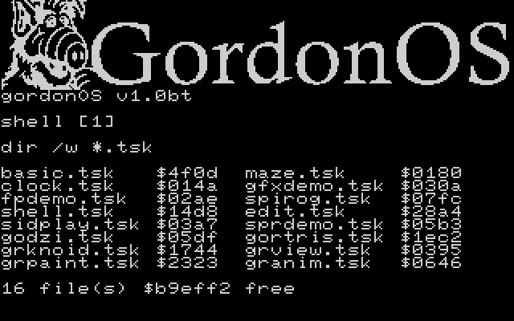
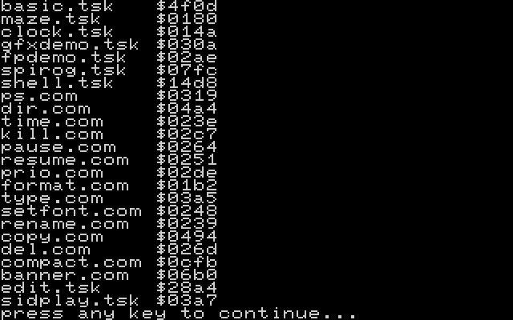
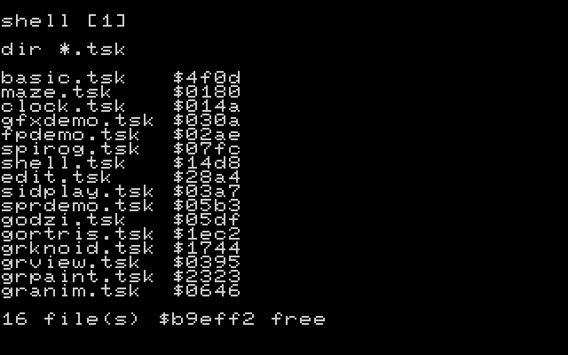

# GordonOS — Quick Start Guide

> What to do after the shell prompt appears
>
> What the OS offers, subsystem by subsystem, is in **[features.md](features.md)**.

---

## Getting GordonOS

### Option 1: Download the pre-built `.prg` (no build tools needed)

1. Download `build/gordon-os.prg` **and** the pre-formatted REU image
   `reu/REU.bin` from this repository.
2. Launch VICE **3.10 or later** with REU support and the bundled image
   (**absolute path** required for `-reuimage`):
   ```bash
   x64sc -speed 200 -reu -reusize 16384 -reuimage /absolute/path/to/reu/REU.bin -reuimagerw build/gordon-os.prg
   ```
   `-reuimagerw` writes the REU image back to disk on exit so saved files
   persist. Dragging the `.prg` into the VICE window alone is **not** enough
   — also load the image via Settings → Cartridges → RAM Expansion Module →
   16384K → Browse → select `reu/REU.bin`, and check **"Write image on
   detach/emulator exit"** there so saved files persist.
3. Skip to [Boot](#boot) below.

> No image file handy? Run `tools/build-reu.ps1` (or the **"Build REU"**
> VS Code task) to build a fresh `reu/REU.bin` and `reu/REU-C64U.bin` from
> `tasks-out/*.bin` — the boot task does not format or seed the FS itself;
> `tools/build-reu.ps1` does.

### Option 2: Build from source

> The full picture — every tool, the three build stages, the files that configure them
> and the gates that fail the build — is **[development.md](development.md)**. This
> section is the short version.

**Prerequisites.** Nothing is bundled — the build scripts locate every tool
through `.vscode/settings.json` (Step 1). Install:

| Tool | Needed for | Windows | Linux / macOS |
|---|---|---|---|
| VS Code + **VS64** (`rosc.vs64`) | the build task, the F5 flows, and the bundled Ninja | Extensions view, or `code --install-extension rosc.vs64` | same |
| **Java** (JRE 17+; any recent runtime) | running KickAssembler | Adoptium Temurin, <https://adoptium.net> | Debian/Ubuntu: `sudo apt install default-jre-headless`; macOS: `brew install --cask temurin` |
| **KickAssembler** v5.25+ | the 6502 assembler | download the zip from <http://theweb.dk/KickAssembler/>, extract to e.g. `C:\Tools\KickAssembler` | download the zip, extract to e.g. `~/tools/KickAssembler` |
| **VICE** 3.10+ (GTK3) | running the result | GTK3 VICE zip from <https://vice-emu.sourceforge.io> | Debian/Ubuntu: `sudo apt install vice` (see the ROM note below); macOS: install from <https://vice-emu.sourceforge.io> or Homebrew |
| **PowerShell 7** (`pwsh`) | the build scripts | built in (Windows PowerShell 5.1) | Debian/Ubuntu: `sudo apt install powershell` (Microsoft repo — see below) or the release `.deb`; macOS: `brew install --cask powershell` |
| **Python 3** | `gen-*.py`, `check-task-headers.py`, publish | <https://www.python.org> (command `python`) | usually already present (command `python3`) |
| **FFmpeg** | extracting an animation's frames for `tools/gen-anim.py` — **not needed for the build** | `python -m pip install imageio-ffmpeg` in the venv (**no separate install** — the package vendors a static FFmpeg), or `winget install Gyan.FFmpeg` | `python -m pip install imageio-ffmpeg` in the venv (same), or `brew install ffmpeg` / `sudo apt install ffmpeg` |

Ninja needs no install: it ships inside the VS64 extension, and
`tools/toolpaths.ps1` picks up the bundled copy automatically (or set
`vs64.ninjaExecutable` for a custom one). Python is only needed for the task
build's header check and the asset generators; the kernel build alone does not
use it.

The Python generators need **Pillow**, and frame extraction needs an **FFmpeg**:

```bash
python -m pip install Pillow imageio-ffmpeg   # once, in the activated venv
```

`imageio-ffmpeg` is the recommended route because it **vendors a static FFmpeg** — there is
nothing to install system-wide, no `PATH` to edit, and no administrator prompt. `Pillow` is
wanted by `img2pic.py`, `img2bnr.py` and `gen-anim.py`; `imageio-ffmpeg` only by the film
workflow. `python -c "import imageio_ffmpeg,sys; print(imageio_ffmpeg.get_ffmpeg_exe())"`
prints the binary's path if you want to drive it directly.

<details>
<summary>PowerShell 7 from the Microsoft apt repository (Ubuntu / Debian)</summary>

```bash
sudo apt-get update
sudo apt-get install -y wget apt-transport-https software-properties-common
source /etc/os-release
wget -q https://packages.microsoft.com/config/ubuntu/$VERSION_ID/packages-microsoft-prod.deb
sudo dpkg -i packages-microsoft-prod.deb && rm packages-microsoft-prod.deb
sudo apt-get update
sudo apt-get install -y powershell
```

If the repository has no `powershell` package for your release, install the
`.deb` from <https://github.com/PowerShell/PowerShell/releases> instead:
`sudo apt install ./powershell_<version>_amd64.deb`, or unpack the portable
`powershell-<version>-linux-x64.tar.gz` anywhere and put its `pwsh` on `PATH`.

</details>

> **VICE ROMs.** The Debian/Ubuntu `vice` package is built `+dfsg` and ships
> **no C64 ROM images**, so `x64sc` aborts with
> `Couldn't load kernal ROM 'kernal-901227-03.bin'` unless it can find them
> (`kernal-901227-03.bin`, `basic-901226-01.bin`, `chargen-901225-01.bin`). Put
> them where VICE looks (`~/.local/share/vice/C64/` on Linux) or point VICE at a
> directory that holds them with `vs64.viceArgs`:
>
> ```json
> // .vscode/settings.json — VICE does not expand "~", so use an absolute path
> "vs64.viceArgs": "-directory /home/you/.local/share/vice:/usr/share/vice"
> ```
>
> **Symptom to know:** with no ROMs VICE starts and dies in milliseconds, so the
> F5 session looks like it does nothing. development.md → section 10
> (*Troubleshooting*) lists it.

**Step 1 — create `.vscode/settings.json` (once per machine).** It is
**gitignored** (the tool locations are machine-specific), so a fresh clone has
none, and the first build stops with `KickAss.jar not found at:` — an *empty*
path, which means the settings file is missing, not that KickAssembler is.
Copy the bundled sample and edit the four paths:

```bash
cp .vscode/settings.json.sample .vscode/settings.json           # Linux/macOS
```
```powershell
Copy-Item .vscode\settings.json.sample .vscode\settings.json    # Windows
```

| Setting | Points at |
|---|---|
| `vs64.kickInstallDir` | the KickAssembler **folder** (the one holding `KickAss.jar`) — not the jar |
| `vs64.javaExecutable` | the Java executable that runs it (`.../bin/java.exe`, or `/usr/bin/java`; JDK 26+) |
| `vs64.ninjaExecutable` | leave blank to use the Ninja bundled in the VS64 extension (`.../resources/ninja/<platform>/ninja`); otherwise a `ninja`/`ninja.exe` path |
| `vs64.viceExecutable` | `x64sc.exe`/`x64sc` from your VICE 3.7+ GTK3 install |

The file is the single source of truth: `tools/toolpaths.ps1` reads it for the
build/launch scripts, and the VS64 extension reads the same keys to assemble
and launch. `VICE_EXE` / `KICKASS_JAR` / `JAVA_EXE` / `NINJA_EXE` env vars
override it for ad-hoc runs. If a path is wrong you get the same message naming
the setting (e.g. `VICE not found at: ... - edit .vscode/settings.json (vs64.viceExecutable)`).

**Step 2 — build.** Also requires VS Code + VS64 + KickAssembler + Java JDK.
Press **F5** (pick a launch flow in the Run and Debug view) or run:

```bash
pwsh -NoProfile -File tools/build-kernel.ps1                                 # Linux/macOS
powershell -NoProfile -ExecutionPolicy Bypass -File tools/build-kernel.ps1   # Windows
```

Output: `build/gordon-os.prg`. Load the same way as Option 1.

> **Failed `.assert`s fail the build.** KickAssembler prints
> `ERROR IN ASSERTION` / `Made N asserts, M FAILED!` on a failed assert but
> still exits 0. Every KickAssembler invocation is therefore wrapped by
> `tools/kick.ps1`, which turns a failed assert into a non-zero exit. The
> `VS64: Build` task runs `tools/build-kernel.ps1`; it patches VS64's
> generated `build/build.ninja` asm rule back through `tools\kick.ps1`
> before invoking Ninja.

> **The 24-bit REU FS offset is linted.** `reuFsPtr` is a 3-byte offset and
> its bank byte is not always 0 — `compact` repacks the FS from the start, so
> which files live above FS `$10000` depends on what the user deleted.
> `tools/check-fs-offsets.ps1` fails the build on a copy/stash of `reuFsPtr`
> that drops `+2`, on a hard-coded bank byte, or on a 24-bit add whose carry
> never reaches `+2`. It is a data-flow slip rather than a size or address
> slip, so no `.assert` catches it. Both
> `build-kernel.ps1` and `build-tasks.ps1` run the lint first; a deliberate
> case is annotated with an `fs-lint: allow` comment.

> **Library ids are linted as well.** A library's id *is* its index in the
> positional descriptor tables in `src/main.asm` (`libNameLo`, `libEntryCount`,
> `libEager`, …), while a task declares dependencies by writing `LIB_*` names
> from `src/kernel/task-header.inc` into its `libMask`, and the kernel's lazy
> stubs pass those ids to `libLoad`. Reorder one without the other and a task
> loads the **wrong library, silently** — nothing fails at build or run time.
> `tools/check-lib-ids.ps1` compares the two lists and fails the build on
> drift; both build scripts run it alongside the FS-offset lint.

> **Tool paths live in `.vscode/settings.json`** (which is gitignored — copy
> `.vscode/settings.json.sample` if you have not, see Step 1 above).
> `tools/toolpaths.ps1` reads that file and nothing else; the VS64 extension
> reads the same keys to assemble and launch. Env vars `VICE_EXE` /
> `KICKASS_JAR` / `JAVA_EXE` override it for ad-hoc runs.

### Building dynamic task binaries (fixup generation)

Dynamic tasks (REU FS loadable) are built separately from the kernel with
`tools/assemble-tasks.asm` + `tools/gen-fixups.asm` — a KickAssembler pipeline
that assembles each task three times (origin, origin+$100, origin+$200) and
auto-generates hi-byte fixup tables from the diff. Both files are **generated**
from `tools/tasks.json` by `tools/gen-task-asm.ps1`, which `build-tasks.ps1`
runs first — so you add a task to the manifest, never to the assembler files.
See [writing-relocatable-tasks.md](writing-relocatable-tasks.md).

VS Code: run the **"Build dynamic tasks"** task (Terminal → Run Task), or from
a terminal in the project root:

```bash
pwsh -NoProfile -File tools/build-tasks.ps1                                 # Linux/macOS
powershell -NoProfile -ExecutionPolicy Bypass -File tools/build-tasks.ps1   # Windows
```

(The script runs three `assemble-tasks.asm` passes plus `gen-fixups.asm` in
order. Equivalent manual commands, run from the project root:)

```bash
java -cp /path/to/KickAss.jar kickass.KickAssembler -afo -libdir src tools/assemble-tasks.asm :shift=0
java -cp /path/to/KickAss.jar kickass.KickAssembler -afo -libdir src tools/assemble-tasks.asm :shift=256
java -cp /path/to/KickAss.jar kickass.KickAssembler -afo -libdir src tools/assemble-tasks.asm :shift=512
java -cp /path/to/KickAss.jar kickass.KickAssembler -afo tools/gen-fixups.asm
```

Output: one `tasks-out/<name>.bin` per manifest entry. The generator prints each
task's **version, code size and fixup count** and runs a relocation self-check
(`relocation verification OK`) before writing, so the build fails instead of
emitting a binary that is not genuinely position-independent. Counts vary with
the source: `sidrst` carries **0** fixups, the `.com` commands a
handful, and the large tasks (`basic`, `edit`) many hundreds.
`tasks-out/` lives outside `build/` so a VS64 clean build doesn't delete it.

#### Building the REU filesystem (host-side)

The REU filesystem is built **on the host** by `tools/build-reu.ps1`, which
mirrors the kernel's on-disk FS layout (512-entry directory at REU bank 5 /
`$9000-$CFFF`, data base at `$D000`) and writes every `tasks-out/*.bin`
into it with a 16-byte space-padded name field (11-char names), plus every
`*.bat` in `src/batch/`, every `*.bnr` in `src/banners/`, and every
`*.bas` in `src/corpus/` (the REU-backed-BASIC demo corpus generated by
`tools/gen-corpus.py` — load it in BASIC with `load "basdemo"`).
The charsets, the shared sprite sheets, the `.pic` pictures, grpaint's UI band
(`assets/ui/gpui.bin` and its MC twin `assets/ui/gpui_mc.bin`) come from the script's
`$assets` array, and a glob clause seeds every `*.anm` and `*.inf` under
`assets/anim/` — the bundled animation, `run granim llama` (see
[pic-format.md](pic-format.md) → *The `.anm` film container*). The script also
**regenerates** everything that has a source in the tree before it seeds — charsets,
sprite sheets, the UI band, the pictures and the BASIC corpus, via
`tools/build-assets.ps1` — so the image always matches the art on disk.

⚠️ **The animation chunks are not regenerated**, and that is deliberate: like
`music/*.mus`, a film's source is a video that is not in the tree, so the committed chunks
ship as they stand. Regenerating one is a host-side job with `tools/gen-anim.py` after
an FFmpeg has extracted the frames, and the recipe is in
[pic-format.md](pic-format.md).
The kernel PRG no
longer embeds task binaries or a seed table — the boot task spawns `shell`
with the startup args `runbatch boot`, so the first shell executes
`boot.bat` once before it prompts.

`src/batch/` is the **batch scripts folder**: every `*.bat` file there is
screen-code encoded and seeded by `tools/build-reu.ps1` under its own
filename, so you can add as many batch files as you like and run them from
the shell with `runbatch <name>` (lowercase base name ≤ 7 chars — `runbatch`
appends `.bat`). `boot.bat` is the **bootstrap hook** for initial tasks: it
currently contains `run shell` (spawns the interactive shell, which takes
the display), then `exit` (the bootstrap shell disappears). Add `run <task>`
lines to boot extra tasks at startup — the last line should stay `exit` so
the bootstrap shell disappears.

The **play button** (Run and Debug view) offers four launch flows (press
**F5** to run the selected one):

- **Build & Launch with REU** — builds the kernel only (preLaunchTask
  `VS64: Build`), then launches VICE with the existing `reu/REU.bin`.
  Nothing else is rebuilt: the dynamic tasks are **not** re-assembled, the
  filesystem is not re-seeded, and `reu/REU-C64U.bin` is not rewritten.
- **Build & Launch with fresh REU** — rebuilds the dynamic tasks, the
  kernel, and a fresh filesystem (`Prepare fresh REU`), then launches VICE
  with the new `reu/REU.bin`. The asset generators run as part of it
  (`tools/build-assets.ps1`), so this is the flow to use after editing
  anything under `assets/` or `charsets/` or the BASIC corpus; the
  "existing REU" flow above leaves the image, and so the art in it, alone.
  `tools/build-reu.ps1` writes **both** images in that one pass —
  `reu/REU.bin` (speed 200, for VICE) and `reu/REU-C64U.bin` (speed 100, for
  a real machine) — so this flow and the **"Build REU"** task are what keep
  the C64 Ultimate image current.
- **Build & Launch with REU (1351 mouse)** and **Build & Launch with fresh
  REU (1351 mouse)** — the same two flows with a Commodore 1351 in control
  port 2 *and* VICE's pointer grab on (`-controlport2device 1351 -mouse`).
  Both flags are needed: the control-port device alone leaves the POT bytes
  frozen and the buttons reading released. Use these for `grpaint` and
  `mtest`; **Alt-M** toggles the grab while VICE runs.

All four pass `-speed 200 -reu -reusize 16384 -reuimage reu/REU.bin -reuimagerw`
to VICE (`-speed 200` = 200% of real time); the 1351 pair adds the two mouse
flags on top.

After boot: `dir` shows the bundled files (including `boot.bat`, and `buildid` — the image's build stamp, which `type buildid` prints so you can tell which build you booted); `run clock` works out of the box, and `run gortris` starts Tetris (`run grknoid` starts Gorkanoid). `run granim llama` plays the bundled 15-second animation.

#### Adding a new bundled task

Full walkthrough: **[writing-relocatable-tasks.md](writing-relocatable-tasks.md)**
(§8 for a `.tsk`, §9 for a `.com`, §10 for the build, §11.1 for the F5 flows).

1. Write the task: the wrapper `.asm` plus the body `.inc`, in
   `src/tasks/dynamic/` (`.tsk`) or `src/tasks/cmd/` (`.com`).
2. Add **one entry** to `tools/tasks.json` (name, source, origin, fsName, kind).
   The two assembler files are generated from it and `tools/build-reu.ps1`
   seeds the same list, so there is one place to edit.
3. Run **Terminal → Run Task → "Build dynamic tasks + REU"**, or press **F5**
   with **"Build & Launch with fresh REU"** selected. No kernel rebuild is
   needed — the kernel does not embed task binaries.

---

## VICE with REU Image

GordonOS ships a pre-built REU image (`reu/REU.bin`, produced by `tools/build-reu.ps1`) containing stack images, ZP shadows, char shadows (seeded at boot), and the REU filesystem with all task binaries already seeded. Files you `save` persist there across reboots.

**Important:** VICE requires an **absolute path** for `-reuimage` — relative paths will cause VICE to fail silently or not start.

### Launch VICE with REU.bin

```bash
x64sc -speed 200 -reu -reusize 16384 -reuimage /absolute/path/to/reu/REU.bin -reuimagerw build/gordon-os.prg
```

`-speed 200` runs the emulator at 200% of real time — the speed the blink and
keyboard-repeat timings are tuned for, so see **VICE speed, and the blink / repeat
timings** under the shell commands if you change it.

`-reuimagerw` auto-saves the REU image back to disk when VICE exits. Or in
the VICE GUI: Settings → Cartridges → RAM Expansion Module → 16384K → Browse →
select `reu/REU.bin`.

**`grpaint` needs a mouse as well, and that is two flags, not one.** The paint program drives
its pointer sprite from a Commodore **1351** in control port 2, and it refuses to start without
one (`? mouse off - run 'mouse 1351'`) — see [gordonpaint.md](gordonpaint.md). Start VICE with the control-port device *and* the
host-pointer grab:

```bash
x64sc -speed 200 -reu -reusize 16384 -reuimage /absolute/path/to/reu/REU.bin -reuimagerw \
      -controlport2device 1351 -mouse build/gordon-os.prg
```

`-controlport2device 1351` is a 1351 in control port 2 (`1351` is a name VICE's control-port
option accepts, and `3` is its number); in the GUI it is *Control port settings* → control
port 2 → **Mouse (1351)**. `-mouse` is VICE's `Mouse` resource — the host-pointer grab — and
**without it the POT bytes stay frozen and the buttons read released**, so the device alone is
not enough; in the GUI it is VICE's mouse-grab setting. Attach the mouse **before** the machine
starts, since attaching one afterwards needs a reset. **`tools/launch-vice.ps1 -Mouse1351`**
adds both flags, and so do the two **Build & Launch with REU (1351 mouse)** F5 flows; the other
F5 flows leave port 2 to the joystick. While VICE runs, **Alt-M** toggles the mouse grab on and
off (`Command-M` on macOS — VICE's `mouse-grab-toggle` hotkey), which is how to get the host
pointer back without quitting. Then declare it once at the shell: `mouse 1351` (the image's
`boot.bat` already does at boot).
On a C64 Ultimate the mouse is either a real 1351 in control port 2 — a joystick-port device whose
POT lines the board handles itself, so nothing needs enabling for it, and an Ultimate 64 Elite
can swap the ports from the menu with `C= + J` if the mouse is in port 1 — or a **USB mouse**,
which the machine presents to the C64 as a 1351 (its mouse options include *Cursor*, *Mouse*,
*Mouse+Cursor* and *Mouse+Wheel* modes, and firmware 3.15 reads each mouse by its HID report
descriptor, so most USB mice work).

### VS Code tasks.json / launch.json / extensions.json (in repo)

The repo ships `.vscode/tasks.json`, `.vscode/launch.json` and
`.vscode/extensions.json`: the first two add the play-button launch flows
below, the third tells VS Code which extensions the project expects (VS64 —
required — plus KickAss syntax highlighting and, optionally, the PowerShell
extension for the build scripts). VS Code offers those the first time the
folder is opened; nothing is downloaded unless you accept.

Four flows live in the Run and Debug view. Each passes the speed and
REU options (`-speed 200 -reu -reusize 16384 -reuimage reu/REU.bin -reuimagerw`)
straight to VICE, and `tools/launch-vice.ps1` uses the same `-speed 200`:

- **Build & Launch with REU** — preLaunchTask `VS64: Build` (kernel only;
  the existing REU image is reused).
- **Build & Launch with fresh REU** — preLaunchTask `Prepare fresh REU`
  (`VS64: Build` → `Build dynamic tasks` → `Build REU`; tasks are
  re-assembled and relocation-verified, and a fresh filesystem is seeded
  before VICE launches).
- **Build & Launch with REU (1351 mouse)** — the first flow plus VICE's
  `-controlport2device 1351 -mouse`, for `grpaint`/`mtest` (see the
  **1351** paragraph under *VICE with REU Image* above).
- **Build & Launch with fresh REU (1351 mouse)** — the second flow plus the
  same two mouse flags.

Tool paths are not hardcoded — see `tools/toolpaths.ps1`. Press **F5** to
build and launch (the VICE debugger attaches), or run the **"VICE with REU"**
build task (**Ctrl+Shift+B**) to launch VICE without the debugger via
`tools/launch-vice.ps1`. Build the kernel alone via the **"VS64: Build"**
task (Terminal → Run Task). Every task and launch configuration is listed in
[development.md](development.md) §7.

---

## Boot

Press F5 (or load `gordon-os.prg` into VICE). After a brief pause you'll see a blinking block cursor — the GordonOS shell is ready.

```
 
```

Type commands and press RETURN. The shell supports cursor keys (← → HOME), mid-line editing, and backspace (DEL) to correct mistakes.

---

## Commands

### `help`

Print the command list: `help`, `clear`, `view`, `run`, `exit`, `print`,
`runbatch`, `fsinfo`, `save`, `load`, `pool`, `ver`, `me`, `wait`.

```
help
```

### `ver`

Print the OS name and version (the former startup banner):

```
ver
```

```
gordonOS v0.9.5
```

### `wait`

Print `press any key to continue...` and wait for any keypress. Useful
at the end of a batch file to pause before the next step.

```
wait
```

### `ps`

Show all currently running tasks with their ID, memory address, priority, and name.

```
ps
```

```
id  pri  address  name
----------------------------
2   001  $5700    shell
```

A fresh boot lists **one** task, the shell, at slot **2** — the bootstrap shell that
ran `boot.bat` held slot 1 and has exited, so the next thing you spawn takes slot 1
and the one after it takes slot 3.

Markers: `(swp)` = evicted (code swapped out), `(pau)` = paused,
`(slp)` = sleeping, `(shr)` = this instance shares its code with **another** instance of the same name (a lone instance that merely remains attached to a shared record is not flagged).

### `run edit [<filename>]`

Open an editor screen: a fresh hires-text surface (shell colors) with
its own keyboard focus. `run edit <filename>` opens that file (CR+NUL
line endings; up to 192 lines of 40 columns — larger files are
truncated) or starts blank for a new file. `run edit` with no argument
prints a usage error on the shell's screen and exits. The document is
held in memory as a growable line table: typing past each 24-line page
mallocs another 4-page chunk on the fly (up to 192 lines, freed again as
you delete back). The window scrolls both ways, with content-aware
↑/↓ movement. RETURN splits the line at
the cursor; DEL erases left of the cursor; ← → ↑ ↓ HOME move; INST
toggles insert/overwrite (shown as INS/OVR on the status bar, which
also shows the document size). STOP+S saves (to the same name — an
empty document deletes the file), STOP+W saves under a new filename
(prompts for a name on the status bar; refuses an existing file),
STOP+X saves and exits, STOP+Q quits (asks first if modified), STOP+C
clears the document (asks for confirmation — press C again — and keeps the
filename). **STOP+M** toggles mark mode: the cursor anchors a selection,
cursor keys extend it, and selected characters are highlighted in reverse
video. With a selection marked, **STOP+Y** copies it to an in-memory
clipboard and **STOP+K** cuts it; **STOP+P** pastes the clipboard at the
cursor (insert semantics). Pressing STOP shows the full
command list. While that modal STOP prompt is active, the editor parks
its blinking text cursor and restores it when editing resumes; tasks that
reuse screen space for modal UI should follow the same rule. F1/F3/F5/F7 switch
back to the
shell (the editor keeps running); `kill <id>` terminates it (take the ID from `ps`).

The document model, the save machinery and the limits are in
[edit.md](edit.md).

### `type <filename>`

Print a file's contents from the REU filesystem on the shell's screen.
The **full filename** is required — nothing is appended. The file is
streamed in 80-byte REU DMA windows, so any size works. Rendering:
CR followed by NUL (the batch line terminator) breaks the line, NUL is
skipped, and every other byte prints as its screen-code glyph — CRs
not followed by NUL are the letter `m`. So `.bat` files show one
command per line, exactly as authored.

```
type boot.bat
```

### `setfont <name>`

Switch the system font to a font file from the REU filesystem. The font
is **REU-only**: the 2 KB file stays in the REU FS and only its record
is installed — the blitter DMA's each glyph on demand. The **base
filename** is taken — `.fnt` is appended automatically (`setfont c64low`
loads `c64low.fnt`). Names are ≤ 7 characters and must not include an
explicit extension. Fonts must be seeded host-side in the REU image
(they are never created at runtime) and must be exactly 2048 bytes.

### `banner <file> <row> <col>`

Draw a `.bnr` custom-glyph banner from the REU filesystem at (row, col)
on the shell's screen. `.bnr` layout: byte 0 = columns c (1–40), byte 1
= rows r (1–25), then c·r glyph definitions of 8 bytes each. The base
filename is taken (≤ 7 chars, `.bnr` appended); row and col are
mandatory. Bad dimensions, out-of-range or wrapping placement, and
truncated files all print an error and draw nothing. After drawing,
the shell prompt returns to its previous position.

Every `*.bnr` file in the `src/banners/` folder is seeded into the REU
filesystem by `tools/build-reu.ps1` (like `src/batch/*.bat`), so
`banner <name> <row> <col>` works for anything you drop there:

```
banner hello 2 3
```

Create `.bnr` files from images with
`python tools/img2bnr.py <image> <output.bnr>` (see its `--help` for
threshold, inking direction, width and preview options).

```
setfont c64low
```

Bundled fonts: `gordon.fnt` (the default OS font), `c64low.fnt` (stock
C64 lowercase/uppercase), and `c64uppr.fnt` (stock C64
uppercase/graphics).

### `speed <percent>`

Declare the speed the whole machine runs at relative to real time: `100` is real
time, `200` is what VICE runs at here. Everything in the OS that depends on it is
derived from it — the kernel's blink and key-repeat tick counts, and sid.lib's
pitch and tempo compensation — so this is the *only* setting a different machine
needs. Powers of two only (25 50 100 200 400 800): the pitch correction is a whole
octave per step, so a speed between them could not be compensated exactly. Set it
BEFORE `blink`/`keyrpt`, which override what it derives.

```
speed 200
```

The image declares it at boot (`reu/REU.bin` 200, `reu/REU-C64U.bin` 100), so you
only need this to change it live. It is silent on success; anything else — including no
argument — prints the values it accepts.

### `blink <n>`

Set the cursor blink interval to `n` ticks (~60 Hz; default 30, which is ~500 ms on
a machine at real time). Higher values blink slower.

```
blink 60
```

### `keyrpt <delay> <repeat>`

Set the keyboard repeat timing: `delay` ticks before the first repeat
(default 30), then `repeat` ticks between repeats (default 6), both at
~60 Hz (~500 ms and ~100 ms at real time). Values below 1 are clamped to 1.
The kernel's two repeat immediates are patched in place (self-modifying), so
the change lasts until reboot. `speed` re-derives both from these same
defaults, which is why it has to run first.

### `mouse [1351|off]`

Declare what pointer this machine has. It writes the kernel's `mouseKind` byte —
`0` = off, `1` = 1351 — which is the machine-wide setting a program reads at
start-up, and it is the one input device `grpaint` will use. Bare `mouse` prints
the current setting; anything else prints `? mouse 1351 off` and leaves the byte
alone.

```
mouse 1351
```

The kernel's default is **off**: a program that needs a 1351 refuses to start with
a message rather than running with a dead pointer. The shipped `boot.bat` declares
`mouse 1351`, so the pointer is live from the first prompt; the setting is a line in
that file, exactly like `speed`, and deleting the line puts the machine back to the
default. Nothing else persists it.

This command records what the machine *has*; the reading of the device itself is
`mouse.lib`, and neither it nor `mtest` consults `mouseKind` — see
[lib-mouse.md](lib-mouse.md).

### VICE speed, and the blink / repeat timings

> **The machine's speed is a SETTING, not a per-constant tweak.** `-speed` runs the whole
> emulated machine faster or slower, so anything measured against the host's clock moves
> with it: the kernel's **cursor blink** and **key repeat**, a **game's pace** (its rules
> are emulated-time and stay self-consistent, but the player feels the ratio), tasks whose
> output is time-sensitive (the `clock` task's seconds), and **the SID's pitch** — a voice's
> output frequency is its register value scaled by that clock, so every note rises an octave
> at 200%. **`speed <percent>`** is the one place that speed is declared: it scales the two
> timings below, and **sid.lib** reads it to put a tune's pitch and tempo back where the file
> wrote them, so neither the music nor the keyboard needs per-task tuning. **The video
> standard needs no setting either**: the clock a standard fixes (985248 Hz PAL, 1022727 Hz
> NTSC) scales every note too, and the archive's table is the NTSC one, so `sid.lib` measures
> the standard from the VIC and picks the matching table — a PAL machine is in tune with
> nothing declared, and the only note left flat is a B in the top octave (45.5 cents). A
> game's own pace follows the *display* frame rate instead, so an NTSC machine runs it ~19%
> faster, and that difference is accepted — nothing scales a game for the video standard. See
> [lib-sid.md → Tuning](lib-sid.md), and **[programmers-guide.md → Machine Speed](programmers-guide.md#machine-speed--code-a-speed-change-cannot-alter)**
> for how to write a task, game or sprite so a declared speed cannot change what it does.
>
> **A C64 Ultimate needs none of this.** Its turbo is a *CPU* speed setting (up to 48x, 64x on
> an Elite-II): the CPU is granted more of the fast system clock's time slots, the VIC keeps
> priority, and accesses that leave the board — the SID sockets among them — still run at
> 1 MHz. So the SID is clocked as it is at 1x and **the pitch does not change**, and because
> the video timing stays standard the tick counts stay in real time too. Turbo buys CPU
> throughput, not wall-clock speed — which is why that machine gets its own image
> (`reu/REU-C64U.bin`, built with `speed 100`).

**Both timings are the 100% values**: 30 ticks is ~500 ms and 6 ticks ~100 ms on a machine
running at real time. `speed` scales them by the machine's speed, because a tick gets
shorter as the machine gets faster — so **more speed needs MORE ticks**, and the shipped
images declare the speed they are built for (`reu/REU.bin` 200 for VICE,
`reu/REU-C64U.bin` 100 for an Ultimate), so a fresh boot is already right:

| VICE `-speed` | `speed` | `blink` | `keyrpt` |
|---|---|---|---|
| 100 (real time) | `100` | `30` | `30 6` |
| 200 (what this repo uses) | `200` | `60` | `60 12` |
| 400 | `400` | `120` | `120 24` |

Only powers of two are accepted (25 50 100 200 400 800). The pitch correction is a whole
octave per step, so a speed between them could not be compensated exactly — an in-between
speed would leave the music up to half an octave out. Both the setting and the two timings
are **runtime** settings: a reboot restores what the image's `boot.bat` declares. To keep
your own, put them in `src/batch/boot.bat` (the bootstrap hook the first shell runs) and
reseed the image with `tools/build-reu.ps1`:

```
speed 200
blink 60
keyrpt 60 12
```

**Order matters**: `speed` re-derives the blink and repeat ticks, so run it BEFORE
`blink`/`keyrpt`, or it will overwrite them.

The music needs no such table. sid.lib applies the same speed to a tune's pitch (one
octave per step) and to its tempo (the ticks-per-jiffy delay is shifted by the same
exponent), so a caller asks for the tune as it was written and hears it that way on any
machine. It does **not** adjust for the video standard: the player's note table is the
archive's own, played as shipped on PAL and NTSC alike (see
[lib-sid.md → Tuning](lib-sid.md)). `kSidPlay`'s `delay` is
therefore **the tempo at 100%** — 1 is the file's own tempo, 2 is half speed — and
`gortris`, `godzi` and `grknoid` all pass 1.
`run sidplay <tune>` follows the same rule, and its optional `transpose` argument is an
*extra* offset on top of the compensation (a tune written for another register, or a
deliberate octave), not an answer to the emulator.

The **games** need no table either, for the same reason: each writes its timings in its own
frames — one game step per displayed frame, which is what a real C64 runs and what
`REU-C64U.bin` declares — and a machine that declares itself faster waits proportionally
more of those frames for the same real time, so a game step lasts the same real time
everywhere. `gortris` does that for every timer it has (fall delay, input repeat, the
attract and level-flash delays, the game-over hold, the music-mute hold, and the
line-clear flash wait), and `godzi` for
its walk step and its pose/music cadence. `grknoid` scales its *motion* instead: the ball
and the paddle move in whole steps of their own size, so a faster machine skips some
displayed frames rather than moving a smaller distance in each -- the SAME frames for
both -- which keeps its 8.8 ball velocity, its collision granularity and all three of the
paddle's gears. Its screens' holds and the game-over wait are shifted to real time as
they are set, and the paddle's accelerator counts the frames it actually moves on, so
nothing the player sees changes pace with the declared speed. One limit: `gortris`' and
`godzi`'s frame counts are single bytes, so a machine declared faster than 200% saturates
at 255 frames (`grknoid`'s countdowns are sixteen bits and its motion needs no count).

**Above 200% applies to the emulator only, and is not recommended.** A real machine takes no
speed setting: `REU-C64U.bin` declares 100, which is the machine's own speed. The caveat is
for VICE's `-speed`. The music is the reason: `sidlib` answers a faster machine by dropping
the tune whole octaves, and one octave is all `-speed 200` needs. At `-speed 400` or
`-speed 800` the tune would need two or three, which takes its notes below the SID's usable
range, so the pitch would come out wrong. `gortris`' and `godzi`'s frame counts are at the
byte limit there too. `100` (the C64 Ultimate image) and `200` (the VICE image) are the
speeds these
images are built for.

### `sidrst`

Reset the SID chip — zeroes all 25 writeable SID registers
(`$D400`–`$D418`). It is the **manual fallback** for a stuck note:
`kill` silences the chip itself when the task it kills (or the task that
spawned it) declared `sid.lib`, which covers every task that can play music
— so killing `sidplay`, `gortris`, `godzi` or `grknoid` needs no second
command. Reach for `sidrst` when the chip was left sounding some other
way (a task that died without being killed, or a SID something else
programmed).

```
sidrst
```

### `run <filename>`

Load a task binary from the REU filesystem and spawn it via the dynamic
task loader (there is no known-task registry — every task, including the
shell, is a dynamic binary). Use `dir`
to list available files and `ps` to
list running tasks. The shell disables its cursor around the spawn and
re-enables it afterwards — no phantom cursor when the new task takes
its own surface and you F-key back to the shell.

```
run basic              ← open/create the BASIC working file (basicwrk)
```

- **`basic`** — EhBASIC v2.22p5 interpreter (`run basic` opens or creates
  the persistent REU working file `basicwrk`, deleted on `EXIT`; C64
  screen-editor navigation). BASIC is single-instance and large enough to
  evict other tasks while loaded. Adds `DIR` (list the REU FS) and
  `SAVE "name"` / `LOAD "name"` (exports/imports programs as `name.bas`;
  names are 1-7 chars, no `.` — `.bas` is appended for you).
  Full language reference: [gordonbasic.md](gordonbasic.md).
- **`edit`** — full-screen 25×40 text editor (see the `run edit` command
  above): insert/overwrite modes, two-way scrolling, document grows on
  demand up to 192 lines, saves back to the same file, `STOP+W` only
  switches to a new filename after the save succeeds, and `STOP+M`/`Y`/`K`/`P`
  add mark-mode selection with copy, cut and paste.
  Full reference: [edit.md](edit.md)
- **`maze`** / **`clock`** — relocatable demo tasks; **maze** is re-runnable and exits on `q`. **clock** only displays the CIA #1 TOD, so run `time hh:mm[:ss] [am|pm]` first; it is accurate only at 100% emulation speed, and it loses time under REU load — see [lib-time.md](lib-time.md)
- **`gfxdemo`** — spider-web line weave (four symmetric corner fans of `kLine`), drawn once then idling, yielding every frame so the OS stays responsive; **re-runnable**, and **`q` exits** (it polls the keyboard on every yield, so the key is picked up promptly — a background demo cannot steal your keystrokes, because the poll is focus-guarded). Takes an optional step arg: `run gfxdemo 3` = tight weave, `run gfxdemo 20` = loose (default 5)
- **`spirog`** — integer spirograph: a hypotrochoid traced segment by segment with `kLine` from a 256-entry sine table and four 8x8 multiplies per point (no floating point), so it draws quickly and **closes exactly**. `run spirog <R> <r> <d> [col]` gives the ring radius, the rolling circle's radius (`R` must exceed `r`) and the pen offset; colour 1-15. `R`, `r` and `d` above 127 are clamped, and the figure is scaled down to fit the bitmap, so nothing ever draws off-screen. No arguments draws an 80/35/45 rosette, and `run spirog 1`-`9` picks one of nine presets, each sized to use the full screen height. `run spirog 10` switches to **multicolour** and draws **25 random presets** at random sizes and positions, each in one of three colours picked at random for the whole screen, then idles. **`q` exits**, from the drawing or once idle; **re-runnable**
- **`fpdemo`** — the fp.lib showcase: a sine wave drawn edge to edge with a cosine wave superimposed, computed **pixel by pixel** from the fp.lib (`FSIN`/`FCOS` + arithmetic) and plotted with `kPlot`; peaks and troughs touch the top/bottom of the screen. Slow by design (one pixel at a time, yielding every pixel), then idles with the bitmap on screen, and **`q` exits** from either state; **re-runnable**
- **`sprdemo`** — the sprite subsystem's demo: eight coloured balls bouncing off the walls and off each other, forever (`q` exits, or `kill` it from the shell). No text, and one asset (`ball.spr`) — it drives all eight sprite slots, so it exercises the library (`sprite.lib`, lib 7), both VIC slot bands, the ninth X bit as balls cross x=256, and per-sprite colour. It animates **once per displayed frame** (the kernel's `frameCount`) with fractional positions, so the motion is smooth rather than stuttering. See [lib-sprite.md](lib-sprite.md) for the calls and [programmers-guide.md](programmers-guide.md) → *Sprites* for how to drive one yourself; the source is `src/tasks/dynamic/sprdemo.inc`. The nine sprite **test-vector modes** it can also carry (mode `7` is the sprite-tear procedure) are parked unbuilt in `removed/sprdemo-modes.inc`; import that file to bring them back. It is **re-runnable**, and it may run **alongside any other sprite task**: each task's shadow, sheet records and frame indices are saved with it and swapped with the display, so two sprite tasks never share a live register set
- **`godzi`** (pinned — `KF_NOT_EVICTABLE`, so pool eviction never swaps it out) — a port of the stand-alone demo in `reference/godzi.asm` / `reference/main.asm`: a black boat-shaped walker crosses the screen (its 9-bit x walks through the x=256 boundary, which is what the reference's `$D010` phase did) while a black "Godzilla" flaps between two poses. Four sprite slots — the reference's own layout, the walker being two overlapping, X-expanded layers (black rigging over a light-blue hull: `$D028`, the colour register both reference files forgot to write) — art from `boat.spr`/`godzi.spr`, and one update per **displayed frame**. Its music is its own: it declares `sid.lib` and calls `kSidPlay` **directly** from a thread child — the arrangement `gortris` uses, with no `sidplay` and no `sidrst` involved — and it loads *both* tunes at startup (`commodo` for mode 1, `fsonata` for mode 2), so `1`/`2` switching the look switches the song with it by re-pointing the child: no re-load, no gap in the music. `q` sets the child's quit flag, hushes the SID, reaps the child and frees both tune buffers, so nothing is left playing. `1`/`2` switch between the two reference looks live (`run godzi 2` starts in mode 2 — the airborne, shimmering Godzilla), `q` exits. It is deliberately **single-instance for the SID**: a second `run godzi` gets `? already running`, because it holds the chip — the library's claim *and* the SID registers — for its whole life. (The sprite side needs no guard: `godzi` may run beside `sprdemo`.) (`kill`ing it from the shell skips the hush, but `kill` silences the chip itself for a task that declared `sid.lib` — so a killed demo leaves no drone either.) See `src/tasks/dynamic/godzi.inc` for the full source
- **`sidplay`** — plays a COMPUTE!'s Enhanced Sidplayer `.mus` song from the REU FS (`run sidplay commodo` / `run sidplay fsonata` / `run sidplay tetris`) through **`sid.lib`** (the player body lives in the library; the task is a 508-byte wrapper that loads the tune and calls `kSidPlay`). Single-instance, no screen. Optional `delay` arg slows it down (`run sidplay commodo 2` = half speed) to compensate for VICE warp, and an optional `repeats` arg decides how many times it plays: `0` = forever (until killed), `1` = once (the default), `2`-`255` = that many. Download thousands more songs at https://www.c64music.co.uk/ — drop a `.mus` (base name ≤ 7 chars) into `music/`, rebuild the REU image, then `run sidplay <name>`. A failure prints `? tune <name>` / `? load <name>` / `? no memory` / `? no player` on a temporary screen and waits for a key rather than exiting silently
- **`gortris`** — **Tetris**, a port of the game logic of Wiebo de Wit's `tetris.c64`
  (MIT; the art is ours, drawn with the kernel's glyphs, because the reference is
  char-mode and GordonOS is all-bitmap). The 10×20 board lives in the task image and
  is the authority, so collision is a board lookup rather than a screen read. Five
  screens: attract (four screens, 1016 frames each), level select (levels 0–9 on the
  reference's own grid — `j`/`k` to choose or a digit to pick outright, ENTER to
  start; the hi-score table is shown here), play, the reference's game-over
  animation (the well fills a row a frame, is held full ~3 s, empties, then
  `game over` / `press key` are printed inside it), and the hi-score name entry
  that follows it. Keys are the reference's bar the
  move pair — `j` `k` move, `a` `s` turn, ENTER soft drop, `p` pause — plus **SPACE** (hard drop:
  straight to the floor, 2 a row against the step's 1) and **`q`** to leave; **`m`**
  mutes the music from any screen (the panel says `music off`, and the mute survives
  losing the display and getting it back). The port-2 joystick also works (UP rotate CCW, DOWN soft drop, LEFT/RIGHT move, FIRE
  rotate CW, and FIRE starts a game). 10 lines per level, the fall delay drops 4 per
  level (floored at 4), a line scores × (level+1), and the level you chose is kept
  for the next game. Three hi scores (7-character names) live in the REU FS as
  `gortris.hi` and are typed in on the game-over screen under the kernel's blinking
  block cursor. Its music is `music/tetris.mus`, loaded by the task itself and played
  through **`sid.lib`** from a thread child it spawns — not through `sidplay.tsk`
  (the arrangement `godzi` now uses too) —
  and hushed whenever the display is lost. The tune itself is a single pass — it has no
  HED/TAL loop of its own — so the repetition the game wants is the player's: the thread
  passes `repeats = 0` and `kSidPlay` starts it again each time it ends, while
  `run sidplay tetris` (the default `1`) plays it once and stops. It is **not re-runnable** (a second
  `run gortris` gets `? already running`) and **pinned** in the pool, because it owns
  the display and holds the board.
  Full reference: [gortris.md](gortris.md)
- **`grknoid`** — **Gorkanoid**, an Arkanoid/Breakout game, and the OS's second
  game. A paddle sprite (X-expanded 24→48 px) sits under a wall of glyph bricks
  with a ball flown in 8.8 fixed point. The wall is a 48-entry byte array in the
  task image (0 = a gap, 1-3 = the hits to break the brick) and is the
  **authority** — the drawn cells are presentation, and nothing reads the surface
  back. The paddle follows the **held** key (`keybHeld` is a level; `kReadKey`'s
  event cadence is wrong for a paddle) one step per displayed frame, and that step
  **accelerates** — 1 px on a fresh press, gaining a gear every 16 displayed frames the
  *same* direction is held, up to 3 px, and dropped straight back by a release or a
  reversal, so placing the paddle stays precise while chasing with it is fast:
  **`j`** and
  **`k`** to move, **SPACE** to serve, **`p`** to pause, **`q`** to leave. The
  port-2 joystick path is written but **has not been played-tested** — the dev
  setup has no stick. The bounce angle comes from where the ball met the paddle
  (floored so it can never climb straight up) plus english from the paddle's own
  movement, so a paddle held against a wall adds nothing. Five lives, a per-level
  launch ramp (level 5 launches at twice level 1), a colour pulse on the ball, and
  `score`/`bricks`/`lives`/`lev` on the HUD.
  Four **attract screens** cycle on 1016-frame holds — title, controls, credits and
  the high scores — and any key starts a game. Three hi scores (7-character names)
  live in the REU FS as `grknoid.hi` and are typed in under the kernel's blinking
  block cursor. The game-over screen's **tune is its clock**: it waits for the tune
  to play through and then leaves for the attract loop, or leaves at once on a key
  (the countdown still applies when there is no tune to wait for).
  Its music is three **Compute's Gazette Sid Collection** tunes — `katmand` on the
  attract screens, `immig` during a game, `firstdt` once at game over — played
  through **`sid.lib`** from a thread child it spawns, out of **one buffer for the
  session**: an 18-page `kMalloc` taken at startup (the largest tune's size) and
  freed on the way out, after the child has been reaped, so a mode change makes no
  pool request at all and the pool sees one request per session instead of three
  sizes cycling. A tune longer than the buffer is **refused** rather than loaded past
  its end (a bigger tune means raising `GK_MUS_PAGES`). Two ways it can fail are
  handled separately: a SID
  another task is holding is retried (the tune is kept, and the retry costs nothing),
  while a tune that will not load (missing, or too big) falls back to the attract tune
  and then to silence, and does not retry on a timer. Losing the display **freezes the game** — no step is taken and no mode can
  change — while the music **keeps playing**, deliberately (unlike `gortris`, which
  hushes on focus loss). It is **not re-runnable** (a second `run grknoid` gets
  `? already running`) and **pinned** in the pool (`KF_NOT_EVICTABLE`), because it
  owns the display for its whole life and holds the wall and the score table. It
  also holds `filesys.lib` for the session, because the score file is written at
  game over and its child reads a tune file on every switch.
  Full reference: [grknoid.md](grknoid.md)
- **`fstest`** (`.com`, typed as `fstest`) - REU filesystem **bank-boundary self-test**.
  Reads a 16-byte window that spans a bank wrap, writes the complement of those
  bytes back over it, re-reads to prove the write landed exactly there, then
  restores the original bytes - one pass over the chunked DMA paths
  (`kReuReadAt` -> `reuDmaRange`, `kReuWriteAt` -> `fsxWriteRange`) and the
  24-bit offset arithmetic. Prints `read/write/restore/post ok|FAIL` plus a
  verdict. The seeded asset `fscross.bin` is placed so that window lands across
  the wrap; after a `compact` the test reports `skipped` instead, which means
  the coverage is gone - the first `compact` after a seed is what removes it,
  because closing the alignment gap moves the asset, so the run to trust is the
  one taken before it
- **`ipctest`** (`.com`, typed as `ipctest`) - **ipc.lib self-test** (keep it -
  the counterpart of `fstest`). Exercises the four inter-process byte channels:
  it proves the out-of-range guard refuses `X >= 4` and stores nothing, that all
  four rings start empty, and then runs **two thread producers at once** - one
  posting `0,1,2…` on channel 1, one posting `255,254,…` on channel 3 - while
  consuming both **interleaved** and comparing every byte in order. Both
  producers are faster than the single consumer, so it also covers the
  backpressure path inside `kIpcPost` (the wait, where `SYS_SLEEP` returns with
  `X = curTask` and the channel is recovered from the stack). Prints
  `guard / 4 empty / ch1 / ch3` then `ipc PASS`; a stall prints
  `TIMEOUT` rather than hanging. See [lib-ipc.md](lib-ipc.md)- **`shell`** — interactive shell (auto-started at boot via `kDynLoad`; **re-entrant**
  each instance allocates its own surface)

**Pool eviction:** the pool is 27.25KB of pool pages (256B each, 109 pages;
page size configurable via `src/kernel/pool.inc`). When `run` loads a task
that doesn't fit, the loader evicts the largest resident task (swaps its
code out — `ps` marks it `swp`) and restores every evicted task
automatically when space frees up (on `exit`/`kill`). Use `pool` to see
the current pool map: range + total pages header, one row per
allocation (code, program-RAM, malloc, libraries), and the used/free
totals at the bottom (accumulated from the rows).

Placement: **task code / program RAM / `kMalloc` grow up from the bottom;
libraries come down from the top** — so a library can never sit between two
task blocks and split the free space. A library's `pg` therefore
reads high (e.g. `099`+): the `pg` column is zero-padded to three digits, and
the `len`/`type`/`owner` columns follow one to the right of it. Because a load
needs one **contiguous** run, a correct-looking used/free total can still
refuse: compare the rows' `pg` values with a fresh boot if a load that should
fit is refused.

**Pool fragmentation is an accepted limitation** — nothing relocates a live
task, so holes can persist and `? no space in pool` is a *placement* problem
rather than a size problem: `kill` what you no longer need, or reboot to reset
the pool bitmap. What is already mitigated, and the options deliberately not
taken: [programmers-guide.md](programmers-guide.md) § Pool fragmentation.

**Dynamic libraries:** cold kernel code ships as shared `.lib` binaries —
`time.lib`, `filesys.lib`, `gfx.lib`, `fp.lib`, `string.lib`, `sid.lib`,
`ipc.lib`, `sprite.lib`, `mouse.lib` — loaded into the pool on
demand and freed automatically when their last consumer exits. `gfxdemo`
pulls in `gfx.lib`; `clock`/`time` pull in `time.lib`;
`save`/`del`/`rename`/`format` and `basic`'s `SAVE` pull in `filesys.lib`;
`basic` also pulls in `fp.lib` (floating point — one `fpExec` entry, lib
id 3); `sidplay`, `gortris`, `godzi` and `grknoid` pull in `sid.lib` (the Sidplayer — the
*caller* loads the tune and declares ZP `$02-$0A`); `ipctest` pulls in `ipc.lib`
(four lock-free byte channels between tasks: `kIpcPost` blocks by yielding
while a ring is full, `kIpcPick` never blocks — see [lib-ipc.md](lib-ipc.md));
and `sprdemo`/`godzi` pull in [`sprite.lib`](lib-sprite.md), the one library
whose *per-task* state lives in the kernel: the library is stateless, and the
shadow it writes is the display owner's, handed over with the display.
`grpaint` pulls it in too — its pointer is two sprites — along with `gfx.lib` and
[`mouse.lib`](lib-mouse.md), and `mtest` pulls in `mouse.lib` for its `l` path.
`gfx.lib` provides the bitmap primitives
(`kPlot`/`kLine`/`kBox`/`kFillBox`/`kCircle`/`kEllipse`/`kFloodFill`/
`kGetPixel`/`kSetGfxColor`/`kFillMatrix`) plus pixel-positioned text
(`kGfxChar`/`kGfxString`), all hires- and multicolor-aware — see
[lib-gfx.md](lib-gfx.md). See
[dynamic-libraries.md](dynamic-libraries.md).

`run` starts a **task** — a long-running background program (`.tsk`) —
and returns to the prompt immediately. The other utility words (`ps`,
`dir`, `time`, `kill`, `pause`, `resume`, `prio`, `format`, `type`,
`setfont`, `banner`, `rename`, `copy`, `del`, `compact`, `sidrst`, `speed`,
`blink`, `keyrpt`, `fstest`) are **commands** (`.com`) — the shell loads each
one, waits for it to finish, then re-enters the prompt. `pool` (built
into the shell) prints the task-pool map. Commands share the shell's screen and read
their arguments from `cmdArgsBuf`. `help`, `clear`, `view`, `run`,
`runbatch`, `exit`, `print`, `fsinfo`, `save`, `load`, `pool`,
`ver`, `me` and `wait` are
built into the shell itself (no file is loaded). See
[`programmers-guide.md`](programmers-guide.md) for how to write each
kind.
- **`grview`** — the picture viewer for the `.pic` format (`run grview hires` opens `hires.pic`: the suffix is appended, as `sidplay` appends `.mus`, so the base name is ≤ 7 characters). It allocates a bitmap surface, takes the display, and DMAs the file's three regions straight to `$2000` / `$0400` / `$D800`; the mode and all four VIC colours come from the file's own header, never from the shell. `m` reinterprets the same bytes in the other mode — nothing is converted — and any other key exits. The header's label is metadata and is not printed, because a 1-bit glyph blit is unreadable on a multicolour surface. A name that is not there, or a `<name>.pic` that is not a picture, takes a screen of its own, prints `? not found <name>.pic` / `? not a picture <name>.pic` and waits for a key, so the shell's screen is never left holding a message. `hires.pic`, `mc.pic`, `alf.pic` and `alfgs.pic` are bundled as samples. Format and host tool: [pic-format.md](pic-format.md)
- **`grpaint`** — the **1351 paint program**: single-instance and pinned in the pool (a second `run grpaint` gets `? already running`), and it needs the pointer — with `mouseKind` off it takes a screen of its own, prints `? mouse off - run 'mouse 1351'` and waits for a key. `run grpaint <name>` opens `<name>.pic` (the suffix is appended, so the base name is at most 7 characters): a picture that is there is **loaded**, and one that is not is the blank canvas the allocator just handed over. **The colours a new picture starts in are the rest of the command line, and their count is the mode** — `run grpaint shot 1 1 0` is hires (border 1, paper 1, ink 0) and `run grpaint shot 1 1 2 7 15` is multicolour (border and background 1, then c1/c2/c3 = red/yellow/light grey); no values keeps the black-and-white defaults, any other count is refused, and **an existing picture's own mode and colours win**, so a colour argument is refused rather than dropped.
  - **The pointer is a 1351 on control port 2**, and it must be there before the program starts. Under VICE that is `-controlport2device 1351 -mouse` (both flags — see *Launch VICE with REU.bin* above); on a C64 Ultimate it is a real 1351 in port 2, and an Ultimate 64 Elite can swap the ports with `C= + J` if the mouse is in port 1. `mouse 1351` declares it, which the image's `boot.bat` already does at boot.
  - **The canvas is the whole screen** and the UI is a band over its bottom two cell rows, **up from the start**. **A right press anywhere toggles it**; a **left press takes an entry** and leaves the band up, and a **left press off the entries dismisses it** and lands on the canvas.
  - **The palette** is sixteen swatches, and a press sets the ink. In hires the **first swatch (colour 0) is the eraser** — the drawing calls read colour 0 as *clear*, so it takes a pixel off to the cell's own paper without re-colouring the cell — while in multicolour four **slot chips** select which of a cell's four colour sources a mark claims, and slot 0, the background, erases the same way.
  - **Thirteen tiles**: pencil, line, box, filled box, circle, flood fill, three brushes, text, clear, save and the MODE tile. A shape previews live with a kernel-drawn XOR band and commits on the release. The **text** tile takes the keyboard — click the canvas and type; glyphs are XORed so they stay legible over existing work, DEL takes one back and RETURN starts a line.
  - **Undo and redo**: `u` and `r`, or the band's two stacked arrows — **the top cell row steps back, the bottom one forward** — five steps each way. An arrow is **white while it has a step to take** and grey when it does not. One press is one step: a stroke, a shape's commit, a fill, a text entry put away, CLEAR, a palette press and a MODE switch are each one. The line's first click only **anchors** and is *not* a step, so `u` after it takes the anchor's dot off without touching the history.
  - **CLEAR** blanks the canvas and puts the picture's palette back, leaving the tool and the ink alone. **SAVE** writes `<name>.pic`, and its tile is marked only while the canvas has changed — a press on an unmarked one does nothing, there being no message on success. **The MODE tile** switches hires ⇄ multicolour in place — there is no key for it (while the text pen is down every key is text, `q` included). See [pic-format.md](pic-format.md) for the file itself, and [gordonpaint.md](gordonpaint.md) for the program's reference and internals
  - **`q` asks before it loses work**: with nothing drawn since the last save it leaves at once, otherwise the band comes up and the SAVE tile **flashes** until you either press it (which saves and stays) or press `q` again **while the band is up** (which leaves as it is). Dismissing the band hides the warning, so the next `q` raises it again
- **`mtest`** — the **1351 readout**, the tool that settles the mouse protocol: the raw POT byte, the position mod 64, the delta since the last sample, the running total and the six button lines of `$DC00`, refreshed while it runs. `p` switches port, `h` cycles the hold, `l` switches between reading the hardware directly and reading it through `mouse.lib`, and any other key exits. It ignores `mouseKind`, so a machine the OS believes has no mouse can still be diagnosed. See [lib-mouse.md](lib-mouse.md)

### `runbatch <filename>`

Execute a batch file `<filename>.bat` from the REU filesystem line by
line, exactly as if typed at the prompt. Lines are ≤ 79 characters,
each followed by CR+NUL: CR (`$0D`) is the display separator (`type`
shows a newline), NUL is the real terminator `runbatch` splits on — so
commands containing `m` (like `run maze` or `time`) work. Empty and
space-only lines are skipped. The file is streamed, so there is no
size limit.

```
runbatch boot
```

The batch stops on the first error — the failing command prints its
normal message (`? unknown`, `? not found`, …) and the rest of the file
is skipped. A line longer than 79 characters prints `? line too long`.
Nested `runbatch` calls work: the outer batch continues after the inner
one finishes. See `programmers-guide.md` for how to create a `.bat`
file.

### `kill <id>`

Terminate a task by its ID number (the `id` column of `ps`).

```
kill 3
```

### `pause <id>`

Suspend a task by its ID number. Paused tasks keep their state but are skipped by the scheduler. Use `ps` to see paused tasks — they show `(paused)` after their name.

```
pause 2
```

```
paused clock
```

### `resume <id>`

Resume a paused task by its ID number.

```
resume 2
```

```
resumed clock
```

### `prio <id> <0-5>`

Set a task's scheduling priority. Higher values get more CPU slices per round. Default is 1. Values above 5 are clamped to 5. Setting to 0 pauses the task — it must be explicitly `resume`d to run again, even after changing priority back.

```
prio 2 3
```

```
priority set
```

```
prio 2 0              ← pause via priority
resume 2              ← must explicitly resume
```

Use `ps` to see current priorities.

### `dir`

List files in the REU filesystem.

```
dir
```

Options and a wildcard pattern can be combined in any order, e.g.
`dir /w *.com` or `dir *.com /p`:

- `/w` — wide: two columns per line
- `/p` — paged: pauses every 24 lines








- `<pattern>` — wildcard filter (`*` matches any run, `?` any single
  character), e.g. `dir *.com` or `dir ?ir.*`

### `save <name> <start> <end>`

Save a C64 memory block to the REU filesystem. Addresses are hex.

```
save mydata c000 c100
```

### `load <name> <address>`

Load a file from the REU filesystem into C64 memory. Address is hex.

```
load mydata c000
```

### `del <pattern>`

Delete files from the REU filesystem. `<pattern>` is a wildcard: `*`
matches any run (including empty), `?` matches any single character. A
plain name (no wildcards) deletes exactly that file. Names are 1–11
chars; use the full name including any extension.

```
del mydata
del *.tmp
```

Errors: `? not found` (nothing matched), `? bad name` (empty or >11
chars, or missing argument).

### `compact`

Reclaim REU filesystem space. `del` only marks a file as a *tombstone*:
its data stays allocated and its directory slot can never be reused, so
both leak permanently. `compact` packs every live file down to the front
of the data region, releases the slots held by tombstones, and resets the
allocator pointer — so the free figure shown by `dir` finally reflects
reality.

```
compact
```

```
compact: 59 files, 12 dead slots
reclaim $1A8000
moved 37, purged 12
free $F5C000 (was $DB4000)
```

`free` is the new free space and `was` the old one — the same quantity `dir`
reports, so `free - was` equals `reclaim`. (`free` is not the allocator
pointer: that is the space *in use*, and it falls after a compaction.)

A status line (`12/37  edit.tsk   $0F2000`) is rewritten in place while it
runs, so it can take a few seconds on a large filesystem. Run against an
already-compact filesystem it prints `already compact - nothing to
reclaim` and writes nothing.

**It refuses to start while any other task is alive**, printing
`? busy - N task(s) must be killed` and listing up to six of them (then
`... and N more (see ps)`). Kill them and re-run. The reason: a task
saving a file mid-compaction would allocate from the very allocator
pointer compaction is lowering, and the next save would overwrite it.
`compact` never kills anything itself. The same rule covers the editor —
an open `edit` session holds a file record whose offset compaction would
move.

Nothing is erased: reclaiming a tombstone's bytes leaves the old contents
on the REU until a later save overwrites them (`format` does not erase data
either).

Errors: `no fs`, `? busy - ...`, `? fs corrupt at slot N` (nothing is
written), `? stopped - rerun to finish`.

### `rename <old> <new>`

Rename a file in the REU filesystem. Only the name changes — contents,
size, and directory position stay as they are. Names are 1–11 chars;
use the full name including any extension.

```
rename file1.xxx file2.xxx
```

Errors: `? not found` (old name missing), `? exists` (new name taken),
`? bad name` (empty or >11 chars, or missing argument). A name freed
by `del` can be reused immediately.

### `copy <src> <dst>`

Copy a file in the REU filesystem under a new name. The source is
unchanged; the destination is created at the same size and its contents
copied byte-for-byte. Names are 1–11 chars; use the full name including
any extension. Works with any file size the FS can store (≤ 65535
bytes) — the file is streamed through a 4-page (1024-byte) C64 scratch
buffer in chunks, because REU→REU DMA is not possible.

```
copy file1.xxx file2.xxx
```

Errors: `? not found` (source missing), `? exists` (destination already
taken), `? bad name` (empty or >11 chars, or missing argument),
`? no space` / `? dir full` (FS full), `? out of memory` (no 4-page
scratch block free).

### `format`

Format the REU filesystem (prompts `format? y/n`). This wipes the FS
including the bundled binaries — rebuild `reu/REU.bin` via
`tools/build-reu.ps1` before the next boot (the boot task only loads
`shell`).

```
format
```

### `fsinfo`

Show REU filesystem information (capacity, free space, bank count).

```
fsinfo
```

### `time`

Show the current CIA Time-of-Day clock.

```
time
```

```
12:34:56 AM
```

### `time hhmmss [am|pm]`

Set the clock. The `am`/`pm` suffix is optional (defaults to AM).

```
time 013015pm
```

```
01:30:15 PM
```

```
time 235959
```

```
time set
```

### `clear`

Clear the screen.

```
clear
```

### `view <id>`

Switch the display (and keyboard focus) to a task's screen. Tasks with `allocscreen` have their own virtual screen; tasks without share the default `$2000` display. `view` takes a task **ID** — run `ps` to find it — and only changes what you see and where you type; it does not affect where tasks write.

```
run maze              ← maze allocates its own screen and takes focus
F1                    ← switch back to the shell's screen
ps                    ← note maze's task ID
view 2                ← switch back to maze's screen (replace 2 with its ID)
```

**Keyboard shortcut:** **F1**, **Shift+F1**, **F3**, **Shift+F3**, **F5**, **Shift+F5**, **F7**, **Shift+F7** cycle through the owned screens — the same as `view`, but usable from any task (they are intercepted in the IRQ handler and never pollute the keyboard buffer).

### `exit`

Terminate the current shell task. Since tasks cannot be duplicated, this means you lose your interface — use with care.

```
exit
```

---

## Example Session

```
help                     ← see what's available
ps                       ← show running tasks (just the shell at this point)
dir                      ← list REU FS files (tasks, commands, fonts, banners,
                         sprites, BASIC corpus, music)
run clock               ← spawn the clock: it shares the shell's screen
pause 1                  ← suspend the clock: the displayed time freezes
ps                       ← the clock now shows as (pau)
resume 1                 ← the clock is ticking again
ps                       ← the clock is running again
time 023000pm            ← set the clock first: the task only shows the TOD
time                     ← verify: 02:30:00 PM
run clock               ← a second run is refused: clock is single-instance
ps                       ← now shows the shell and the clock
kill 1                   ← stop the clock
run basic              ← launch EhBASIC (working file basicwrk)
pool                   ← show the task-pool map
PRINT 2+2                ← → 4
DIR                     ← list REU FS (names + decimal sizes)
SAVE "prog"              ← save program as prog.bas
NEW                     ← clear the program
LOAD "prog"              ← load it back (then LIST/RUN)
exit                    ← leave BASIC
clear                   ← clean up the shell screen
```

---

## Tips

- **Multiple shells**: you can `run shell` to open additional shells. Each one works independently. `run shell <cmd>` opens a second shell that executes `<cmd>` once at startup (e.g. `run shell ps`), then shows its prompt.
- **Task IDs**: use `ps` to see IDs, then `kill 3` to remove a specific task. `kill`/`pause`/`resume`/`prio`/`view` take the **ID only** — there is no lookup by task name.
- **Dynamic tasks**: `run` loads a task from REU on demand — kill it to free its RAM, then `run` it again. The bundled programs (`maze`, `clock`, `gfxdemo`, `fpdemo`, `spirog`, `sprdemo`, `godzi`, `gortris`, `grknoid`, `grpaint`, `grview`, `basic`, `edit`, `shell`, `sidplay`) are bundled in the pre-built REU image.
- **Preemption is automatic**: you never need to manually yield. Tasks that spin in tight loops still get their fair share of CPU time.
