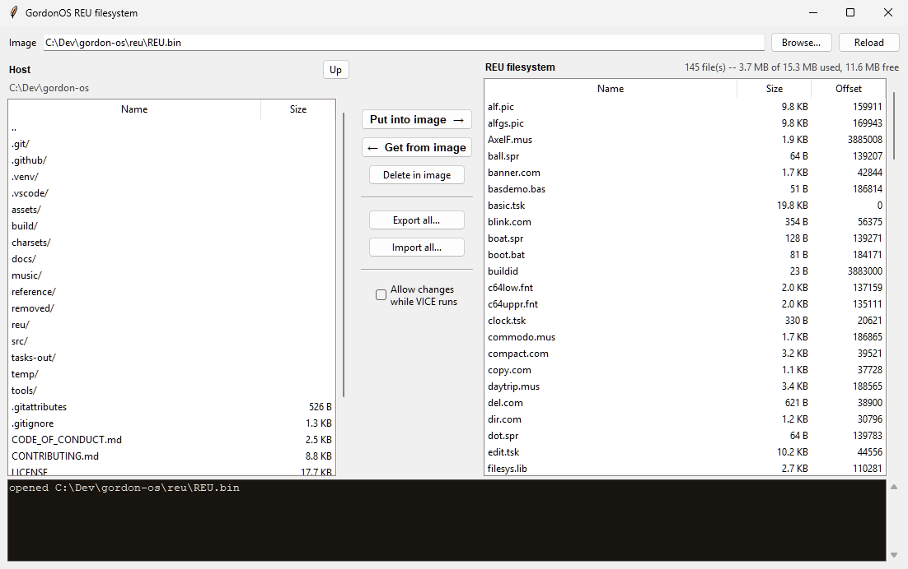
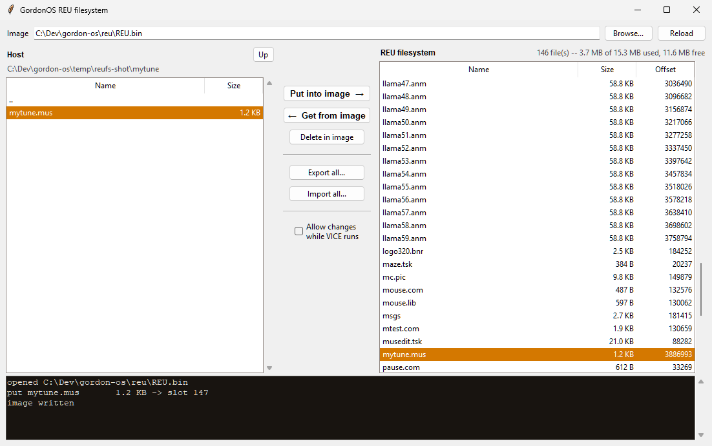

# Moving files between the host and the image

Everything GordonOS saves — a tune, a BASIC program, a picture, a hi-score table
— lives in the **REU filesystem**, and that filesystem lives inside the REU
image. There is no disk and no serial link, so the image file *is* the disk, and
a file leaves the machine by leaving the image.

Two host programs do the moving. They are plain Python 3 with no packages
(`tkinter` for the window), so they run on Windows, Linux and macOS:

| Program | Shape |
|---|---|
| `reufs-gui.py` | A two-pane file manager: your computer on the left, the image on the right |
| `reufs.py` | The same library as a command line — `ls`, `get`, `put`, `rm`, `export`, `import`, `selftest` |

In the source repo both are in `tools/`; in the published package they sit beside
the images. Either way they find `REU.bin` next to themselves, so neither needs
an argument to start on the image it ships with.

On Windows say `python`; on Linux and macOS `python3`.



*As it opens: the image's 145 files on the right, the current folder on the
left, and a log across the bottom.*

## Before you start: close VICE

The emulator memory-maps the image and keeps the mapping for the whole session.

- **Windows** refuses a second writer outright.
- **Linux and macOS** do not, and the emulator would carry on with the old copy
  while the file on disk changed — the two diverge with no error at all.

So both programs **refuse to change an image while a VICE process is running**,
on every platform, found by process name. Reading is always allowed, which is the
useful half: a file a task saved can be pulled out of a session that is still
running, including one that has wedged.

The window shows this as a red banner and disables its editing buttons. The
command line refuses with `a VICE emulator is running (...)`; pass `--force` when
the emulator is only sitting at a prompt and you accept that its next write-back
will overwrite the change.

## The window

```
python3 reufs-gui.py            # this folder's REU.bin
python3 reufs-gui.py other.bin  # any image, including one from another machine
```

The top bar shows which image is open, with **Browse...** to pick another and
**Reload** to re-read it — use Reload after a task has written to the image.

| Control | What it does |
|---|---|
| **Put into image →** | Copies the selected host files in. Select several with Ctrl/Shift. |
| **← Get from image** | Writes the selected image files into the host folder the left pane shows. |
| **Delete in image** | Tombstones the selected entries, as `del` does. |
| **Export all...** | Writes *every* image file into a folder you choose. |
| **Import all...** | Adds every file in a folder (no recursion — the filesystem has no folders). |
| **Allow changes while VICE runs** | The `--force` of the window. Off by default. |

The left pane is a normal folder browser: double-click a folder to enter it,
**Up** to go back. The right pane lists the image's files with name, size and
data offset, and the header shows `N file(s) — used of capacity, free`. A log
across the bottom records every action and every refusal, and a refusal also
raises a dialog — nothing fails silently.



*After **Put**: the new file is in the image at slot 147 and the log says what
happened, including the write itself.*

Double-clicking an image file is a shortcut for **Get**.

Overwriting always asks first (on both sides), and it says what it costs: a
replaced image file leaves its old bytes as a hole until `compact` runs on the
machine. If the replacement does not fit, it is refused and the file you were
replacing is left exactly as it was — and so is everything else in the image: a
refused action reloads it from disk, so a batch that stopped part way through
cannot leave half of its work staged.

## The command line

```
python3 reufs.py ls
python3 reufs.py get <name> <host-file>
python3 reufs.py put <host-file> [--name <name>]
python3 reufs.py rm <name>
python3 reufs.py export <host-directory>
python3 reufs.py import <host-directory>
python3 reufs.py selftest
```

| Option | Meaning |
|---|---|
| `-i`, `--image <path>` | Work on another image (default: the one beside the script) |
| `--force` | Allow a change while VICE runs |

`ls` prints one line per file and a total:

```
musedit.tsk       21.0 KB  offset 88282
...
145 file(s), 3.7 MB used of 15.3 MB, 11.6 MB free
```

`put` and `import` **replace silently** — they are for scripts, where a prompt
would be a nuisance. The window is the interactive one. `export` likewise
overwrites host files of the same name.

Exit codes: `0` done, `1` refused (with the reason on stderr).

### Names the filesystem cannot hold

Two things happen to a host name on the way in, and both are reported — never
done silently.

**Characters with no key are dropped.** A name is typed on the machine as often
as it is typed here: `load` takes it, `dir` shows it, and the font draws it
straight from the directory bytes. So a character the C64 keyboard cannot type
has no glyph either — an underscore is stored as screen code `$5F`, which
`charsets/gordon.fnt` draws as a checkerboard. It is removed:

| Host file | Stored as | Why |
|---|---|---|
| `Axel_F.mus` | `AxelF.mus` | `_` has no key on the machine |
| `A@B.bin` | `AB.bin` | `@` is screen code `$00` — end of a name |
| `a/b.bin` | `ab.bin` | the kernel reads `/` as a path separator |
| `weird~name.bin` | `weirdna.bin` | `~` has no key — then the cut below |

Everything a name **can** hold stays: the letters, the digits, space, and
`! " # $ % & ' ( ) * + , - . : ; < = > ? [ ] ^`. The two rows in the middle are
typeable but unstorable: `reuCmpName` gives `$00` the meaning "the name ends
here" and `/` the meaning "the next path component starts here", so an entry
holding either could never be found again.

**The rest is cut to the slot.** A directory entry holds **11 characters
including the dot and the extension**, so the **base** gives way, never the
extension — that is what tells the OS how to treat the file:

| Host file | Stored as |
|---|---|
| `alongname.xxx` | `alongna.xxx` |
| `alongnamefile` | `alongnamefi` |
| `alongname.tar.gz` | `alongnam.gz` |
| `a.verylongext` | `a.verylonge` |

The first two are the ordinary cases; the third keeps only the **last**
extension, and the fourth is a name whose extension alone would leave no base at
all, so it is cut whole. A leading dot or a dot with nothing after it protects
nothing either — those names are cut at eleven too.

Nothing has to be renamed on your computer first: the window logs the step and
the result (`removed '_': no C64 keyboard key types it`, then
`'Axel_F.mus' -> 'AxelF.mus'`), `put` prints the same before
`put 'Axel_F.mus' as 'AxelF.mus'`, and `import` does it per file. A name with
nothing typeable left in it (`___`) is refused. Two host files can end up with
the same stored name, and then the second replaces the first — the window asks
first, the command line (which replaces silently) does not.

### From Python

`reufs.py` is a library as well as a command. Nothing in it imports `tkinter`:

```python
import reufs
fs = reufs.ReuImage("REU.bin")     # reads the whole image
for e in fs.entries():             # Entry(slot, name, offset, size, deleted)
    print(e.name, e.size)
blob = fs.get("immig.wrk")
fs.put("mine.mus", blob)           # appends, as the OS does
fs.delete("immig.wrk")
fs.save()                          # refused while VICE runs unless force=True
```

`fs.next_free`, `fs.capacity` and `fs.free` are the header's figures;
`fs.export_to(dir)` and `fs.import_from(dir)` are the bulk operations — the
latter returns `[(host name, name as stored, bytes)]`, so the two differ exactly
where a name was cleaned or cut. `reufs.store_name(name)` is what a transfer will
store, `reufs.clean_name` and `reufs.fit_name` are the two steps on their own,
and `reufs.name_report(name)` returns the lines explaining them — for a caller
that wants to show the result before it goes in.

Every refusal raises `reufs.FsError`, whose `code` matches the kernel's
`kReuSave` error where one exists (`0` duplicate, `1` no space, `2` directory
full, `3` name too long, `4` empty).

## The rules, and where they come from

These are not the tools' choices — they are the filesystem's, and the tools
mirror `kReuSave` and `kReuDelete` rule for rule so that an image written from
the host is one the machine could have written itself.

| Rule | Detail |
|---|---|
| **Name** | 1–11 characters, **extension included**: `musedit.tsk` is exactly eleven. Only characters a C64 keyboard can type are kept — a character with no key has no glyph either, so `Axel_F.mus` stores as `AxelF.mus` — and a longer name is **cut to fit with its extension kept** (`alongname.xxx` → `alongna.xxx`). Stored in **screen codes**, not ASCII — `a`–`z` are `$01`–`$1A`, everything else is its own byte, which is why `musedit.tsk` reads `0d 15 13 05 04 09 14 2e 14 13 0b` in the directory. Case-sensitive. |
| **No empty files** | Size 0 *is* the kernel's empty-slot marker, so a zero-length file cannot exist. |
| **No duplicates** | A live name appears once. Replace means delete-then-add. |
| **Where data goes** | Appended at `nextFreeOffset`, which then advances by the size. The first slot whose two size bytes are zero is used. |
| **Tombstones** | Delete sets bit 7 and blanks the name but **keeps the extent**, so the space returns only when `compact` runs on the machine. The host tools never compact. |
| **Slots** | 511 usable entries (slot 0 is the header). |
| **One file** | At most **65,535 bytes** — the size field is 16-bit. |
| **Capacity** | `$3000` in bank 5 plus `$10000` per bank above it: **15.3 MB** on a 16 MB REU. |
| **No folders** | Flat, by design. |
| **No timestamps or permissions** | Name, offset and size is all an entry holds. |

Writes are atomic: the image is changed in memory and written to a sibling
temporary file that is then renamed over the original, so an interrupted write
cannot leave a half-written directory.

## When it refuses

| Message | Why | What to do |
|---|---|---|
| `... is not a GordonOS filesystem (no $A5 signature ...)` | The image was never formatted, or it is not a GordonOS image | `format` on the machine, or seed one with `tools/build-reu.ps1` |
| `no such file in the image: X` | The name does not match exactly — **including the extension** | `ls` and copy the name from there |
| `an empty name cannot be stored` | Nothing to store under | Give it a name |
| `'___' keeps nothing a C64 keyboard can type` | Every character was dropped | Use a name the C64 keyboard could type |
| `a zero-length file cannot be stored` | Size 0 is the empty-slot marker | Nothing to copy — skip it |
| `... is over the 16-bit size field's 65535` | One file cannot exceed 64 KB | Split it |
| `the directory is full (all 511 slots are live or tombstoned)` | The directory is out of entries | `compact` on the machine reclaims the deleted ones |
| `not enough room: N bytes needed from offset O` | Capacity reached | `compact`, delete something, or use a bigger image. A refused **replacement** leaves the file it was going to replace untouched |
| `a VICE emulator is running (...)` | The image is mapped by the emulator | Close VICE, or `--force` |

## Knowing it worked

- **`reufs.py selftest`** exercises every rule above on a synthetic image — the
  name codec against bytes taken from a real image, the append order, every
  refusal, overwrite, tombstone behaviour, reload and the bulk operations. It
  touches no image in the tree.
- **`tools/check-reu-fs.ps1`** is the layout gate and the oracle: it decodes the
  directory and requires `nextFreeOffset` to equal the highest extent of *any*
  entry, tombstones included.
- **`reufs.py ls`** after a change shows the new entry and the new totals.

## On a C64 Ultimate

The Ultimate does not write REU memory back to USB by itself, so files reach the
disk only when you **save the REU memory** (Menu → F5 → C64 Machine → Save REU
Memory). That saved file is an ordinary image, and these tools read it like any
other — so an individual file can be taken out of it on a PC without the machine
being involved.

## See also

In the source repository: `lib-filesys.md` for the format itself
and the kernel calls that write it, `limitations.md` for what the
filesystem cannot do, and `development.md` for building a fresh
image from the tree.
