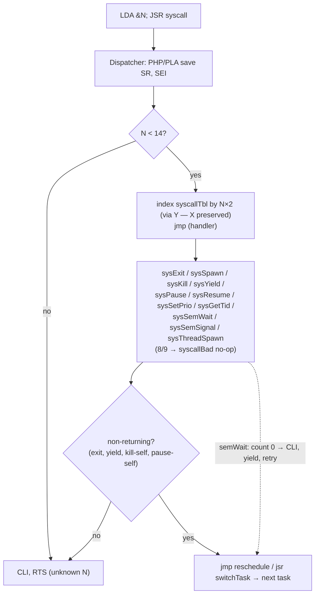

# GordonOS Syscalls

> System call API — the interface between tasks and the GordonOS kernel

**Syscalls** (`JSR syscall` with A=call number) are the scheduler-aware task API (spawn, sleep, kill, etc.). **Kernel calls** are direct `JSR` to fixed jump table addresses — these are the low-level primitives (screen I/O, math, string utils, REU DMA, REU filesystem). See [`kernel.md`](kernel.md) for the full kernel call reference. The REU filesystem calls (`kReuSave`, `kReuLoad`, `kReuDelete`, `kReuRename`, `kReuDirEntry`, `kReuFormat`, `kReuCreate`, `kReuOpen`, `kReuReadAt`, `kReuWriteAt`) are kernel calls, not syscalls; most are lazy `filesys.lib` jump-table calls, while `kReuLoad` and helper calls stay resident (see [dynamic-libraries.md](dynamic-libraries.md)).

The five **sprite** calls (`kSpriteSheet`, `kSpriteFrame`, `kSpritePos`, `kSpriteCollide`, `kSpriteReg`) have their entry stubs in a scavenged pocket at `$CDDE-$CDEC` rather than in the `$E000` band (which is full), because the sprite feature owns its own `.pc` blocks. **Four of them are `sprite.lib` call entries** (`libLoad` rewrites each stub in place), and `kSpriteCollide` is resident kernel code because it reads the collision latch. A task references them exactly like any other kernel call — see [lib-sprite.md](lib-sprite.md) for the calls and [programmers-guide.md](programmers-guide.md) → *Sprites* for how to drive them.

---

## Overview

Tasks invoke kernel services through a single entry point: `syscall` in `syscall.inc`. The calling convention is:

```asm
    lda #syscall_number
    jsr syscall
```

The dispatcher captures the caller's status register (`PHP`/`PLA`), disables interrupts (`SEI`), then dispatches through a **jump table** (`syscallTbl`) indexed by the syscall number — constant-time regardless of how many syscalls exist. Out-of-range numbers (`N ≥ 14`) fall through to `CLI`/`RTS`, a no-op return. ⚠️ **The table must end below `$0F00`**, the sprite band's first slot: a slot's art is DMA'd over its whole 64 bytes, so art would replace the `SYS_SLEEP` entry's two bytes with sprite pixels and the dispatcher would jump wherever they point. `main.asm` asserts the clearance, and it is `init.inc`'s size pad that holds the table's address — the two have to stay in step.

**Register safety:** The table is indexed via **Y** (`N×2`), never X. This is deliberate: `kill`, `pause`, `resume`, `setprio`, `semWait`, and `semSignal` pass their target index **in X**, so the dispatcher must leave X untouched for the handler. Y is not part of the syscall calling convention (inputs are X plus the `kArg` scratch bytes), so it is the safe index register. **`srcPtr` does not survive a syscall:** the dispatcher loads the handler address into it for `jmp (srcPtr)`. Park a pointer you need afterwards in the task's own instance buffer, not in the shared zero page.

**Reentrancy guard:** The dispatcher saves SR with I=0 (interrupts were enabled at call time). Returning handlers (`spawn`, `kill`-other, `pause`-other, `resume`, `setprio`, `gettid`, `semSignal`) issue `CLI` before `RTS`. Non-returning handlers (`exit`, `kill`-self, `yield`, `pause`-self) rely on RTI or RTS+CLI to restore I from the saved interrupt frame or dispatcher state. **Syscalls 8 and 9 are inert** — their table entries point at `syscallBad`, a clean `CLI; RTS` no-op; call `kAllocScreen`/`kFreeScreen` from the jump table instead. **10 and 11 dispatch to the kernel's resident counting-semaphore routines**, and `semWait` blocks by yielding while the count is 0.

---

## Dispatch Flow



---

## Syscall Reference

### Quick Reference Table

> **Use the named constants.** The number goes in A, then `jsr syscall`. The
> names below also exist as `SYS_*` constants (e.g. `SYS_EXIT`, `SYS_GETTID`,
> `SYS_SLEEP`) in `src/kernel/syscalls.inc`, which both the kernel build and the
> task pipeline import — `lda #SYS_GETTID; jsr syscall` beats
> `lda #7; jsr syscall`. They must match `syscallTbl` in
> `src/kernel/syscall.inc`. Numbers 8 and 9 are inert no-ops and are
> deliberately not named; 10 and 11 are `SYS_SEMWAIT` / `SYS_SEMSIGNAL`. Task sources do **not** import the constants file themselves — the
> task pipeline already does, and re-importing it is a duplicate-symbol error
> (see §2.2 of [writing-relocatable-tasks.md](writing-relocatable-tasks.md)).

| N | Name | Input | Returns | Reentrant? | Description |
|---|---|---|---|---|---|
| 0 | `exit` | — | *never* | no (→reschedule) | Terminate current task (`dynFree` releases its dynamic pages, program-RAM block, lib refcounts and dyn-table entry, plus its `kMalloc`'d blocks) |
| 1 | `spawn` | `spawnPtr`, `taskNamePtr`, `kArg+1`=dataSize, `kArg+6`=zpBase, `kArg+7`=zpLen | C=0 ok; C=1 (kArg=0 no slots, kArg=1 heap full) | yes (CLI/RTS) | Create named task, initTCB_ptr DMAs frame to REU |
| 2 | `kill` | X = target index | — | self→no, other→yes | Mark target DEAD (cascades to thread children; every victim — target and children alike — is released with `dynFree`, i.e. dynamic pages, program-RAM block, lib refcounts and the dyn-table slot, plus its `kMalloc`'d blocks) |
| 3 | `yield` | — | *resumes later* | no (→reschedule) | Give up timeslice voluntarily |
| 4 | `pause` | X = target index | — | self→no, other→yes | Suspend task |
| 5 | `resume` | X = target index | — | yes (CLI/RTS) | Resume PAUSED→ALIVE |
| 6 | `setprio` | X = target, `kArg+1`=prio | — | yes (CLI/RTS) | Set priority 0-5 (0=pause) |
| 7 | `gettid` | — | A = curTask | yes (CLI/RTS) | Return current task index |
| 8 | `allocscreen` | — | no-op (`CLI`/`RTS`) | — | Inert — call `kAllocScreen` (jump table) directly |
| 9 | `freescreen` | — | no-op | — | Inert — call `kFreeScreen` directly |
| 10 | `semWait` | X = semaphore index | — (blocks until acquired) | yes (yields internally) | Acquire: decrement the count, or `CLI`+yield and retry while it is 0 |
| 11 | `semSignal` | X = semaphore index | — | yes (CLI/RTS) | Release: increment the count (caps at 255); clears `semOwner` on 0→1 |
| 12 | `threadSpawn` | `spawnPtr` = entry address | C=0 ok; C=1 (kArg=0 no free slots) | yes (CLI/RTS) | Spawn child task, auto-named `parent.N`; `kArg+6`/`kArg+7` = zpBase/zpLen, **the caller's to set** (0 = none) |
| 13 | `sleep` | `kArg+1` = tick count (0→1) | resumes after N ticks | yes (CLI/RTS) | Timed block — sleeps N IRQ ticks (~16.7 ms each) |

---

### 0 — `exit`

Terminate the current task.

```
Input:  —
Output: never returns
```

**What it does:**
1. Marks `taskState[curTask]` = `DEAD`
2. Calls `transferFocusAway` — if the exiting task owns display or keyboard focus, they're transferred to another task
3. Calls `shrinkTotalTasks` to trim the scheduler scan range if the highest-index slots are now dead
4. Releases semaphores owned by the dying task (mutex case only — see the `kill` note)
5. Calls `dynFree` on the dying task's GordonOS ID — frees its dynamic task pages, program-RAM block, library refcounts and dyn-table entry, and reclaims any `kMalloc`'d blocks it owns (e.g. the editor's text buffer) by calling `freeMallocBlocks` itself. A thread child has no dyn entry, so only its `kMalloc`'d blocks are released
6. Jumps to `reschedule` — the next ALIVE/PAUSED task runs immediately

The task's TCB/stack REU slot stays allocated; a future `spawn` will reuse the slot. Dynamic *code* pages, the program-RAM block and the dyn-table entry are freed by `dynFree`, and `kMalloc`'d blocks by its internal `freeMallocBlocks` call. Display and keyboard focus are automatically transferred by `transferFocusAway`.

**Does NOT cascade (by design):** a task that exits normally leaves any children it spawned running as orphans (their `taskParent` link is cleared when the freed slot is later reused). `kill` on a task does cascade-kill its **thread-spawned children** (syscall 12); tasks spawned via `run` or `spawn` (syscall 1) are unaffected — `spawn` tasks have no parent link, and `run` tasks' parent link (used for screen-sharing) is ignored by the cascade.

```asm
    lda #0
    jsr syscall             ; never returns
```

---

### 1 — `spawn`

Create a new task from a pre-built TCB.

```
Input:  spawnPtr   ($F7-$F8) = task entry address
        taskNamePtr ($F3-$F4) = pointer to null-terminated name string
        kArg+1               = instance data size (0 = none)
        kArg+6               = ZP base (0 = no ZP DMA)
        kArg+7               = ZP length (0 = no ZP DMA)
Output: Carry set = no free TCB slots available
        Carry clear = task created and running
```

**What it does:**
1. Calls `findFreeSlot` to locate a DEAD TCB slot (never recycles slot 0 — the boot slot)
2. Calls `initTCB_ptr` to build the new task's stack frame from `spawnPtr`
3. Stores the task name, entry address, data size, and ZP DMA region in the per-task arrays
4. Validates ZP region: `base + len ≤ $F1`; clamps to 0 if invalid
5. Marks the task `ALIVE`
6. DMAs the fresh TCB stack image to REU (so the first context switch loads valid data, not stale REU contents from a previously-dead task in that slot)
7. Increments `totalTasks` (scheduler now sees the new task)

```asm
    lda #<myTaskEntry
    sta spawnPtr
    lda #>myTaskEntry
    sta spawnPtr+1
    lda #<myTaskName
    sta taskNamePtr
    lda #>myTaskName
    sta taskNamePtr+1
    lda #1
    jsr syscall
    bcs noFreeSlot
```

---

### 2 — `kill`

Terminate a task by index.

```
Input:  X = target task index
Output: —
```

**What it does:**
1. Marks `taskState[X]` = `DEAD`; if the target owns a surface, a surviving sharer inherits it (`screenOwner = $FF` — the shared screen outlives its owner), otherwise the slot is freed
2. Calls `transferFocusAway` (if the target owned display/keyboard focus)
3. **Recursively cascades:** kills the target's thread-spawned descendant tree — children, grandchildren, and deeper spawned via `threadSpawn` (syscall 12) — via a multi-pass fixpoint. Each victim is marked with a temporary sentinel so its own children are found on the next pass. Tasks spawned via `spawn` (syscall 1) have `taskParent = $FF` (no parent) and are unaffected; `run`-loaded tasks set `taskParent` to their spawner (for screen-sharing) but are also exempt because the cascade only follows `threadSpawn` children (`taskThreadNameReuHi != 0`). Exit-orphans (a live task whose parent died via `exit`) are left untouched by the cascade; `findNextAlive`'s `childGate` refuses to schedule them, so they keep their TCB slot but never run, and reaping remains the spawner's job. **Each victim is released as it is killed:** `dynFree` frees its dynamic code pages, program-RAM block, library refcounts and dyn-table entry, and its `kMalloc`'d blocks go through `freeMallocBlocks`.
4. Releases semaphores owned by any now-dead task (mutex case only — see limitation below)
5. Calls `shrinkTotalTasks` (saves/restores X — see Rule 3 in copilot-instructions)
6. Calls `dynFree` on the target's task ID — frees its dynamic task pages, program-RAM block, library refcounts and dyn-table entry, and reclaims its `kMalloc`'d blocks (`dynFree` calls `freeMallocBlocks` itself). A thread child has no dyn entry, so only its `kMalloc`'d blocks are released
7. If `X == curTask` (self-kill): jumps to `reschedule` — never returns
8. If `X != curTask`: returns normally

**Semaphore limitation:** only fully-exhausted (mutex, count = 0) semaphores held by a dead task are reclaimed. A task that consumed one slot of a multi-count semaphore and then dies does not return that slot.

**Cascade root:** the cascade keeps its root task index in `dlCascadeRoot` and its fixpoint flag in `dlCascadeFlag` — two dedicated kernel-data bytes (repurposed dead ones, so no offset moved). Keeping the root in `kArg` is not an option: `surfFreeSlot` clobbers `kArg..+3` and `dynFree` clobbers `kArg+3..+7`, so a `kill` whose victim had a **thread child owning an unshared surface** can lose the root and leave part of the subtree un-killed (`childGate` then holds those children, so the symptom is a stale `ps` row rather than freed code being executed).

```asm
    ldx #3                  ; kill task at slot 3
    lda #2
    jsr syscall
```

---

### 3 — `yield`

Voluntarily give up the remainder of the current timeslice.

> **It forces the switch.** `switchTask` decides whether to advance or to re-enter
> the same task from that task's slice counter, so a yield that did not reset the
> counter would be *swallowed* until the quantum ran out at any priority above 1 —
> and `semWait`'s busy path is a yield-and-retry loop, so a blocked task would poll
> with a full context save/restore per retry. `sysYield` sets
> `taskSliceLeft = 1` before switching, so a yield always hands over immediately at
> any priority. A task's CPU *share* is still its priority; only the voluntary
> hand-over is unconditional.

```
Input:  —
Output: resumes later at the instruction after JSR syscall
```

**What it does:**
1. Saves the caller's X and Y registers
2. Pops the JSR return address (PC+2 — last byte of `JSR syscall`)
3. Adds 1 to get PC+3 (the instruction after `JSR syscall`) — needed because RTI doesn't add 1 like RTS does
4. Builds a fake interrupt frame on the stack: Y, X, A, SR, PCL, PCH
5. Calls `switchTask` — saves this frame to the TCB, switches to the next task
6. When the scheduler eventually restores this task, `switchTask`'s RTS returns to `irqRet`, which pops the registers and RTIs to PC+3

```asm
    lda #3
    jsr syscall             ; next instruction executes on resume
```

---

### 4 — `pause`

Suspend a task. The scheduler skips PAUSED tasks in `findNextAlive`.

```
Input:  X = target task index
Output: —
```

**What it does:**
1. **Guards the current state first:** a target that is `DEAD` or `SWAPPED` is left exactly as it is — the call is a no-op. `TA_SWAPPED` in particular must never be overwritten, because that byte is the only record that the task's code pages are back in the pool (`sysPause`'s write is not paired with a reload), and `TA_DEAD` must stay dead so the slot is not resurrected. `resume` on a *dead* task is still allowed and is the caller's responsibility (see below) — pause simply refuses to create that state.
2. Sets `taskState[X]` = `PAUSED`
3. If `X == curTask` (self-pause): saves the frame and switches away exactly like a `yield` — it never returns *until something resumes it*, and when it does, it returns at the instruction after the `jsr syscall` (A=0, Y=`syscall#*2`, the yield contract). The save is not optional: a self-pause that jumps straight to the scheduler stores nothing, so the task resumes at its **last preemption point** and replays the work since.
4. If `X != curTask`: returns normally

Use `resume` (syscall 5) to bring the task back.

```asm
    ldx #3                  ; pause task at slot 3
    lda #4
    jsr syscall
```

---

### 5 — `resume`

Resume a PAUSED task.

```
Input:  X = target task index
Output: —
```

**What it does:** Sets `taskState[X]` = `ALIVE`. Safe to call on an already-ALIVE task (no-op). Safe to call on a DEAD task (sets it to ALIVE — caller must ensure this is intentional).

```asm
    ldx #3                  ; resume task at slot 3
    lda #5
    jsr syscall
```

---

### 6 — `setprio`

Set a task's scheduling priority.

```
Input:  X = target task index
        kArg+1 = priority (0-255)
Output: —
```

**Priority values:**
- `0` — Pause the task (dispatches to `sysPause`, so the same **state guard** applies: a `DEAD`/`SWAPPED` target is left untouched; if self, reschedules immediately)
- `1-5` — Valid priority levels (higher = more timeslices per round)
- `6+` — Clamped to 5

Setting priority also resets `taskSliceLeft` so the new priority takes effect on the next scheduling round.

```asm
    ldx #3
    lda #3
    sta kArg+1              ; priority 3
    lda #6
    jsr syscall
```

---

### 7 — `gettid`

Return the caller's own task slot index.

```
Input:  —
Output: A = current task index (0 to MAX_TASKS-1)
```

Useful for self-identification in IPC, logging, or per-task data arrays.

```asm
    lda #7
    jsr syscall             ; A = my task slot (0-23)
    sta myTaskId
```

---

### 8 — `allocscreen` (inert)

**This syscall number is a no-op** (`syscallBad`: `CLI; RTS`) — allocate a surface
with a direct call to `kAllocScreen` instead.

`kAllocScreen` allocates a REU surface slot (10 KB, 28 max) for the current task.

```
Input:  A = surface mode (0 = hires-text, 1 = mc-graphics)
        kArg..kArg+3 = border / bg0 / bg1 / bg2 colours
Output: Carry set = no free slot or bad mode
        Carry clear = slot allocated, taskGfxReu* set
```

**What it does:** The slot is cleared (pixels = 0, matrix bg nibble = bg0). After allocation, the task owns a private surface — all `kPrint*` calls render into its slot (or straight into the framebuffer when focused).

```asm
    lda #$0b
    sta kArg                ; border
    lda #0
    sta kArg+1              ; bg0
    sta kArg+2              ; bg1 (unused in hires)
    sta kArg+3              ; bg2 (unused in hires)
    lda #0                  ; mode: 0 = hires-text
    jsr kAllocScreen
    bcs noScreen
```

---

### 9 — `freescreen` (inert)

**This syscall number is a no-op** — release a surface with a direct call to
`kFreeScreen` instead.

```
Input:  —
Output: —
```

**What `kFreeScreen` does:** If the task is the owner (`screenOwner = $FF`), the 10KB REU slot is returned to the free pool and all sharers are detached. If the task is sharing another task's screen, it simply detaches itself.

```asm
    jsr kFreeScreen
```

---

### 10 — `semWait`

Acquire a counting semaphore.

```
Input:  X = semaphore index (0 to MAX_SEMAPHORES-1, currently 0-3)
Output: — (returns only when the semaphore is held)
Blocks: yes — yields the timeslice and retries while the count is 0
```

**What it does:** Decrements the semaphore count if >0. When the count transitions 1→0 (becomes unavailable), records ownership for mutex cleanup. If the count is 0, yields the timeslice and retries on the next scheduling round — other tasks keep running, and the holder is guaranteed to get the CPU again, so this cannot deadlock against a live holder.

> **It is a blocking call.** A task inside `semWait` stays inside it until some other task signals. There is no timeout and no cancellation (`SYS_SLEEP` and this share that property — see §2 of [`future-improvements.md`](future-improvements.md)). A task that can never be signalled should be `kill`ed.

> **Note on ownership:** `semOwner[x]` is only set on the 1→0 transition — well-defined for mutexes (initialised to 1), best-effort for counting semaphores (N>1), where several tasks can hold units concurrently. Only the mutex case is auto-released when its holder dies.

**Semaphore 0** is reserved for the screen lock. Tasks take it via `kLockScreen`/`kUnlockScreen`; a task should not acquire index 0 itself. **Semaphores 1-3 are free**, and a task sets the initial count itself by storing to `semCount+X` (one byte — see [`programmers-guide.md`](programmers-guide.md) → Semaphores for full examples).

**Call it with interrupts enabled** — the normal task state. The routine brackets its critical section with `sei`/`cli` and returns with IRQs enabled, so it is not for use inside an SEI'd region.

```asm
    ; Mutex: semaphore 1 initialised to 1 somewhere earlier
    ldx #1
    lda #SYS_SEMWAIT
    jsr syscall             ; returns holding the lock (yields if another task has it)
    ; ... critical section ...
    ldx #1
    lda #SYS_SEMSIGNAL
    jsr syscall             ; release

    ; Throttle: semaphore 2 initialised to 4 free slots
    ldx #2
    lda #SYS_SEMWAIT
    jsr syscall             ; waits until one of the four is free
```

---

### 11 — `semSignal`

Release a counting semaphore.

```
Input:  X = semaphore index (0 to MAX_SEMAPHORES-1, currently 0-3)
Output: —
Does not block: the releasing task runs straight on
```

**What it does:** Increments the semaphore count (caps at 255). When the count transitions from 0→1 (fully released), clears the ownership record. Releasing a semaphore that is already at 255 is a harmless no-op rather than an overflow.

```asm
    ldx #1
    lda #SYS_SEMSIGNAL
    jsr syscall             ; signal — releases one slot
```

---
### 12 — `threadSpawn`

Spawn a child task from `spawnPtr`, automatically named after the parent.

```
Input:  spawnPtr ($F7-$F8) = entry address
Output: Carry clear = success (child created, named "parent.N")
        Carry set = failure, kArg=0 (no free TCB slots — same code as spawn)
```

**What it does:** Finds a free TCB slot, builds the TCB from `spawnPtr`, generates a name as `parent.N` (e.g. "godzi.0"), and marks the child ALIVE. The child is tracked as belonging to the parent — killing the parent cascades to kill all children. The thread counter resets when the parent task is killed and re-spawned.

```asm
    lda #<thInc; sta spawnPtr
    lda #>thInc; sta spawnPtr+1
    lda #12; jsr syscall    // spawn child, name = "parent.0"
    bcs noSlots
```

**Differences from `spawn` (syscall 1):**
- No need to set `taskNamePtr` or `kArg+1` — the kernel handles naming and uses zero data size
- ⚠️ **`kArg+6`/`kArg+7` (zpBase/zpLen) are YOURS to set.** A thread may declare its own ZP window exactly as `spawn` does, because the scheduler's save and restore are gated on the **switching task's own** `taskZpLen` and use its own REU shadow — a window declared by the *parent* cannot cover a child: the parent's restore DMAs the parent's shadow over the child's live ZP, and the child's own restore is skipped at length 0. Set both to `0` for a thread with no ZP state. They are not cleared for you, and they are per-task scratch, so a caller that forgets inherits whatever they held last.
- Child tasks show as `parent.0`, `parent.1` etc. in `ps`
- The child's `taskParent` is set to the parent, enabling cascading kill: killing the parent task with `kill` automatically kills all its thread-spawned children
- Tasks spawned via `spawn` (syscall 1) have `taskParent = $FF` (no parent); `run`-loaded tasks set `taskParent` to their spawner (for screen-sharing) — but only `threadSpawn` children (marked `taskThreadNameReuHi != 0`) are affected by cascading kill
- ⚠️ **A thread child must not outlive its parent.** It has no dyn entry and runs its parent's *code pages*, so once those pages are freed (parent exited or evicted) a scheduled child would execute freed memory. Three layers cover it: `kill` cascades over the whole thread subtree; pool eviction **refuses to swap** a task with live thread children (it kills the subtree instead, `dlEvKill`); and `findNextAlive`'s **`childGate` holds any thread child whose parent is not running** (`TA_DEAD` → never scheduled again, `TA_SWAPPED` → held until the parent is restored, and `$FF`/`$FE` in `taskParent` → held, because a *cleared* parent link on a thread child means the pages are not its parent's). A held child is not *reclaimed*, so a task that spawns children must still reap them before exiting (`godzi`, `gortris`, `ipctest` do).

---
### 13 — `sleep`

Timed blocking — put the current task to sleep for a specified number of IRQ ticks.

```
Input:  kArg+1 = tick count (1-255, ~16.7ms/tick at 60 Hz)
        (0 is treated as 1 — minimum sleep of one tick)
Output: resumes later at the instruction after JSR syscall
```

**What it does:**
1. Reads `kArg+1` as sleep duration in ticks (clamps 0→1)
2. Stores the count in `taskSleepTicks[curTask]`
3. Marks the task `SLEEPING` (state 3) — skipped by `findNextAlive`
4. Sets `taskSliceLeft` to 1 to force an immediate context switch
5. Calls `switchTask` — saves full task state (ZP, stack, screen) and switches to the next ALIVE task

Each IRQ tick (~60 Hz), the kernel decrements `taskSleepTicks` for every SLEEPING task. When the count reaches 0, the task transitions back to ALIVE and is eligible for scheduling. When the scheduler eventually selects it, `restoreStack` RTS's back into `sysSleep`, which executes `CLI` (re-enabling interrupts disabled by the dispatcher's `SEI`) then `RTS` to the instruction after `JSR syscall`.

**Important:** Sleep does NOT guarantee exact timing. If the system is busy, the task may not be scheduled immediately after waking. The tick count is a minimum — the task will sleep for *at least* N ticks.

```asm
    ; Sleep for ~0.5 seconds (30 ticks at 60 Hz)
    lda #30
    sta kArg+1
    lda #13
    jsr syscall             ; resumes here after 30+ ticks

    ; Minimum sleep — one tick (~16.7ms)
    lda #0                  ; 0 → clamped to 1
    sta kArg+1
    lda #13
    jsr syscall
```

**Use case — periodic task:**

```asm
    ; Flash border every 0.5 seconds
blink:
    inc $d020
    lda #30; sta kArg+1
    lda #13; jsr syscall    ; sleep ~500ms
    jmp blink
```

---
## Internal Routines

These are not syscalls but are part of `syscall.inc` and called by syscall handlers.

### `findFreeSlot`

Scan `taskState` for a DEAD slot.

```
Input:  —
Output: X = free slot index, carry clear
        Carry set = no free slots (all MAX_TASKS slots occupied)
```

Starts scanning from slot 1 — slot 0 (boot task) is never recycled. Once the boot task exits, its slot remains DEAD but is never reused.

### `shrinkTotalTasks`

Decrement `totalTasks` while the highest-index slot(s) are DEAD.

```
Input:  —
Output: —
Clobbers: X
```

Keeps the scheduler scan range tight. For example, if `totalTasks=8` but slots 5-7 are all DEAD, `shrinkTotalTasks` reduces `totalTasks` to 5 so `findNextAlive` doesn't waste time scanning dead entries.

**⚠️ Rule 3:** This routine clobbers X. Callers must save/restore X if they need it preserved — `sysKill` does this to detect self-kill after the shrink.

### `taskParent` Array

Tracks parent-child task relationships. `taskParent[child] = parentTaskIndex`. `$FF` means no parent (a root task). Set by `threadSpawn` (syscall 12) **and** by the dynamic loader (`kDynLoad`, so `run`-loaded tasks can find their spawner to share its screen). When `sysKill` marks a task DEAD, it recursively kills only the target's **thread-spawned** descendant tree — children marked `taskThreadNameReuHi != 0` (i.e. spawned via `threadSpawn`) — using a multi-pass fixpoint with a temporary `$FE` sentinel to mark cascade victims. `run`-loaded tasks set `taskParent` but are **not** cascade targets.

---

## Notes for Task Authors

- **Syscalls 0, 2 (self), 3, 4 (self) never return.** Code after them is unreachable.
- **Syscall 6 (setprio) with priority 0 is equivalent to pause.** It routes through `sysPause`, including its state guard (a `DEAD`/`SWAPPED` target is left alone). If pausing self, this never returns.
- **Syscall 10 (semWait) may block.** It yields the timeslice if the semaphore is unavailable. The task resumes at the instruction after `JSR syscall` when the semaphore is acquired.
- **Syscall 13 (sleep) blocks and later returns.** The task resumes at the instruction after `JSR syscall` once the tick count expires. Sleep is a minimum duration — scheduling latency may extend it.
- **Screen syscalls (8-9) are no-ops.** Allocate and release surfaces with `kAllocScreen`/`kFreeScreen` directly. See [`kernel.md`](kernel.md) for detailed behaviour.
- **Syscalls do not validate inputs.** Passing an invalid task index to `kill`, `pause`, `resume`, or `setprio` will corrupt kernel state.
